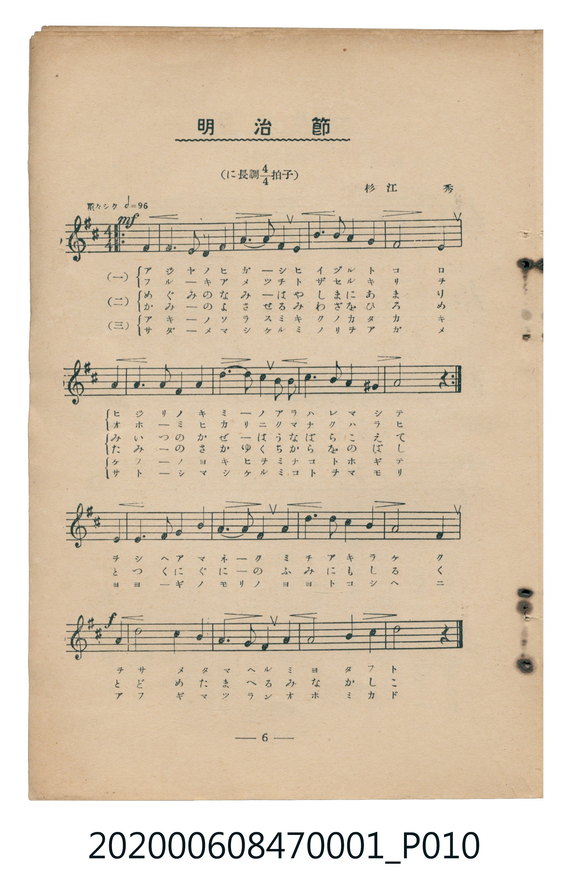
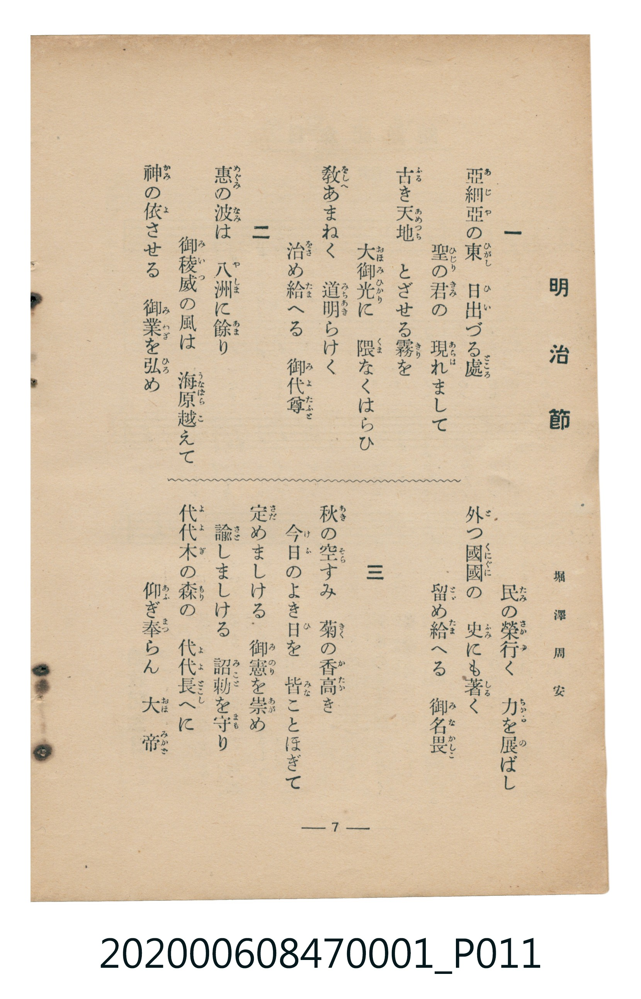

# 明治節

<audio controls src="meijisetsu.mp3"></audio>

- 詞：堀澤周安
- 曲：杉江秀
- 臺灣教育會公認《新定兒童唱歌》尋常科第一學年用（2020.006.0847.0001）

## 說明

原書資訊與歌詞全文（對應 P010.jpg – P011.jpg，儀式歌 pp. 6–7，第 6 首）：
調性與拍號：ニ長調 4/4 拍子，「勇々シク」（原譜前兩行有反覆記號）

## 跨冊／重複收錄參照

> 同曲（堀澤周安作詞、杉江秀作曲〈明治節〉；收錄於《新定兒童唱歌》卷首及《唱歌帖》P182 謄寫版、P185 印刷伴奏譜）

- **[同曲]** 楊金土手抄《唱歌帖》第 1 冊（2020.006.0843）：[**〈明治節唱歌 (明治節唱歌 — 謄寫版)〉**](../../../shokacho/vol_01/p182_meijisetsu_shoka/index.md)（`D` / `4/4` — [原始 TMD](../../../shokacho/vol_01/p182_meijisetsu_shoka/meijisetsu_shoka.tmd)）
- **[同曲]** 楊金土手抄《唱歌帖》第 1 冊（2020.006.0843）：[**〈明治節唱歌 (明治節唱歌 — 印刷譜)〉**](../../../shokacho/vol_01/p185_meijisetsu_shoka_printed/index.md)（`D` / `4/4` — [原始 TMD](../../../shokacho/vol_01/p185_meijisetsu_shoka_printed/meijisetsu_shoka_printed.tmd)）
- 總表：[跨冊重複與同名歌曲總索引](../../../duplicate_songs.md)

## 歌詞

```text
一　亜細亜（あじや）の東（ひがし）　日出（ひい）づる處（ところ）
聖（ひじり）の君（きみ）の　現（あらは）れまして
古（ふる）き天地（あめつち）　とざせる霧（きり）を
大御光（おほみひかり）に　隈（くま）なくはらひ
教（をしへ）あまねく　道明（みちあき）らけく
治（をさ）め給（たま）へる　御代尊（みよたふと）

二　恵（めぐみ）の波（なみ）は　八洲（やしま）に餘（あま）り
御稜威（みいつ）の風（かぜ）は　海原越（うなばらこ）えて
神（かみ）の依（よ）させる　御業（みわざ）を弘（ひろ）め
民（たみ）の榮行（さかゆ）く　力（ちから）を展（の）ばし
外（と）つ國國（くにぐに）の　史（ふみ）にも著（しる）く
留（とゞ）め給（たま）へる　御名畏（みなかしこ）

三　秋（あき）の空（そら）すみ　菊（きく）の香高（かたか）き
今日（けふ）のよき日（ひ）を　皆（みな）ことほぎて
定（さだ）めましける　御憲（みのり）を崇（あが）め
諭（さと）しましける　詔勅（みこと）を守（まも）り
代代木（よよぎ）の森（もり）の　代代長（よよとこし）へに
仰（あふ）ぎ奉（まつ）らん　大帝（おほみかど）
```

## ABC

```abc
X:1
T:明治節
C:曲：杉江秀
M:4/4
L:1/16
Q:1/4=96
K:D
V:V1 name="Piano" snm="Pia"
[V:V1]
z4 z4 z4 F4 | F6 E2 D4 F4 | A6 A2 F4 E4 | B6 B2 A4 G4 |
F8 E4 A4 | A6 A2 F4 A4 | d6 d2 c4 B2 B2 | c6 B2 A4 G4 |
A8 z4 F4 | F6 E2 D4 F4 | A6 A2 F4 E4 | B6 B2 A4 G4 |
F8 E4 A4 | A6 A2 F4 A4 | d6 d2 c4 B2 B2 | c6 B2 A4 G4 |
A8 z4 E4 | E6 F2 G4 B4 | A6 A2 F4 A4 | d6 d2 c4 B4 |
A8 F4 A4 | d8 c4 B4 | A6 B2 F4 A4 | A8 B4 c4 |
d8 z4 z4 |
```

## TMD 檔案連結

- [主旋律 TMD 檔案](meijisetsu.tmd) [[在 TMD Studio 編輯](https://tmdlang.github.io/Tmd-TS/#tmd=s7IKdvYPcrWy4qpTUCpJTLdSSM7PyUlNLsnMz7MqzsjMK0nNjM_KTMmPL87Iz05Ugisry88pzU21Si9KTEmNN4w3MjAyiDcwMIs3sDAxBzIMDBFKi_NLi5JTrYqTM_Lzc-JLUitKkvLzsxHyBUX5Zal5iXlANQVFIBtTwIoQClLLMlNSQdKpKZkl-UWZiTlI7kgtKga7FWxJfElRYl5xclFmAcgDCFUlGalAx2bmFqSi6oaIJ6cWpebm54FltLQUns3oe7Zp9_P1DQpaWlyKtgqWZlz2tgouXDYm-iZ2IK0vVs57v2fW0wUNz_YteTpxxdN1nWATn83eBBR-Nrfz2cb5z5c3gMVetO963rj42dSZL5o2PZvT_LR1zYtVvY8bup5N2_B03aynrZOer176dMrGZ2t7Hjd0P93Q_XTHjufLJz5fs-bJjoana3c83bnl-ZQV7_d0gMJXDxi-eqDwBTIMDN_vAdrKpa-lYEstwKWgoPC0b_6z2TtebG5_saLrRUc70F1Azz5tXfFsWjvQFU839D5r71QIMDA00MsqSFd41DAZxDEEcd7v6Xna0vB0Tz9Qj0JBgZ6CGVDWHCgK9IyCmcLLZdOALgaGD8iWF6v2P2tYDjK_u_fFzPlA0cfN3S-nbgeKKwADWQEo_HTtBKDexw09T7vbHze0Pm7a_rhp_eOGXpAr-ua_WDvnaWfv09aVLxb2PJvT-bS_98WythcrZoAN6-QC2QEMwMcNDU92zXm-ZQOQBOp73Nj0uHHG46YWoJLHjeuezd0IFtz0uLHnceN0kGBDw7PpS5-274KJQ1QufdzU_WLmVLDgiseNkx83AV3RCfZHI9BTEKVAc7sg5j6dMBss2Pu4cT9EBGju8_59UBc0AUXWg8SbgLbuA1r8uHEZOOT7l4BVbAXaBtbW-3TJyqdzNsC0NT5uXPK4cSHEmWCHTHvcOBuo-OWc5VD7IC5omgQ2bsnyp_sWPm0FBjlQrutx426gc8Au7Ya5dDXQoJezOsAK-oFuAQuuArPXg525CWQQMO2CVDRNAjt1B1gRMByBLl8LUgo0onEyMMeATQFasBAsCwogsBETgWrApmzaDTMFGJBAucbnW5eB9cyH2bwD6BegcUBXP9m9-OkGoBvBJjZB1GwFehketbuACaPhWeNWsJHAgJkAD-pnmxeB9QG9AREBppmGp62rn20B5k2g4hawLyAWrn65ZAYsWYBFmrrAIbdv4fMVc56uaIR5CagHGDUg018uAuVFUBA2AhMU1PRnW7eDUuQ2iIPbwHZvAHt-MlgNUBAcwc-XAksNiGaoY5_smwt2FDAKgNypkOiEBMGzpWth_gdGByjrAMPu6R6IezdBUiDQ6-Cg3TARFpCwQFi2DpgvwIJAQ4Hx3QYWB0XW0y5I4gRGE1AcmDjA5m6EJO51YGUbgEEESUGQxA0KdmAIPJ3TDUSwxLIaHOir4en7aT84fEHRBHHE6sdNTS8mAnMVUHA6LEmDk8JzSIICpuAmYIAQSApPJ_Q-n9oPiwlgyAJDDxiBoJCF5nJQdni-HOIwWMprXPd8JSQTz4V6snEmyICGhhf9kGgCZk6gqeA4XTbz5WpIuALNBjoBmvvApu_uAhYIYDlgQgYmN7BvQSmyFyYO9DYoCEGOmAUMZqg7wSong3MpMN_1wbL4ulmwSFkA8TmsBJiIiPg2SEACTQHaBM3QT7eASl-w_4DRCov4F6shaQRoHCSOQCkb2bgXK6c87W6FGQdyDtS4dZBMvw8YR4h0D8x1QPRsDjiJA_0I8iYwW4MT1GJg0gCKAIshaCEHKlrB6oGlNpJ6cPEIKUuBkdi4GmIurAyDhmDf06WQUgnoWHDGAuaVpskg7wPLrB3gLIEosIBxshJa2lJew0GBgpY-F5ejoVVAZmJevkONrmGNQjXIAgUbEy07MKNGwQAMjRVqoHwNYwVdXQUjTVUNXV1NBUOQjIKGKUjMFCpmrGCEUG0GkjGDypgqmADFgAYAVZgi1KDpBsooaBjGgQQN46Ci5iCTzBRAPE2ERnNMw4FmgR1cw1UL9JoREV5DcqwRyDxjqHkmQPuwOg6mGsOJIPUg-5FVgRRBpcBGwVyLrAakxwyoCKoa7nxdOwVHQwUwCWYbgUhlLi4A)]
- [鋼琴伴奏 TMD 檔案](meijisetsu_piano.tmd) [[在 TMD Studio 編輯](https://tmdlang.github.io/Tmd-TS/#tmd=s7IKdvYPcrWy4tLSUng2o-_Zpt3P1ze839PxsnvP8wlbnuzZ8nRp__POjvd7OhW0tLgUbRUszbjsbRVcuGxM9E3suOoUlF6snPd-z6ynCxqe7VvydOKKp-s6lUDCz2ZvAgo_m9v5bOP858sbwGIv2nc9b1z8bOrMF02bns1pftq65sWq3scNXc-mbXi6btbT1knPVy99OmXjs7U9jxu6n27ofrpjx_PlE5-vWfNkR8PTtTue7tzyfMoKoOOMDIwM9AwMzPQMLEzMgQwDQ6D7lLi4HA2tAjIT8_KDPBxqdA1rFKq5FIDAxkTLDsyoUTAAQ2OFGihfw1hBV1fBSFNVQ1dXU8EQJKOgYQoSM4WKGSsYIVSbgWTMoDKmCiZAMaABQBWmCDVouoEyChqGcSBBwzioqDnIJDMFEE8TodEc03CgWWAH13DVIjzng99zINUQvmG8QrRhLIzC4ENVmQC5JrEwCq7KNB5Im8Yj1KGbZgZSYBafi9AKVQjXiTACSTPMM0ZExRRS2BuBgscYGjwmwODDGtYw1RghDlIPCk5kVSBFUCmIUbDQR1YE0mQGVAVVjogOqA-Ijg784UJElKCpgnIJqCIqNnTtFBwNFcAkmG0EIpW5uAA)]

## 分析

```text
================================================================================
📊 TMD Song Profile: [ 明治節 ]
================================================================================
⏱  Duration:       1:00 (60.0s), 24 measures total
🎼 Key & Tempo:    首調基準 D, != 96.0 BPM, <4/4>
   - 分析範圍：      由實際發聲的音符與和弦推測調性；播放脈絡另行呈現
🎤 人聲音域:    D4 (MIDI 62) – D5 (MIDI 74) [跨度: 12 個半音 / 1.0 個八度, 難度: easy]
   - 最低音:  D4 in [A1 #1 @ m.2, 0:03]
   - 最高音: D5 in [A1 #1 @ m.7, 0:15]
   - 適合: soprano, mezzo-soprano, contralto, tenor, baritone, bass
🏛  結構:      A1 (20.0s) -> A1 (20.0s) -> A2 (20.0s)
⚡ 編曲密度:        Peak 1 軌道同時演奏
🗝  調性診斷：       A 調性不明確（推測轉調經歷 1 次）
   - 風格氣質:    流行大調（略帶和弦色彩音與裝飾副屬和弦）
   - 轉調歷程:    A 調性不明確起奏 ➔ [A2] 轉至 A 大調 (+3 半音 / 五度圈 -3 步)
   - 核心骨幹音:  A, F#, D, B, C#
   - 調性數值:    A 調性不明確 [相關度: 0.82, 穩定度: Ambiguous, 自然音純度: 94.6%]
   - 候選調性 (K-S): A 大調 (0.82), F# 小調 (0.81), D 大調 (0.76)
   - 五度圈歷程:   +6 -> +6 -> +3
   - 各段落調性細節:
     • [A1 #1]: F# 小調 (r: 0.88, 自然音純度: 93.1%, 調外音: G)
     • [A1 #2]: F# 小調 (r: 0.85, 自然音純度: 93.5%, 調外音: G)
     • [A2 #1]: A 大調 (r: 0.86, 自然音純度: 96.8%, 調外音: G)

  [ 五度圈游移軌跡 ]
               C  
         F            G  
      Bb               D  
      Eb              [A ]*
         Ab           E  
            Db       B  
              [F#]*
     (* = active key center)

  [ 十二半音累積音高分佈 ]
     C  :                            0.0%
     C# : ██████                     8.6%
     D  : █████████                 12.9%
     D# :                            0.0%
     E  : ██████                     8.1%
     F  :                            0.0%
     F# : ███████████████           19.9%
     G  : ████                       5.4%
     G# :                            0.0%
     A  : ████████████████████████  32.8%
     A# :                            0.0%
     B  : █████████                 12.4%
--------------------------------------------------------------------------------
Assignment 軌道音域：
  - Piano         : D4 – D5 (12 個半音 / 1.0 個八度, 87 個音符)
================================================================================
```


## 原書掃描頁






