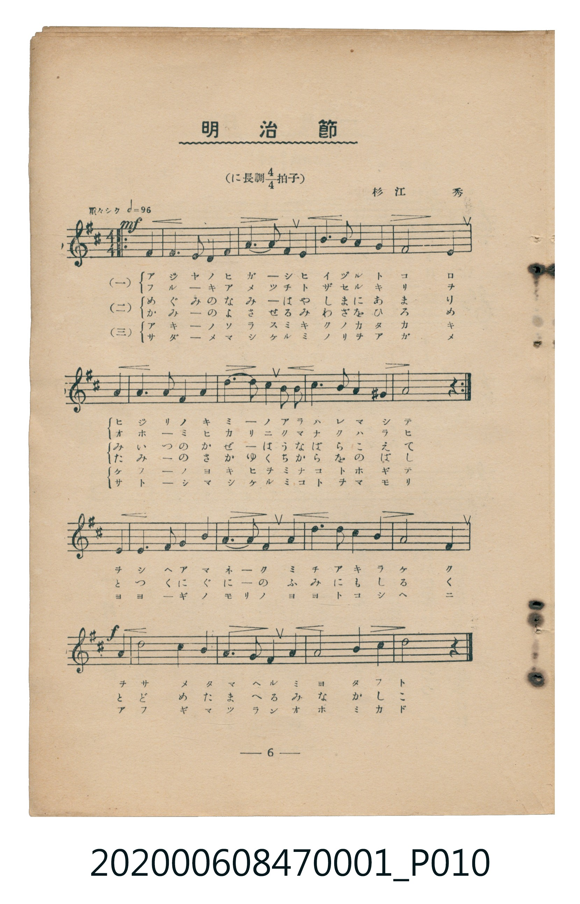
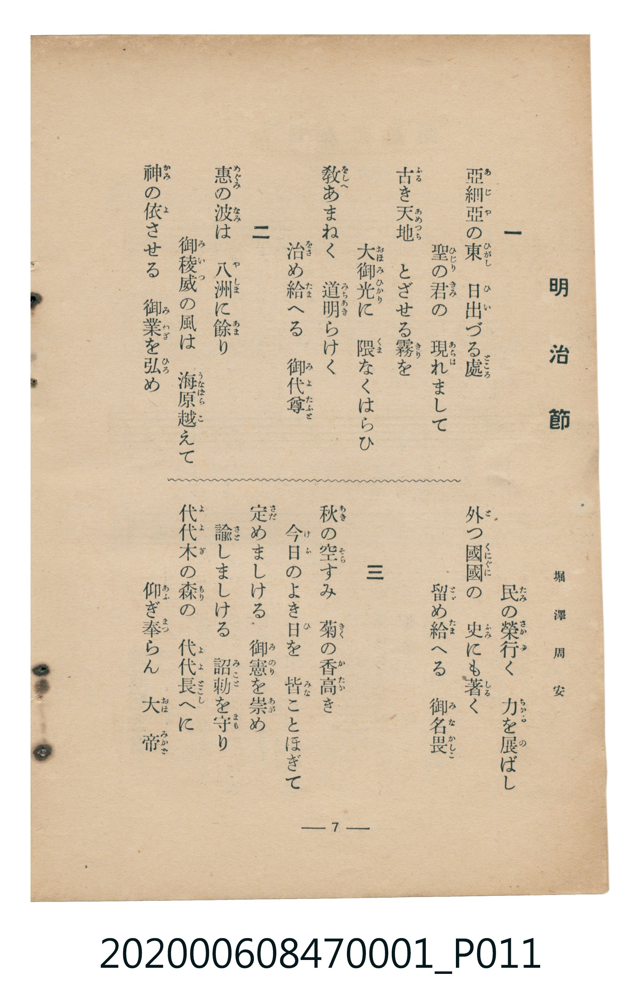

# 明治節

> Re:Shōka 使用 AI 協助辨識與重建樂譜，可能會有錯誤。歡迎回報。

- **鋼琴伴奏版**：<br><audio controls src="meijisetsu.mp3"></audio>
- **NEUTRINO 歌聲合成版**：<br><audio controls src="meijisetsu_neutrino.mp3"></audio>

- 詞：堀澤周安
- 曲：杉江秀
- 臺灣教育會公認《新定兒童唱歌》尋常科第一學年用（2020.006.0847.0001）

## 說明

原書資訊與歌詞全文（對應 P010.jpg – P011.jpg，儀式歌 pp. 6–7，第 6 首）：
調性與拍號：ニ長調 4/4 拍子，「勇々シク」（原譜前兩行有反覆記號）


## 歌詞

```text
一　亜細亜（あじや）の東（ひがし）　日出（ひい）づる處（ところ）
聖（ひじり）の君（きみ）の　現（あらは）れまして
古（ふる）き天地（あめつち）　とざせる霧（きり）を
大御光（おほみひかり）に　隈（くま）なくはらひ
教（をしへ）あまねく　道明（みちあき）らけく
治（をさ）め給（たま）へる　御代尊（みよたふと）

二　恵（めぐみ）の波（なみ）は　八洲（やしま）に餘（あま）り
御稜威（みいつ）の風（かぜ）は　海原越（うなばらこ）えて
神（かみ）の依（よ）させる　御業（みわざ）を弘（ひろ）め
民（たみ）の榮行（さかゆ）く　力（ちから）を展（の）ばし
外（と）つ國國（くにぐに）の　史（ふみ）にも著（しる）く
留（とゞ）め給（たま）へる　御名畏（みなかしこ）

三　秋（あき）の空（そら）すみ　菊（きく）の香高（かたか）き
今日（けふ）のよき日（ひ）を　皆（みな）ことほぎて
定（さだ）めましける　御憲（みのり）を崇（あが）め
諭（さと）しましける　詔勅（みこと）を守（まも）り
代代木（よよぎ）の森（もり）の　代代長（よよとこし）へに
仰（あふ）ぎ奉（まつ）らん　大帝（おほみかど）
```

## ABC

<div class="abc-score" data-abc-src="meijisetsu.abc" aria-label="五線譜載入中"></div>

[下載 ABC 原始檔](meijisetsu.abc)

## TMD 檔案連結

- [主旋律 TMD 檔案](meijisetsu.tmd) [[在 TMD Studio 編輯](https://tmdlang.github.io/Tmd-TS/#tmd=s7IKdvYPcrWy4qpTUCpJTLdSSM7PyUlNLsnMz7MqzsjMK0nNjM_KTMmPL87Iz05Ugisry88pzU21Si9KTEmNN4w3MjAyiDcwMIs3sDAxBzIMDBFKi_NLi5JTrYqTM_Lzc-JLUitKkvLzsxHyBUX5Zal5iXlANQVFIBtTwIoQClLLMlNSQdKpKZkl-UWZiTlI7kgtKga7FWxJfElRYl5xclFmAcgDCFUlGalAx2bmFqSi6oaIJ6cWpebm56HIAK1Jz8yzAgonlQK9jiFRkpgJFAaFSnlifG5iZl5OYl4KsqqSjHxg4BRkVFplZBaDXJ2cmBOfnZiHFIZQNxckpqdaBRgYGugCCWC4aWkpPJvR92zT7ufrGxS0tLgUbRUszbjsbRVcuGxM9E3sQPpfrJz3fs-spwsanu1b8nTiiqfrOsHGPpu9CSj8bG7ns43zny9vAIu9aN_1vHHxs6kzXzRtejan-Wnrmhereh83dD2btuHpullPWyc9X7306ZSNz9b2PG7ofrqh--mOHc-XT3y-Zs2THQ1P1-54unPL8ykr3u_pAEWxHjCK9UBRDGQYGL7fA7SVS19LwZZagEtBQeFp3_xns3e82Nz-YkXXi452oLuAnn3auuLZtHagK55u6H3W3qkACi69rIJ0hUcNk0EcQxDn_Z6epy0NT_f0A_UoFBToKZgBZc2BokDPKJgpvFw2DehiYPiAbHmxav-zhuUg87t7X8ycDxR93Nz9cup2oLgCMJAVgMJP104A6n3c0PO0u_1xQ-vjpu2Pm9Y_bugFuaJv_ou1c5529j5tXfliYc-zOZ1P-3tfLGt7sWIG2LBOLpAdwAB83NDwZNec51s2AEmgvseNTY8bZzxuagEqedy47tncjWDBTY8bex43TgcJNjQ8m770afsumDhE5dLHTd0vZk4FC6543Dj5cRPQFZ1gfzQCPQVRCjS3C2Lu0wmzwYK9jxv3Q0SA5j7v3wd1QRNQZD1IvAlo6z6gxY8bl4FDvn8JWMVWoG1gbb1Pl6x8OmcDTFvj48YljxsXQpwJdsi0x42zgYpfzlkOtQ_igqZJYOOWLH-6b-HTVmCQA-W6HjfuBjoH7NJumEtXAw16OasDrKAf6Baw4Cowez3YmZtABgHTLkhF0ySwU3eAFQHDEejytSClQCMaJwNzDNgUoAULwbKgAAIbMRGoBmzKpt0wU4ABCZRrfL51GVjPfJjNO4B-ARoHdPWT3YufbgC6EWxiE0TNVqCX4VG7C5gwGp41bgUbCQyYCfCgfrZ5EVgf0BsQEWCaaXjauvrZFmDeBCpuAfsCYuHql0tmwJIFWKSpCxxy-xY-XzHn6YpGmJeAeoBRAzL95SJQXgQFYSMwQUFNf7Z1OyhFboM4uA1s9waw5yeD1QAFwRH8fCmw1IBohjr2yb65YEcBowDInQqJTkgQPFu6FuZ_YHSAsg4w7J7ugbh3EyQFAr0ODtoNE2EBCQuEZeuA-QIsCDQUGN9tYHFQZD3tgiROYDQBxYGJA2zuRkjiXgdWtgEYRJAUBEncoGAHhsDTOd1ABEssq8GBvhqevp_2g8MXFE0QR6x-3NT0YiIwVwEFp8OSNDgpPIckKGAKbgIGCIGk8HRC7_Op_bCYAIYsMPSAEQgKWWguB2WH58shDoOlvMZ1z1dCMvFcqCcbZ4IMaGh40Q-JJmDmBJoKjtNlM1-uhoQr0GygE6C5D2z67i5ggQCWAyZkYHID-xaUInth4kBvg4IQ5IhZwGCGuhOscjI4lwLzXR8si6-bBYuUBRCfw0qAiYiIb4MEJNAUoE3QDP10C6j0BfsPGK2wiH-xGpJGgMZB4giUspGNe7FyytPuVphxIOdAjVsHyfT7gHGESPfAXAdEz-aAkzjQjyBvArM1OEEtBiYNoAiwGIIWcqCiFaweWGojqQcXj5CyFBiJjash5sLKMGgI9j1dCimVgI4FZyxgXmmaDPI-sMzaAc4SiAILGCcroaUt5TUcFCho6XNxORpaBWQm5uU71Oga1lSDzFewMdGyAzNqFAzA0FihBsz3MaxRiAfDx02LYGJGcLHmqTAxY4S6RpiYCVyssRsmZorFPDOE2FagGNQhGsYKukBopKmqoaurqWAIcpOChilY0BQqaKxghORQjcdNO8DSj5uXaAKJPiCeBNL0uGkNWByoA1idQkThXtF43LwaoqtprSaYAjoMJLoQalYLyKxGIO5A8qwGsBiAyDfuB8o3rgPiVWB9jfvhdjWuB5rWghQccFmgBohdQDNBolOhorNBLuwGGYoUYED3r4WbCfJV016IC1dC3b0TJD4f5AGkIAXKNyB0LQTieZCw2A7VtREkvhqsExHoZmBJM2j4miqYAAVBEWEEZKOE9BJo6LTCTAH55HHTZrDgWowwbtoGtXU3VD3IrUDWKrD6TUA-MPSQQ3c6NET2gcIRqL6xCaS-cR_YkC7kEAKHa1M_VP00UAhOAjI2gd3TC1YPjL1GkC-RQnQ91P19IPUg9wDNA7PACQEUPKhh2QdVvwrkfpB7QakEkrDAoYuSdNFTKTDsFDQM48CihnFQYXNQaINDWhN7IgZbBYpuUFABnTAfOREA1S0CMlbC9UKS8myo3vkgVcBgAHoILA4KZ6jeboj3gekBrhcS5C3QIARlHnCCBuZakPgc5AQN5LeB0jpcL7ZkDUzPYNFuaKS3gfT2g0SAIdXYDdcLjgpgIYKcuJtXQJIpJMkDPQEJcLD_Hzd3wfVCoqUDrhecsbEncYjeps0gvbAoMseS0EHRBir9kGOjGZqwmteAzJoHtgeUcNuAgqAyCyX0u6D2rgep7QdFD1jtJFS1kNDeAFXbCQqbyUAMzkCNy1DVQhJ3J1QtKCzAMbMBrBaUR5DUQhI2KAeC3NsBcsNsoKZ12NyLHHrA4IX6rRmcqMGJBaK2FlhdGBGuLpBLYVjVAMx_6NVFIzBq0asLUHTDI8UI7B5jaKSYAHtP2DMTcm6BxnXzDFAaAGUJSBpoBuV8aMoAJXZ49gfHVCO0-GrshxUvEyApFlIVgNM6KJxBmRoRZ0C3ws0EygJTK1h0EVp-RfESZq4HeQrkJ3SfAOsYSCwvApkPKkLBqQdYEIGTFFqQIuW51SD1TeD0AFIPynSg3IYa3HDXQ1IGMJnAUvIMsCCw0gHXyFB3g50NcSs0AmBZBdXZoHIPVgKCSlCgNfOQIgRev8CcDWzUgL0DLZFB3gAV6SAX78Co-4DOhpQOkOCGRiy0mAIVfY-bQd4A1RxQZ4OcagZ0N9QDqJkZEgIgd4IbLuA6Cz0Tg2pxkGNA7gAHJzBromdeSCkLKVNAxevjZlD-hGcYXTsFR0MFEAlMznYKylwA)]
- [鋼琴伴奏 TMD 檔案](meijisetsu_piano.tmd) [[在 TMD Studio 編輯](https://tmdlang.github.io/Tmd-TS/#tmd=s7IKdvYPcrWy4qpTUCpJTLdSyC8qychPL0osyKi0ysgsLskvykxOzInPTsxLVIIrKs4vLUpOjS9ITE-1CjAwNNAFEoZKXFpaCs9m9D3btPv5-ob3ezpedu95PmHLkz1bni7tf97Z8X5Pp4KWFpeirYKlGZe9rYILl42JvokdyNAXK-e93zPr6YKGZ_uWPJ244um6TrBdz2ZvAgo_m9v5bOP858sbwGIv2nc9b1z8bOrMF02bns1pftq65sWq3scNXc-mbXi6btbT1knPVy99OmXjs7U9jxu6n27ofrpjx_PlE5-vWfNkR8PTtTue7tzyfMoKoOOMDIwM9AwMzPQMLEzMgQwDQ6D7lLi4HA2tAjIT8_KDPBxqdA1rqrkUgMDGRMsOzKhRMABDY4UaMN_HsEYhHgwfNy2CiRnBxZqnwsSMEeoaYWImcLHGbpiYKRbzzBBiW4FiUIdoGCvoAqGRpqqGrq6mgiHITQoapmBBU6igsYIRkkM1HjftAEs_bl6iCST6gHgSSNPjpjVgcaCOx03bIaJwr2g8bl4N0dW0VhNMAR0GEl0INasFZFYjEHcgeVbjceMEiHzjfqB84zogXgXW17gfblfjeqBpLUjBAZcFaoDYBTQTJDoVKjob5MJukKFIAQZ0_1q4mSBfNe2FuHAl1N07QeLzQR5AClKgfANC10IgngcJi-1QXRtB4qvBOhGBbgaWNIOGr6mCCVAQFBFGQDZKSC-BmrILZgrIJ4-bNoODbC1GGDdtg6rfDVUPciuQtQqsfhOQDww95NCdDg2RfaBwBKpvbAKpb9wHNqQLOYTA4drUD1U_DRSCk4CMTWD39ILVA2OvEeRLpBBdD43dPpB6kHuA5oFZ4IQACh7UsOyDql8Fcj_IvaBUAklY4NBFSbroqRQYdgoahnFgUcM4qLA5KLTBIa2JPRGDrQJFNyiogE6Yj5wIgOoWARkr4XohSXk2VO98kCpgMAA9BBYHhTNUbzfE-8D0ANcLCfIWaBCCMg84QQNzLUh8DnKCBvLbQGkdrhdbsgamZ7BoNzTS20B6-0EiwJBq7IbrBUcFsBBBTtzNKyDJFJLkgZ6ABDjY_4-bu-B6IdHSAdcLztjYkzhEb9NmkF5YFJljSeigaAOVfsix0QxNWM1rQGbNA9sDSrhtQEFQmYUS-l1Qe9eD1PaDogesdhKqWkhob4Cq7QSFzWQgBmegxmWoaiGJuxOqFhQW4JjZAFYLyiNIaiEJG5QDQe7tALlhNlDTOmzuRQ49YPBC_dYMTtTgxAJRW4uoMHzwVhiwQKtRMIxXiDaMhVEYfKgqEyDXJBZGwVWZxgNp03iEOnTTzEAKzOJzEVqhCuE6EUYgaQY5D-QXI2IqP-Q6BVbRAUsT9MqvEZhQ0Ss_UOKFJzEjcOgaQ5OYiYIZjqIBOe9DU27zDFCKBmVwSIpuBpVj0HQOyrrwwgyc7hqhhXFjP6ywnADJf5CKDZxzQakGVEQhUiDQrXAzgbLAvAcWXYRW-qB4CbMMA3kK5Cd0nwBrTEiaXQQyH1QhgPMCsFgFZxC0IEUqQVaD1DeBUzdIPagIAZUdqMENdz0knQMTPSxfzgALAqtQcPsClopAzoa4FRoBsIyP6mxQKQ4rz0H1AdCaeUgRAq8tYc5-3AiqguH1C8gboAoK5OIdGDU50NmQsg4S3NCIhRa6oIL8cTPIG6B6EJamQQ4FuhvqAdSiCRICIHeCm2HgGhi9SAK1SUCOAbkDHJzAgga9KILUGZASElRZPG4GlTaI7A_NMsRmf_z5kIgiAE0VlEtAFVG5X9dOwdEw2gcoBmUZQVhGIDGwQVBxY7gKoJVQFUYoKkzhKszgKozhKpS5AA)]

## 分析

```text
================================================================================
📊 TMD Song Profile: [ 明治節 ]
================================================================================
⏱  Duration:       0:40 (40.0s), 16 measures total
🎼 Key & Tempo:    首調基準 D, != 96.0 BPM, <4/4>
   - 分析範圍：      由實際發聲的音符與和弦推測調性；播放脈絡另行呈現
🎤 人聲音域:    D4 (MIDI 62) – D5 (MIDI 74) [跨度: 12 個半音 / 1.0 個八度, 難度: easy]
   - 最低音:  D4 in [A1 #1 @ m.2, 0:03]
   - 最高音: D5 in [A1 #1 @ m.7, 0:15]
   - 適合: soprano, mezzo-soprano, contralto, tenor, baritone, bass
🏛  結構:      A1 (20.0s) -> A2 (20.0s)
⚡ 編曲密度:        Peak 1 軌道同時演奏
🗝  調性診斷：       A 大調（推測轉調經歷 1 次）
   - 風格氣質:    純淨自然大調（陽光明朗、易唱易記，無明顯調外色彩）
   - 轉調歷程:    A 大調起奏 ➔ [A2] 轉至 A 大調 (+3 半音 / 五度圈 -3 步)
   - 核心骨幹音:  A, F#, D, B, C#
   - 調性數值:    A 大調 [相關度: 0.84, 穩定度: Moderate, 自然音純度: 95.2%]
   - 候選調性 (K-S): A 大調 (0.84), F# 小調 (0.78), D 大調 (0.78)
   - 五度圈歷程:   +6 -> +3
   - 各段落調性細節:
     • [A1 #1]: F# 小調 (r: 0.88, 自然音純度: 93.1%, 調外音: G)
     • [A2 #1]: A 大調 (r: 0.86, 自然音純度: 96.8%, 調外音: G)

  [ 五度圈游移軌跡 ]
               C  
         F            G  
      Bb               D  
      Eb              [A ]*
         Ab           E  
            Db       B  
              [F#]*
     (* = active key center)

  [ 十二半音累積音高分佈 ]
     C  :                            0.0%
     C# : ██████                     8.9%
     D  : ███████████               14.5%
     D# :                            0.0%
     E  : ██████                     8.1%
     F  :                            0.0%
     F# : █████████████             17.7%
     G  : ████                       4.8%
     G# :                            0.0%
     A  : ████████████████████████  33.1%
     A# :                            0.0%
     B  : █████████                 12.9%
--------------------------------------------------------------------------------
Assignment 軌道音域：
  - Piano         : D4 – D5 (12 個半音 / 1.0 個八度, 57 個音符)
================================================================================
```


## 原書掃描頁






