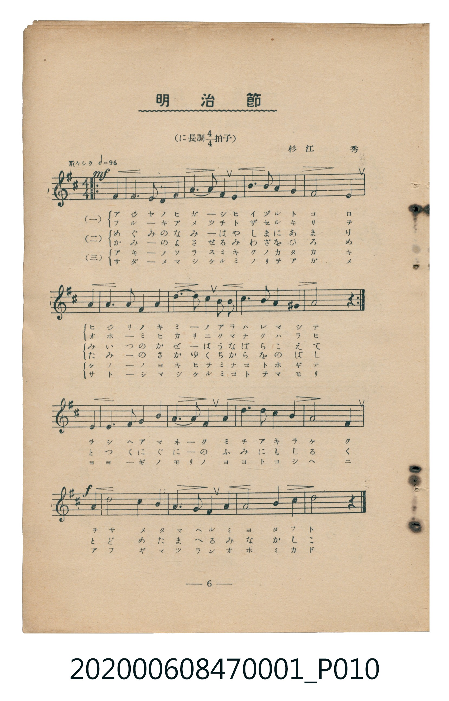
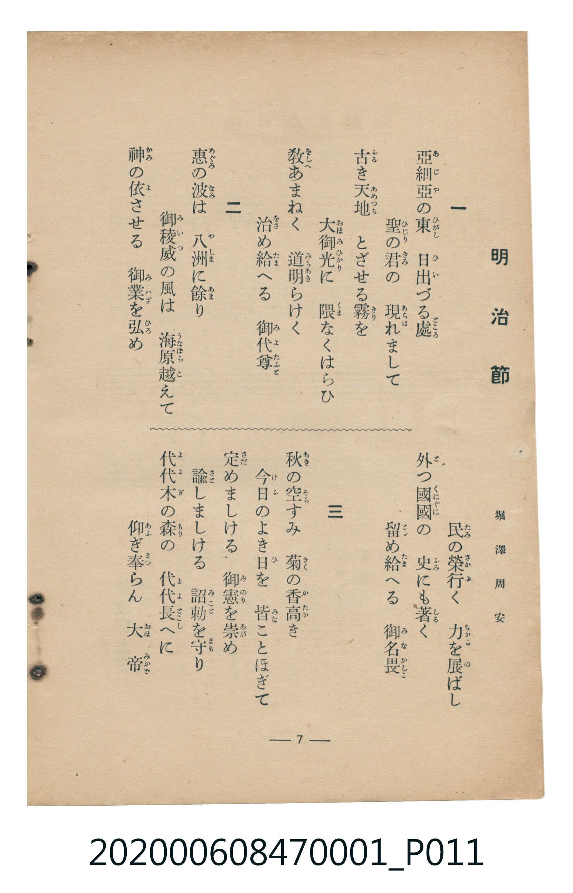

# 明治節

> Re:Shōka 使用 AI 協助辨識與重建樂譜，可能會有錯誤。歡迎回報。

- **鋼琴伴奏版**：<br><audio controls src="meijisetsu.mp3"></audio>
- **NEUTRINO 歌聲合成版**：<br><audio controls src="meijisetsu_neutrino.mp3"></audio>

- 詞：堀澤周安
- 曲：杉江秀
- 臺灣教育會公認《新定兒童唱歌》尋常科第一學年用（2020.006.0847.0001）

## 說明

原書資訊與歌詞全文（對應 P010.jpg – P011.jpg，儀式歌 pp. 6–7，第 6 首）：
調性與拍號：ニ長調 4/4 拍子，「勇々シク」（原譜前兩行有反覆記號）


## 歌詞

```text
一　亜細亜（あじや）の東（ひがし）　日出（ひい）づる處（ところ）
聖（ひじり）の君（きみ）の　現（あらは）れまして
古（ふる）き天地（あめつち）　とざせる霧（きり）を
大御光（おほみひかり）に　隈（くま）なくはらひ
教（をしへ）あまねく　道明（みちあき）らけく
治（をさ）め給（たま）へる　御代尊（みよたふと）

二　恵（めぐみ）の波（なみ）は　八洲（やしま）に餘（あま）り
御稜威（みいつ）の風（かぜ）は　海原越（うなばらこ）えて
神（かみ）の依（よ）させる　御業（みわざ）を弘（ひろ）め
民（たみ）の榮行（さかゆ）く　力（ちから）を展（の）ばし
外（と）つ國國（くにぐに）の　史（ふみ）にも著（しる）く
留（とゞ）め給（たま）へる　御名畏（みなかしこ）

三　秋（あき）の空（そら）すみ　菊（きく）の香高（かたか）き
今日（けふ）のよき日（ひ）を　皆（みな）ことほぎて
定（さだ）めましける　御憲（みのり）を崇（あが）め
諭（さと）しましける　詔勅（みこと）を守（まも）り
代代木（よよぎ）の森（もり）の　代代長（よよとこし）へに
仰（あふ）ぎ奉（まつ）らん　大帝（おほみかど）
```

## ABC

<div class="abc-score" data-abc-src="meijisetsu.abc" aria-label="五線譜載入中"></div>

[下載 ABC 原始檔](meijisetsu.abc)

## TMD 檔案連結

- [主旋律 TMD 檔案](meijisetsu.tmd) [[在 TMD Studio 編輯](https://tmdlang.github.io/Tmd-TS/#tmd=s7IKdvYPcrWy4qpTUCpJTLdSSM7PyUlNLsnMz7MqzsjMK0nNjM_KTMmPL87Iz05Ugisry88pzU21Si9KTEmNN4w3MjAyiDcwMIs3sDAxBzIMDBFKi_NLi5JTrYqTM_Lzc-JLUitKkvLzsxHyBUX5Zal5iXlANQVFIBtTwIoQClLLMlNSQdKpKZkl-UWZiTlI7kgtKga7FWxJfElRYl5xclFmAcgDCFUlGalAx2bmFqSi6oaIJ6cWpebm56HIAK1Jz8yzAgonlQK9jiFRkpgJFAaFSnlifG5iZl5OYl6KEpeWlsKzGX3PNu1-vr5BQUuLS9FWwdKMy95WwYXLxkTfxA5kzIuV897vmfV0QcOzfUueTlzxdF0n2PRnszcBhZ_N7Xy2cf7z5Q1gsRftu543Ln42deaLpk3P5jQ_bV3zYlXv44auZ9M2PF0362nrpOerlz6dsvHZ2p7HDd1PN3Q_3bHj-fKJz9esebKj4enaHU93bnk-ZcX7PR2g6NEDRo8eKHqADAPD93uAtnLpaynYUgtwKSgoPO2b_2z2jheb21-s6HrR0Q50F9CzT1tXPJvWDnTF0w29z9o7FQIMDA30sgrSFR41TAZxDEGc93t6nrY0PN3TD9SjUFCgp2AGlDUHigI9o2Cm8HLZNKCLgeEDsuXFqv3PGpaDzO_ufTFzPlD0cXP3y6nbgeIKwEBWAAo_XTsBqPdxQ8_T7vbHDa2Pm7Y_blr_uKEX5Iq--S_Wznna2fu0deWLhT3P5nQ-7e99saztxYoZYMM6uUB2AAPwcUPDk11znm_ZACSB-h43Nj1unPG4qQWo5HHjumdzN4IFNz1u7HncOB0k2NDwbPrSp-27YOIQlUsfN3W_mDkVLLjicePkx01AV3SC_dEI9BREKdDcLoi5TyfMBgv2Pm7cDxEBmvu8fx_UBU1AkfUg8SagrfuAFj9uXAYO-f4lYBVbgbaBtfU-XbLy6ZwNMG2NjxuXPG5cCHEm2CHTHjfOBip-OWc51D6IC5omgY1bsvzpvoVPW4FBDpTrety4G-gcsEu7YS5dDTTo5awOsIJ-oFvAgqvA7PVgZ24CGQRMuyAVTZPATt0BVgQMR6DL14KUAo1onAzMMWBTgBYsBMuCAghsxESgGrApm3bDTAEGJFCu8fnWZWA982E27wD6BWgc0NVPdi9-ugHoRrCJTRA1W4FehkftLmDCaHjWuBVsJDBgJsCD-tnmRWB9QG9ARIBppuFp6-pnW4B5E6i4BewLiIWrXy6ZAUsWYJGmLnDI7Vv4fMWcpysaYV4C6gFGDcj0l4tAeREUhI3ABAU1_dnW7aAUuQ3i4Daw3RvAnp8MVgMUBEfw86XAUgOiGerYJ_vmgh0FjAIgdyokOiFB8GzpWpj_gdEByjrAsHu6B-LeTZAUCPQ6OGg3TIQFJCwQlq0D5guwINBQYHy3gcVBkfW0C5I4gdEEFAcmDrC5GyGJex1Y2QZgEEFSECRxg4IdGAJP53QDESyxrAYH-mp4-n7aDw5fUDRBHLH6cVPTi4nAXAUUnA5L0uCk8BySoIApuAkYIASSwtMJvc-n9sNiAhiywNADRiAoZKG5HJQdni-HOAyW8hrXPV8JycRzoZ5snAkyoKHhRT8kmoCZE2gqOE6XzXy5GhKuQLOBToDmPrDpu7uABQJYDpiQgckN7FtQiuyFiQO9DQpCkCNmAYMZ6k6wysngXArMd32wLL5uFixSFkB8DisBJiIivg0SkEBTgDZBM_TTLaDSF-w_YLTCIv7FakgaARoHiSNQykY27sXKKU-7W2HGgZwDNW4dJNPvA8YRIt0Dcx0QPZsDTuJAP4K8CczW4AS1GJg0gCLAYghayIGKVrB6YKmNpB5cPELKUmAkNq6GmAsrw6Ah2Pd0KaRUAjoWnLGAeaVpMsj7wDJrBzhLIAosYJyshJa2lNdwUKCgpc_F5WhoFZCZmJfvUKNrWFMNMl_BxkTLDsyoUTAAQ2OFGjDfx7BGIR4MHzctgokZwcWap8LEjBHqGmFiJnCxxm6YmCkW88wQYluBYlCHaBgr6AKhkaaqhq6upoIhyE0KGqZgQVOooLGCEZJDNR437QBLP25eogkk-oB4EkjT46Y1YHGgDmB1ChGFe0XjcfNqiK6mtZpgCugwkOhCqFktILMagbgDybMawGIAIt-4HyjfuA6IV4H1Ne6H29W4HmhaC1JwwGWBGiB2Ac0EiU6Fis4GubAbZChSgAHdvxZuJshXTXshLlwJdfdOkPh8kAeQghQo34DQtRCI50HCYjtU10aQ-GqwTkSgm4ElzaDha6pgAhQERYQRkI0S0kugodMKMwXkk8dNm8GCazHCuGkb1NbdUPUgtwJZq8DqNwH5wNBDDt3p0BDZBwpHoPrGJpD6xn1gQ7qQQwgcrk39UPXTQCE4CcjYBHZPL1g9MPYaQb5ECtH1UPf3gdSD3AM0D8wCJwRQ8KCGZR9U_SqQ-0HuBaUSSMIChy5K0kVPpcCwU9AwjAOLGsZBhc1BoQ0OaU3siRhsFSi6QUEFdMJ85EQAVLcIyFgJ1wtJyrOheueDVAGDAeghsDgonKF6uyHeB6YHuF5IkLdAgxCUecAJGphrQeJzkBM0kN8GSutwvdiSNTA9g0W7oZHeBtLbDxIBhlRjN1wvOCqAhQhy4m5eAUmmkCQP9AQkwMH-f9zcBdcLiZYOuF5wxsaexCF6mzaD9MKiyBxLQgdFG6j0Q46NZmjCal4DMmse2B5Qwm0DCoLKLJTQ74Laux6kth8UPWC1k1DVQkJ7A1RtJyhsJgMxOAM1LkNVC0ncnVC1oLAAx8wGsFpQHkFSC0nYoBwIcm8HyA2zgZrWYXMvcugBgxfqt2ZwogYnFojaWmB1YUS4ukAuhWFVAzD_oVcXjcCoRa8uQNENjxQjsHuMoZFiAuw9Yc9MyLkFGtfNM0BpAJQlIGmgGZTzoSkDlNjh2R8cU43Q4quxH1a8TICkWEhVAE7roHAGZWpEnAHdCjcTKAtMrWDRRWj5FcVLmLke5CmQn9B9AqxjILG8CGQ-qAgFpx5gQQROUmhBipTnVoPUN4HTA0g9KNOBchtqcMNdD0kZwGQCS8kzwILASgdcI0PdDXY2xK3QCIBlFVRng8o9WAkIKkGB1sxDihB4_QJzNrBRA_YOtEQGeQNUpINcvAOj7gM6G1I6QIIbGrHQYgpU9D1uBnkDVHNAnQ1yqhnQ3VAPoGZmSAiA3AluuIDrLPRMDKrFQY4BuQMcnMCsiZ55IaUspEwBFa-Pm0H5E55hdO0UHA0VgKQyFwA)]
- [鋼琴伴奏 TMD 檔案](meijisetsu_piano.tmd) [[在 TMD Studio 編輯](https://tmdlang.github.io/Tmd-TS/#tmd=s7IKdvYPcrWy4tLSUng2o-_Zpt3P1ze839PxsnvP8wlbnuzZ8nRp__POjvd7OhW0tLgUbRUszbjsbRVcuGxM9E3suOoUlF6snPd-z6ynCxqe7VvydOKKp-s6lUDCz2ZvAgo_m9v5bOP858sbwGIv2nc9b1z8bOrMF02bns1pftq65sWq3scNXc-mbXi6btbT1knPVy99OmXjs7U9jxu6n27ofrpjx_PlE5-vWfNkR8PTtTue7tzyfMoKoOOMDIwM9AwMzPQMLEzMgQwDQ6D7lLi4HA2tAjIT8_KDPBxqdA1rqrkUgMDGRMsOzKhRMABDY4UaMN_HsEYhHgwfNy2CiRnBxZqnwsSMEeoaYWImcLHGbpiYKRbzzBBiW4FiUIdoGCvoAqGRpqqGrq6mgiHITQoapmBBU6igsYIRkkM1HjftAEs_bl6iCST6gHgSSNPjpjVgcaCOx03bIaJwr2g8bl4N0dW0VhNMAR0GEl0INasFZFYjEHcgeVbjceMEiHzjfqB84zogXgXW17gfblfjeqBpLUjBAZcFaoDYBTQTJDoVKjob5MJukKFIAQZ0_1q4mSBfNe2FuHAl1N07QeLzQR5AClKgfANC10IgngcJi-1QXRtB4qvBOhGBbgaWNIOGr6mCCVAQFBFGQDZKSC-Bhk4rzBSQTx43bQYLrsUI46ZtUFt3Q9WD3ApkrQKr3wTkA0MPOXSnQ0NkHygcgeobm0DqG_eBDelCDiFwuDb1Q9VPA4XgJCBjE9g9vWD1wNhrBPkSKUTXQ93fB1IPcg_QPDALnBBAwYMaln1Q9atA7ge5F5RKIAkLHLooSRc9lQLDTkHDMA4sahgHFTYHhTY4pDWxJ2KwVaDoBgUV0AnzkRMBUN0iIGMlXC8kKc-G6p0PUgUMBqCHwOKgcIbq7YZ4H5ge4HohQd4CDUJQ5gEnaGCuBYnPQU7QQH4bKK3D9WJL1sD0DBbthkZ6G0hvP0gEGFKN3XC94KgAFiLIibt5BSSZQpI80BOQAAf7_3FzF1wvJFo64HrBGRt7EofobdoM0guLInMsCR0UbaDSDzk2mqEJq3kNyKx5YHtACbcNKAgqs1BCvwtq73qQ2n5Q9IDVTkJVCwntDVC1naCwmQzE4AzUuAxVLSRxd0LVgsICHDMbwGpBeQRJLSRhg3IgyL0dIDfMBmpah829yKEHDF6o35rBiRqcWCBqaxEVhg_eCgMWaDUKhvEK0YaxMAqDD1VlAuSaxMIouCrTeCBtGo9Qh26aGUiBWXwuQitUIVwnwggkzSDngfxiREzlh1ynwCo6YGmCXvk1AhMqeuUHSrzwJGYEDl1jaBIzUTDDUTQg531oym2eAUrRoAwOSdHNoHIMms5BWRdemIHTXSO0MG7shxWWEyD5D1KxgXMuKNWAiihECgS6FW4mUBaY98Cii9BKHxQvYZZhIE-B_ITuE2CNCUmzi0DmgyoEcF4AFqvgDIIWpEglyGqQ-iZw6gapBxUhoLIDNbjhroekc2Cih-XLGWBBYBUKbl_AUhHI2RC3QiMAlvFRnQ0qxWHlOag-AFozDylC4LUlzNmPG0FVMLx-AXkDVEGBXLwDoyYHOhtS1kGCGxqx0EIXVJA_bgZ5A1QPwtI0yKFAd0M9gFo0QUIA5E5wMwxcA6MXSaA2CcgxIHeAgxNY0KAXRZA6A1JCgiqLx82g0gaR_aFZhtjsjz8fElEEoKmCcgmoIir369opOBpG-wDFoCwjCMsIJAY2CCpuDFcBtBKqwghFhSlchRlchTFchTIXAA)]

## 分析

```text
================================================================================
📊 TMD Song Profile: [ 明治節 ]
================================================================================
⏱  Duration:       0:20 (20.0s), 8 measures total
🎼 Key & Tempo:    首調基準 D, != 96.0 BPM, <4/4>
   - 分析範圍：      由實際發聲的音符與和弦推測調性；播放脈絡另行呈現
🎤 人聲音域:    D4 (MIDI 62) – D5 (MIDI 74) [跨度: 12 個半音 / 1.0 個八度, 難度: easy]
   - 最低音:  D4 in [A1 #1 @ m.2, 0:03]
   - 最高音: D5 in [A1 #1 @ m.7, 0:15]
   - 適合: soprano, mezzo-soprano, contralto, tenor, baritone, bass
🏛  結構:      A1 (20.0s)
⚡ 編曲密度:        Peak 1 軌道同時演奏
🗝  調性診斷：       F# 小調（流行色彩小調，未偵測到可信轉調）
   - 風格氣質:    流行小調（略帶和弦色彩音與裝飾副屬和弦）
   - 轉調歷程:    全曲維持單一推測調性（未偵測到可信轉調）
   - 核心骨幹音:  A, F#, B, D, C#
   - 調性數值:    F# 小調 [相關度: 0.85, 穩定度: Moderate, 自然音純度: 93.5%]
   - 候選調性 (K-S): F# 小調 (0.85), A 大調 (0.77), D 大調 (0.70)
   - 五度圈歷程:   +6
   - 各段落調性細節:
     • [A1 #1]: F# 小調 (r: 0.88, 自然音純度: 93.1%, 調外音: G)

  [ 五度圈游移軌跡 ]
               C  
         F            G  
      Bb               D  
      Eb               A  
         Ab           E  
            Db       B  
              [F#]*
     (* = active key center)

  [ 十二半音累積音高分佈 ]
     C  :                            0.0%
     C# : ██████                     8.1%
     D  : ███████                    9.7%
     D# :                            0.0%
     E  : ██████                     8.1%
     F  :                            0.0%
     F# : ██████████████████        24.2%
     G  : █████                      6.5%
     G# :                            0.0%
     A  : ████████████████████████  32.3%
     A# :                            0.0%
     B  : ████████                  11.3%
--------------------------------------------------------------------------------
Assignment 軌道音域：
  - Piano         : D4 – D5 (12 個半音 / 1.0 個八度, 30 個音符)
================================================================================
```


## 原書掃描頁






