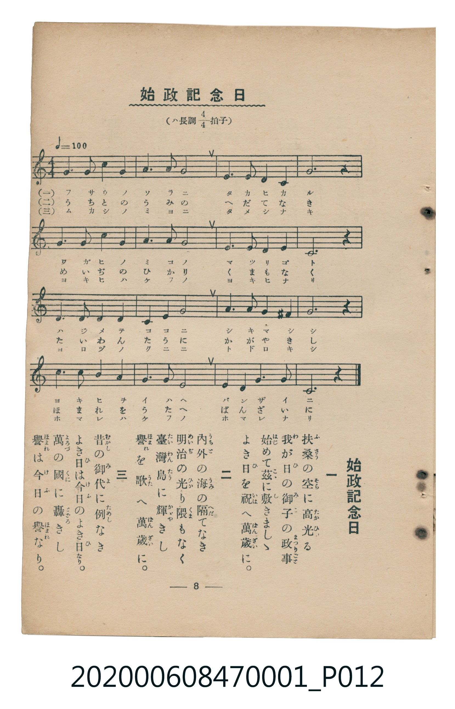

# 始政記念日

<audio controls src="shisei_kinenbi.mp3"></audio>

- 臺灣教育會公認《新定兒童唱歌》尋常科第一學年用（2020.006.0847.0001）

## 說明

原書資訊與歌詞全文（對應 P012.jpg，儀式歌 p. 8，第 7 首）：
調性與拍號：ハ長調 4/4 拍子

## 跨冊／重複收錄參照

> 同曲（6月17日臺灣始政紀念日唱歌；收錄於《新定兒童唱歌》卷首及《唱歌帖》P047 五線譜版、P125 五線譜與簡譜對照版）

- **[同曲]** 楊金土手抄《唱歌帖》第 3 冊・I（2020.006.0843）：[**〈始政紀念日〉**](../../../shokacho/vol_03/p047_shisei_kinembi/index.md)（`C` / `4/4` — [原始 TMD](../../../shokacho/vol_03/p047_shisei_kinembi/shisei_kinembi.tmd)）
- **[同曲]** 楊金土手抄《唱歌帖》第 1 冊（2020.006.0843）：[**〈始政紀念日〉**](../../../shokacho/vol_01/p125_shisei_kinenbi/index.md)（`C` / `4/4` — [原始 TMD](../../../shokacho/vol_01/p125_shisei_kinenbi/shisei_kinenbi.tmd)）
- 總表：[跨冊重複與同名歌曲總索引](../../../duplicate_songs.md)

## 歌詞

```text
一　扶桑（ふさう）の空（そら）に高光（たかひか）る
我が日（ひ）の御子（みこ）の政事（まつりごと）
始（はじ）めて茲（こゝ）に敷きましゝ
よき日（ひ）を祝（いは）へ萬歳（ばんざい）に。

二　内外（うちと）の海（うみ）の隔（へだ）てなき
明治（めいぢ）の光（ひか）り隈（くま）もなく
臺灣島（たいわんたう）に輝（かゞや）きし
譽（ほまれ）を歌（うた）へ萬歳（ばんざい）に。

三　昔（むかし）の御代（みよ）に例（ためし）なき
よき日（ひ）は今日（けふ）のよき日（ひ）なり。
萬（よろづ）の國（くに）に轟（とゞろ）きし
譽（ほまれ）は今日（けふ）の譽（ほまれ）なり。
```

## ABC

```abc
X:1
T:始政記念日
M:4/4
L:1/16
Q:1/4=100
K:C
V:V1 name="Piano" snm="Pia"
[V:V1]
C6 D2 E4 F4 | G6 A2 G8 | A6 F2 c4 A4 | G12 z4 |
c4 B4 A4 G4 | E6 G2 D8 | E6 E2 D4 E4 | C12 z4 |
G4 G4 A4 B4 | c6 B2 A8 | B6 G2 ^F4 A4 | G12 z4 |
c4 G4 A4 E4 | F6 A2 G8 | E6 C2 G6 E2 | C12 z4 |
```

## TMD 檔案連結

- [主旋律 TMD 檔案](shisei_kinenbi.tmd) [[在 TMD Studio 編輯](https://tmdlang.github.io/Tmd-TS/#tmd=s7IKdvYPcrWy4tLSUni6vPvZlP0vVsx4un_rs-lLFbS0uBRtFQwNDLjsbRWcuWxM9E3suOoUlF6073reuPjZ1JkvmjY9m9P8tHXNi1W9jxu6nk3b8HTdrKetk56vXvp0ysZna3seN3Q_3dD9dMeO58snPl-z5smOhqdrdzzdueX5lBXv93QYGRgZ6BkYmOkZWJiYAxkGhu_3dCpxcelrKdhSC3ApKCg87Zv_bPaOF5vbX6zoetHRDnTXi5XznraueDatHeiKpxt6n7V3KgQYGBrpZRWkv9_T87Sl4emefqAyhQI9BQugANDpCuYKL5dNA7rv_Z5ZIDNfrNr_rGE5yLTu3hcz5wNFHzf3v5y6HSiuAAwnBaDw07UTuEBKgb5-3NDwrHPbs4UTgfY9btz6uHHq48Y2oGGPG9c9X7kLLDj3cRPQbKDI6perZzxtBbKBgvMfN3Y_btwEJEFSTd0g4551THzc2AOMH7CKTRBTnu5bCLQOLLL_ceNkiCAwMp_sAuoECu573LjkcVPX48YpjxuBQd8JDpblELn1jxtngI1vfNy47EUP0ESg4OTHTXMhznk2dfvjxl6wEdOBgiCdj5uAKnpRnNA06flSoAYgtwVoIljnjhcT1jxbuxksuOFx0-THjdOAshBDHzc0QcJmFzCNNDxta326BBi4QIVtjxsXQpwI8sDW7TDB_RCRl7OmgEV2PG5cABZZ9rhxFdAt4ICZ0fds026QNMgnQGcsgoYNNDDhwdj1clYHWKQf6CuwSBPYlH5wxIIT99PN22AR0PK4qR_seiAbEmerX-yBeLX7cdO8x00QLwFDaDpY_9q9YLndoBBr6oGEDTAtwTwCTCrEhs2OTlC6mQH2cVMDOClMh0f3k92LodHdBPQMSN-TfZD4nA_2P0QlLGywxFjj-ie7u2AiwCS1FWI0NpWrQEkH6CqQ9yasATsHiIA-BioCO2cOxGZgeK6GhtBeoD-BIivAIdRLKIRwuAWbSiS3UF46QIGClj4XV3BGZnFqpndmXmpeUqZVQGZiXr5DjUGNQjXIKgUbCy07MANb4aQAKdteLOxR0DBReLqh__n6Bh14iaKJRQPQQpBhNQqGCrpAaKRgDCRNgLhGwRQsYgalQSJmYNpEwTAOLIFQBIEGIBFwisHtuF09ZDkOZKE51FKQlTVgd4LYRnDXQUSMwSIgNsxPxDtuRyc5jgO5B4RBbgO5EepcEAcSYCAhkARImYk6uUH3dPZssoMO5jxIsICiFzViIUFnCBUxxhp0tVxcunYKKIlTASigzMUFAA)]
- [鋼琴伴奏 TMD 檔案](shisei_kinenbi_piano.tmd) [[在 TMD Studio 編輯](https://tmdlang.github.io/Tmd-TS/#tmd=s7IKdvYPcrWy4tLSUni6vPvZlP0vVsx4un_rs-lL3-_peNm95_mELU_2bHm6tP95Z8f7PZ0KWlpcirYKhgYGXPa2Cs5cNib6JnZcdQpKL9p3PW9c_GzqzBdNm57NaX7auubFqt7HDV3Ppm14um7W09ZJz1cvfTpl47O1PY8bup9u6H66Y8fz5ROfr1nzZEfD07U7nu7c8nzKCqCVRgZGBnoGBmZ6BhYm5kCGgSHQViUuruCMzOLUTO_MvNS8pEyrgMzEvPwgD4cagxqFai4FILCx0LIDM_S1FGzRgQLEnhcLexQ0TBSebuh_vr5BRyHAwNBIL6sgXROLBi19sGE1CoYKukBopGAMJE2AuEbBFCxiBqVBImZg2kTBMA4sgVAEgQYgES78jtvVQ5bjQBaaQy0FWVkDdieIbQR3HUTEGCwCYsP8RLzjdnSS4ziQe0AY5DaQG6HOBXEgAQYSAkmAlJmokxt0T2fPJjvoYM6DBAsoelEjFhJ0hlARY6xBV4s1bfqgpE0TRNp80df1sr336aSeF42bIBkLyU3xCtGGsTAKk28CZJjEwihgSMUDWabxsWCGAdAtKMbAlUH5cNV4RIAUwhwU46HqzEBMs_jcWCRWjYIRkGkUC6MIOQxZJ9SRJLgNGN66dgooQa4AFFDm4gIA)]

## 分析

```text
================================================================================
📊 TMD Song Profile: [ 始政記念日 ]
================================================================================
⏱  Duration:       0:38 (38.4s), 16 measures total
🎼 Key & Tempo:    首調基準 C, != 100.0 BPM, <4/4>
   - 分析範圍：      由實際發聲的音符與和弦推測調性；播放脈絡另行呈現
🎤 人聲音域:    C4 (MIDI 60) – C5 (MIDI 72) [跨度: 12 個半音 / 1.0 個八度, 難度: easy]
   - 最低音:  C4 in [ShiseiKinenbi #1 @ m.1, 0:00]
   - 最高音: C5 in [ShiseiKinenbi #1 @ m.3, 0:06]
   - 適合: soprano, mezzo-soprano, contralto, tenor, baritone, bass
🏛  結構:      ShiseiKinenbi (38.4s)
⚡ 編曲密度:        Peak 1 軌道同時演奏
🗝  調性診斷：       C 大調（純淨自然大調，未偵測到可信轉調）
   - 風格氣質:    純淨自然大調（陽光明朗、易唱易記，無明顯調外色彩）
   - 轉調歷程:    全曲維持單一推測調性（未偵測到可信轉調）
   - 核心骨幹音:  G, C, A, E, B
   - 調性數值:    C 大調 [相關度: 0.87, 穩定度: Moderate, 自然音純度: 98.3%]
   - 候選調性 (K-S): C 大調 (0.87), G 大調 (0.77), E 小調 (0.69)
   - 五度圈歷程:   +0
   - 各段落調性細節:
     • [ShiseiKinenbi #1]: C 大調 (r: 0.87, 自然音純度: 98.3%, 調外音: F#)

  [ 五度圈游移軌跡 ]
              [C ]*
         F            G  
      Bb               D  
      Eb               A  
         Ab           E  
            Db       B  
               F# 
     (* = active key center)

  [ 十二半音累積音高分佈 ]
     C  : █████████████████         20.8%
     C# :                            0.0%
     D  : █████                      5.8%
     D# :                            0.0%
     E  : ███████████               14.2%
     F  : ████                       5.0%
     F# : █                          1.7%
     G  : ████████████████████████  30.0%
     G# :                            0.0%
     A  : █████████████             15.8%
     A# :                            0.0%
     B  : █████                      6.7%
--------------------------------------------------------------------------------
Assignment 軌道音域：
  - Piano         : C4 – C5 (12 個半音 / 1.0 個八度, 48 個音符)
================================================================================
```


## 原書掃描頁




