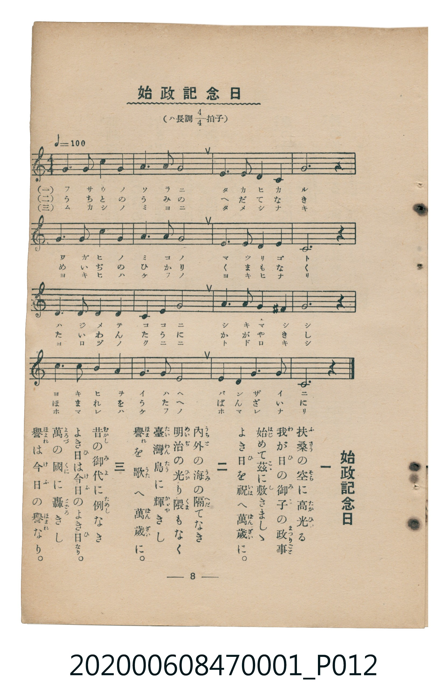

# 始政記念日

> Re:Shōka 使用 AI 協助辨識與重建樂譜，可能會有錯誤。歡迎回報。

- **鋼琴伴奏版**：<br><audio controls src="shisei_kinenbi.mp3"></audio>
- **NEUTRINO 歌聲合成版**：<br><audio controls src="shisei_kinenbi_neutrino.mp3"></audio>

- 臺灣教育會公認《新定兒童唱歌》尋常科第一學年用（2020.006.0847.0001）

## 說明

原書資訊與歌詞全文（對應 P012.jpg，儀式歌 p. 8，第 7 首）：
調性與拍號：ハ長調 4/4 拍子


## 歌詞

```text
一　扶桑（ふさう）の空（そら）に高光（たかひか）る
我が日（ひ）の御子（みこ）の政事（まつりごと）
始（はじ）めて茲（こゝ）に敷きましゝ
よき日（ひ）を祝（いは）へ萬歳（ばんざい）に。

二　内外（うちと）の海（うみ）の隔（へだ）てなき
明治（めいぢ）の光（ひか）り隈（くま）もなく
臺灣島（たいわんたう）に輝（かゞや）きし
譽（ほまれ）を歌（うた）へ萬歳（ばんざい）に。

三　昔（むかし）の御代（みよ）に例（ためし）なき
よき日（ひ）は今日（けふ）のよき日（ひ）なり。
萬（よろづ）の國（くに）に轟（とゞろ）きし
譽（ほまれ）は今日（けふ）の譽（ほまれ）なり。
```

## ABC

```abc
X:1
T:始政記念日
M:4/4
L:1/16
Q:1/4=100
K:C
V:V1 name="Piano" snm="Pia"
[V:V1]
G4 G4 c4 G4 | A6 A2 G8 | E6 E2 D4 C4 | G12 z4 |
w: 1.~フ サ ウ ノ | ソ ラ ニ | タ カ ヒ カ | ル
w: 2.~う ち と の | う み の | へ だ て な | き
w: 3.~ム カ シ ノ | ミ ヨ ニ | タ メ シ ナ | キ
G4 G4 c4 G4 | A6 A2 G8 | E6 E2 D4 C4 | C12 z4 |
w: 1.~ワ ガ ヒ ノ | ミ コ ノ | マ ツ リ ゴ | ト
w: 2.~め い ぢ の | ひ か り | く ま も な | く
w: 3.~ヨ キ ヒ ハ | ケ フ ノ | ヨ キ ヒ ナ | リ
D4 D4 D4 D4 | C4 E4 G8 | A4 A4 G4 ^F4 | G12 z4 |
w: 1.~ハ ジ メ テ | コ コ ニ | シ キ マ シ | シ
w: 2.~た い わ ん | た う に | か が や き | し
w: 3.~ヨ ロ ヅ ノ | ク ニ ニ | ト ド ロ キ | シ
c4 c4 B4 A4 | G6 G2 E8 | E4 D4 G6 G2 | C12 z4 |
w: 1.~ヨ キ ヒ ヲ | イ ハ ヘ | バ ン ザ イ | ニ
w: 2.~ほ ま れ を | う た へ | ば ん ざ い | に
w: 3.~ホ マ レ ハ | ケ フ ノ | ホ マ レ ナ | リ
```

## TMD 檔案連結

- [主旋律 TMD 檔案](shisei_kinenbi.tmd) [[在 TMD Studio 編輯](https://tmdlang.github.io/Tmd-TS/#tmd=s7IKdvYPcrWy4qpTUCpJTLdSSM7PyUlNLsnMz7MqzsjMK0nNjM_KTMmPL87Iz05Ugisry88pzU21Si9KTEmNN4w3MjAyiDcwMIs3sDAxBzIMDBFKi_NLi5JTrYqTM_Lzc-JLUitKkvLzsxHyBUX5Zal5iXlANQVFIBtTwIoQClLLMlNSQdKpKZkl-UWZiTlI7kgtKga7FWxJfElRYl5xclFmAcgDCFUlGalAx2bmFqSi6oaIJ6cWpebm56HIAK1Jz8yzKknMLE_Mi89PS8tMBstraSk8Xd79bMr-FytmPN2_9dn0pQpaWlyKtgqGBgZc9rYKzlw2JvomdiBzXrTvet64-NnUmS-aNj2b0_y0dc2LVb2PG7qeTdvwdN2sp62Tnq9e-nTKxmdrex43dD_d0P10x47nyyc-X7PmyY6Gp2t3PN255fmUFe_3dIDCVg8YtnqgsAUyDAzf7-lU4uLS11KwpRbgUlBQeNo3_9nsHS82t79Y0fWiox3orhcr5z1tXfFsWjvQFU839D5r71QIMDA00ssqSH-_p-dpS8PTPf1AZQoFegoWQAGg0xXMFV4umwZ03_s9s0Bmvli1_1nDcpBp3b0vZs4Hij5u7n85dTtQXAEYTgpA4adrJ3CBlAJ9_bih4VnntmcLJwLte9y49XHj1MeNbUDDHjeue75yF1hw7uMmoNlAkdUvV8942gpkAwXnP27sfty4CUiCpJq6QcY965j4uLEHGD9gFZsgpjzdtxBoHVhk_-PGyRBBYGQ-2QXUCRTc97hxyeOmrseNUx43AoO-ExwsyyFy6x83zgAb3_i4cdmLHqCJQMHJj5vmQpzzbOr2x429YCOmAwVBOh83AVX0ojihadLzpUANQG4L0ESwzh0vJqx5tnYzWHDD46bJjxunAWUhhj5uaIKEzS5gGml42tb6dAkwcIEK2x43LoQ4EeSBrdthgvshIi9nTQGL7HjcuAAssuxx4yqgW8ABM6Pv2abdIGmQT4DOWAQNG2hgwoOx6-WsDrBIP9BXYJEmsCn94IgFJ-6nm7fBIqDlcVM_2PVANiTOVr_YA_Fq9-OmeY-bIF4ChtB0sP61e8Fyu0Eh1tQDCRtgWoJ5BJhUiA2bHZ2gdDMD7OOmBnBSmA6P7ie7F0OjuwnoGZC-J_sg8Tkf7H-ISljYYImxxvVPdnfBRIBJaivEaGwqV4GSDtBVIO9NWAN2DhABfQxUBHbOHIjNwPBcDQ2hvUB_AkVWgEOol1AI4XALNpVIbqG8dIACBS19Lq7gjMzi1EzvzLzUvKRMq4DMxLx8hxqDmmqQTQo2Flp2YAa2skkBUrS9WNijoGGi8HRD__P1DTrwAkUTiwagfSDDahRMFXTB2DAOyqhRMAOSukASxAPBGgVjMG2sYARSCBaByYGgAUgEbJyPYY3C4-apQP7jpq1gchmIbO4D63nctBes_nHzSiDuhpv-uGk_RLxpNVB8EpQFlmkG0TAYj7DHCCjX2AZS2bgQTK4Ak-sgusAyIP5-qBjUnsYdUPEFQAx2WeMqqEwvdnuMQW5YAHfR46btyP5png_1zwrs_mleCNfRBZVZi2EP_kjd1UPHSAWRuCJ1Pdj7a8CeAUcReiA0bYaKQQOheR40EFqAGBTMj5u2QGU6sAc2KFKbGkEqG1vA5CIwCYvUTRDzGruBqkDBCYvUfqj4PqB4E5gFi1SIDPZIBScYcHTA_ANSDXLBRqi7p6L5B6QDogemAxqpYN-REqk7OsmJVFA8IWNIfIFiERGnoFgGYZCIiTpYCF9OBXn5cRMoV4DSKogE5RxQIGwGy4BJlJQNTs3QYANFMEQEJoMrp4KSCDRSmyB2TobogspAcjIsr4PEQXYCGxlgtZDEAMqhIJnp2O1BRGozxHWtYBJW8oCTL9gnKP4BJ8XHzZ0IfWC_YfcP3kh9Ons2OZEKzqFgwhyIQVEHizFTaAaFZVVQlMNk8GdVzKQNyjogPy0BqwfF--PmGUihMAEsConzbRA1QLUgGVhYYYvV3SB1wGwHUg2JKZBtyOXvfHiZCxHfAFYFintgcwOqpgUsg6OcB8fqbLDrwKmtGVIAEcqq6DogmRV7Vq3l4tK1U0CpexWAAspcAA)]
- [鋼琴伴奏 TMD 檔案](shisei_kinenbi_piano.tmd) [[在 TMD Studio 編輯](https://tmdlang.github.io/Tmd-TS/#tmd=s7IKdvYPcrWy4tLSUni6vPvZlP0vVsx4un_rs-lL3-_peNm95_mELU_2bHm6tP95Z8f7PZ0KWlpcirYKhgYGXPa2Cs5cNib6JnZcdQpKL9p3PW9c_GzqzBdNm57NaX7auubFqt7HDV3Ppm14um7W09ZJz1cvfTpl47O1PY8bup9u6H66Y8fz5ROfr1nzZEfD07U7nu7c8nzKCqCVRgZGBnoGBmZ6BhYm5kCGgSHQViUuruCMzOLUTO_MvNS8pEyrgMzEvPwgD4cag5pqLgUgsLHQsgMz9LUUbNGBAsSaFwt7FDRMFJ5u6H--vkFHIcDA0EgvqyBdE4sGLX2wYTUKpgq6YGwYB2XUKJgBSV0gCeKBYI2CMZg2VjACKQSLwORA0AAkAjbOx7BG4XHzVCD_cdNWMLkMRDb3gfU8btoLVv-4eSUQd8NNf9y0HyLetBooPgnKAss0g2gYjEfYYwSUa2wDqWxcCCZXgMl1EF1gGRB_P1QMak_jDqj4AiAGu6xxFVSmF7s9xiA3LIC76HHTdmT_NM-H-mcFdv80L4Tr6ILKrMWwB3-k7uqhY6SCSFyRuh7s_TVgz4CjCD0QmjZDxaCB0DwPGggtQAwK5sdNW6AyHdgDGxSpTY0glY0tYHIRmIRF6iaIeY3dQFWg4IRFaj9UfB9QvAnMgkUqRAZ7pIITDDg6YP4BqQa5YCPU3VPR_APSAdED0wGNVLDvSInUHZ3kRCoonpAxJL5AsYiIU1AsgzBIxEQdLIQvp4K8_LgJlCtAaRVEgnIOKBA2g2XAJErKBqdmaLCBIhgiApPBlVNBSQQaqU0QOydDdEFlIDkZltdB4iA7Hzf2gNVCEgMoh4JkpmO3BxGpzRDXtYJJWMkDTr5gn6D4B5wUHzd3IvSB_YbdP3gj9ens2eREKjiHgglzIAZFHSzGTKEZFJZVQVEOk8GfVTGTNijrgPy0BKweFO-Pm2cghcIEsCgkzrdB1ADVgmRgYYUtVneD1AGzHUg1JKZAtiGXv_PhZS5EfANYFSjuHzdOg6ppAcvgKOfBsTob7DpwamuGFECEsiq6DkhmxZ5Va7FWvT7IVa8Joup90df1sr0XGNnPunufrp3wdFLPi8ZNkPYDUqTGK0QbxsKoGgUTIMMEiQ9lmMYDadN4NBEDqN8pMAZIIUyBS2NVh2KyEZAyAvFR9GA4CKoa0xhCDgIGta6dAkpoR_sYxoJNx5QwwiVhDJdQ5gIA)]

## 分析

```text
================================================================================
📊 TMD Song Profile: [ 始政記念日 ]
================================================================================
⏱  Duration:       0:38 (38.4s), 16 measures total
🎼 Key & Tempo:    首調基準 C, != 100.0 BPM, <4/4>
   - 分析範圍：      由實際發聲的音符與和弦推測調性；播放脈絡另行呈現
🎤 人聲音域:    C4 (MIDI 60) – C5 (MIDI 72) [跨度: 12 個半音 / 1.0 個八度, 難度: easy]
   - 最低音:  C4 in [ShiseiKinenbi #1 @ m.3, 0:06]
   - 最高音: C5 in [ShiseiKinenbi #1 @ m.1, 0:01]
   - 適合: soprano, mezzo-soprano, contralto, tenor, baritone, bass
🏛  結構:      ShiseiKinenbi (38.4s)
⚡ 編曲密度:        Peak 1 軌道同時演奏
🗝  調性診斷：       G 大調（純淨自然大調，未偵測到可信轉調）
   - 風格氣質:    純淨自然大調（陽光明朗、易唱易記，無明顯調外色彩）
   - 轉調歷程:    全曲維持單一推測調性（未偵測到可信轉調）
   - 核心骨幹音:  G, C, E, D, A
   - 調性數值:    G 大調 [相關度: 0.84, 穩定度: Moderate, 自然音純度: 100.0%]
   - 候選調性 (K-S): G 大調 (0.84), C 大調 (0.80), E 小調 (0.63)
   - 五度圈歷程:   +1
   - 各段落調性細節:
     • [ShiseiKinenbi #1]: G 大調 (r: 0.84, 自然音純度: 100.0%)

  [ 五度圈游移軌跡 ]
               C  
         F           [G ]*
      Bb               D  
      Eb               A  
         Ab           E  
            Db       B  
               F# 
     (* = active key center)

  [ 十二半音累積音高分佈 ]
     C  : ██████████████            21.7%
     C# :                            0.0%
     D  : ███████                   11.7%
     D# :                            0.0%
     E  : ████████                  13.3%
     F  :                            0.0%
     F# : █                          1.7%
     G  : ████████████████████████  38.3%
     G# :                            0.0%
     A  : ███████                   11.7%
     A# :                            0.0%
     B  : █                          1.7%
--------------------------------------------------------------------------------
Assignment 軌道音域：
  - Piano         : C4 – C5 (12 個半音 / 1.0 個八度, 48 個音符)
================================================================================
```


## 原書掃描頁




