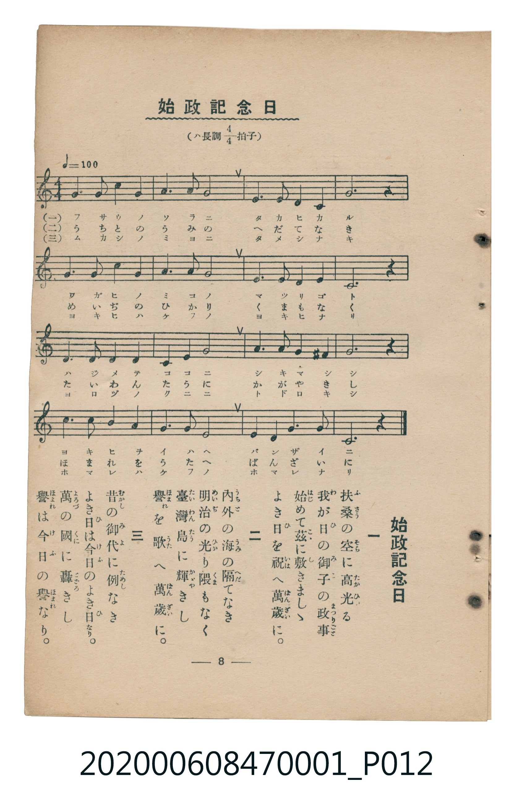

# 始政記念日

> Re:Shōka 使用 AI 協助辨識與重建樂譜，可能會有錯誤。歡迎[回報](https://github.com/TMDLang/reshoka/issues)。

- **鋼琴伴奏版**：<br><audio controls src="shisei_kinenbi.mp3"></audio>
- **NEUTRINO 歌聲合成版**：<br><audio controls src="shisei_kinenbi_neutrino.mp3"></audio>

- 臺灣教育會公認《新定兒童唱歌》尋常科第一學年用（2020.006.0847.0001）

## 說明

原書資訊與歌詞全文（對應 P012.jpg，儀式歌 p. 8，第 7 首）：
調性與拍號：ハ長調 4/4 拍子


## 歌詞

```text
一　扶桑（ふさう）の空（そら）に高光（たかひか）る
我が日（ひ）の御子（みこ）の政事（まつりごと）
始（はじ）めて茲（こゝ）に敷きましゝ
よき日（ひ）を祝（いは）へ萬歳（ばんざい）に。

二　内外（うちと）の海（うみ）の隔（へだ）てなき
明治（めいぢ）の光（ひか）り隈（くま）もなく
臺灣島（たいわんたう）に輝（かゞや）きし
譽（ほまれ）を歌（うた）へ萬歳（ばんざい）に。

三　昔（むかし）の御代（みよ）に例（ためし）なき
よき日（ひ）は今日（けふ）のよき日（ひ）なり。
萬（よろづ）の國（くに）に轟（とゞろ）きし
譽（ほまれ）は今日（けふ）の譽（ほまれ）なり。
```

## ABC

<div class="abc-score" data-abc-src="shisei_kinenbi.abc" aria-label="五線譜載入中"></div>

[下載 ABC 原始檔](shisei_kinenbi.abc)

## TMD 檔案連結

- [主旋律 TMD 檔案](shisei_kinenbi.tmd) [[在 TMD Studio 編輯](https://tmdlang.github.io/Tmd-TS/#tmd=s7IKdvYPcrWy4qpTUCpJTLdSSM7PyUlNLsnMz7MqzsjMK0nNjM_KTMmPL87Iz05Ugisry88pzU21Si9KTEmNN4w3MjAyiDcwMIs3sDAxBzIMDBFKi_NLi5JTrYqTM_Lzc-JLUitKkvLzsxHyBUX5Zal5iXlANQVFIBtTwIoQClLLMlNSQdKpKZkl-UWZiTlI7kgtKga7FWxJfElRYl5xclFmAcgDCFUlGalAx2bmFqSi6oaIJ6cWpebm56HIAK1Jz8yzKknMLE_Mi89PS8tMRpMvycgH-r4go9IqI7MY5KzkxJz47MQ8pECCOqogMT3VKsDA0EiJS0tL4eny7mdT9r9YMePp_q3Ppi9V0NLiUrRVMDQw4LK3VXDmsjHRN7EDmfCifdfzxsXPps580bTp2Zzmp61rXqzqfdzQ9WzahqfrZj1tnfR89dKnUzY-W9vzuKH76Ybupzt2PF8-8fmaNU92NDxdu-Ppzi3Pp6x4v6cDFDV6wKjRA0UNkGFg-H5PpxIXl76Wgi21AJeCgsLTvvnPZu94sbn9xYquFx3tQHe9WDnvaeuKZ9Paga54uqH3WXunAigU9LIK0t_v6Xna0vB0Tz9QmUKBnoIFUADodAVzhZfLpgHd937PLJCZL1btf9awHGRad--LmfOBoo-b-19O3Q4UVwCGkwJQ-OnaCVwgpUBfP25oeNa57dnCiUD7Hjdufdw49XFjG9Cwx43rnq_cBRac-7gJaDZQZPXL1TOetgLZQMH5jxu7HzduApIgqaZukHHPOiY-buwBxg9YxSaIKU_3LQRaBxbZ_7hxMkQQGJlPdgF1AgX3PW5c8rip63HjlMeNwKDvBAfLcojc-seNM8DGNz5uXPaiB2giUHDy46a5EOc8m7r9cWMv2IjpQEGQzsdNQBW9KE5omvR8KVADkNsCNBGsc8eLCWuerd0MFtzwuGny48ZpQFmIoY8bmiBhswuYRhqetrU-XQIMXKDCtseNCyFOBHlg63aY4H6IyMtZU8AiOx43LgCLLHvcuAroFnDAzOh7tmk3SBrkE6AzFkHDBhqY8GDsejmrAyzSD_QVWKQJbEo_OGLBifvp5m2wCGh53NQPdj2QDYmz1S_2QLza_bhp3uMmiJeAITQdrH_tXrDcblCINfVAwgaYlmAeASYVYsNmRyco3cwA-7ipAZwUpsOj-8nuxdDobgJ6BqTvyT5IfM4H-x-iEhY2WGKscf2T3V0wEWCS2goxGpvKVaCkA3QVyHsT1oCdA0RAHwMVgZ0zB2IzMDxXQ0NoL9CfQJEV4BDqJRRCONyCTSWSWygvHaBAQUufiysYWFimZnpn5qXmJWVaBWQm5uU71BjUVINsUrCx0LIDM7CVTQqQou3Fwh4FDROFpxv6n69v0IEXKJpYNADtAxlWo2CqoAvGhnFQRo2CGZDUBZIgHgjWKBiDaWMFI5BCsAhMDgQNQCJg43wMaxQeN08F8h83bQWTy0Bkcx9Yz-OmvWD1j5tXAnE33PTHTfsh4k2rgeKToCywTDOIhsF4hD1GQLnGNpDKxoVgcgWYXAfRBZYB8fdDxaD2NO6Aii8AYrDLGldBZXqx22MMcsMCuIseN21H9k_zfKh_VmD3T_NCuI4uqMxaDHvwR-quHjpGKojEFanrwd5fA_YMOIrQA6FpM1QMGgjN86CB0ALEoGB-3LQFKtOBPbBBkdrUCFLZ2AImF4FJWKRugpjX2A1UBQpOWKT2Q8X3AcWbwCxYpEJksEcqOMGAowPmH5BqkAs2Qt09Fc0_IB0QPTAd0EgF-46USN3RSU6kguIJGUPiCxSLiDgFxTIIg0RM1MFC-HIqyMuPm0C5ApRWQSQo54ACYTNYBkyipGxwaoYGGyiCISIwGVw5FZREoJHaBLFzMkQXVAaSk2F5HSQOshPYyACrhSQGUA4FyUzHbg8iUpshrmsFk7CSB5x8wT5B8Q84KT5u7kToA_sNu3_wRurT2bPJiVRwDgUT5kAMijpYjJlCMygsq4KiHCaDP6tiJm1Q1gH5aQlYPSjeHzfPQAqFCWBRSJxvg6gBqgXJwMIKW6zuBqkDZjuQakhMgWxDLn_nw8tciPgGsCpQ3AObG1A1LWAZHOU8OFZng10HTm3NkAKIUFZF1wHJrNizai0Xl66dAkrdqwAUUOYCAA)]
- [鋼琴伴奏 TMD 檔案](shisei_kinenbi_piano.tmd) [[在 TMD Studio 編輯](https://tmdlang.github.io/Tmd-TS/#tmd=s7IKdvYPcrWy4qpTUCpJTLdSyC8qychPL0osyKi0ysgsLskvykxOzInPTsxLVIIrKs4vLUpOjS9ITE-1CjAwNFLi0tJSeLq8-9mU_S9WzHi6f-uz6Uvf7-l42b3n-YQtT_Zsebq0_3lnx_s9nQpaWlyKtgqGBgZc9rYKzlw2JvomdiBjX7Tvet64-NnUmS-aNj2b0_y0dc2LVb2PG7qeTdvwdN2sp62Tnq9e-nTKxmdrex43dD_d0P10x47nyyc-X7PmyY6Gp2t3PN255fmUFUArjQyMDPQMDMz0DCxMzIEMA0OgrUpcXMFAv6RmemfmpeYlZVoFZCbm5Qd5ONQY1FRzKQCBjYWWHZihr6Vgiw4UINa8WNijoGGi8HRD__P1DToKIH_rZRWka2LRoKUPNqxGwVRBF4wN46CMGgUzIKkLJEE8EKxRMAbTxgpGIIVgEZgcCBqARMDG-RjWKDxungrkP27aCiaXgcjmPrCex017weofN68E4m646Y-b9kPEm1YDxSdBWWCZZhANg_EIe4yAco1tIJWNC8HkCjC5DqILLAPi74eKQe1p3AEVXwDEYJc1roLK9GK3xxjkhgVwFz1u2o7sn-b5UP-swO6f5oVwHV1QmbUY9uCP1F09dIxUEIkrUteDvb8G7BlwFKEHQtNmqBg0EJrnQQOhBYhBwfy4aQtUpgN7YIMitakRpLKxBUzOAJOwSN0EMa-xG6gKFJywSO2Hiu8DijeBWbBIhchgj1RwggFHB8w_INUgF2yEunsqmn9AOiB6YDqgkQr2HSmRuqOTnEgFxRMyhsQXKBYRcQqKZRAGiZiog4Xw5VSQlx83gXIFKK2CSFDOAQXCZrAMmERJ2eDUDA02UARDRGAyuHIqKIlAI7UJYudkiC6oDCQnw_I6SBxk5-PGHrBaSGIA5VCQzHTs9iAitRnsuqZdYDas5AEnX7BPUPwDToqPmzuR9IFI7P7BG6lPZ88mJ1LBORRMmAMxKOpgMWYKzaCwrAqKcpgM_qyKmbRBWQfkpyVg9aB4f9wMylywUJgAFoXE-TaIGqBakAwsrLDF6m6QOmC2A6mGxBTINuTydz68zIWIbwCrAsX948ZpUDUtYBkc5Tw4VmeDXQdObc2QAohQVkXXAcms2LNqLdaq1we56jVBVL0v-rpetvcCI_tZd-_TtROeTup50bgJ0n5AitR4hWjDWBhVo2ACZJgg8aEM03ggbRqPJmIA9TsFxgAphClwaazqUEw2AlJGID6KHgwHQVVjGkPIQcCg1rVTQAntaB_DWLDpmBJGuCSM4RLKXAA)]

## 分析

```text
================================================================================
📊 TMD Song Profile: [ 始政記念日 ]
================================================================================
⏱  Duration:       0:38 (38.4s), 16 measures total
🎼 Key & Tempo:    首調基準 C, != 100.0 BPM, <4/4>
   - 分析範圍：      由實際發聲的音符與和弦推測調性；播放脈絡另行呈現
🎤 人聲音域:    C4 (MIDI 60) – C5 (MIDI 72) [跨度: 12 個半音 / 1.0 個八度, 難度: easy]
   - 最低音:  C4 in [ShiseiKinenbi #1 @ m.3, 0:06]
   - 最高音: C5 in [ShiseiKinenbi #1 @ m.1, 0:01]
   - 適合: soprano, mezzo-soprano, contralto, tenor, baritone, bass
🏛  結構:      ShiseiKinenbi (38.4s)
⚡ 編曲密度:        Peak 1 軌道同時演奏
🗝  調性診斷：       G 大調（純淨自然大調，未偵測到可信轉調）
   - 風格氣質:    純淨自然大調（陽光明朗、易唱易記，無明顯調外色彩）
   - 轉調歷程:    全曲維持單一推測調性（未偵測到可信轉調）
   - 核心骨幹音:  G, C, E, D, A
   - 調性數值:    G 大調 [相關度: 0.84, 穩定度: Moderate, 自然音純度: 100.0%]
   - 候選調性 (K-S): G 大調 (0.84), C 大調 (0.80), E 小調 (0.63)
   - 五度圈歷程:   +1
   - 各段落調性細節:
     • [ShiseiKinenbi #1]: G 大調 (r: 0.84, 自然音純度: 100.0%)

  [ 五度圈游移軌跡 ]
               C  
         F           [G ]*
      Bb               D  
      Eb               A  
         Ab           E  
            Db       B  
               F# 
     (* = active key center)

  [ 十二半音累積音高分佈 ]
     C  : ██████████████            21.7%
     C# :                            0.0%
     D  : ███████                   11.7%
     D# :                            0.0%
     E  : ████████                  13.3%
     F  :                            0.0%
     F# : █                          1.7%
     G  : ████████████████████████  38.3%
     G# :                            0.0%
     A  : ███████                   11.7%
     A# :                            0.0%
     B  : █                          1.7%
--------------------------------------------------------------------------------
Assignment 軌道音域：
  - Piano         : C4 – C5 (12 個半音 / 1.0 個八度, 48 個音符)
================================================================================
```


## 原書掃描頁




