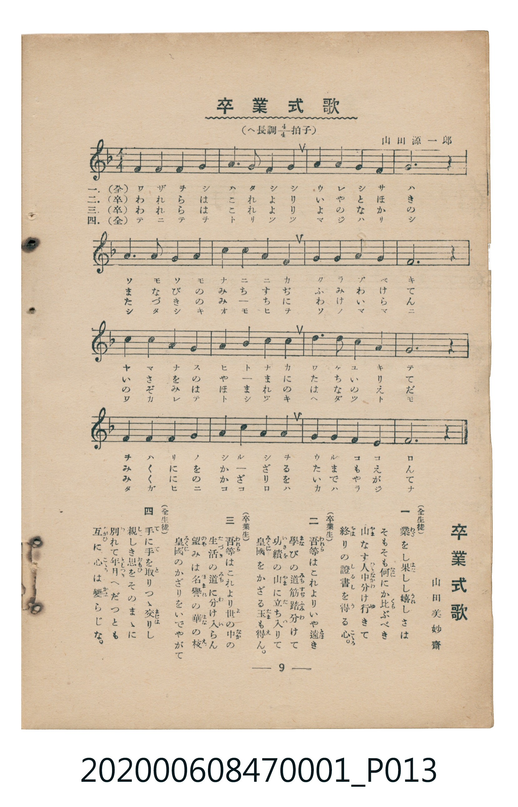

# 卒業式歌

> Re:Shōka 使用 AI 協助辨識與重建樂譜，可能會有錯誤。歡迎回報。

- **鋼琴伴奏版**：<br><audio controls src="sotsugyoshiki_uta.mp3"></audio>
- **NEUTRINO 歌聲合成版**：<br><audio controls src="sotsugyoshiki_uta_neutrino.mp3"></audio>

- 詞：山田美妙齋
- 曲：山田源一郎
- 臺灣教育會公認《新定兒童唱歌》尋常科第一學年用（2020.006.0847.0001）

## 說明

原書資訊與歌詞全文（對應 P013.jpg，儀式歌 p. 9，第 8 首）：
調性與拍號：ヘ長調 4/4 拍子


## 歌詞

```text
一（全生徒）
業（わざ）をし果（はた）しし嬉（うれ）しさは
そもそも何（なに）にか比（くら）ぶべき
山（やま）なす人中（ひとなか）分（わ）け行（ゆ）きて
終（をは）りの證書（しるし）を得（う）る心（こゝろ）。

二（卒業生）
吾等（われら）はこれよりいや遠（とほ）き
學（まな）びの道筋（みちすぢ）踏（ふ）み分（わ）けて
功績（いさを）の山（やま）に立（た）ち入（い）りて
皇國（みくに）をかざる玉（たま）も得（え）ん。

三（卒業生）
吾等（われら）はこれより世（よ）の中（なか）の
生活（たづき）の道（みち）に分（わ）け入（い）らん
望（のぞ）みは名譽（ほまれ）の華（はな）の枝（え）
皇國（みくに）のかざりをいでやがて

四（全生徒）
手（て）に手（て）を取（と）りつゝ交（まじは）りし
親（した）しき思（おもひ）をそのまゝに
別（わか）れて年月（としつき）へだつとも
互（たがひ）に心（こゝろ）は變（かは）らじな。
```

## ABC

<div class="abc-score" data-abc-src="sotsugyoshiki_uta.abc" aria-label="五線譜載入中"></div>

[下載 ABC 原始檔](sotsugyoshiki_uta.abc)

## TMD 檔案連結

- [主旋律 TMD 檔案](sotsugyoshiki_uta.tmd) [[在 TMD Studio 編輯](https://tmdlang.github.io/Tmd-TS/#tmd=s7IKdvYPcrWy4qpTUCpJTLdSSM7PyUlNLsnMz7MqzsjMK0nNjM_KTMmPL87Iz05Ugisry88pzU21Si9KTEmNN4w3MjAyiDcwMIs3sDAxBzIMDBFKi_NLi5JTrYqTM_Lzc-JLUitKkvLzsxHyBUX5Zal5iXlANQVFIBtTwIoQClLLMlNSQdKpKZkl-UWZiTlI7kgtKga7FWxJfElRYl5xclFmAcgDCFUlGalAx0JdkJOZlooulZxalJqbn4diNNCm9Mw8q9zUzKxMLM7OLyrJyAf6vyCj0iojsxjksOTEnPjsxDykYII6qyAxPdUqwMDQWIlLS0vhae-kZ0vXPt3T_2xtj4KWFpeirYKlGZe9rYIbl42JvokdSPeLlfPe75n1dOPG51M2PN_X93TZzJd7u8HmPpu9CS7zbNeEJzsaXjb3gWVetO963rj42dSZL5o2PZvT_LR1zYtVvY8bup5N2_B03aynrZOer176dMpGoK2PG7qfbuh-umPH8-UTn69ZAzTj6dodT3dueT5lxfs9HaDI1ANGph4oMoEMA8P3ezqVuLj0tRRsqQW4FBQUnvbNfzZ7x4vN7S9WdL3oaAe6C-jrp60rnk1rB7ri6YbeZ-2dCqBQ08sqSH-_p-dpSwM00Ar0FCyBAkCnK1govFw2Deg-YJiAzHyxav-zhuUg07p7X8ycDxR93Dzj5dTtQHEFYNgqAIWfrp3ABVIK9DXImtYVz6fMf7pvEtAMkCgwZoCij5v6HzeCjH3cNOlx4_Rn8-aABBvXP24EGtkJFAGip2uAlgIF2x439cAEpwLVgEx53Dj3cVMThHyydypY3arHjavB6lY_bux-tn4KWLD_cRPQFKDgtseNOx839oLDZeNGsBNaHjfuA8sBdc58smvXkx1gpzVuety4AizYDZR92tEGcS9Y5cQXC4FuAXKBgkBu7-PGZSATn29tAosC_bIe7Kmux43rXqztBAY_2MTpj5u6gSTEv0_3ARkgf4G53U_3N4O5kx83AX3TCxJsaIIE4C6QXZDUDAxDaAA-nbDv-VpwyADDsKkH5j9g0AFNAHKB4kDbW4Dee9m4AGwy0DO7Ic4F618LcdM-oBfBopuBbn3ZOPn5WqB3geL7HzcuBIbH48ZFQNkXO4D-BgpuBavcjxYYUN8_7Zr_fAcwJIHqgEE6FehFsPQ6jHBe_Xw1xA5IJC982roUogsWZpDAnNX-dA7cLcB0Ao5VUNgCw3AaMMSe90ESxnyouU1NsCDtAHMnwwNwB0ghOQH4ZAcwcQIZYAMb18FSBjRNAEXADp0y_9kWYMhCnLIUGL4QOWBgwkMS4m-0cEP1N8jF4JwxZzZYdN3jRmDZBApuoKOeTuh9sXYvWHw3KM6gWWHdi35gQoPkGEgsrns2by48DHAHI8h0SDB2gYMUGDfLwTHUAwp9cPDMBjkDI9t2QoxaBvEQCheYpPvBwdUILN0gEbkEmJif7FoCS2gzkPLFdHAxsgzoanDGQGT43mcNEB8AXQbM2sBSGBLrc8GOBnodyFgNdmEHOPhARQg4NoCR1rgMWLo-mwP0OyS9A41bAouPHY8bF4C5K4DmQvIV0FeQSAPqBNsDjCLMbNi4_sW6LrAgMMQg7gcKAv2yCpTAgAZRXkxDgYKWPhdXcH5JcWl6ZT6wWZCdGVqSaBWQmZiX71BjUFMNskzBxkLLDszAVk8oQKoZYPGkoGGi8HRD__P1DTrwwl0TiwaglSDDahQMFXTh2AiIaxSMgSSIjSoCwiAeSLQGzIJBA5AI2DQfwxqFx83rgfzHTdtAZPMmMHs7WM_j5n6w-sdN-6FicJmmZWDVa-Bij5u2ouiBwHiETUYgXSA5YPyDyU4Q2QiyGyjTOBlqUw8Qd4BZXVCZFjAPTDauAJO7oTK92G0yJtMmCK9xHZhcBSa7oXpAYlhsMgH5tw0cEiCVMDYoDEEyIPNA_FVADHY_mATJzAPbuwMsBnYpUA3EDaCwRLUJfxra1UNOGoKkGGNwqgCxaxRMgSQIg3iIFAOTh6QqkDiONNS0F-rXRVA2iAXxKyh0YeEDJptWQ_0KTnfNK8HkNDA5EyqzFnt4g9JQ4z6ITcAYAtaFYBYodkAy-8G8hWASZBKwToTKgNImVB6SMhonQmVA6RhHGmqcD7VpKTStodoEkYPYBvMRwmxYugWlPZAMJNVhTUHQOEfOZSD_g2TAqRAcko-bJ4FJaNqChnEfmASnJjAJCm9QGJOSgnZ0kpOCkNMLoswxgYqCcI2CGdgNZnB1-EuhJUh-AaeZpp1QH0F8Ds6dUBloeINLLhB_I5ANLpFgIQfOibhSEKQsmQpWDzYbFq_gUgYSr6BUBo9XeEpYCI9XWOmEL_1AShKwj6BpE1YGgUowqB2QMgqesqA-AqduiH6Qv0EyC7DbBC6DICU4yLXQMhnsf1gZBE1VkDIIHkIzIDY1N8BLJ6hN4PRGQgoCtkCoV4_B0goivcDqMHOwU_AVQpDKC6lAhWQQWBZ73AwOICgblpEgFRlEBlycgEmQafgKIUh0QrI7RC8oIYFkYNkP2GgDi8OqEFASgkV5E5gNDW5cRQM4CWHYA08o4KIUagckU8BcAEney8FiEDYoieFJrOBCCFI4QhIPJMNBXY4UKpAwgYQwSAaS4CDhDS7GwVUarNBHtamWi0vXTgG90aQAFFPmAgA)]
- [鋼琴伴奏 TMD 檔案](sotsugyoshiki_uta_piano.tmd) [[在 TMD Studio 編輯](https://tmdlang.github.io/Tmd-TS/#tmd=s7IKdvYPcrWy4qpTUCpJTLdSyC8qychPL0osyKi0ysgsLskvykxOzInPTsxLVIIrKs4vLUpOjS9ITE-1CjAwNFbi0tJSeNo76dnStU_39D9b2_N-T8fL7j3PJ2x5smfL06X9zzs73u_pVNDS4lK0VbA047K3VXDjsjHRN7EDGfli5bz3e2Y93bjx-ZQNz_f1PV028-XebrBlz2Zvgss82zXhyY6Gl819YJkX7bueNy5-NnXmi6ZNz-Y0P21d82JV7-OGrmfTNjxdN-tp66Tnq5c-nbIR6JTHDd1PN3Q_3bHj-fKJz9esAZrxdO2Opzu3PJ-yAuhKIwMjAz0DAzM9AwsTcyDDwBDoUCUuruD8kuLS9Mr84ozM7MzQkkSrgMzEvPwgD4cag5pqLgUgsLHQsgMz9LUUbNGBAsSmFwt7FDRMFJ5u6H--vkFHARRUelkF6ZpYNGjpgw2rUTBU0IVjIyCuUTAGkiA2qggIg3gg0RowCwYNQCJg03wMaxQeN68H8h83bQORzZvA7O1gPY-b-8HqHzfth4rBZZqWgVWvgYs9btqKogcC4xE2GYF0geQeN_WAyU4Q2QiyGyjTOBlqUw8Qd4BZXVCZFjAPTDauAJO7oTK92G0yJtMmCK9xHZhcBSa7oXpAYlhsMgH5tw0cEiCVMDYoDEEyIPNA_FVADHY_mATJzAPbuwMsBnYpUA3EDaCwRLUJfxra1UNOGoKkGGNwqgCxaxRMgSQIg3iIFAOTh6QqkDiONNS0F-rXRVA2iAXxKyh0YeEDJptWQ_0KTnfNK8HkNDA5EyqzFnt4g9JQ4z6ITcAYety4GcwCxQ5IZj-YtxBMgkx63DgDKgNKm1B5SMponAiVAaVjHGmocT7UplnQtIZqE0QOYhvMRwizYekWlPZAMpBUhzUFQeMcOZeB_A-SAadCcEg-bp4EJqFpCxrGfWASnJrAJCi8QWFMSgra0UlOCkJOL4gyxwQqCsI1CmZgN5jB1eEvhZYg-QWcZpp2Qn0E8Tk4d0JloOENLrlA_I1ANrhEgoUcOCfiSkGQsmQqWD3YbFi8gksZSLyCUhk8XuEpYSE8XmGlE770AylJwD6Cpk1YGQQqwaB2QMooeMqC-gicuiH6Qf4GySzAbhO4DIKU4CDXQstksP9hZRA0VUHKIHgIgfIGSLQBXjpBbQKnNxJS0NPZs6lXj8HSCiK9wOowc7BT8BVCkMoLqUCFZBBYFnvcDA4gKBuWkSAVGUQGXJyASZBp-AohSHRCsjtELyghgWRg2e9xI7hIa4JVIaAkBIvyJjAbGty4igZwEsKwB55QwEUp1A5IpoC5AJK8l4PFIGxQEsOTWMGFEKRwhCQeSIaDuhwpVCBhAglhkAwkwUHCG1yMg6s0WKGPalMtrjaTD3KbyQTRZnrauuPl7NYXfV0v23uBSexZd-_TtRMgzUWkRBSvEG0YC6PgfNN4IG0ajyQCVwGXAjEMoEGA0yDs2jCMJt4cEyDDhB7OAYa3rp0CepBH-xjGgq3AKmeER84Yj5wJXE6ZCwA)]

## 分析

```text
================================================================================
📊 TMD Song Profile: [ 卒業式歌 ]
================================================================================
⏱  Duration:       0:40 (40.0s), 16 measures total
🎼 Key & Tempo:    首調基準 F, != 96.0 BPM, <4/4>
   - 分析範圍：      由實際發聲的音符與和弦推測調性；播放脈絡另行呈現
🎤 人聲音域:    E4 (MIDI 64) – D5 (MIDI 74) [跨度: 10 個半音 / 0.8 個八度, 難度: easy]
   - 最低音:  E4 in [SotsugyoshikiUta #1 @ m.15, 0:36]
   - 最高音: D5 in [SotsugyoshikiUta #1 @ m.11, 0:25]
   - 適合: soprano, mezzo-soprano, contralto, tenor, baritone, bass
🏛  結構:      SotsugyoshikiUta (40.0s)
⚡ 編曲密度:        Peak 1 軌道同時演奏
🗝  調性診斷：       F 大調（純淨自然大調，未偵測到可信轉調）
   - 風格氣質:    純淨自然大調（陽光明朗、易唱易記，無明顯調外色彩）
   - 轉調歷程:    全曲維持單一推測調性（未偵測到可信轉調）
   - 核心骨幹音:  G, F, A, C, D
   - 調性數值:    F 大調 [相關度: 0.72, 穩定度: Moderate, 自然音純度: 100.0%]
   - 候選調性 (K-S): F 大調 (0.72), C 大調 (0.64), A 小調 (0.52)
   - 五度圈歷程:   -1
   - 各段落調性細節:
     • [SotsugyoshikiUta #1]: F 大調 (r: 0.72, 自然音純度: 100.0%)

  [ 五度圈游移軌跡 ]
               C  
        [F ]*          G  
      Bb               D  
      Eb               A  
         Ab           E  
            Db       B  
               F# 
     (* = active key center)

  [ 十二半音累積音高分佈 ]
     C  : ███████████               13.3%
     C# :                            0.0%
     D  : ███                        3.3%
     D# :                            0.0%
     E  : █                          1.7%
     F  : ██████████████████████    26.7%
     F# :                            0.0%
     G  : ████████████████████████  29.2%
     G# :                            0.0%
     A  : ████████████████████      24.2%
     A# : █                          1.7%
     B  :                            0.0%
--------------------------------------------------------------------------------
Assignment 軌道音域：
  - Piano         : E4 – D5 (10 個半音 / 0.8 個八度, 52 個音符)
================================================================================
```


## 原書掃描頁




