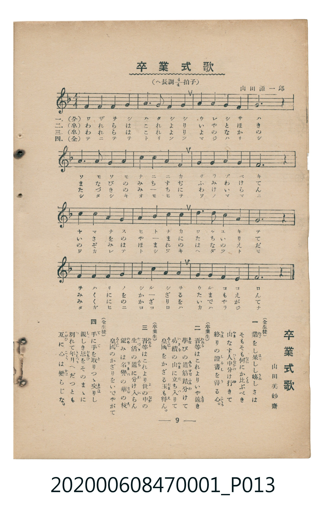

# 卒業式歌

> Re:Shōka 使用 AI 協助辨識與重建樂譜，可能會有錯誤。歡迎回報。

- **NEUTRINO 歌聲合成版**：<br><audio controls src="sotsugyoshiki_uta_neutrino.mp3"></audio>
- **鋼琴伴奏版**：<br><audio controls src="sotsugyoshiki_uta.mp3"></audio>


- 詞：山田美妙齋
- 曲：山田源一郎
- 臺灣教育會公認《新定兒童唱歌》尋常科第一學年用（2020.006.0847.0001）

## 說明

原書資訊與歌詞全文（對應 P013.jpg，儀式歌 p. 9，第 8 首）：
調性與拍號：ヘ長調 4/4 拍子


## 跨冊／重複收錄參照

> 同曲（收錄於《新定兒童唱歌》卷首〈卒業式歌〉與《唱歌帖》P179〈卒業式〉，詞曲相同）

- **[同曲]** 楊金土手抄《唱歌帖》第 1 冊（2020.006.0843）：[**〈卒業式〉**](../../../shokacho/vol_01/p179_sotsugyoshiki/index.md)（`F` / `4/4` — [原始 TMD](../../../shokacho/vol_01/p179_sotsugyoshiki/sotsugyoshiki.tmd)）
- 總表：[跨冊重複與同名歌曲總索引](../../../duplicate_songs.md)

## 歌詞

```text
一（全生徒）
業（わざ）をし果（はた）しし嬉（うれ）しさは
そもそも何（なに）にか比（くら）ぶべき
山（やま）なす人中（ひとなか）分（わ）け行（ゆ）きて
終（をは）りの證書（しるし）を得（う）る心（こゝろ）。

二（卒業生）
吾等（われら）はこれよりいや遠（とほ）き
學（まな）びの道筋（みちすぢ）踏（ふ）み分（わ）けて
功績（いさを）の山（やま）に立（た）ち入（い）りて
皇國（みくに）をかざる玉（たま）も得（え）ん。

三（卒業生）
吾等（われら）はこれより世（よ）の中（なか）の
生活（たづき）の道（みち）に分（わ）け入（い）らん
望（のぞ）みは名譽（ほまれ）の華（はな）の枝（え）
皇國（みくに）のかざりをいでやがて

四（全生徒）
手（て）に手（て）を取（と）りつゝ交（まじは）りし
親（した）しき思（おもひ）をそのまゝに
別（わか）れて年月（としつき）へだつとも
互（たがひ）に心（こゝろ）は變（かは）らじな。
```

## ABC

```abc
X:1
T:卒業式歌
C:曲：山田源一郎
M:4/4
L:1/16
Q:1/4=96
K:F
V:V1 name="Piano" snm="Pia"
[V:V1]
F4 F4 F4 G4 | A6 G2 F4 G4 | A4 A4 G4 F4 | G12 z4 |
w: 1.~ワ ザ ヲ シ | ハ タ シ シ | ウ レ シ サ | ハ
w: 2.~わ れ ら は | こ れ よ り | い や と ほ | き
w: 3.~わ れ ら は | こ れ よ り | よ の な か | の
w: 4.~テ ニ テ ヲ | ト リ ツ ツ | マ ジ ハ リ | シ
A6 A2 G4 A4 | c4 c4 A4 F4 | G4 G4 A4 G4 | F12 z4 |
w: 1.~ソ モ ソ モ | ナ ニ ニ カ | ク ラ ブ ベ | キ
w: 2.~ま な び の | み ち す ぢ | ふ み わ け | て
w: 3.~た づ き の | み _ ち に | わ け い ら | ん
w: 4.~シ タ シ キ | オ モ ヒ ヲ | ソ ノ マ マ | ニ
c4 c4 A4 G4 | A4 B4 c4 c4 | d6 d2 c4 A4 | G12 z4 |
w: 1.~ヤ マ ナ ス | ヒ ト ナ カ | ワ ケ ユ キ | テ
w: 2.~い さ を の | や _ ま に | た ち い り | て
w: 3.~の ぞ み は | ほ ま れ の | は な の え | だ
w: 4.~ワ カ レ テ | ト シ ツ キ | ヘ ダ ツ ト | モ
F4 F4 F4 G4 | A4 c4 A4 A4 | G4 G4 F4 E4 | F12 z4 |
w: 1.~ヲ ハ リ ノ | シ ル シ ヲ | ウ ル コ コ | ロ
w: 2.~み く に を | か _ ざ る | た ま も え | ん
w: 3.~み く に の | か ざ り を | い で や が | て
w: 4.~タ ガ ヒ ニ | コ コ ロ ハ | カ ハ ラ ジ | ナ
```

## TMD 檔案連結

- [主旋律 TMD 檔案](sotsugyoshiki_uta.tmd) [[在 TMD Studio 編輯](https://tmdlang.github.io/Tmd-TS/#tmd=s7IKdvYPcrWy4qpTUCpJTLdSSM7PyUlNLsnMz7MqzsjMK0nNjM_KTMmPL87Iz05Ugisry88pzU21Si9KTEmNN4w3MjAyiDcwMIs3sDAxBzIMDBFKi_NLi5JTrYqTM_Lzc-JLUitKkvLzsxHyBUX5Zal5iXlANQVFIBtTwIoQClLLMlNSQdKpKZkl-UWZiTlI7kgtKga7FWxJfElRYl5xclFmAcgDCFUlGalAx0JdkJOZlooulZxalJqbnwc2WktL4WnvpGdL1z7d0_9sbY-ClhaXoq2CpRmXva2CG5eNib6JHUj3i5Xz3u-Z9XTjxudTNjzf1_d02cyXe7vB5j6bvQku82zXhCc7Gl4294FlXrTvet64-NnUmS-aNj2b0_y0dc2LVb2PG7qeTdvwdN2sp62Tnq9e-nTKRqCtjxu6n27ofrpjx_PlE5-vWQM04-naHU93bnk-ZcX7PR2g4NYDBrceKLiBDAPD93s6lbi49LUUbKkFuBQUFJ72zX82e8eLze0vVnS96GgHugvo66etK55Nawe64umG3mftnQoBBobGelkF6e_39DxtaYAGWoGegiVQAOh0BQuFl8umAd0HDBOQmS9W7X_WsBxkWnfvi5nzgaKPm2e8nLodKK4ADFsFoPDTtRO4QEqBvgZZ07ri-ZT5T_dNApoBEgXGDFD0cVP_40aQsY-bJj1unP5s3hyQYOP6x41AIzuBIkD0dA3QUqBg2-OmHpjgVKAakCmPG-c-bmqCkE_2TgWrW_W4cTVY3erHjd3P1k8BC_Y_bgKaAhTc9rhx5-PGXnC4bNwIdkLL48Z9YDmgzplPdu16sgPstMZNjxtXgAW7gbJPO9og7gWrnPhiIdAtQC5QEMjtfdy4DGTi861NYFGgX9aDPdX1uHHdi7WdwOAHmzj9cVM3kIT49-k-IAPkLzC3--n-ZjB38uMmoG96QYINTZAA3AWyC5KagWEIDcCnE_Y9XwsOGWAYNvXA_AcMOqAJQC5QHGh7C9B7LxsXgE0GemY3xLlg_WshbtoH9CJYdDPQrS8bJz9fC_QuUHz_48aFwPB43LgIKPtiB9DfQMGtYJX70QID6vunXfOf7wCGJFAdMEinAr0Ill6HEc6rn6-G2AGJ5IVPW5dCdMHCDBKYs9qfzoG7BZhOwLEKCltgGE4DhtjzPkjCmA81t6kJFqQdYO5keADuACkkJwCf7AAmTiADbGDjOljKgKYJoAjYoVPmP9sCDFmIU5YCwxciBwxMeEhC_I0Wbqj-BrkYnDPmzAaLrnvcCCybQMENdNTTCb0v1u4Fi-8GxRk0K6x70Q9MaJAcA4nFdc_mzYWHAe5gBJkOCcYucJAC42Y5OIZ6QKEPDp7ZIGdgZNtOiFHLIB5C4QKTdD84uBqBpRskIpcAE_OTXUtgCW0GUr6YDi5GlgFdDc4YiAzf-6wB4gOgy4BZG1gKQ2J9LtjRQK8DGavBLuwABx-oCAHHBjDSGpcBS9dnc4B-h6R3oHFLYPGx43HjAjB3BdBcSL4C-goSaUCdYHuAUYSZDRvXv1jXBRYEhhjE_UBBoF9WgRIY0CDKi2koUNDS5-IKzi8pLk2vzAdW3NmZoSWJVgGZiXn5DjUGNdUgyxRsLLTswAxs9YQCpJoBFk8KGiYKTzf0P1_foAMv3DWxaABaCTKsRsFQQReOjYC4RsEYSILYqCIgDOKBRGvALBg0AImATfMxrFF43LweyH_ctA1ENm8Cs7eD9Txu7gerf9y0HyoGl2laBla9Bi72uGkrih4IjEfYZATSBZIDxj-Y7ASRjSC7gTKNk6E29QBxB5jVBZVpAfPAZOMKMLkbKtOL3SZjMm2C8BrXgclVYLIbqgckhsUmE5B_28AhAVIJY4PCECQDMg_EXwXEYPeDSZDMPLC9O8BiYJcC1UDcAApLVJvwp6FdPeSkIUiKMQanChC7RsEUSIIwiIdIMTB5SKoCieNIQ017oX5dBGWDWBC_gkIXFj5gsmk11K_gdNe8EkxOA5MzoTJrsYc3KA017oPYBIwhYF0IZoFiBySzH8xbCCZBJgHrRKgMKG1C5SEpo3EiVAaUjnGkocb5UJuWQtMaqk0QOYhtMB8hzIalW1DaA8lAUh3WFASNc-RcBvI_SAacCsEh-bh5EpiEpi1oGPeBSXBqApOg8AaFMSkpaEcnOSkIOb0gyhwTqCgI1yiYgd1gBleHvxRaguQXcJpp2gn1EcTn4NwJlYGGN7jkAvE3AtngEgkWcuCciCsFQcqSqWD1YLNh8QouZSDxCkpl8HiFp4SF8HiFlU740g-kJAH7CJo2YWUQqASD2gEpo-ApC-ojcOqG6Af5GySzALtN4DIIUoKDXAstk8H-h5VB0FQFKYPgITQDYlNzA7x0gtoETm8kpCBgC4R69RgsrSDSC6wOMwc7BV8hBKm8kApUSAaBZbHHzeAAgrJhGQlSkUFkwMUJmASZhq8QgkQnJLtD9IISEkgGlv2AjTawOKwKASUhWJQ3gdnQ4MZVNICTEIY98IQCLkqhdkAyBcwFkOS9HCwGYYOSGJ7ECi6EIIUjJPFAMhzU5UihAgkTSAiDZCAJDhLe4GIcXKXBCn1Um2q5uHTtFNAbTQpAMWUuAA)]
- [鋼琴伴奏 TMD 檔案](sotsugyoshiki_uta_piano.tmd) [[在 TMD Studio 編輯](https://tmdlang.github.io/Tmd-TS/#tmd=s7IKdvYPcrWy4tLSUnjaO-nZ0rVP9_Q_W9vzfk_Hy-49zydsebJny9Ol_c87O97v6VTQ0uJStFWwNOOyt1Vw47Ix0Tex46pTUHqxct77PbOebtz4fMqG5_v6ni6b-XJvtxJI5tnsTXCZZ7smPNnR8LK5Dyzzon3X88bFz6bOfNG06dmc5qeta16s6n3c0PVs2oan62Y9bZ30fPXSp1M2Ap3yuKH76Ybupzt2PF8-8fmaNUAznq7d8XTnludTVgBdaWRgZKBnYGCmZ2BhYg5kGBgCHarExRWcX1Jcml6ZX5yRmZ0ZWpJoFZCZmJcf5OFQY1BTzaUABDYWWnZghr6Wgi06UIDY9GJhj4KGicLTDf3P1zfoKAQYGBrrZRWka2LRoKUPNqxGwVBBF46NgLhGwRhIgtioIiAM4oFEa8AsGDQAiYBN8zGsUXjcvB7If9y0DUQ2bwKzt4P1PG7uB6t_3LQfKgaXaVoGVr0GLva4aSuKHgiMR9hkBNIFknvc1AMmO0FkI8huoEzjZKhNPUDcAWZ1QWVawDww2bgCTO6GyvRit8mYTJsgvMZ1YHIVmOyG6gGJYbHJBOTfNnBIgFTC2KAwBMmAzAPxVwEx2P1gEiQzD2zvDrAY2KVANRA3gMIS1Sb8aWhXDzlpCJJijMGpAsSuUTAFkiAM4iFSDEwekqpA4jjSUNNeqF8XQdkgFsSvoNCFhQ-YbFoN9Ss43TWvBJPTwORMqMxa7OENSkON-yA2AWPoceNmMAsUOyCZ_WDeQjAJMulxI9QNjaC0CZWHpIzGiVAZUDrGkYYa50NtWgpNa6g2QeQgtsF8hDAblm5BaQ8kA0l1WFMQNM6RcxnI_yAZcCoEh-Tj5klgEpq2oGHcBybBqQlMgsIbFMakpKAdneSkIOT0gihzTKCiIFyjYAZ2gxlcHf5SaAmSX8Bppmkn1EcQn4NzJ1QGGt7gkgvE3whkg0skWMiBcyKuFAQpS6aC1YPNhsUruJSBxCsolcHjFZ4SFsLjFVY64Us_kJIE7CNo2oSVQaASDGoHpIyCpyyoj8CpG6If5G-QzALsNoHLIEgJDnIttEwG-x9WBkFTFaQMgofQDIhNzQ3w0glqEzi9kZCCns6eTb16DJZWEOkFVoeZg52CrxCCVF5IBSokg8Cy2ONmcABB2bCMBKnIIDLg4gRMgkzDVwhBohOS3SF6QQkJJAPLfo8bwUVaE6wKASUhWJQ3gdnQ4MZVNICTEIY98IQCLkqhdkAyBcwFkOS9HCwGYYOSGJ7ECi6EIIUjJPFAMhzU5UihAgkTSAiDZCAJDhLe4GIcXKXBCn1Um2pxtZl8kNtMJog209PWHS9nt77o63rZ3gtMYs-6e5-unQBpLiIloniFaMNYGAXnm8YDadN4JBG4CrgUiGEADQKcBmHXhmE08eaYABkm9HAOMLx17RTQgzzaxzAWbAVWOSM8csZ45EzgcspcAA)]

## 分析

```text
================================================================================
📊 TMD Song Profile: [ 卒業式歌 ]
================================================================================
⏱  Duration:       0:40 (40.0s), 16 measures total
🎼 Key & Tempo:    首調基準 F, != 96.0 BPM, <4/4>
   - 分析範圍：      由實際發聲的音符與和弦推測調性；播放脈絡另行呈現
🎤 人聲音域:    E4 (MIDI 64) – D5 (MIDI 74) [跨度: 10 個半音 / 0.8 個八度, 難度: easy]
   - 最低音:  E4 in [SotsugyoshikiUta #1 @ m.15, 0:36]
   - 最高音: D5 in [SotsugyoshikiUta #1 @ m.11, 0:25]
   - 適合: soprano, mezzo-soprano, contralto, tenor, baritone, bass
🏛  結構:      SotsugyoshikiUta (40.0s)
⚡ 編曲密度:        Peak 1 軌道同時演奏
🗝  調性診斷：       F 大調（純淨自然大調，未偵測到可信轉調）
   - 風格氣質:    純淨自然大調（陽光明朗、易唱易記，無明顯調外色彩）
   - 轉調歷程:    全曲維持單一推測調性（未偵測到可信轉調）
   - 核心骨幹音:  G, F, A, C, D
   - 調性數值:    F 大調 [相關度: 0.72, 穩定度: Moderate, 自然音純度: 100.0%]
   - 候選調性 (K-S): F 大調 (0.72), C 大調 (0.64), A 小調 (0.52)
   - 五度圈歷程:   -1
   - 各段落調性細節:
     • [SotsugyoshikiUta #1]: F 大調 (r: 0.72, 自然音純度: 100.0%)

  [ 五度圈游移軌跡 ]
               C  
        [F ]*          G  
      Bb               D  
      Eb               A  
         Ab           E  
            Db       B  
               F# 
     (* = active key center)

  [ 十二半音累積音高分佈 ]
     C  : ███████████               13.3%
     C# :                            0.0%
     D  : ███                        3.3%
     D# :                            0.0%
     E  : █                          1.7%
     F  : ██████████████████████    26.7%
     F# :                            0.0%
     G  : ████████████████████████  29.2%
     G# :                            0.0%
     A  : ████████████████████      24.2%
     A# : █                          1.7%
     B  :                            0.0%
--------------------------------------------------------------------------------
Assignment 軌道音域：
  - Piano         : E4 – D5 (10 個半音 / 0.8 個八度, 52 個音符)
================================================================================
```


## 原書掃描頁




