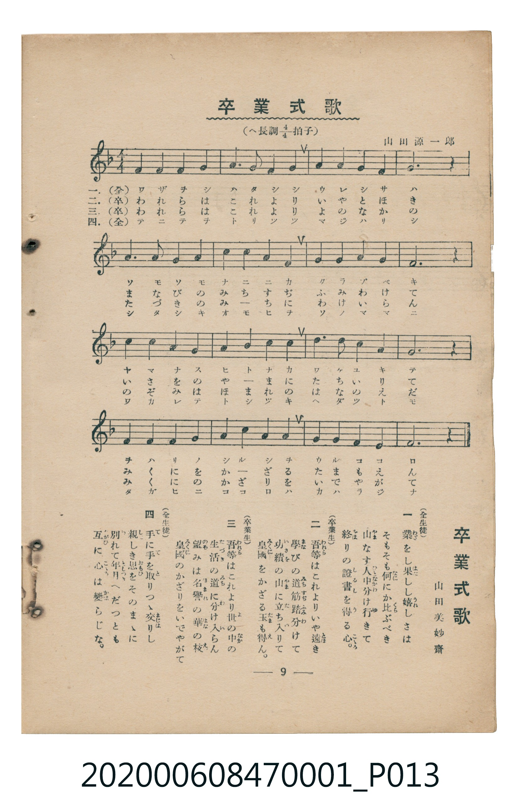

# 卒業式歌

<audio controls src="sotsugyoshiki_uta.mp3"></audio>

- 詞：山田美妙齋
- 曲：山田源一郎
- 臺灣教育會公認《新定兒童唱歌》尋常科第一學年用（2020.006.0847.0001）

## 說明

原書資訊與歌詞全文（對應 P013.jpg，儀式歌 p. 9，第 8 首）：
調性與拍號：ヘ長調 4/4 拍子

## 歌詞

```text
一（全生徒）
業（わざ）をし果（はた）しし嬉（うれ）しさは
そもそも何（なに）にか比（くら）ぶべき
山（やま）なす人中（ひとなか）分（わ）け行（ゆ）きて
終（をは）りの證書（しるし）を得（う）る心（こゝろ）。

二（卒業生）
吾等（われら）はこれよりいや遠（とほ）き
學（まな）びの道筋（みちすぢ）踏（ふ）み分（わ）けて
功績（いさを）の山（やま）に立（た）ち入（い）りて
皇國（みくに）をかざる玉（たま）も得（え）ん。

三（卒業生）
吾等（われら）はこれより世（よ）の中（なか）の
生活（たづき）の道（みち）に分（わ）け入（い）らん
望（のぞ）みは名譽（ほまれ）の華（はな）の枝（え）
皇國（みくに）のかざりをいでやがて

四（全生徒）
手（て）に手（て）を取（と）りつゝ交（まじは）りし
親（した）しき思（おもひ）をそのまゝに
別（わか）れて年月（としつき）へだつとも
互（たがひ）に心（こゝろ）は變（かは）らじな。
```

## ABC

```abc
X:1
T:卒業式歌
C:曲：山田源一郎
M:4/4
L:1/16
Q:1/4=96
K:F
V:V1 name="Piano" snm="Pia"
[V:V1]
c6 c2 f4 f4 | g6 g2 c8 | a6 g2 f4 d4 | c12 z4 |
f6 g2 a4 f4 | a4 b4 c8 | d6 e2 f4 a4 | g12 z4 |
g6 a2 b4 g4 | a4 b4 c8 | d6 c2 a4 f4 | g12 z4 |
c6 a2 f4 b4 | a4 g4 f8 | g6 a2 g6 f2 | f12 z4 |
```

## TMD 檔案連結

- [主旋律 TMD 檔案](sotsugyoshiki_uta.tmd)
- [鋼琴伴奏 TMD 檔案](sotsugyoshiki_uta_piano.tmd)

## 分析

```text
================================================================================
📊 TMD Song Profile: [ 卒業式歌 ]
================================================================================
⏱  Duration:       0:40 (40.0s), 16 measures total
🎼 Key & Tempo:    首調基準 F, != 96.0 BPM, <4/4>
   - 分析範圍：      由實際發聲的音符與和弦推測調性；播放脈絡另行呈現
🎤 人聲音域:    C4 (MIDI 60) – F5 (MIDI 77) [跨度: 17 個半音 / 1.4 個八度, 難度: challenging]
   - 最低音:  C4 in [SotsugyoshikiUta #1 @ m.1, 0:00]
   - 最高音: F5 in [SotsugyoshikiUta #1 @ m.7, 0:16]
   - 適合: soprano, mezzo-soprano, contralto, tenor, baritone, bass
🏛  結構:      SotsugyoshikiUta (40.0s)
⚡ 編曲密度:        Peak 1 軌道同時演奏
🗝  調性診斷：       F 大調（純淨自然大調，未偵測到可信轉調）
   - 風格氣質:    純淨自然大調（陽光明朗、易唱易記，無明顯調外色彩）
   - 轉調歷程:    全曲維持單一推測調性（未偵測到可信轉調）
   - 核心骨幹音:  G, F, C, A, D
   - 調性數值:    F 大調 [相關度: 0.82, 穩定度: Moderate, 自然音純度: 100.0%]
   - 候選調性 (K-S): F 大調 (0.82), C 大調 (0.78), G 小調 (0.51)
   - 五度圈歷程:   -1
   - 各段落調性細節:
     • [SotsugyoshikiUta #1]: F 大調 (r: 0.82, 自然音純度: 100.0%)

  [ 五度圈游移軌跡 ]
               C  
        [F ]*          G  
      Bb               D  
      Eb               A  
         Ab           E  
            Db       B  
               F# 
     (* = active key center)

  [ 十二半音累積音高分佈 ]
     C  : ████████████████████      21.7%
     C# :                            0.0%
     D  : ██████                     6.7%
     D# :                            0.0%
     E  : █                          0.8%
     F  : ██████████████████████    23.3%
     F# :                            0.0%
     G  : ████████████████████████  25.8%
     G# :                            0.0%
     A  : ██████████████            15.0%
     A# : ██████                     6.7%
     B  :                            0.0%
--------------------------------------------------------------------------------
Assignment 軌道音域：
  - Piano         : C4 – F5 (17 個半音 / 1.4 個八度, 48 個音符)
================================================================================
```


## 原書掃描頁




