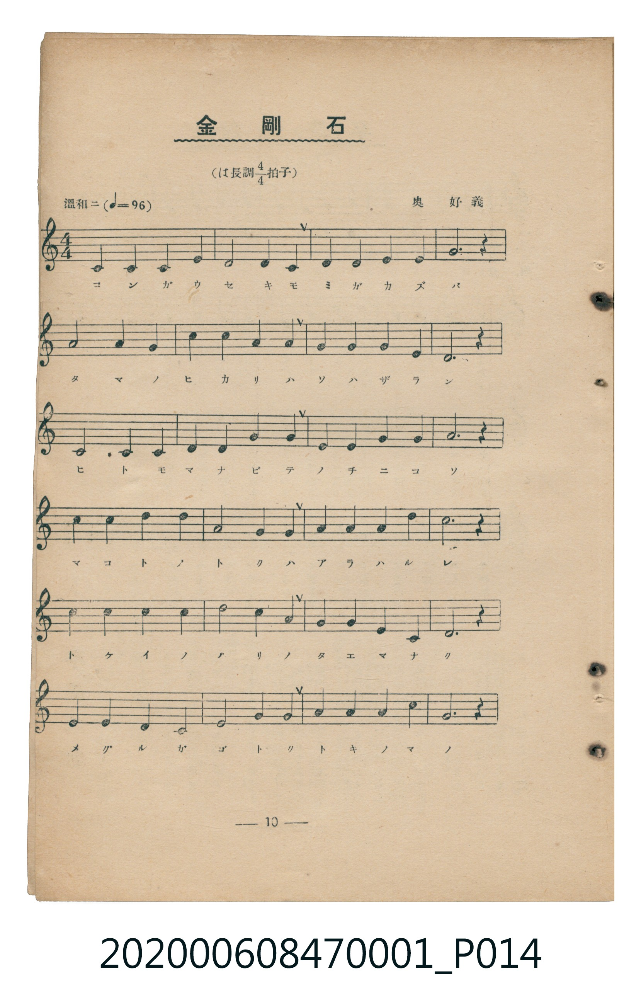
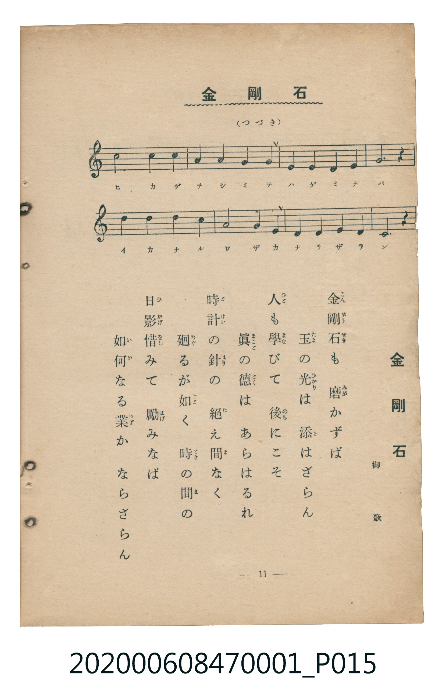

# 金剛石

> Re:Shōka 使用 AI 協助辨識與重建樂譜，可能會有錯誤。歡迎回報。

- **鋼琴伴奏版**：<br><audio controls src="kongoseki.mp3"></audio>
- **NEUTRINO 歌聲合成版**：<br><audio controls src="kongoseki_neutrino.mp3"></audio>

- 詞：昭憲皇太后（御歌）
- 曲：奥好義
- 臺灣教育會公認《新定兒童唱歌》尋常科第一學年用（2020.006.0847.0001）

## 說明

原書資訊與歌詞全文（對應 P014.jpg – P015.jpg，儀式歌 pp. 10–11，第 9 首）：
調性與拍號：ハ長調 4/4 拍子，「温和ニ」


## 歌詞

```text
金剛石（こんがうせき）も　磨（みが）かずば
玉（たま）の光（ひかり）は　添（そ）はざらん
人（ひと）も學（まな）びて　後（のち）にこそ
眞（まこと）の徳（とく）は　あらはるれ
時計（とけい）の針（はり）の　絶（た）え間（ま）なく
廻（めぐ）るが如（ごと）く　時（とき）の間（ま）の
日影（ひかげ）惜（をし）みて　勵（はげ）みなば
如何（いか）なる業（わざ）か　ならざらん
```

## ABC

<div class="abc-score" data-abc-src="kongoseki.abc" aria-label="五線譜載入中"></div>

[下載 ABC 原始檔](kongoseki.abc)

## TMD 檔案連結

- [主旋律 TMD 檔案](kongoseki.tmd) [[在 TMD Studio 編輯](https://tmdlang.github.io/Tmd-TS/#tmd=s7IKdvYPcrWy4qpTUCpJTLdSSM7PyUlNLsnMz7MqzsjMK0nNjM_KTMmPL87Iz05Ugisry88pzU21Si9KTEmNN4w3MjAyiDcwMIs3sDAxBzIMDBFKi_NLi5JTrYqTM_Lzc-JLUitKkvLzsxHyBUX5Zal5iXlANQVFIBtTwIoQClLLMlNSQdKpKZkl-UWZiTlI7kgtKga7FWxJfElRYl5xclFmAcgDCFUlGalAx5bmJeckFhdnpmWmpiDkgAamZ-ZZ5ebnJZUCPYkpkZqZlYnF2flFJRn5QP8XZFRaZWQWgxyWnJgTn52YhxRMUGcVJKanWgUYGJroAglTJS4tLYWX7ROfds5-Pn-zgpYWl6KtgqUZl72tgjOXjYm-iR1I_4uV897vmfVsxtpnbZuez2p_umTV0wl97_d0PN238Nnanvd7OsG2PJu9Cajq6dKlT5fufb5vJVjsRfuu542Ln02d-aJp07M5zU9b17xY1fu4oevZtA1P18162jrp-eqlT6dsBJryuKH76Ybupzt2PF8-8fmaNU92NDxdu-Ppzi3Pp6wA2gSKVD1gpOqBIhXIMDAE28qlr6VgSy3ApaCg8LRv_rPZO15sbn-xoutFRzvQXUC_P21d8WxaO8i_G3qftXcqgEJPL6sgXeFRw2QQxxTEeb-n52lLw9M9_UA9CgUFegqGBkBpQ6A7e4DeUbBUeLlsGtDNwBAC2fNi1f5nDctBNnT3vpg5Hyj6uLn_5dTtQHEFYKgrAIWfrp0A1Pu4oefZjpVPJ_U8bu5-3NDLBdIMjy-gkx43Tn7cNPlxY8_jxrbHjbMfN_YCLXnc1PS4oeH5YlDIPW7cD5QFCTZ2P26c9bhxA8iI531AlwDl5j9u3AeWW_e0FSKyCaSuqQssuB5oyrPtu8Hic6EijdMeNwEtmAwy5cmuXTA9QKtA1gLjDCyy73HjKrCGzY8blwFNeboP6ASg-LrHjQvB4qtBDm-cC3bLHGDqgugBCoENAjpnH8R3Kx439sPd8rixCWQ5kN0EdGMPSPOzmU0vVnTAlE583NgC0f-yHehgoCBQKcQv60AhsnUbxNdgkY6X0yZDLAZzVwFtAieB3WAPNzU-bgRGANBTwGDrebqsCax0CsyB_aCgmQkRBFoMDnWgrSgmrgM7cPrSp3s3IoK2cRJQ7lnzHLAdkx43TgcrBcYROJi6t0JdDVYGFge6CxxlQCc82TsVLN0CNAjq5qbuZ0vXgs3qB0YNNJpBIQWUArKRIovyDAIFClr6XFze-Xnp-cWp2ZlWAZmJefkONQY11SBbFGxMtOzADGxZUwGSs18s7FHQMFF4uqH_-foGHXh-0sSiAWgXyLAaBUMwNAayjBR0gdgQzDICioDETIFiugoGCjVg1T41Co-bNis8bgbipjVAvAyo5HHTbqCSx01rgeKLQPzm-VDZ1UC8CywyAWxMPNAY_F7Y1UOOF8yAZpsBnQpxuDkQghwOgjBvoXlhP8jBzfOAuA_svEkQxzavAuJ-sJf2glmPm7YB6ZVgNZuJ9MKOTvJjQRfqBZDTa8AxAGGBPIjqBaCTQV7ogIc5yDNdQDwZiNvAIn1A3AjE3eA4g3iKKC88nT2bLC_EgZARGEGcDHM8CIIFgfIYHgE6HJykQF6BxEYHODmth8fFInAcgOOjeTVYxRpik9MU8j0CQcD4ALkZyDKDJipjaA7B8AjQA00bgXgJ3CP94DgCJSowH5jsHjetgMcVSGQ9kTHSupYcj4ASECRDG6PFBthnmHm7eSHQTRvAwQzKwSAXboGlM6BbYb4E5XRQ6poHTWdEZoxmTD-Aa3hCkQEOfrCLQU5H5A1QGYXVF-C8AS59NoFduAnI2g4pl6B5A5S1gaJgEXBMEFtCPW1dTY4vILkCiKDeAMUGpGwCecIIXABglFLAhAQulUDZGpLuQckFXCYBxUF8kAwwZ2AtpWq5uHTtFODViQKQo8wFAA)]
- [鋼琴伴奏 TMD 檔案](kongoseki_piano.tmd) [[在 TMD Studio 編輯](https://tmdlang.github.io/Tmd-TS/#tmd=s7IKdvYPcrWy4qpTUCpJTLdSyC8qychPL0osyKi0ysgsLskvykxOzInPTsxLVIIrKs4vLUpOjS9ITE-1CjAwNNEFEqZKXFpaCi_bJz7tnP18_ub3ezpedu95PmHLkz1bni7tf97Z8X5Pp4KWFpeirYKlGZe9rYIzl42JvokdyNAXK-e93zPr2Yy1z9o2PZ_V_nTJqqcT-oAmPN238NnaHqBGsNXPZm8Cqnq6dOnTpXuf71sJFnvRvut54-JnU2e-aNr0bE7z09Y1L1b1Pm7oejZtw9N1s562Tnq-eunTKRuBpjxu6H66ofvpjh3Pl098vmbNkx0NT9fueLpzy_MpK4A2GRkYGegZGJjpGViYmAMZBoZgW7m88_PS84tTszOtAjIT8_KDPBxqDGqquRSAwMZEyw7M0NdSsEUHChArXizsUdAwUXi6of_5-gYdBVBY6WUVpGti0aClDzasRsEQDI2BLCMFXSA2BLOMgCIgMVOgmK6CgUINWLVPjcLjps0Kj5uBuGkNEC8DKnnctBuo5HHTWqD4IhC_eT5UdjUQ7wKLTAAbEw80Br8XdvWQ4wUzoNlmQKdCHG4OhCCHgyDMW2he2A9ycPM8IO4DO28SxLHNq4C4H-ylvWDW46ZtQHolWM1mIr2wo5P8WNCFegHk9BpwDEBYIA-iegHoZJAXOuBhDvJMFxBPBuI2sEgfEDcCcTc4ziCeIsoLT2fPJssLcSBkBEYQJ8McD4JgQaA8hkeADgcnKZBXILHRAU5O6-FxsQgcB-D4aF4NVrGG2OQ0hXyPQBAwPkBuBrLMoInKGJpDMDwC9EDTRiBeAvdIPziOQIkKzAcmu8dNK-BxBRJZT2SMtK4lxyOgBATJ0MZosQH2GWbebl4IdNMGcDCDcjDIhVtg6QzoVpgvQTkdlLrmQdMZkRmjGdMPpsREBjj4wS4GOR2RN0BlFFZfgPMGuPTZBHbhJiBrO6RcguYNUNYGioJFwDFBbAn1tHU1Ob6A5AoggnoDFBuQsgnkCSNwAYBRSgETErhUAmVrSLoHJRdwmQQUB_FBMsCcgbWUqsWoTXxw1CbPdq1-OqnnaeuOl7NbgXn_WXfv07UTIPUoUjzEK0QbxsIoYLDHA1mm8bEIBpIYdlUwz9UomABFTQgYhtdChFE4lcFF0FVALQdSGA5Cst4MxDSLz8XUiNWNuB2EsA5EweUR5hPtNSJNxm8IetATGcyYwUpaHIJMAqZIXTsFeKJUAHKUuQA)]

## 分析

```text
================================================================================
📊 TMD Song Profile: [ 金剛石 ]
================================================================================
⏱  Duration:       1:20 (80.0s), 32 measures total
🎼 Key & Tempo:    首調基準 C, != 96.0 BPM, <4/4>
   - 分析範圍：      由實際發聲的音符與和弦推測調性；播放脈絡另行呈現
🎤 人聲音域:    C4 (MIDI 60) – D5 (MIDI 74) [跨度: 14 個半音 / 1.2 個八度, 難度: moderate]
   - 最低音:  C4 in [Kongoseki #1 @ m.1, 0:00]
   - 最高音: D5 in [Kongoseki #1 @ m.13, 0:31]
   - 適合: soprano, mezzo-soprano, contralto, tenor, baritone, bass
🏛  結構:      Kongoseki (80.0s)
⚡ 編曲密度:        Peak 1 軌道同時演奏
🗝  調性診斷：       G 調性不明確（純淨自然大調，未偵測到可信轉調）
   - 風格氣質:    純淨自然大調（陽光明朗、易唱易記，無明顯調外色彩）
   - 轉調歷程:    全曲維持單一推測調性（未偵測到可信轉調）
   - 核心骨幹音:  C, D, G, A, E
   - 調性數值:    G 調性不明確 [相關度: 0.80, 穩定度: Ambiguous, 自然音純度: 100.0%]
   - 候選調性 (K-S): G 大調 (0.80), C 大調 (0.79), A 小調 (0.60)
   - 五度圈歷程:   +1
   - 各段落調性細節:
     • [Kongoseki #1]: G 調性不明確 (r: 0.80, 自然音純度: 100.0%)

  [ 五度圈游移軌跡 ]
               C  
         F           [G ]*
      Bb               D  
      Eb               A  
         Ab           E  
            Db       B  
               F# 
     (* = active key center)

  [ 十二半音累積音高分佈 ]
     C  : ████████████████████████  24.2%
     C# :                            0.0%
     D  : ███████████████████████   23.3%
     D# :                            0.0%
     E  : █████████████             13.3%
     F  :                            0.0%
     F# :                            0.0%
     G  : ██████████████████████    21.7%
     G# :                            0.0%
     A  : ████████████████          15.8%
     A# :                            0.0%
     B  : ██                         1.7%
--------------------------------------------------------------------------------
Assignment 軌道音域：
  - Piano         : C4 – D5 (14 個半音 / 1.2 個八度, 96 個音符)
================================================================================
```


## 原書掃描頁






