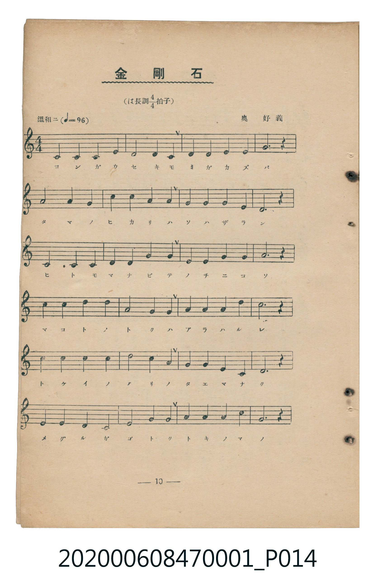
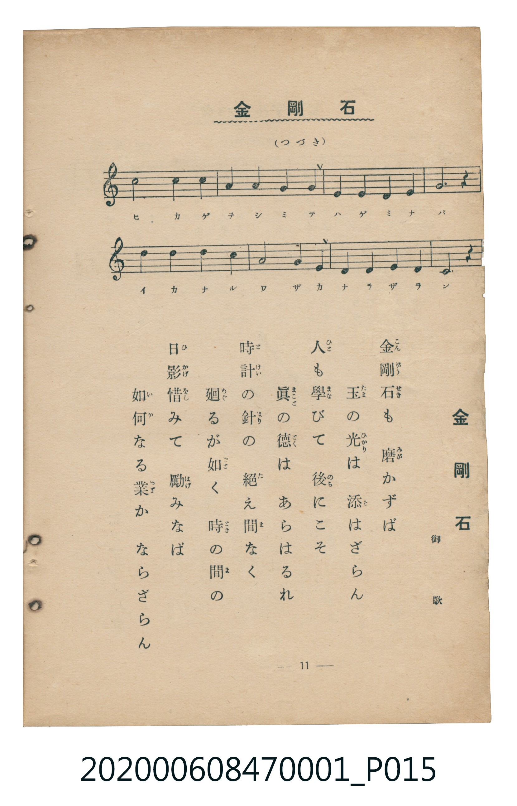

# 金剛石

> Re:Shoka 使用 AI 協助辨識與重建樂譜，可能會有錯誤。歡迎回報。

<audio controls src="kongoseki.mp3"></audio>

- 詞：昭憲皇太后（御歌）
- 曲：奥好義
- 臺灣教育會公認《新定兒童唱歌》尋常科第一學年用（2020.006.0847.0001）

## 說明

原書資訊與歌詞全文（對應 P014.jpg – P015.jpg，儀式歌 pp. 10–11，第 9 首）：
調性與拍號：ハ長調 4/4 拍子，「温和ニ」

## 跨冊／重複收錄參照

> 同曲（昭憲皇太后御歌、奧好義作曲〈金剛石〉；收錄於《新定兒童唱歌》卷首與《唱歌帖》P051–P052 夾頁）

- **[同曲]** 楊金土手抄《唱歌帖》第 3 冊・I（2020.006.0843）：[**〈金剛石・水は器〉**](../../../shokacho/vol_03/p051_kongoseki_mizu_wa_utsuwa/index.md)（`G` / `4/4` — [原始 TMD](../../../shokacho/vol_03/p051_kongoseki_mizu_wa_utsuwa/kongoseki_mizu_wa_utsuwa.tmd)）
- 總表：[跨冊重複與同名歌曲總索引](../../../duplicate_songs.md)

## 歌詞

```text
金剛石（こんがうせき）も　磨（みが）かずば
玉（たま）の光（ひかり）は　添（そ）はざらん
人（ひと）も學（まな）びて　後（のち）にこそ
眞（まこと）の徳（とく）は　あらはるれ
時計（とけい）の針（はり）の　絶（た）え間（ま）なく
廻（めぐ）るが如（ごと）く　時（とき）の間（ま）の
日影（ひかげ）惜（をし）みて　勵（はげ）みなば
如何（いか）なる業（わざ）か　ならざらん
```

## ABC

```abc
X:1
T:金剛石
C:曲：奥好義
M:4/4
L:1/16
Q:1/4=96
K:C
V:V1 name="Piano" snm="Pia"
[V:V1]
C4 C4 C4 E4 | D8 D4 C4 | D4 D4 E4 E4 | G12 z4 |
A8 A4 G4 | D4 D4 B4 B4 | G4 G4 G4 E4 | D12 z4 |
C4 C4 C8 | D4 D4 G4 G4 | E4 E4 G4 G4 | A12 z4 |
c4 c4 d4 d4 | A8 G4 G4 | A4 A4 A4 d4 | c12 z4 |
c4 c4 c4 c4 | d8 c4 A4 | G4 G4 E4 C4 | D12 z4 |
E4 E4 D4 C4 | E8 G4 G4 | A4 A4 A4 c4 | G12 z4 |
c8 c4 c4 | A4 A4 G4 G4 | E4 E4 D4 E4 | G12 z4 |
d4 d4 d4 c4 | A8 G4 E4 | D4 D4 E4 D4 | C12 z4 |
```

## TMD 檔案連結

- [主旋律 TMD 檔案](kongoseki.tmd) [[在 TMD Studio 編輯](https://tmdlang.github.io/Tmd-TS/#tmd=s7IKdvYPcrWy4qpTUCpJTLdSSM7PyUlNLsnMz7MqzsjMK0nNjM_KTMmPL87Iz05Ugisry88pzU21Si9KTEmNN4w3MjAyiDcwMIs3sDAxBzIMDBFKi_NLi5JTrYqTM_Lzc-JLUitKkvLzsxHyBUX5Zal5iXlANQVFIBtTwIoQClLLMlNSQdKpKZkl-UWZiTlI7kgtKga7FWxJfElRYl5xclFmAcgDCFUlGalAx5bmJeckFhdnpmWmpihxaWkpvGyf-LRz9vP5mxW0tLgUbRUszbjsbRWcuWxM9E3sQJpfrJz3fs-sZzPWPmvb9HxW-9Mlq55O6Hu_p-PpvoXP1va839MJtuLZ7E1AVU-XLn26dO_zfSvBYi_adz1vXPxs6swXTZuezWl-2rrmxarexw1dz6ZteLpu1tPWSc9XL306ZSPQlMcN3U83dD_dseP58onP16x5sqPh6dodT3dueT5lBdAmUMDqAQNWDxSwQIaBIdhWLn0tBVtqAS4FBYWnffOfzd7xYnP7ixVdLzrage4C-v1p64pn09pB_t3Q-6y9UyHAwNBEL6sgXeFRw2QQxxTEeb-n52lLw9M9_UA9CgUFegqGBkBpQ6A7e4DeUbBUeLlsGtDNwBAC2fNi1f5nDctBNnT3vpg5Hyj6uLn_5dTtQHEFYKgrAIWfrp0A1Pu4oefZjpVPJ_U8bu5-3NDLBdIMjy-gkx43Tn7cNPlxY8_jxrbHjbMfN_YCLXnc1PS4oeH5YlDIPW7cD5QFCTZ2P26c9bhxA8iI531AlwDl5j9u3AeWW_e0FSKyCaSuqQssuB5oyrPtu8Hic6EijdMeNwEtmAwy5cmuXTA9QKtA1gLjDCyy73HjKrCGzY8blwFNeboP6ASg-LrHjQvB4qtBDm-cC3bLHGDqgugBCoENAjpnH8R3Kx439sPd8rixCWQ5kN0EdGMPSPOzmU0vVnTAlE583NgC0f-yHehgoCBQKcQv60AhsnUbxNdgkY6X0yZDLAZzVwFtAieB3WAPNzU-bgRGANBTwGDrebqsCax0CsyB_aCgmQkRBFoMDnWgrSgmrgM7cPrSp3s3IoK2cRJQ7lnzHLAdkx43TgcrBcYROJi6t0JdDVYGFge6CxxlQCc82TsVLN0CNAjq5qbuZ0vXgs3qB0YNNJpBIQWUArKRIovyDAIFClr6XFze-Xnp-cWp2ZlWAZmJefkONQY1CtUgaxRsLLTswAxseVMBkrVfLOxR0DBReLqh__n6Bh14htLEogFoGciwGgVDBV04NgbiGgUjIAmCIBokChEBYZC8sQJYyBSqCAQNQCLgLITbcbt6yHGcGdQGEA2yEeEUcyiGuASGUT1ArNt2dFIacCCIcBvMNTXQAEMWgfmISLc9nT2bLLfFgRwGIozgBMJuVNfAMFQRWBdJMTuFMhciCGAIwiwH80GuQsQvKBwRyZGUMGxdS44LYXGHyAYgHu7wg3qB1IyxoxnTceCaj3DwwQMKajXMJZjpD5Z5SXbe09bV5DgPkerABJL7YOGHyKkwt4FoSK5CdV8tF5eunQK8YFQAcpS5AA)]
- [鋼琴伴奏 TMD 檔案](kongoseki_piano.tmd) [[在 TMD Studio 編輯](https://tmdlang.github.io/Tmd-TS/#tmd=s7IKdvYPcrWy4tLSUnjZPvFp5-zn8ze_39PxsnvP8wlbnuzZ8nRp__POjvd7OhW0tLgUbRUszbjsbRWcuWxM9E3suOoUlF6snPd-z6xnM9Y-a9v0fFb70yWrnk7oA5rwdN_CZ2t7gBqVQKqezd4EVPV06dKnS_c-37cSLPaifdfzxsXPps580bTp2Zzmp61rXqzqfdzQ9WzahqfrZj1tnfR89dKnUzYCTXnc0P10Q_fTHTueL5_4fM2aJzsanq7d8XTnludTVgBtMjIwMtAzMDDTM7AwMQcyDAzBtnJ55-el5xenZmdaBWQm5uUHeTjUGNQoVHMpAIGNhZYdmKGvpWCLDhQgdrxY2KOgYaLwdEP_8_UNOgoBBoYmelkF6ZpYNGjpgw2rUTBU0IVjYyCuUTACkiAIokGiEBEQBslD1JhC1YCgAUiEC7_bdvWQ4zYzqA0gGmQjwiXmUAxxCQyjup9Yt-3opDTcQBDhNphrauDhhRCB-YhItz2dPZsst8WBHAYijOAEwm5U18AwVBFYF0kxO4UyFyIIYAjCLAfzQa5CxC8oHBGpkZQwbF1LjgthcYfIBSAe7vCDeoHUjLGjGdNxpsQFHzygoFbDXIKZ_mB5l2TnPW1dTY7zEKkOTCC5DxZ-iJwKcxuIhuQqVPfVYhSLPijFogmiWHy2a_XTST1PW3e8nN0KzDnPunufrp0AqRGQgi5eIdowFkYBQyQeyDKNj0UwkMSwqzIAOgtimAlQ1ISAYXgtRBiFUxlcBF0F1HIgheEgJOvNQEyz-FxMjVjdiNtBCOtAFFweYT7RXiPSZPyGoAc9kcGMGaykxSHIJGCS1LVTgKdKBSBHmQsA)]

## 分析

```text
================================================================================
📊 TMD Song Profile: [ 金剛石 ]
================================================================================
⏱  Duration:       1:20 (80.0s), 32 measures total
🎼 Key & Tempo:    首調基準 C, != 96.0 BPM, <4/4>
   - 分析範圍：      由實際發聲的音符與和弦推測調性；播放脈絡另行呈現
🎤 人聲音域:    C4 (MIDI 60) – D5 (MIDI 74) [跨度: 14 個半音 / 1.2 個八度, 難度: moderate]
   - 最低音:  C4 in [Kongoseki #1 @ m.1, 0:00]
   - 最高音: D5 in [Kongoseki #1 @ m.13, 0:31]
   - 適合: soprano, mezzo-soprano, contralto, tenor, baritone, bass
🏛  結構:      Kongoseki (80.0s)
⚡ 編曲密度:        Peak 1 軌道同時演奏
🗝  調性診斷：       G 調性不明確（純淨自然大調，未偵測到可信轉調）
   - 風格氣質:    純淨自然大調（陽光明朗、易唱易記，無明顯調外色彩）
   - 轉調歷程:    全曲維持單一推測調性（未偵測到可信轉調）
   - 核心骨幹音:  C, D, G, A, E
   - 調性數值:    G 調性不明確 [相關度: 0.80, 穩定度: Ambiguous, 自然音純度: 100.0%]
   - 候選調性 (K-S): G 大調 (0.80), C 大調 (0.79), A 小調 (0.60)
   - 五度圈歷程:   +1
   - 各段落調性細節:
     • [Kongoseki #1]: G 調性不明確 (r: 0.80, 自然音純度: 100.0%)

  [ 五度圈游移軌跡 ]
               C  
         F           [G ]*
      Bb               D  
      Eb               A  
         Ab           E  
            Db       B  
               F# 
     (* = active key center)

  [ 十二半音累積音高分佈 ]
     C  : ████████████████████████  24.2%
     C# :                            0.0%
     D  : ███████████████████████   23.3%
     D# :                            0.0%
     E  : █████████████             13.3%
     F  :                            0.0%
     F# :                            0.0%
     G  : ██████████████████████    21.7%
     G# :                            0.0%
     A  : ████████████████          15.8%
     A# :                            0.0%
     B  : ██                         1.7%
--------------------------------------------------------------------------------
Assignment 軌道音域：
  - Piano         : C4 – D5 (14 個半音 / 1.2 個八度, 96 個音符)
================================================================================
```


## 原書掃描頁






