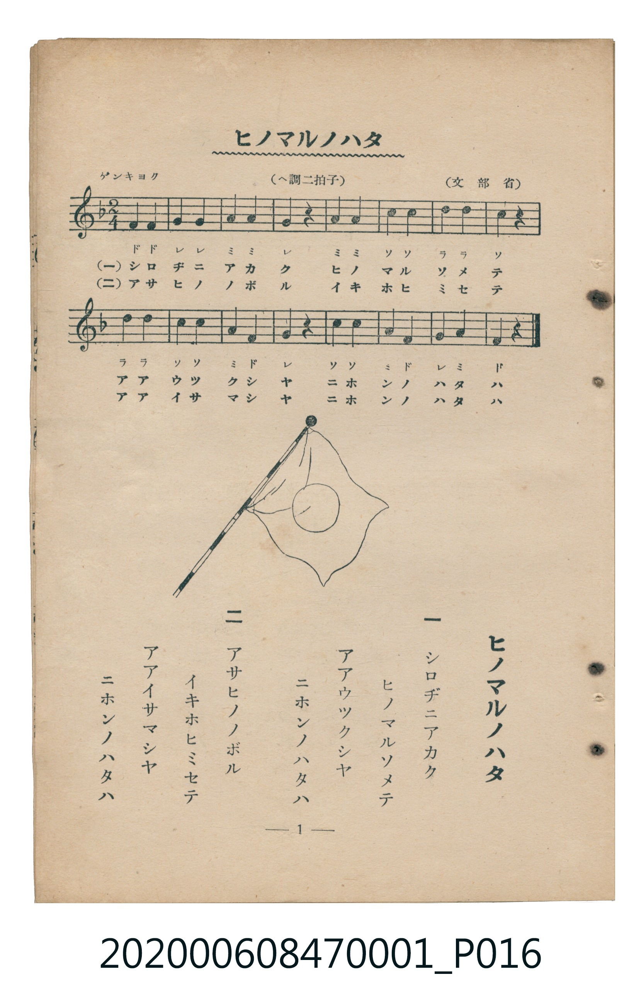

# ヒノマルノハタ

<audio controls src="hinomaru_no_hata.mp3"></audio>

- 詞：文部省
- 曲：文部省
- 臺灣教育會公認《新定兒童唱歌》尋常科第一學年用（2020.006.0847.0001）

## 說明

原書資訊與歌詞全文（對應 P016.jpg，書頁 p. 1，第一學期第 1 首）：
調性與拍號：ヘ調二拍子（F 大調 2/4 拍），「ゲンキヨク」

## 歌詞

```text
一
シロヂニアカク
ヒノマルソメテ
アアウツクシヤ
ニホンノハタハ

二
アサヒノノボル
イキホヒミセテ
アアイサマシヤ
ニホンノハタハ
```

## 原書掃描頁



## 分析

```text
================================================================================
📊 TMD Song Profile: [ ヒノマルノハタ ]
================================================================================
⏱  Duration:       0:17 (17.8s), 16 measures total
🎼 Key & Tempo:    首調基準 F, != 108.0 BPM, <2/4>
   - 分析範圍：      由實際發聲的音符與和弦推測調性；播放脈絡另行呈現
🎤 人聲音域:    F4 (MIDI 65) – D5 (MIDI 74) [跨度: 9 個半音 / 0.8 個八度, 難度: easy]
   - 最低音:  F4 in [HinomaruNoHata #1 @ m.1, 0:00]
   - 最高音: D5 in [HinomaruNoHata #1 @ m.7, 0:06]
   - 適合: soprano, mezzo-soprano, contralto, tenor, baritone, bass
🏛  結構:      HinomaruNoHata (17.8s)
⚡ 編曲密度:        Peak 1 軌道同時演奏
🗝  調性診斷：       F 調性不明確（純淨自然大調，未偵測到可信轉調）
   - 風格氣質:    純淨自然大調（陽光明朗、易唱易記，無明顯調外色彩）
   - 轉調歷程:    全曲維持單一推測調性（未偵測到可信轉調）
   - 核心骨幹音:  C, A, F, G, D
   - 調性數值:    F 調性不明確 [相關度: 0.77, 穩定度: Ambiguous, 自然音純度: 100.0%]
   - 候選調性 (K-S): F 大調 (0.77), C 大調 (0.76), A 小調 (0.73)
   - 五度圈歷程:   -1
   - 各段落調性細節:
     • [HinomaruNoHata #1]: F 調性不明確 (r: 0.77, 自然音純度: 100.0%)

  [ 五度圈游移軌跡 ]
               C  
        [F ]*          G  
      Bb               D  
      Eb               A  
         Ab           E  
            Db       B  
               F# 
     (* = active key center)

  [ 十二半音累積音高分佈 ]
     C  : ████████████████████████  25.0%
     C# :                            0.0%
     D  : ██████████████            14.3%
     D# :                            0.0%
     E  :                            0.0%
     F  : █████████████████         17.9%
     F# :                            0.0%
     G  : █████████████████         17.9%
     G# :                            0.0%
     A  : ████████████████████████  25.0%
     A# :                            0.0%
     B  :                            0.0%
--------------------------------------------------------------------------------
Assignment 軌道音域：
  - Piano         : F4 – D5 (9 個半音 / 0.8 個八度, 28 個音符)
================================================================================
```

## ABC

```abc
X:1
T:ヒノマルノハタ
C:曲：文部省
M:2/4
L:1/16
Q:1/4=108
K:F
V:V1 name="Piano" snm="Pia"
[V:V1]
f4 f4 | g4 g4 | a4 a4 | g4 z4 |
a4 a4 | c4 c4 | d4 d4 | c4 z4 |
d4 d4 | c4 c4 | a4 f4 | g4 z4 |
c4 c4 | a4 f4 | g4 a4 | f4 z4 |
```

- [主旋律 TMD 檔案](hinomaru_no_hata.tmd)
- [鋼琴伴奏 TMD 檔案](hinomaru_no_hata_piano.tmd)
