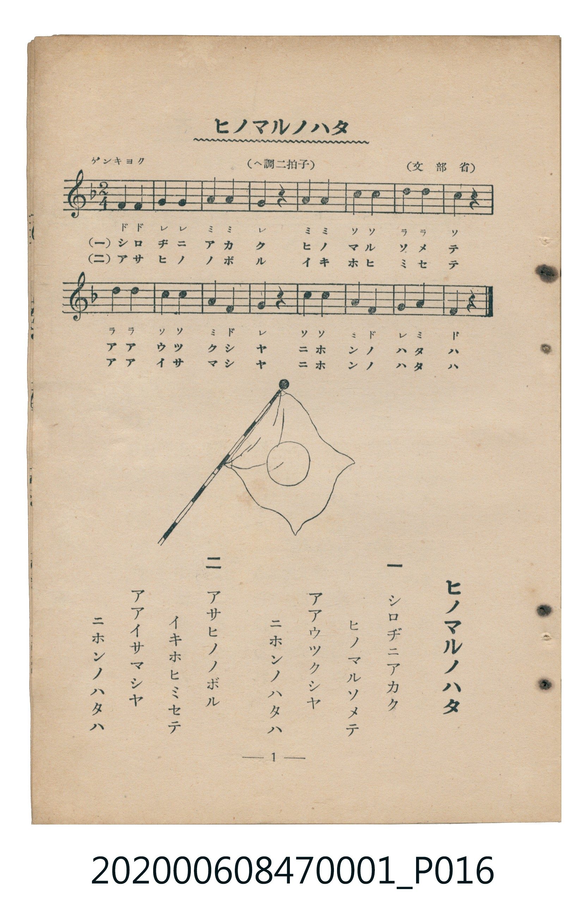

# ヒノマルノハタ（日之丸旗）

> Re:Shōka 使用 AI 協助辨識與重建樂譜，可能會有錯誤。歡迎回報。

- **鋼琴伴奏版**：<br><audio controls src="hinomaru_no_hata.mp3"></audio>
- **NEUTRINO 歌聲合成版**：<br><audio controls src="hinomaru_no_hata_neutrino.mp3"></audio>

- 詞：文部省
- 曲：文部省
- 臺灣教育會公認《新定兒童唱歌》尋常科第一學年用（2020.006.0847.0001）

## 說明

曲目說明
中文解釋：描寫日本國旗在風中飄揚，帶有愛國與敬意的歌曲。

原書資訊與歌詞全文（對應 P016.jpg，書頁 p. 1，第一學期第 1 首）：
調性與拍號：ヘ調二拍子（F 大調 2/4 拍），「ゲンキヨク」


## 歌詞

```text
一
シロヂニアカク
ヒノマルソメテ
アアウツクシヤ
ニホンノハタハ

二
アサヒノノボル
イキホヒミセテ
アアイサマシヤ
ニホンノハタハ
```

## ABC

```abc
X:1
T:ヒノマルノハタ（日之丸旗）
C:曲：文部省
M:2/4
L:1/16
Q:1/4=108
K:F
V:V1 name="Piano" snm="Pia"
[V:V1]
F4 F4 | G4 G4 | A4 A4 | G4 z4 |
w: 1.~シ ロ | ヂ ニ | ア カ | ク
w: 2.~ア サ | ヒ ノ | ノ ボ | ル
A4 A4 | c4 c4 | d4 d4 | c4 z4 |
w: 1.~ヒ ノ | マ ル | ソ メ | テ
w: 2.~イ キ | ホ ヒ | ミ セ | テ
d4 d4 | c4 c4 | A4 F4 | G4 z4 |
w: 1.~ア ア | ウ ツ | ク シ | ヤ
w: 2.~ア ア | イ サ | マ シ | ヤ
c4 c4 | A4 F4 | G4 A4 | F4 z4 |
w: 1.~ニ ホ | ン ノ | ハ タ | ハ
w: 2.~ニ ホ | ン ノ | ハ タ | ハ
```

## TMD 檔案連結

- [主旋律 TMD 檔案](hinomaru_no_hata.tmd) [[在 TMD Studio 編輯](https://tmdlang.github.io/Tmd-TS/#tmd=s7IKdvYPcrWy4qpTUCpJTLdSSM7PyUlNLsnMz7MqzsjMK0nNjM_KTMmPL87Iz05Ugisry88pzU21Si9KTEmNN4w3MjAyiDcwMIs3sDAxBzIMDBFKi_NLi5JTrYqTM_Lzc-JLUitKkvLzsxHyBUX5Zal5iXlANQVFIBtTwIoQClLLMlNSQdKpKZkl-UWZiTlI7kgtKga7FWxJfElRYl5xclFmAcgDCFUlGalAx2bmFqSi6gYalp6ZZ5Wbn5dUCvSgEpeWlsLj5kmPm_seN8973LwazOh_3LT__Z6OZ9OXPtnZ_WTHjmfTp7_f06mgpcWlaKtgaGDBZW-r4MZlY6RvYgcy-MXKee_3zHo2rf1l84rncxrBlj2bvQlD7EX7rueNi59NnfmiadOzOc1PW9e8WNX7uKHr2bQNT9fNeto66fnqpU-nbHy2tudxQ_fTDd1Pd-x4vnzi8zVrnuxoeLp2x9OdW55PWQF0Fyjo9YBBrwcKeiDDwBDoOiUufS0FoK3PZ697sWrVsxl9XAoKCk92rAU64cXyxS_bu0HO6e9_un410FvP5qx5Oqcb6K2nc1a8XLQCqOzl4pZn_bPe7-l5umPbszmdz1pmAxW86Gh_NnXNs5b-57NagK4Cmv64oYlLS58LZJcttQDIoU_75j-bvePF5vYXK7pAtq7tAQbq09YVQNcDPfx0Q--z9k6FAANDM72sgnSgK4GKXy5oVCjQUwD6vQceRM_mzAeyFQwVXi6bBgwToJdBhr9Ytf9Zw3KQsd29L2bOB4o-bp4BFHyyqwco8nTtBKAVbgpPlywHiikAI1UBKArWDYyHnsdNmx43b37ctPZx84rHTesfN_RyQUK2AUQ9btr-uBko1fS4uftx06LHTauBasASyGmqae_j5oWPm9sgOoCqgGjZ4-YWkHkgA5ZAdHQ_bp4NsguWBIEkxK5dPXCdW2EGA9EcoNkQiSVg9wE1A-XmP27ajWYXUBqobx4hu4ASlMcmFCiAUolHZl5-bmJRqV--R2JJolVAZmJevkONQU01yCoFGxMtOzADW2JSgMTpi4U9ChoWCk839D9f36ADTwGaWDQALQQZVgOMfUMgaQSENQrGQAhiG8DZpkBYo2AGhCA2UBysy8ewBhSXwIBZCxQHxicoiECspkVAvBrMWq8QD5abBMR9YNY8IIbI7QWyFoLF2kCqIGYawfRvRdPXB8RzwKzVEDOblgAxxObZYJUg1nyg2G4kM_GH1a4ecsIKFg6gMDGGhhsorFBFQOFmiBZWIH8tArt9GdCFLdAQAoUhyMVLoGHVDfYRiLUZ7vt-oKr9UBZmWEHMBIUHJNSAYUyGmbVcXLp2CqjpTwEooswFAA)]
- [鋼琴伴奏 TMD 檔案](hinomaru_no_hata_piano.tmd) [[在 TMD Studio 編輯](https://tmdlang.github.io/Tmd-TS/#tmd=s7IKdvYPcrWy4tLSUnjcPOlxc9_j5nmPm1eDGf2Pm_a_39PxsnvP8wlbnuzZ8nRp__POjvd7OhW0tLgUbRUMDSy47G0V3LhsjPRN7LjqFJRerJz3fs-sZ9PaXzaveD6nUQkk9mz2JgyxF-27njcufjZ15oumTc_mND9tXfNiVe_jhq5n0zY8XTfraeuk56uXPp2y8dnanscN3U83dD_dseP58onP16x5sqPh6dodT3dueT5lBdBpRgZGBnoGBmZ6BhYm5kCGgSHQdUpcXB6Zefm5iUWlfvkeiSWJVgGZiXn5QR4ONQY11VwKQGBjomUHZuhrKdiiAwWIPS8W9ihoWCg83dD_fH2DjkKAgaGZXlZBuiYWDVr6YMNqFAyBsEbBCAhrFIyBEMQ2gLNNgbBGwQwIQWygOFiXj2GNwuOm7cDgXwsUf9zcBMTdIFbTIiBeDWatV4gHy00C4j4wax4QQ-T2AlkLwWJtIFUQM41g-rei6esD4jlg1mqImU1LgBhi82ywShBrPlBsN5KZ-MNqVw85YQULB1CYGEPDDRRWqCKgcDNECyuQvxaB3b4M6MIWaAiBwhDk4iXQsOoG-wjE2gz3fT9Q1X4oCzOsIGaCwgMSasAwJsPMWuzJzwdb8gP6LV4h2jAW5O14IMs0HsREEQMFCVwAzjABMkygIrDAQRVF04DbKFSLQYYBfaBrp4DqiWgfoGIsokZgUWUuAA)]

## 分析

```text
================================================================================
📊 TMD Song Profile: [ ヒノマルノハタ（日之丸旗） ]
================================================================================
⏱  Duration:       0:17 (17.8s), 16 measures total
🎼 Key & Tempo:    首調基準 F, != 108.0 BPM, <2/4>
   - 分析範圍：      由實際發聲的音符與和弦推測調性；播放脈絡另行呈現
🎤 人聲音域:    F4 (MIDI 65) – D5 (MIDI 74) [跨度: 9 個半音 / 0.8 個八度, 難度: easy]
   - 最低音:  F4 in [HinomaruNoHata #1 @ m.1, 0:00]
   - 最高音: D5 in [HinomaruNoHata #1 @ m.7, 0:06]
   - 適合: soprano, mezzo-soprano, contralto, tenor, baritone, bass
🏛  結構:      HinomaruNoHata (17.8s)
⚡ 編曲密度:        Peak 1 軌道同時演奏
🗝  調性診斷：       F 調性不明確（純淨自然大調，未偵測到可信轉調）
   - 風格氣質:    純淨自然大調（陽光明朗、易唱易記，無明顯調外色彩）
   - 轉調歷程:    全曲維持單一推測調性（未偵測到可信轉調）
   - 核心骨幹音:  C, A, F, G, D
   - 調性數值:    F 調性不明確 [相關度: 0.77, 穩定度: Ambiguous, 自然音純度: 100.0%]
   - 候選調性 (K-S): F 大調 (0.77), C 大調 (0.76), A 小調 (0.73)
   - 五度圈歷程:   -1
   - 各段落調性細節:
     • [HinomaruNoHata #1]: F 調性不明確 (r: 0.77, 自然音純度: 100.0%)

  [ 五度圈游移軌跡 ]
               C  
        [F ]*          G  
      Bb               D  
      Eb               A  
         Ab           E  
            Db       B  
               F# 
     (* = active key center)

  [ 十二半音累積音高分佈 ]
     C  : ████████████████████████  25.0%
     C# :                            0.0%
     D  : ██████████████            14.3%
     D# :                            0.0%
     E  :                            0.0%
     F  : █████████████████         17.9%
     F# :                            0.0%
     G  : █████████████████         17.9%
     G# :                            0.0%
     A  : ████████████████████████  25.0%
     A# :                            0.0%
     B  :                            0.0%
--------------------------------------------------------------------------------
Assignment 軌道音域：
  - Piano         : F4 – D5 (9 個半音 / 0.8 個八度, 28 個音符)
================================================================================
```


## 原書掃描頁




