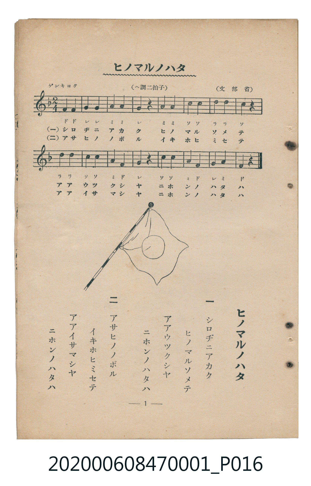

# ヒノマルノハタ（日之丸旗）

> Re:Shōka 使用 AI 協助辨識與重建樂譜，可能會有錯誤。歡迎回報。

- **鋼琴伴奏版**：<br><audio controls src="hinomaru_no_hata.mp3"></audio>
- **NEUTRINO 歌聲合成版**：<br><audio controls src="hinomaru_no_hata_neutrino.mp3"></audio>

- 詞：文部省
- 曲：文部省
- 臺灣教育會公認《新定兒童唱歌》尋常科第一學年用（2020.006.0847.0001）

## 說明

曲目說明
中文解釋：描寫日本國旗在風中飄揚，帶有愛國與敬意的歌曲。

原書資訊與歌詞全文（對應 P016.jpg，書頁 p. 1，第一學期第 1 首）：
調性與拍號：ヘ調二拍子（F 大調 2/4 拍），「ゲンキヨク」


## 歌詞

```text
一
シロヂニアカク
ヒノマルソメテ
アアウツクシヤ
ニホンノハタハ

二
アサヒノノボル
イキホヒミセテ
アアイサマシヤ
ニホンノハタハ
```

## ABC

<div class="abc-score" data-abc-src="hinomaru_no_hata.abc" aria-label="五線譜載入中"></div>

[下載 ABC 原始檔](hinomaru_no_hata.abc)

## TMD 檔案連結

- [主旋律 TMD 檔案](hinomaru_no_hata.tmd) [[在 TMD Studio 編輯](https://tmdlang.github.io/Tmd-TS/#tmd=s7IKdvYPcrWy4qpTUCpJTLdSSM7PyUlNLsnMz7MqzsjMK0nNjM_KTMmPL87Iz05Ugisry88pzU21Si9KTEmNN4w3MjAyiDcwMIs3sDAxBzIMDBFKi_NLi5JTrYqTM_Lzc-JLUitKkvLzsxHyBUX5Zal5iXlANQVFIBtTwIoQClLLMlNSQdKpKZkl-UWZiTlI7kgtKga7FWxJfElRYl5xclFmAcgDCFUlGalAx2bmFqSi6gYalp6ZZ5Wbn5dUCvQgskRJRj7QcwUZlVYZmcUgW5MTc-KzE_OQwgBqZ0FieqpVgIGhmRKXlpbC4-ZJj5v7HjfPe9y8Gszof9y0__2ejmfTlz7Z2f1kx45n06e_39OpoKXFpWirYGhgwWVvq-DGZWOkb2IHMvnFynnv98x6Nq39ZfOK53MawbY9m70JQ-xF-67njYufTZ35omnTsznNT1vXvFjV-7ih69m0DU_XzXraOun56qVPp2x8trbncUP30w3dT3fseL584vM1a57saHi6dsfTnVueT1kBdBco5vSAMacHijkgw8AQ6DolLn0tBaCtz2eve7Fq1bMZfVwKCgpPdqwFOuHF8sUv27tBzunvf7p-NdBbz-aseTqnG-itp3NWvFy0Aqjs5eKWZ_2z3u_pebpj27M5nc9aZgMVvOhofzZ1zbOW_uezWoCuApr-uKGJS0ufC2SXLbUAyKFP--Y_m73jxeb2Fyu6QLau7QEG6tPWFUDXAz38dEPvs_ZOBVCE6WUVpANdCVT8ckGjQoGeAtDvPfAgejZnPpCtYKjwctk0YJgAvQwy_MWq_c8aloOM7e59MXM-UPRx8wyg4JNdPUCRp2snAK1wU3i6ZDlQTAEYqQpAUbBuYDz0PG7a9Lh58-OmtY-bVzxuWv-4oZcLErINIOpx0_bHzUCppsfN3Y-bFj1uWg1UA5ZATlNNex83L3zc3AbRAVQFRMseN7eAzAMZsASio_tx82yQXbAkCCQhdu3qgevcCjMYiOYAzYZILAG7D6gZKDf_cdNuNLuA0kB98wjZBZSgPDahQAGUSjwy8_JzE4tK_fI9EksSrQIyE_PyHWoMaqpBVinYmGjZgRnYEpMCJE5fLOxR0LBQeLqh__n6Bh14CtDEogFoIciwGmDsGwJJIyCsUTAGQhDbAM42BcIaBTMgBLGB4mBdPoY1oLgEBsxaoDgwPkFBBGI1LQLi1WDWeoV4sNwkIO4Ds-YBMURuL5C1ECzWBlIFMdMIpn8rmr4-IJ4DZq2GmNm0BIghNs8GqwSx5gPFdiOZiT-sdvWQE1awcACFiTE03EBhhSoCCjdDtLAC-WsR2O3LgC5sgYYQKAxBLl4CDatusI9ArM1w3_cDVe2HsjDDCmImKDwgoQYMYzLMrOXi0rVTQE1_CkARZS4A)]
- [鋼琴伴奏 TMD 檔案](hinomaru_no_hata_piano.tmd) [[在 TMD Studio 編輯](https://tmdlang.github.io/Tmd-TS/#tmd=s7IKdvYPcrWy4qpTUCpJTLdSyC8qychPL0osyKi0ysgsLskvykxOzInPTsxLVIIrKs4vLUpOjS9ITE-1CjAwNFPi0tJSeNw86XFz3-PmeY-bV4MZ_Y-b9r_f0_Gye8_zCVue7NnydGn_886O93s6FbS0uBRtFQwNLLjsbRXcuGyM9E3sQIa_WDnv_Z5Zz6a1v2xe8XxOI9jCZ7M3YYi9aN_1vHHxs6kzXzRtejan-Wnrmhereh83dD2btuHpullPWyc9X7306ZSNz9b2PG7ofrqh--mOHc-XT3y-Zs2THQ1P1-54unPL8ykrgE4zMjAy0DMwMNMzsDAxBzIMDIGuU-Li8sjMy89NLCr1y_dILEm0CshMzMsP8nCoMaip5lIAAhsTLTswQ19LwRYdKEDsebGwR0HDQuHphv7n6xt0FEDBpJdVkK6JRYOWPtiwGgVDIKxRMALCGgVjIASxDeBsUyCsUTADQhAbKA7W5WNYo_C4aTsw-NcCxR83NwFxN4jVtAiIV4NZ6xXiwXKTgLgPzJoHxBC5vUDWQrBYG0gVxEwjmP6taPr6gHgOmLUaYmbTEiCG2DwbrBLEmg8U241kJv6w2tVDTljBwgEUJsbQcAOFFaoIKNwM0cIK5K9FYLcvA7qwBRpCoDAEuXgJNKy6wT4CsTbDfd8PVLUfysIMK4iZoPCAhBowjMkwsxZ78vPBlvyAfotXiDaMBXk7HsgyjQcxUcRAQQIXgDNMgAwTqAgscFBF0TTgNgrVYpBhQB_o2imgeiLaB6gYi6gRWFSZCwA)]

## 分析

```text
================================================================================
📊 TMD Song Profile: [ ヒノマルノハタ（日之丸旗） ]
================================================================================
⏱  Duration:       0:17 (17.8s), 16 measures total
🎼 Key & Tempo:    首調基準 F, != 108.0 BPM, <2/4>
   - 分析範圍：      由實際發聲的音符與和弦推測調性；播放脈絡另行呈現
🎤 人聲音域:    F4 (MIDI 65) – D5 (MIDI 74) [跨度: 9 個半音 / 0.8 個八度, 難度: easy]
   - 最低音:  F4 in [HinomaruNoHata #1 @ m.1, 0:00]
   - 最高音: D5 in [HinomaruNoHata #1 @ m.7, 0:06]
   - 適合: soprano, mezzo-soprano, contralto, tenor, baritone, bass
🏛  結構:      HinomaruNoHata (17.8s)
⚡ 編曲密度:        Peak 1 軌道同時演奏
🗝  調性診斷：       F 調性不明確（純淨自然大調，未偵測到可信轉調）
   - 風格氣質:    純淨自然大調（陽光明朗、易唱易記，無明顯調外色彩）
   - 轉調歷程:    全曲維持單一推測調性（未偵測到可信轉調）
   - 核心骨幹音:  C, A, F, G, D
   - 調性數值:    F 調性不明確 [相關度: 0.77, 穩定度: Ambiguous, 自然音純度: 100.0%]
   - 候選調性 (K-S): F 大調 (0.77), C 大調 (0.76), A 小調 (0.73)
   - 五度圈歷程:   -1
   - 各段落調性細節:
     • [HinomaruNoHata #1]: F 調性不明確 (r: 0.77, 自然音純度: 100.0%)

  [ 五度圈游移軌跡 ]
               C  
        [F ]*          G  
      Bb               D  
      Eb               A  
         Ab           E  
            Db       B  
               F# 
     (* = active key center)

  [ 十二半音累積音高分佈 ]
     C  : ████████████████████████  25.0%
     C# :                            0.0%
     D  : ██████████████            14.3%
     D# :                            0.0%
     E  :                            0.0%
     F  : █████████████████         17.9%
     F# :                            0.0%
     G  : █████████████████         17.9%
     G# :                            0.0%
     A  : ████████████████████████  25.0%
     A# :                            0.0%
     B  :                            0.0%
--------------------------------------------------------------------------------
Assignment 軌道音域：
  - Piano         : F4 – D5 (9 個半音 / 0.8 個八度, 28 個音符)
================================================================================
```


## 原書掃描頁




