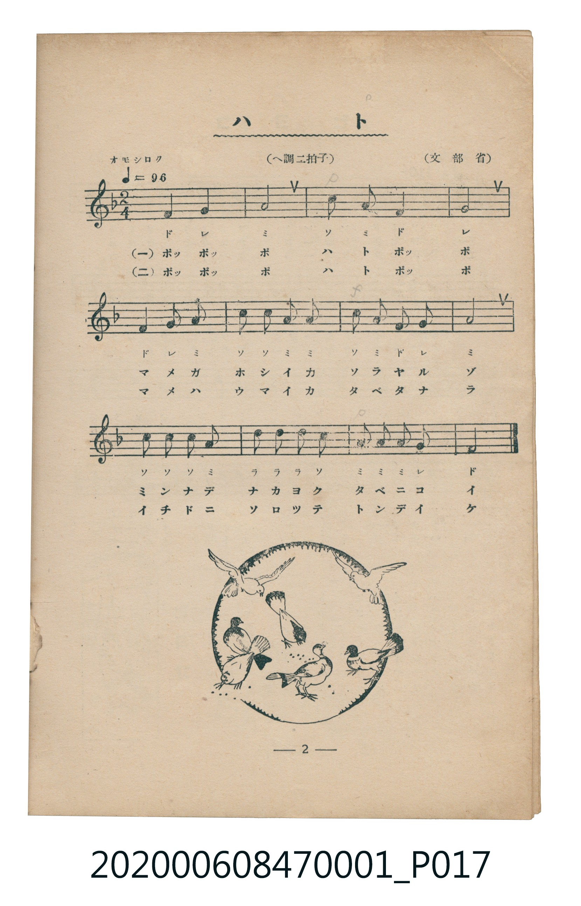

# ハト（鴿子）

> Re:Shōka 使用 AI 協助辨識與重建樂譜，可能會有錯誤。歡迎[回報](https://github.com/TMDLang/reshoka/issues)。

- **鋼琴伴奏版**：<br><audio controls src="hato.mp3"></audio>
- **NEUTRINO 歌聲合成版**：<br><audio controls src="hato_neutrino.mp3"></audio>

- 詞：文部省
- 曲：文部省
- 臺灣教育會公認《新定兒童唱歌》尋常科第一學年用（2020.006.0847.0001）

## 說明

曲目說明
中文解釋：孩子呼喚鴿子，描寫餵食與和鳥兒親近的情景。

原書資訊與歌詞全文（對應 P017.jpg，書頁 p. 2，第一學期第 2 首）：
調性與拍號：ヘ調二拍子（F 大調 2/4 拍），「オモシロク」♩=96


## 歌詞

```text
（一）
ポッポッポ　ハトポッポ
マメガホシイカ　ソラヤルゾ
ミンナデナカヨク　タベニコイ

（二）
ポッポッポ　ハトポッポ
マメハウマイカ　タベタナラ
イチドニソロツテ　トンデイケ
```

## ABC

<div class="abc-score" data-abc-src="hato.abc" aria-label="五線譜載入中"></div>

[下載 ABC 原始檔](hato.abc)

## TMD 檔案連結

- [主旋律 TMD 檔案](hato.tmd) [[在 TMD Studio 編輯](https://tmdlang.github.io/Tmd-TS/#tmd=s7IKdvYPcrWy4qpTUCpJTLdSSM7PyUlNLsnMz7MqzsjMK0nNjM_KTMmPL87Iz05Ugisry88pzU21Si9KTEmNN4w3MjAyiDcwMIs3sDAxBzIMDBFKi_NLi5JTrYqTM_Lzc-JLUitKkvLzsxHyBUX5Zal5iXlANQVFIBtTwIoQClLLMlNSQdKpKZkl-UWZiTlI7kgtKga7FWxJfElRYl5xclFmAcgDCFUlGalAxybmZeYi6wUalZ6ZZ5Wbn5dUCvQeskRJRj7QawUZlVYZmcUgO5MTc-KzE_OQQgBqY0FieqpVgIGhuRKXlpbC4-b-x80d7_d0vNyy_-naCe_3dCpoaXEp2ipYmnHZ2yq4cdkY6ZvYgcx4sXLe-z2znk1rf9m84vmcRrC5z2ZvwhB70b7reePiZ1Nnvmja9GxO89PWNS9W9T5u6Ho2bcPTdbOetk56vnrp0ykbn63tedzQ_XRD99MdO54vn_h8zZonOxqert3xdOeW51NWAB0EiiE9YAzpgWIIyDAwBDpOiUtfSwFo6_PZ616sWvVsRh-XgoLCkx1rgU54sXzxy_ZuoHOerl0J9MnTiXueTpsF81XPs_7-p-tXv1yy9eXi-S862p9O6nm5eSnQMS-WrXqxf-LzWS3PmlufzVz_uKGJS0ufC2SLLbUAyIlP--Y_m73jxeb2Fyu6gNYDPQ8MzqetK4DuBnr16YbeZ-2dCqBI0csqSAc5d_aOlwsaFQr0FIyAPHjgPJszH8hWMFJ4uWwaMDSAngUZ_mLV_mcNy0HGdve-mDkfKPq4eQZQ8MmuHqAI2P8dbgpPlywHiikAo1MBKArWDYyBnsdNqx43L3rctP1x89rHTcAA6H00c6UtMPZBJgM1Ai0GqgVxHjfPfdzcjCAbGiCJBy4CUTTvcfPCx01rHjfPBhnatORx02qQ0qa9j5tXPm5e8rh59eOmfRCl8x83b37c3PW4uR1EAtU1rwA7Aah6_-PmmY-bux83bQYaAXfLrh4y3AKUaFoGYiPcAjYdRALtXglWCpRrbnzc3Am2E-jUtY-bWx43t4ENBpoKdGY7WP9GkGrK0wQUKIDSmkdiSb5VQGZiXr5DjUFNNcgCBRsLLTswA1tCVICkhxcLexQ0TBSebuh_vr5BB556NLFoAFoDMqxGwVBBF5h6dIEsYyAJgjUKpkA2SLwGLAMWA6v2MayBhjNQCM4Ai8H1AgMXiDtwSEOMMaLYGPwhsauH_JAwBvsfFAIQFigkjJBDBykk5oHdvxCYVtaA3TcbyNoOSjlAvBok0rQXKLoSiIEizRCRfViCAm4O0NMgNcvAYsjm7AeKzITSXWC7VhIZFjs6yQkLUAiA_F6jYAaGpuAQAEFQWIBCCj0s5gPxZrDrgBkD7EIgC-h6YA4G0uuRfdHcDWRvBosswQwNkK-bG4G4E6wSFoprgbgZiNvAZoMSBsi2drB6kJqNcJNqubh07RRAeUgBSCtzAQA)]
- [鋼琴伴奏 TMD 檔案](hato_piano.tmd) [[在 TMD Studio 編輯](https://tmdlang.github.io/Tmd-TS/#tmd=s7IKdvYPcrWy4qpTUCpJTLdSyC8qychPL0osyKi0ysgsLskvykxOzInPTsxLVIIrKs4vLUpOjS9ITE-1CjAwNFfi0tJSeNzc_7i54_2ejpfde55P2PJkz5anS_ufdwJFOhW0tLgUbRUszbjsbRXcuGyM9E3sQIa9WDnv_Z5Zz6a1v2xe8XxOI9iCZ7M3YYi9aN_1vHHxs6kzXzRtejan-Wnrmhereh83dD2btuHpullPWyc9X7306ZSNz9b2PG7ofrqh--mOHc-XT3y-Zs2THQ1P1-54unPL8ykrgC4zMjAy0DMwMNMzsDAxBzIMDIGOU-Li8kgsybcKyEzMyw_ycKgxqKnmUgACGwstOzBDX0vBFh0oQEx_sbBHQcNE4emG_ufrG3QUQIGhl1WQrolFg5Y-2LAaBUMFXQUjIK5RMAaSIFijYApkg8RrwDJgMbBqH8MaYMDOfdzcDBSCM8BicL3AgAfiDhzSEGOMKDYGf0js6iE_JIzB_geFAIQFCgkj5NBBCol5YPcvVHjctAbsvtlA1nYgXgLEq0EiTXuBoiuBGCjSDBHZhyUo4OYAPQ1SswwshmzOfqDITCjdBbZrJZFhsaOTnLAAhQDI7zUKZmBoCg4BEASFBSik0MNiPhBvBrvucXM72IVAFtD1j5tXAOn1yL5o7gayN4NFlmCGBsjXzY1A3AlWCQvFtUDcDMRtYLNBCQNkWztYPUjNRrhJtchZyAc5C5lAsxDQB_EK0abxsVCWIQrDNB4miaQYVQmmdnSlJliVGkCcp2unAHJhtA9QBZxtBGYrcwEA)]

## 分析

```text
================================================================================
📊 TMD Song Profile: [ ハト（鴿子） ]
================================================================================
⏱  Duration:       0:15 (15.0s), 12 measures total
🎼 Key & Tempo:    首調基準 F, != 96.0 BPM, <2/4>
   - 分析範圍：      由實際發聲的音符與和弦推測調性；播放脈絡另行呈現
🎤 人聲音域:    F4 (MIDI 65) – D5 (MIDI 74) [跨度: 9 個半音 / 0.8 個八度, 難度: easy]
   - 最低音:  F4 in [Hato #1 @ m.1, 0:00]
   - 最高音: D5 in [Hato #1 @ m.10, 0:11]
   - 適合: soprano, mezzo-soprano, contralto, tenor, baritone, bass
🏛  結構:      Hato (15.0s)
⚡ 編曲密度:        Peak 1 軌道同時演奏
🗝  調性診斷：       A 調性不明確（純淨自然大調，未偵測到可信轉調）
   - 風格氣質:    純淨自然大調（陽光明朗、易唱易記，無明顯調外色彩）
   - 轉調歷程:    全曲維持單一推測調性（未偵測到可信轉調）
   - 核心骨幹音:  A, F, G, C, D
   - 調性數值:    A 調性不明確 [相關度: 0.74, 穩定度: Ambiguous, 自然音純度: 100.0%]
   - 候選調性 (K-S): A 小調 (0.74), F 大調 (0.72), C 大調 (0.57)
   - 五度圈歷程:   +3
   - 各段落調性細節:
     • [Hato #1]: A 調性不明確 (r: 0.74, 自然音純度: 100.0%)

  [ 五度圈游移軌跡 ]
               C  
         F            G  
      Bb               D  
      Eb              [A ]*
         Ab           E  
            Db       B  
               F# 
     (* = active key center)

  [ 十二半音累積音高分佈 ]
     C  : ███████████               16.7%
     C# :                            0.0%
     D  : ████                       6.2%
     D# :                            0.0%
     E  :                            0.0%
     F  : ████████████████          22.9%
     F# :                            0.0%
     G  : █████████████             18.7%
     G# :                            0.0%
     A  : ████████████████████████  35.4%
     A# :                            0.0%
     B  :                            0.0%
--------------------------------------------------------------------------------
Assignment 軌道音域：
  - Piano         : F4 – D5 (9 個半音 / 0.8 個八度, 32 個音符)
================================================================================
```


## 原書掃描頁




