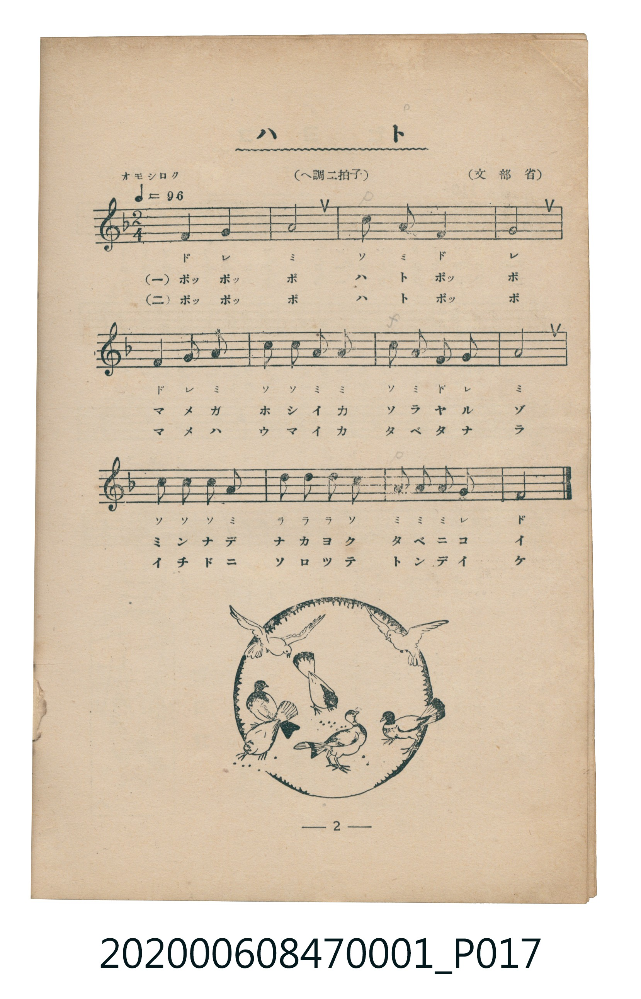

# ハト

<audio controls src="hato.mp3"></audio>

- 詞：文部省
- 曲：文部省
- 臺灣教育會公認《新定兒童唱歌》尋常科第一學年用（2020.006.0847.0001）

## 說明

原書資訊與歌詞全文（對應 P017.jpg，書頁 p. 2，第一學期第 2 首）：
調性與拍號：ヘ調二拍子（F 大調 2/4 拍），「オモシロク」♩=96

## 歌詞

```text
（一）
ポッポッポ　ハトポッポ
マメガホシイカ　ソラヤルゾ
ミンナデナカヨク　タベニコイ

（二）
ポッポッポ　ハトポッポ
マメハウマイカ　タベタナラ
イチドニソロツテ　トンデイケ
```

## ABC

```abc
X:1
T:ハト
C:曲：文部省
M:2/4
L:1/16
Q:1/4=96
K:F
V:V1 name="Piano" snm="Pia"
[V:V1]
F4 G4 | A8 | c2 A2 F4 | G8 |
F4 G2 A2 | c2 c2 A2 A2 | c2 A2 F2 G2 | A8 |
c2 c2 c2 A2 | d2 d2 d2 c2 | A2 A2 A2 G2 | F8 |
```

## TMD 檔案連結

- [主旋律 TMD 檔案](hato.tmd) [[在 TMD Studio 編輯](https://tmdlang.github.io/Tmd-TS/#tmd=s7IKdvYPcrWy4tLSUnjc3P-4uUNBS4tL0VbB0ozL3lbBjcvGSN_EjqtOQenFynnv98x6Nq39ZfOK53MalUBiz2ZvwhB70b7reePiZ1Nnvmja9GxO89PWNS9W9T5u6Ho2bcPTdbOetk56vnrp0ykbn63tedzQ_XRD99MdO54vn_h8zZonOxqert3xdOeW51NWvN_TYWRgZKBnYGCmZ2BhYg5kGBi-39OpxMWlr6VgSy3ApaCg8LRv_rPZO15sbn-xoutFRzvQXUCfPm1dAfQV0BVPN_Q-a-9UCDAwNNfLKkh_v6cHqPjlgkaFAj0FIyAP7u5nc-YD2QpGCi-XTQM6FBgsIMNfrNr_rGE5yNju3hcz5wNFHzfPAAo-2dUDFHm6dgLQCjeFp0uWA8UUgCGtABQF6wYGTs_jplWPmxc9btr-uHnt46b1jxt6H81caQuMGJDJQI1Ai4FqQZzHzXMfNzcjyIYGSFzCRSCK5j1uXvi4ac3j5tkgQ5uWPG5aDVLatPdx88rHzUseN69-3LQPonT-4-bNj5u7Hje3g0iguuYVYCcAVe9_3DzzcXP346bNQCPgbtnVQ4ZbgBJNy0BshFvApoNIoN0rwUqBcs2Nj5s7wXYCnbr2cXPL4-Y2sMFAU4HObAfr3whSTXmagAIFLX0uLo_EknyrgMzEvHyHGoMahWqQDQo2Flp2YAa2lKgASRAvFvYoaJgoPN3Q_3x9gw48-Whi0QC0B2RYjYKhgi4w-egCWcZAEgRrFEyBbJB4DVgGLAYOcdx27-oh325jsI0gOyEskN1GyO4hYPeOTnLsBtkIsqtGwQwMTcE2giDIbpDLIHbXcnHp2imAokQBSCtzcQEA)]
- [鋼琴伴奏 TMD 檔案](hato_piano.tmd) [[在 TMD Studio 編輯](https://tmdlang.github.io/Tmd-TS/#tmd=s7IKdvYPcrWy4tLSUnjc3P-4ueP9no6X3XueT9jyZM-Wp0v7n3cCRToVtLS4FG0VLM247G0V3LhsjPRN7LjqFJRerJz3fs-sZ9PaXzaveD6nUQkk9mz2JgyxF-27njcufjZ15oumTc_mND9tXfNiVe_jhq5n0zY8XTfraeuk56uXPp2y8dnanscN3U83dD_dseP58onP16x5sqPh6dodT3dueT5lBdBlRgZGBnoGBmZ6BhYm5kCGgSHQcUpcXB6JJflWAZmJeflBHg41BjUK1VwKQGBjoWUHZuhrKdiiAwWI8S8W9ihomCg83dD_fH2DjkKAgaG5XlZBuiYWDVr6YMNqFAwVdBWMgLhGwRhIgmCNgimQDRKvAcuAxbjw272rh3y7jcE2guyEsEB2GyG7h4DdOzrJsRtkI8iuGgUzMDQF2wiCILtBLoPYXYscIz4oMWICjRGg8niFaNP4WCjLEIVhGg-TRFKMqgRTO7pSE6xKDSDu07VTADlRAYlW5uICAA)]

## 分析

```text
================================================================================
📊 TMD Song Profile: [ ハト ]
================================================================================
⏱  Duration:       0:15 (15.0s), 12 measures total
🎼 Key & Tempo:    首調基準 F, != 96.0 BPM, <2/4>
   - 分析範圍：      由實際發聲的音符與和弦推測調性；播放脈絡另行呈現
🎤 人聲音域:    F4 (MIDI 65) – D5 (MIDI 74) [跨度: 9 個半音 / 0.8 個八度, 難度: easy]
   - 最低音:  F4 in [Hato #1 @ m.1, 0:00]
   - 最高音: D5 in [Hato #1 @ m.10, 0:11]
   - 適合: soprano, mezzo-soprano, contralto, tenor, baritone, bass
🏛  結構:      Hato (15.0s)
⚡ 編曲密度:        Peak 1 軌道同時演奏
🗝  調性診斷：       A 調性不明確（純淨自然大調，未偵測到可信轉調）
   - 風格氣質:    純淨自然大調（陽光明朗、易唱易記，無明顯調外色彩）
   - 轉調歷程:    全曲維持單一推測調性（未偵測到可信轉調）
   - 核心骨幹音:  A, F, G, C, D
   - 調性數值:    A 調性不明確 [相關度: 0.74, 穩定度: Ambiguous, 自然音純度: 100.0%]
   - 候選調性 (K-S): A 小調 (0.74), F 大調 (0.72), C 大調 (0.57)
   - 五度圈歷程:   +3
   - 各段落調性細節:
     • [Hato #1]: A 調性不明確 (r: 0.74, 自然音純度: 100.0%)

  [ 五度圈游移軌跡 ]
               C  
         F            G  
      Bb               D  
      Eb              [A ]*
         Ab           E  
            Db       B  
               F# 
     (* = active key center)

  [ 十二半音累積音高分佈 ]
     C  : ███████████               16.7%
     C# :                            0.0%
     D  : ████                       6.2%
     D# :                            0.0%
     E  :                            0.0%
     F  : ████████████████          22.9%
     F# :                            0.0%
     G  : █████████████             18.7%
     G# :                            0.0%
     A  : ████████████████████████  35.4%
     A# :                            0.0%
     B  :                            0.0%
--------------------------------------------------------------------------------
Assignment 軌道音域：
  - Piano         : F4 – D5 (9 個半音 / 0.8 個八度, 32 個音符)
================================================================================
```


## 原書掃描頁




