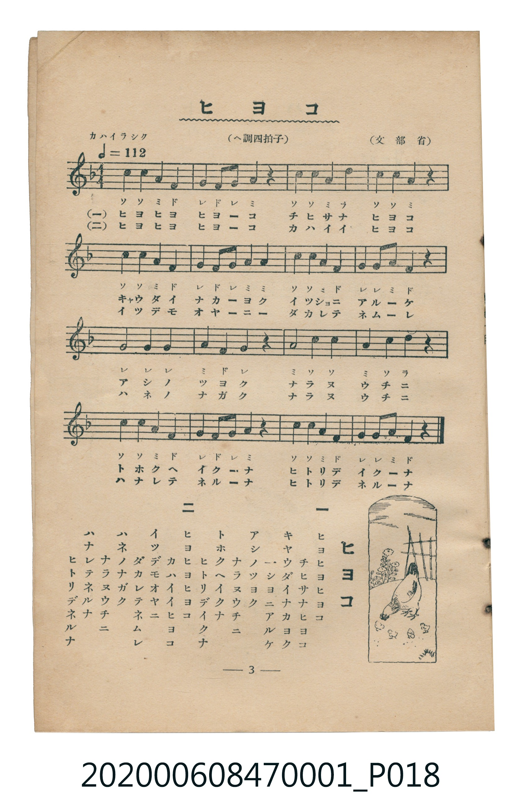

# ヒヨコ（小雞）

> Re:Shōka 使用 AI 協助辨識與重建樂譜，可能會有錯誤。歡迎[回報](https://github.com/TMDLang/reshoka/issues)。

- **鋼琴伴奏版**：<br><audio controls src="hiyoko.mp3"></audio>
- **NEUTRINO 歌聲合成版**：<br><audio controls src="hiyoko_neutrino.mp3"></audio>

- 詞：文部省
- 曲：文部省
- 臺灣教育會公認《新定兒童唱歌》尋常科第一學年用（2020.006.0847.0001）

## 說明

曲目說明
中文解釋：描寫小雞的叫聲、動作與可愛模樣。

原書資訊與歌詞全文（對應 P018.jpg，書頁 p. 3，第一學期第 3 首）：
調性與拍號：ヘ調四拍子（F 大調 4/4 拍），「カハイラシク」♩=112


## 歌詞

```text
一
ヒヨヒヨヒヨコ
チヒサナヒヨコ
キヤウダイナカヨク
一シヨニアルケ
アシノツヨク
ナラヌウチニ
トホクヘイクナ
ヒトリデイクナ

二
ヒヨヒヨヒヨコ
カハイイヒヨコ
イツデモオヤニ
ダカレテネムレ
ハネノナガク
ナラヌウチニ
ハナレテネルナ
ヒトリデネルナ
```

## ABC

<div class="abc-score" data-abc-src="hiyoko.abc" aria-label="五線譜載入中"></div>

[下載 ABC 原始檔](hiyoko.abc)

## TMD 檔案連結

- [主旋律 TMD 檔案](hiyoko.tmd) [[在 TMD Studio 編輯](https://tmdlang.github.io/Tmd-TS/#tmd=s7IKdvYPcrWy4qpTUCpJTLdSSM7PyUlNLsnMz7MqzsjMK0nNjM_KTMmPL87Iz05Ugisry88pzU21Si9KTEmNN4w3MjAyiDcwMIs3sDAxBzIMDBFKi_NLi5JTrYqTM_Lzc-JLUitKkvLzsxHyBUX5Zal5iXlANQVFIBtTwIoQClLLMlNSQdKpKZkl-UWZiTlI7kgtKga7FWxJfElRYl5xclFmAcgDCFUlGalAxybmZeYi6wUalZ6ZZ5Wbn5dUCvQeskRJRj7QawUZlVYZmcUgO5MTc-KzE_OQQgBqY0FieqpVgIGhhRKXlpbC4-ZJj5tXPG7a_H5Px9MN_S9nz3u_p1NBS4tL0VbB0NCIy95WwY3LxkTfxA5kzouVQOlZz6a1v2xe8XxOI9jsZ7M3YYi9aN_1vHHxs6kzXzRtejan-Wnrmhereh83dD2btuHpullPWyc9X7306ZSNz9b2PG7ofrqh--mOHc-XT3y-Zs2THQ1P1-54unPL8ykrgC4CxZIeMJb0QLEEZBgYAl2nxKWvpQC09fnsdS9WrXo2o49LQUHhyY61QCe8WL74ZXs3yDn9_U_Xr4Z46Pmslqf9q180bnrc0Pi0e-qTvXNedLQ_7V__rGX2sxULn61Y_LihiUtLnwtkrC21AMhNT_vmP5u948Xm9hcruoBWAn0LDL-nrSuADgWHdu-z9k4FUEzoZRWkv9_TA1T8ckGjQoGegjGQBw-NZ3PmA9kKxgovl00Deh_oO5DhL1btf9awHGRsd--LmfOBoo-bZwAFn86eDRR5unYC0Ao3hadLlgPFFIDxpwAUBesGBnnP46bVj5v7Hzctedy88nHT9sdN6x839D6audIWFOWQ4GwAUdDUgUw2bYZINIL4TVsfN3ehSjStfdy85HHTssfNDWDzu8B2AaXXQ80F2Qcyrftx06LHzasfN22E6FsEluh73NyCUA42feXjZqCDgQYCreyGiHY8bp4NcnTzDJAdIEYX3LlAuVWPm9sREmB7d_Xg9w88QEBuRpEA8oEuan_cDHQg0GAgF-oIoE-AmtY8bm573Nz7uHkBkA2R6AfzgT4B-n0NAZ8A1QIl4IYADcT0CbIE5SkTChRAKd4jszI_O98qIDMxL9-hxqCmGmSFgo2Flh2YgS1DKEDS5YuFPQoaJgrAHPZ8fYMOPBVrYtEAtAhkWI2CqYIuGBsDsSEQ1ygYgVlGYBEDsAiyGjMMEbAasGk-hjWgQALygXEFJhFsNJmmzUAyHireiFDbtBXM7sKnA2KXEVl2Na0Gi_eDxZfASdx24Q_zXT3UCnNQiENEQBimxhgsD4IgNZA4AYmghTkofy8GO3wZ2BMNKB7rgnob4b310MAAB0BzM5AFzOXLgcxuuG3AvA_kQ7U1bcQMe6jmFjDZDiYXQXWuArJBsiAxJBOhzloNZK0B4jYkmV4gXgDVsYbIsN_RSU7Yg0IZBEE0CNfAwxTEg6R3kAgIwuIJIgJigVI_etiDfA0Jpe1g9_dB_QQJGUSAw1I7KG1DfLoSTPZAQw0SdZC8AAo19LQOSrMQfb0o9oDMA5ZpFNqDN6yB9Rc9yhaYGpzpvLkD7OrZcL8CKxuoryB5GSIG8jksFCC5GqJvFZgEpVWIDoh6FB1o4Q0NXXCahKRYSGoF8SAlCVF2gdM3LAsi7Krl4tK1U4CU9wpAljIXAA)]
- [鋼琴伴奏 TMD 檔案](hiyoko_piano.tmd) [[在 TMD Studio 編輯](https://tmdlang.github.io/Tmd-TS/#tmd=s7IKdvYPcrWy4qpTUCpJTLdSyC8qychPL0osyKi0ysgsLskvykxOzInPTsxLVIIrKs4vLUpOjS9ITE-1CjAwtFDi0tJSeNw86XHzisdNm9_v6XjZvef5hC1P9mx5urT_eWfH-z2dClpaXIq2CoaGRlz2tgpuXDYm-iZ2IANfrJz3fs-sZ9PaXzaveD6nEWzJs9mbMMRetO963rj42dSZL5o2PZvT_LR1zYtVvY8bup5N2_B03aynrZOer176dMrGZ2t7Hjd0P93Q_XTHjufLJz5fs-bJjoana3c83bnl-ZQVQKcZGRgZ6BkYmOkZWJiYAxkGhkDXKXFxeWRW5mfnWwVkJublB3k41BjUVHMpAIGNhZYdmKGvpWCLDhQg5r9Y2KOgYaLwdEP_8_UNOgqgINHLKkjXxKJBSx9sWI2CqYIuGBsDsSEQ1ygYgVlGYBEDsAiyGjMMEbAasGk-hjWg4AfygTEAJhFsNJmmzUAyHireiFDbtBXM7sKnA2KXEVl2Na0Gi_eDxZfASdx24Q_zXT3UCnNQiENEQBimxhgsD4IgNZA4AYmghXnT2sfNi8EOXwb2RAOKx7qg3kZ4bz00MMAB0NwMZG1_3LwcyOyG2_a4aRGQD9XWtBEz7KGaW8BkO5hcBNW5CsgGyYLEkEyEOms1kLUGiNuQZHqBeAFUxxoiw35HJzlhDwplEATRIFwDD1MQD5LeQSIgCIsniAiIBUr96GEP8jUklLaD3d8H9RMkZBABDkvtoLQN8elKMNkDDTVI1EHyAijU0NM6KM1C9PWi2AMy73ETKNQosQdvWD-dPZseZQtMDc503twBdvVsuF8fN8-A-gqSlyFiIJ_DQgGSqyH6VoFJUFqF6ICoR9GBFt7Q0AWnSUiKhaRWEA9SkhBlFzh9w7Igwq5a1OLeB7m4N4EW9zUKhvEK0YaxMAoYYvFAlmk8WMQAIW8CpExA8gj1QFkizICIELAFFqMwUTgDrhMkguQcdIOBziPOOdjMQHcMMOB07RQgYRftA1SCxDMC85S5AA)]

## 分析

```text
================================================================================
📊 TMD Song Profile: [ ヒヨコ（小雞） ]
================================================================================
⏱  Duration:       0:34 (34.3s), 16 measures total
🎼 Key & Tempo:    首調基準 F, != 112.0 BPM, <4/4>
   - 分析範圍：      由實際發聲的音符與和弦推測調性；播放脈絡另行呈現
🎤 人聲音域:    F4 (MIDI 65) – D5 (MIDI 74) [跨度: 9 個半音 / 0.8 個八度, 難度: easy]
   - 最低音:  F4 in [Hiyoko #1 @ m.1, 0:01]
   - 最高音: D5 in [Hiyoko #1 @ m.3, 0:05]
   - 適合: soprano, mezzo-soprano, contralto, tenor, baritone, bass
🏛  結構:      Hiyoko (34.3s)
⚡ 編曲密度:        Peak 1 軌道同時演奏
🗝  調性診斷：       C 調性不明確（純淨自然大調，未偵測到可信轉調）
   - 風格氣質:    純淨自然大調（陽光明朗、易唱易記，無明顯調外色彩）
   - 轉調歷程:    全曲維持單一推測調性（未偵測到可信轉調）
   - 核心骨幹音:  C, A, G, F, D
   - 調性數值:    C 調性不明確 [相關度: 0.76, 穩定度: Ambiguous, 自然音純度: 100.0%]
   - 候選調性 (K-S): C 大調 (0.76), A 小調 (0.76), F 大調 (0.74)
   - 五度圈歷程:   +0
   - 各段落調性細節:
     • [Hiyoko #1]: C 調性不明確 (r: 0.76, 自然音純度: 100.0%)

  [ 五度圈游移軌跡 ]
              [C ]*
         F            G  
      Bb               D  
      Eb               A  
         Ab           E  
            Db       B  
               F# 
     (* = active key center)

  [ 十二半音累積音高分佈 ]
     C  : ████████████████████████  28.9%
     C# :                            0.0%
     D  : ███                        3.5%
     D# :                            0.0%
     E  :                            0.0%
     F  : ███████████████           18.4%
     F# :                            0.0%
     G  : █████████████████         20.2%
     G# :                            0.0%
     A  : ████████████████████████  28.9%
     A# :                            0.0%
     B  :                            0.0%
--------------------------------------------------------------------------------
Assignment 軌道音域：
  - Piano         : F4 – D5 (9 個半音 / 0.8 個八度, 60 個音符)
================================================================================
```


## 原書掃描頁




