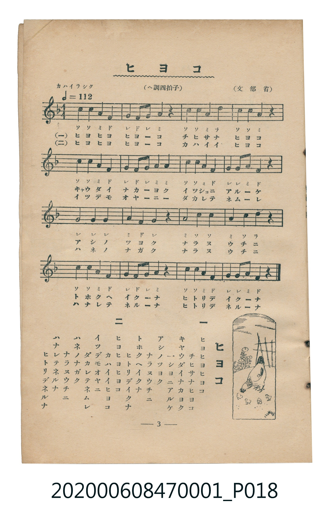

# ヒヨコ（小雞）

> Re:Shōka 使用 AI 協助辨識與重建樂譜，可能會有錯誤。歡迎回報。

- **NEUTRINO 歌聲合成版**：<br><audio controls src="hiyoko_neutrino.mp3"></audio>
- **鋼琴伴奏版**：<br><audio controls src="hiyoko.mp3"></audio>


- 詞：文部省
- 曲：文部省
- 臺灣教育會公認《新定兒童唱歌》尋常科第一學年用（2020.006.0847.0001）

## 說明

曲目說明
中文解釋：描寫小雞的叫聲、動作與可愛模樣。

原書資訊與歌詞全文（對應 P018.jpg，書頁 p. 3，第一學期第 3 首）：
調性與拍號：ヘ調四拍子（F 大調 4/4 拍），「カハイラシク」♩=112


## 歌詞

```text
一
ヒヨヒヨヒヨコ
チヒサナヒヨコ
キヤウダイナカヨク
一シヨニアルケ
アシノツヨク
ナラヌウチニ
トホクヘイクナ
ヒトリデイクナ

二
ヒヨヒヨヒヨコ
カハイイヒヨコ
イツデモオヤニ
ダカレテネムレ
ハネノナガク
ナラヌウチニ
ハナレテネルナ
ヒトリデネルナ
```

## ABC

```abc
X:1
T:ヒヨコ（小雞）
C:曲：文部省
M:4/4
L:1/16
Q:1/4=112
K:F
V:V1 name="Piano" snm="Pia"
[V:V1]
c4 c4 A4 F4 | G4 F2 G2 A4 z4 | c4 c4 A4 d4 | c4 c4 A4 z4 |
w: 1.~ヒ ヨ ヒ ヨ | ヒ ヨ _ コ | チ ヒ サ ナ | ヒ ヨ コ
w: 2.~ヒ ヨ ヒ ヨ | ヒ ヨ _ コ | カ ハ イ イ | ヒ ヨ コ
c4 c4 A4 F4 | G2 F2 G4 A4 A4 | c4 c2 A2 F8 | G2 G2 A4 F4 z4 |
w: 1.~キャ ウ ダ イ | ナ カ _ ヨ ク | イ ッ ショ ニ | ア ル _ ケ
w: 2.~イ ツ デ モ | オ ヤ _ ニ _ | ダ カ レ テ | ネ ム _ レ
G8 G4 G4 | A4 F4 G4 z4 | A8 c4 c4 | A4 c4 d4 z4 |
w: 1.~ア シ ノ | ツ ヨ ク | ナ ラ ヌ | ウ チ ニ
w: 2.~ハ ネ ノ | ナ ガ ク | ナ ラ ヌ | ウ チ ニ
c4 c4 A4 F4 | G4 F2 G2 A4 z4 | c4 c4 A4 F4 | G2 G2 A4 F4 z4 |
w: 1.~ト ホ ク ヘ | イ ク _ ナ | ヒ ト リ デ | イ ク _ ナ
w: 2.~ハ ナ レ テ | ネ ル _ ナ | ヒ ト リ デ | ネ ル _ ナ
```

## TMD 檔案連結

- [主旋律 TMD 檔案](hiyoko.tmd) [[在 TMD Studio 編輯](https://tmdlang.github.io/Tmd-TS/#tmd=s7IKdvYPcrWy4qpTUCpJTLdSSM7PyUlNLsnMz7MqzsjMK0nNjM_KTMmPL87Iz05Ugisry88pzU21Si9KTEmNN4w3MjAyiDcwMIs3sDAxBzIMDBFKi_NLi5JTrYqTM_Lzc-JLUitKkvLzsxHyBUX5Zal5iXlANQVFIBtTwIoQClLLMlNSQdKpKZkl-UWZiTlI7kgtKga7FWxJfElRYl5xclFmAcgDCFUlGalAxybmZeYi6wUalZ6ZZ5Wbn5dUCvSeEpeWlsLj5kmPm1c8btr8fk_H0w39L2fPe7-nU0FLi0vRVsHQ0IjL3lbBjcvGRN_EDmTMi5VA6VnPprW_bF7xfE4j2OhnszdhiL1o3_W8cfGzqTNfNG16Nqf5aeuaF6t6Hzd0PZu24em6WU9bJz1fvfTplI3P1vY8buh-uqH76Y4dz5dPfL5mzZMdDU_X7ni6c8vzKSuALgIFsx4wmPVAwQxkGBgCXafEpa-lALT1-ex1L1atejajj0tBQeHJjrVAJ7xYvvhlezfIOf39T9evhnjo-ayWp_2rXzRuetzQ-LR76pO9c150tD_tX_-sZfazFQufrVj8uKGJS0ufC2SsLbUAyE1P--Y_m73jxeb2Fyu6gFYCfQsMv6etK4AOBYd277P2ToUAA0MLvayC9Pd7eoCKXy5oVCjQUzAG8uCh8WzOfCBbwVjh5bJpQO8DfQcy_MWq_c8aloOM7e59MXM-UPRx8wyg4NPZs4EiT9dOAFrhpvB0yXKgmAIw_hSAomDdwCDvedy0-nFz_-OmJY-bVz5u2v64af3jht5HM1fagqIcEpwNIAqaOpDJps0QiUYQv2nr4-YuVImmtY-blzxuWva4uQFsfhfYLqD0eqi5IPtApnU_blr0uHn146aNEH2LwBJ9j5tbEMrBpq983Ax0MNBAoJXdENGOx82zQY5ungGyA8TogjsXKLfqcXM7QgJs764e_P6BBwjIzSgSQD7QRe2Pm4EOBBoM5EIdAfQJUNOax81tj5t7HzcvALIhEv1gPtAnQL-vIeAToFqgBNwQoIGYPkGWoDxlQoECKMV7ZFbmZ-dbBWQm5uU71BjUVIOsULCx0LIDM7BlCAVIunyxsEdBw0QBmMOer2_QgadiTSwagBaBDKtRMFXQBWNjIDYE4hoFIzDLCCxiABZBVmOGIQJWAzbNx7AGFEhAPjCuwCSCjSbTtBlIxkPFGxFqm7aC2V34dEDsMiLLrqbVYPF-sPgSOInbLvxhvquHWmEOCnGICAjD1BiD5UEQpAYSJyARtDAH5e_FYIcvA3uiAcVjXVBvI7y3HhoY4ABobgaygLl8OZDZDbcNmPeBfKi2po2YYQ_V3AIm28HkIqjOVUA2SBYkhmQi1Fmrgaw1QNyGJNMLxAugOtYQGfY7OskJe1AogyCIBuEaeJiCeJD0DhIBQVg8QURALFDqRw97kK8hobQd7P4-qJ8gIYMIcFhqB6VtiE9XgskeaKhBog6SF0Chhp7WQWkWoq8XxR6QecAyjUJ78IY1sP6iR9kCU4MznTd3gF09G-5XYGUD9RUkL0PEQD6HhQIkV0P0rQKToLQK0QFRj6IDLbyhoQtOk5AUC0mtIB6kJCHKLnD6hmVBhF21XFy6dgqQ8l4ByFLmAgA)]
- [鋼琴伴奏 TMD 檔案](hiyoko_piano.tmd) [[在 TMD Studio 編輯](https://tmdlang.github.io/Tmd-TS/#tmd=s7IKdvYPcrWy4tLSUnjcPOlx84rHTZvf7-l42b3n-YQtT_Zsebq0_3lnx_s9nQpaWlyKtgqGhkZc9rYKblw2Jvomdlx1CkovVs57v2fWs2ntL5tXPJ_TqAQSezZ7E4bYi_ZdzxsXP5s680XTpmdzmp-2rnmxqvdxQ9ezaRuerpv1tHXS89VLn07Z-Gxtz-OG7qcbup_u2PF8-cTna9Y82dHwdO2Opzu3PJ-yAug0IwMjAz0DAzM9AwsTcyDDwBDoOiUuLo_MyvzsfKuAzMS8_CAPhxqDmmouBSCwsdCyAzP0tRRs0YECxPwXC3sUNEwUnm7of76-QUchwMDQQi-rIF0TiwYtfbBhNQqmCrpgbAzEhkBco2AEZhmBRQzAIshqzDBEwGrApvkY1oCCH8gHxgCYRLDRZJo2A8l4qHgjQm3TVjC7C58OiF1GZNnVtBos3g8WXwIncduFP8x39VArzEEhDhEBYZgaY7A8CILUQOIEJIIW5k1rHzcvBjt8GdgTDSge64J6G-G99dDAAAdAczOQtf1x83Igsxtu2-OmRUA-VFvTRsywh2puAZPtYHIRVOcqIBskCxJDMhHqrNVA1hogbkOS6QXiBVAda4gM-x2d5IQ9KJRBEESDcA08TEE8SHoHiYAgLJ4gIiAWKPWjhz3I15BQ2g52fx_UT5CQQQQ4LLWD0jbEpyvBZA801CBRB8kLoFBDT-ugNAvR14tiD8i8x02gUKPEHrxh_XT2bHqULTA1ONN5cwfY1bPhfn3cPAPqK0hehoiBfA4LBUiuhuhbBSZBaRWiA6IeRQdaeENDF5wmISkWklpBPEhJQpRd4PQNy4IIu2pRi3sf5OLeBFrc1ygYxitEG8bCKGCIxQNZpvFgEQOEvAmQMgHJI9QDZYkwAyJCwBZYjMJE4Qy4TpAIknPQDQY6jzjnYDMD3THAgNO1U4CEXbQPUAkSzwjMU-YCAA)]

## 分析

```text
================================================================================
📊 TMD Song Profile: [ ヒヨコ（小雞） ]
================================================================================
⏱  Duration:       0:34 (34.3s), 16 measures total
🎼 Key & Tempo:    首調基準 F, != 112.0 BPM, <4/4>
   - 分析範圍：      由實際發聲的音符與和弦推測調性；播放脈絡另行呈現
🎤 人聲音域:    F4 (MIDI 65) – D5 (MIDI 74) [跨度: 9 個半音 / 0.8 個八度, 難度: easy]
   - 最低音:  F4 in [Hiyoko #1 @ m.1, 0:01]
   - 最高音: D5 in [Hiyoko #1 @ m.3, 0:05]
   - 適合: soprano, mezzo-soprano, contralto, tenor, baritone, bass
🏛  結構:      Hiyoko (34.3s)
⚡ 編曲密度:        Peak 1 軌道同時演奏
🗝  調性診斷：       C 調性不明確（純淨自然大調，未偵測到可信轉調）
   - 風格氣質:    純淨自然大調（陽光明朗、易唱易記，無明顯調外色彩）
   - 轉調歷程:    全曲維持單一推測調性（未偵測到可信轉調）
   - 核心骨幹音:  C, A, G, F, D
   - 調性數值:    C 調性不明確 [相關度: 0.76, 穩定度: Ambiguous, 自然音純度: 100.0%]
   - 候選調性 (K-S): C 大調 (0.76), A 小調 (0.76), F 大調 (0.74)
   - 五度圈歷程:   +0
   - 各段落調性細節:
     • [Hiyoko #1]: C 調性不明確 (r: 0.76, 自然音純度: 100.0%)

  [ 五度圈游移軌跡 ]
              [C ]*
         F            G  
      Bb               D  
      Eb               A  
         Ab           E  
            Db       B  
               F# 
     (* = active key center)

  [ 十二半音累積音高分佈 ]
     C  : ████████████████████████  28.9%
     C# :                            0.0%
     D  : ███                        3.5%
     D# :                            0.0%
     E  :                            0.0%
     F  : ███████████████           18.4%
     F# :                            0.0%
     G  : █████████████████         20.2%
     G# :                            0.0%
     A  : ████████████████████████  28.9%
     A# :                            0.0%
     B  :                            0.0%
--------------------------------------------------------------------------------
Assignment 軌道音域：
  - Piano         : F4 – D5 (9 個半音 / 0.8 個八度, 60 個音符)
================================================================================
```


## 原書掃描頁




