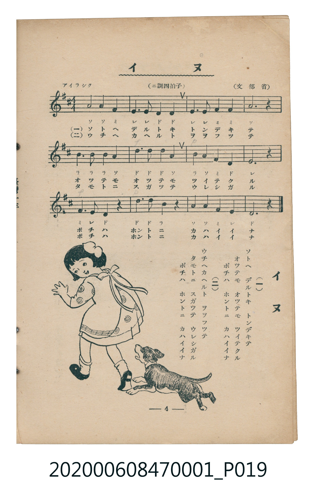

# イヌ（小狗）

> Re:Shōka 使用 AI 協助辨識與重建樂譜，可能會有錯誤。歡迎回報。

- **鋼琴伴奏版**：<br><audio controls src="inu.mp3"></audio>
- **NEUTRINO 歌聲合成版**：<br><audio controls src="inu_neutrino.mp3"></audio>

- 詞：文部省
- 曲：文部省
- 臺灣教育會公認《新定兒童唱歌》尋常科第一學年用（2020.006.0847.0001）

## 說明

曲目說明
中文解釋：歌唱小狗跟隨孩子、親近又可愛的日常。

原書資訊與歌詞全文（對應 P019.jpg，書頁 p. 4，第一學期第 4 首）：
調性與拍號：ニ調四拍子（D 大調 4/4 拍），「アイラシク」


## 歌詞

```text
（一）
ソトヘ　デルトキ　トンデキテ
オツテモ　オツテモ　ツイテクル
ポチハ　ホントニ　カハイイナ

（二）
ウチヘカヘルト　ヲヲフツテ
タモトニ　スガツテ　ウレシガル
ポチハ　ホントニ　カハイイナ
```

## ABC

<div class="abc-score" data-abc-src="inu.abc" aria-label="五線譜載入中"></div>

[下載 ABC 原始檔](inu.abc)

## TMD 檔案連結

- [主旋律 TMD 檔案](inu.tmd) [[在 TMD Studio 編輯](https://tmdlang.github.io/Tmd-TS/#tmd=s7IKdvYPcrWy4qpTUCpJTLdSSM7PyUlNLsnMz7MqzsjMK0nNjM_KTMmPL87Iz05Ugisry88pzU21Si9KTEmNN4w3MjAyiDcwMIs3sDAxBzIMDBFKi_NLi5JTrYqTM_Lzc-JLUitKkvLzsxHyBUX5Zal5iXlANQVFIBtTwIoQClLLMlNSQdKpKZkl-UWZiTlI7kgtKga7FWxJfElRYl5xclFmAcgDCFUlGalAxybmZeYi6wUalZ6ZZ5Wbn5dUCvQeskRJRj7QawUZlVYZmcUgO5MTc-KzE_OQQgBqY0FieqpVgIGhpRKXlpbC46Ylj5t73u_peLqh_3n39Pd7OhW0tLgUbRUMDSy47G0VXLhsTPRN7ECGvFg57_2eWc-mtb9sXvF8TiPY4GezN2GIvWjf9bxx8bOpM180bXo2p_lp65oXq3ofN3Q9m7bh6bpZT1snPV-99OmUjc_W9jxu6H66ofvpjh3Pl098vmbNkx0NT9fueLpzy_MpK4AuAkWRHjCK9EBRBGQYGAJdp8Slr6UAtPX57HUvVq16NqOPS0FB4cmOtUAnvFi--GV7N8g5a3uA5kM89GL7_JezVjxdu_Lp2gmPGxpfLFv1Yv_Ep_0dT_vXP2uZ_XxWy7PpS4EOeNzQxKWlzwUy3JZaAOSyp33zn83e8WJz-4sVXS862oEuA4bi09YVQOeCw7z3WXunAigy9LIK0t_v6QEqfrmgUaFAT8EEyIOHybM584FsBROFl8umAQMB6EeQ4S9W7X_WsBxkbHfvi5nzgaKPm7uBgk9nzwaKAD0MtMJF4emS5UAxBWAsKgBFwbqBAd_zuGkROO5XPm7a_rhp_eOGXi6QmUAtQCuBqkCcx017Hzd3PG6e8bih4XFz--Pm1SBu01owFyi-GSQI5Da3QVSvetzcAuQ8bl4EUoHGBbJB9rWBLGteDdbQPPdxc-Pj5n6w9GyweUBTu8GagVb1gzSA9HTBnbYLmFShTlsG1jsDrHIG1GkgczaB0VSI3RCl-0FOQBi983HTGqjTQFygQWvAgQAUJNVdQNWUJxQoUAAlQM-8UquAzMS8fIcag5pqkPkKNhZadmAGtsSpAEkjLxb2KGiYKIDS_PoGHXiK0sSiAWgLyLAaBVMFXTAE0cZAXKNgBOYbKRgCSRBGiIDkIWpgukDQACQCNs3HsAaUWqDiwOACkzPAOoCJBCq6GibTtBYqA-KBZDZDVSFk2pDsiUfYYwSyZxncnkZke5pWQ0VngO2CuQNk2iaozCYgngpmteC0B39Y7-ohJ6zNwOabgWlQCNYoGMaBhYAUmAURhEmDgho5ArAH9yqop1qg3gCmcmhA4JQBexuYdsFiYJmm9VAZSOBhD_D9UPMWwaO2G2rTTohM0xqY2WBTYZEEzFlg2e1QNbhsIpC8O8kJclAYwhIzOOSQghwUzhAxUGjDQhwU1kBVuEO8eS40HBqBuB_meiAbVEZApTqggQOVAqdJiGJosINJkKYu3AFOa4tqubh07RSAZU10rAKQocwFAA)]
- [鋼琴伴奏 TMD 檔案](inu_piano.tmd) [[在 TMD Studio 編輯](https://tmdlang.github.io/Tmd-TS/#tmd=s7IKdvYPcrWy4qpTUCpJTLdSyC8qychPL0osyKi0ysgsLskvykxOzInPTsxLVIIrKs4vLUpOjS9ITE-1CjAwtFTi0tJSeNy05HFzz_s9HS-79zyfsOXJni1Pl_Y_7-x4v6dTQUuLS9FWwdDAgsveVsGFy8ZE38QOZNqLlfPe75n1bFr7y-YVz-c0gm14NnsThtiL9l3PGxc_mzrzRdOmZ3Oan7auebGq93FD17NpG56um_W0ddLz1UufTtn4bG3P44bupxu6n-7Y8Xz5xOdr1jzZ0fB07Y6nO7c8n7IC6DQjAyMDPQMDMz0DCxNzIMPAEOg6JS4uz7xSq4DMxLz8IA-HGoOaai4FILCx0LIDM_S1FGzRgQLE8BcLexQ0TBSebuh_vr5BRwEUGHpZBemaWDRo6YMNq1EwVdAFQxBtDMQ1CkZgvpGCIZAEYYQISB6iBqYLBA1AImDTfAxrgAG_Fyr-uLkDTM4A63jc3A4VXQ2TaVoLlQHxQDKboaoQMm1I9sQj7DEC2bMMbk8jsj1Nq6GiM8B2wdwBMm0TVGYTEE8Fs1pw2oM_rHf1kBPWZmDzzcA0KARrFAzjwEJACsyCCMKkQUGNHAHYg3sV1FMtUG88bl4EDQicMmBvA3MIWAws07QeKgMJPOwBvh9q3iJ41HZDbdoJkWlaAzMbbCoskh43rwHLboeqwWUTgeTdSU6Qg8IQlpjBIYcU5KBwhoiBQhsW4qCwBqrCHeLNc6Hh0AjE_TDXA9mzQSkYlvIhgQOVAqdJiGJosINJkKYu3AFOa4tqkYoaH-SixgRa1ACDIV4h2jAWRgEDKh7IMo0nTgTEMIB6qEbBBChqgqSMEB-HMSB5qHVAQZguIAXiQTXDtSJ7AGQE0Me6dgpAT0f7AAVhTCMwU5kLAA)]

## 分析

```text
================================================================================
📊 TMD Song Profile: [ イヌ（小狗） ]
================================================================================
⏱  Duration:       0:26 (26.7s), 12 measures total
🎼 Key & Tempo:    首調基準 D, != 108.0 BPM, <4/4>
   - 分析範圍：      由實際發聲的音符與和弦推測調性；播放脈絡另行呈現
🎤 人聲音域:    D4 (MIDI 62) – D5 (MIDI 74) [跨度: 12 個半音 / 1.0 個八度, 難度: easy]
   - 最低音:  D4 in [Inu[] #1 @ m.2, 0:03]
   - 最高音: D5 in [Inu[] #1 @ m.6, 0:11]
   - 適合: soprano, mezzo-soprano, contralto, tenor, baritone, bass
🏛  結構:      Inu[] (26.7s)
⚡ 編曲密度:        Peak 1 軌道同時演奏
🗝  調性診斷：       D 大調（純淨自然大調，未偵測到可信轉調）
   - 風格氣質:    純淨自然大調（陽光明朗、易唱易記，無明顯調外色彩）
   - 轉調歷程:    全曲維持單一推測調性（未偵測到可信轉調）
   - 核心骨幹音:  D, A, E, F#, B
   - 調性數值:    D 大調 [相關度: 0.86, 穩定度: Moderate, 自然音純度: 100.0%]
   - 候選調性 (K-S): D 大調 (0.86), A 大調 (0.79), F# 小調 (0.55)
   - 五度圈歷程:   +2
   - 各段落調性細節:
     • [Inu[] #1]: D 大調 (r: 0.86, 自然音純度: 100.0%)

  [ 五度圈游移軌跡 ]
               C  
         F            G  
      Bb              [D ]*
      Eb               A  
         Ab           E  
            Db       B  
               F# 
     (* = active key center)

  [ 十二半音累積音高分佈 ]
     C  :                            0.0%
     C# :                            0.0%
     D  : ████████████████████████  27.9%
     D# :                            0.0%
     E  : █████████████████         19.8%
     F  :                            0.0%
     F# : █████████████             15.1%
     G  :                            0.0%
     G# :                            0.0%
     A  : ██████████████████████    25.6%
     A# :                            0.0%
     B  : ██████████                11.6%
--------------------------------------------------------------------------------
Assignment 軌道音域：
  - Piano         : D4 – D5 (12 個半音 / 1.0 個八度, 36 個音符)
================================================================================
```


## 原書掃描頁




