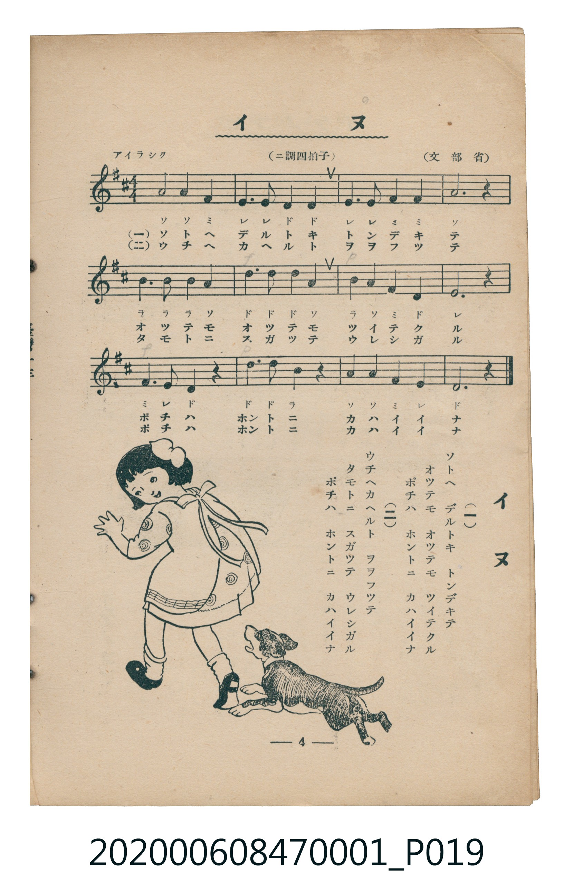

# イヌ

<audio controls src="inu.mp3"></audio>

- 詞：文部省
- 曲：文部省
- 臺灣教育會公認《新定兒童唱歌》尋常科第一學年用（2020.006.0847.0001）

## 說明

原書資訊與歌詞全文（對應 P019.jpg，書頁 p. 4，第一學期第 4 首）：
調性與拍號：ニ調四拍子（D 大調 4/4 拍），「アイラシク」

## 歌詞

```text
（一）
ソトヘ　デルトキ　トンデキテ
オツテモ　オツテモ　ツイテクル
ポチハ　ホントニ　カハイイナ

（二）
ウチヘカヘルト　ヲヲフツテ
タモトニ　スガツテ　ウレシガル
ポチハ　ホントニ　カハイイナ
```

## 原書掃描頁



## 分析

```text
================================================================================
📊 TMD Song Profile: [ イヌ ]
================================================================================
⏱  Duration:       0:26 (26.7s), 12 measures total
🎼 Key & Tempo:    首調基準 D, != 108.0 BPM, <4/4>
   - 分析範圍：      由實際發聲的音符與和弦推測調性；播放脈絡另行呈現
🎤 人聲音域:    D4 (MIDI 62) – D5 (MIDI 74) [跨度: 12 個半音 / 1.0 個八度, 難度: easy]
   - 最低音:  D4 in [Inu #1 @ m.2, 0:03]
   - 最高音: D5 in [Inu #1 @ m.6, 0:11]
   - 適合: soprano, mezzo-soprano, contralto, tenor, baritone, bass
🏛  結構:      Inu (26.7s)
⚡ 編曲密度:        Peak 1 軌道同時演奏
🗝  調性診斷：       D 大調（純淨自然大調，未偵測到可信轉調）
   - 風格氣質:    純淨自然大調（陽光明朗、易唱易記，無明顯調外色彩）
   - 轉調歷程:    全曲維持單一推測調性（未偵測到可信轉調）
   - 核心骨幹音:  D, A, E, F#, B
   - 調性數值:    D 大調 [相關度: 0.86, 穩定度: Moderate, 自然音純度: 100.0%]
   - 候選調性 (K-S): D 大調 (0.86), A 大調 (0.79), F# 小調 (0.55)
   - 五度圈歷程:   +2
   - 各段落調性細節:
     • [Inu #1]: D 大調 (r: 0.86, 自然音純度: 100.0%)

  [ 五度圈游移軌跡 ]
               C  
         F            G  
      Bb              [D ]*
      Eb               A  
         Ab           E  
            Db       B  
               F# 
     (* = active key center)

  [ 十二半音累積音高分佈 ]
     C  :                            0.0%
     C# :                            0.0%
     D  : ████████████████████████  27.9%
     D# :                            0.0%
     E  : █████████████████         19.8%
     F  :                            0.0%
     F# : █████████████             15.1%
     G  :                            0.0%
     G# :                            0.0%
     A  : ██████████████████████    25.6%
     A# :                            0.0%
     B  : ██████████                11.6%
--------------------------------------------------------------------------------
Assignment 軌道音域：
  - Piano         : D4 – D5 (12 個半音 / 1.0 個八度, 36 個音符)
================================================================================
```

## ABC

```abc
X:1
T:イヌ
C:曲：文部省
M:4/4
L:1/16
Q:1/4=108
K:D
V:V1 name="Piano" snm="Pia"
[V:V1]
a8 a4 f4 | e6 e2 d4 d4 | e6 e2 f4 f4 | a12 z4 |
b6 b2 b4 a4 | d6 d2 d4 a4 | b4 a4 f4 d4 | e12 z4 |
f6 e2 d4 z4 | d6 d2 b4 z4 | a4 a4 f4 e4 | d12 z4 |
```

- [主旋律 TMD 檔案](inu.tmd)
- [鋼琴伴奏 TMD 檔案](inu_piano.tmd)
