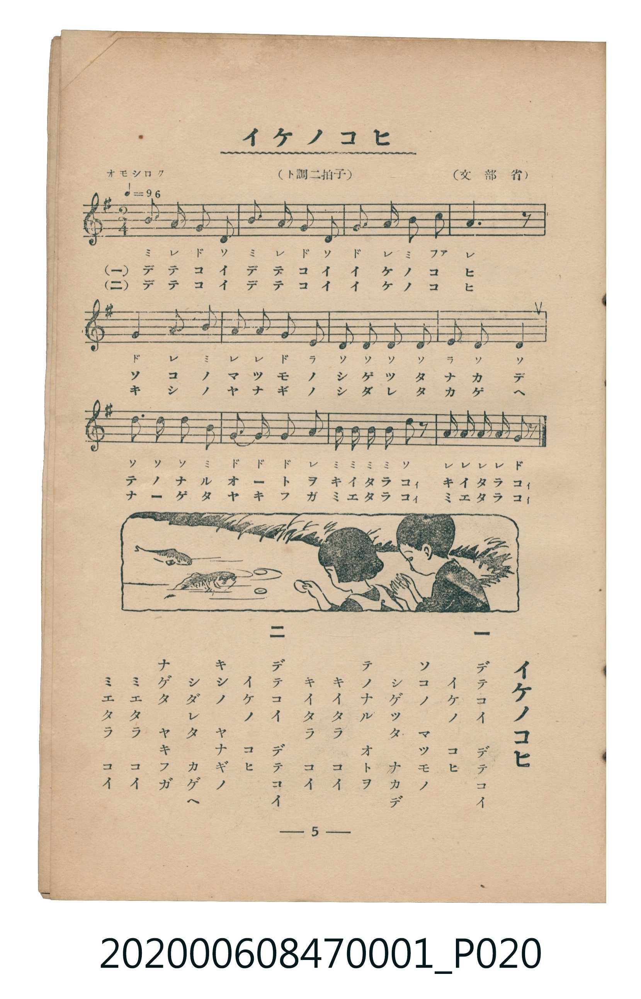

# イケノコヒ

<audio controls src="ike_no_koi.mp3"></audio>

- 詞：文部省
- 曲：文部省
- 臺灣教育會公認《新定兒童唱歌》尋常科第一學年用（2020.006.0847.0001）

## 說明

原書資訊與歌詞全文（對應 P020.jpg，書頁 p. 5，第一學期第 5 首）：
調性與拍號：ト調二拍子（G 大調 2/4 拍），「オモシロク」♩=96

## 歌詞

```text
一
デテコイ　デテコイ
イケノ　コヒ
ソコノ　マツモノ
シゲツタ　ナカデ
テノナル　オトヲ
キイタラ　コイ
キイタラ　コイ

二
デテコイ　デテコイ
イケノ　コヒ
キシノ　ヤナギノ
シダレタ　カゲヘ
ナゲタ　ヤキフガ
ミエタラ　コイ
ミエタラ　コイ
```

## ABC

```abc
X:1
T:イケノコヒ
C:曲：文部省
M:2/4
L:1/16
Q:1/4=96
K:G
V:V1 name="Piano" snm="Pia"
[V:V1]
B3 A G2 D2 | B3 A G2 D2 | G2 A2 B3 c | A6 z2 |
G3 A B2 A2 | A3 G E2 D2 | D3 D E2 D2 | D8 |
D3 D D2 B,2 | G3 G G2 A2 | B B B B d2 z2 | A A A A G2 z2 |
```

## TMD 檔案連結

- [主旋律 TMD 檔案](ike_no_koi.tmd) [[在 TMD Studio 編輯](https://tmdlang.github.io/Tmd-TS/#tmd=s7IKdvYPcrWy4tLSUnjctORx08bHzX2PmzY_bp6koKXFpWirYGnGZW-r4M5lY6RvYsdVp6D0YuW893tmPZvW_rJ5xfM5jUogsWezN2GIvWjf9bxx8bOpM180bXo2p_lp65oXq3ofN3Q9m7bh6bpZT1snPV-99OmUjc_W9jxu6H66ofvpjh3Pl098vmbNkx0NT9fueLpzy_MpK97v6TAyMDLQMzAw0zOwMDEHMgwM3-_pVOLi0tdSsKUW4FJQUHjaN__Z7B0vNre_WNH1oqMd6C6gT5-2rgD6CuiKpxt6n7V3KgSAHJNVkP5-Tw9Q8csFjQoFegqmQB7c3c_mzAeyFUwVXi6bBnQoMFhAhr9Ytf9Zw3KQsd29L2bOB4o-bu4ACj7Z1QMUebp2AtAKd4WnS5YDxRSAIa0AFAXrBgZOz-OmVY-bFz1u2v64ee3jpvWPG3ofzVxpC4wYkMlAW0HU4-b2x81toJgDxmJDAzIXLA2PW6AcOHohonvBHLBo87zHzS0ge5r7IHLbHzdtAgk17QdLdz1uWg00FmJZG0gTUKh5NdhAoPs6HjdvgugDuhFo2f7HzSuhlsGcgE0C7IVdPRR4AWgqMGAgXlgCduY6JC80A0XXQL0AdD_IRzMglgEVboL5DWjy2sfNUx83rYHIzX_ctAKbF3BJUJ4CoUBBS5-LyzM71S_fOz_TKiAzMS_focagRqEaZIuCjaGZlh2YhS3xK0DS4IuFPQoaJgpPN_Q_X9-gA0-xmlg0AC0DGVajYKygC4RGCoZA0jQeSGAVAjGNgBgiZQIUAfFg0ACkBhyfuF23q4cc14HsBdkMshdkI8xeQwUzkMOgrgNTYB4WUQQk5MQdneQ4EWE5mGWMCDCQM2EBBwpVCDSFBRhQHAJBaiBBWMvFpWunAEsECkC2MhcXAA)]
- [鋼琴伴奏 TMD 檔案](ike_no_koi_piano.tmd) [[在 TMD Studio 編輯](https://tmdlang.github.io/Tmd-TS/#tmd=s7IKdvYPcrWy4tLSUnjctORx08bHzX2PmzY_bp70fk_Hy-49zydsebJny9Ol_c87O97v6VTQ0uJStFWwNOOyt1Vw57Ix0jex46pTUHqxct77PbOeTWt_2bzi-ZxGJZDYs9mbMMRetO963rj42dSZL5o2PZvT_LR1zYtVvY8bup5N2_B03aynrZOer176dMrGZ2t7Hjd0P93Q_XTHjufLJz5fs-bJjoana3c83bnl-ZQVQJcZGRgZ6BkYmOkZWJiYAxkGhkDHKXFxeWan-uV752daBWQm5uUHeTjUGNQoVHMpAIGNoZmWHZilr6Vgiw4UIHa8WNijoGGi8HRD__P1DToKASBrsgrSNbFo0NIHG1ajYKygC4RGCoZA0jQeSGAVAjGNgBgiZQIUAfFg0ACkhgu_63b1kOM6kL0gm0H2gmyE2WuoYAZyGNR1YArMwyKKgIScuKOTHCciLAezjBEBBnImLOBAoQqBprAAA4pDIEgNJAhr0dOAD0oaMIEmAaDx8QrRhrHoDJN4EMs0Ph5oXA2SSlOwuAlQPNoQrgQqCjMAm8GoKiC6wAaAHKprpwBzqwIaW5mLCwA)]

## 分析

```text
================================================================================
📊 TMD Song Profile: [ イケノコヒ ]
================================================================================
⏱  Duration:       0:15 (15.0s), 12 measures total
🎼 Key & Tempo:    首調基準 G, != 96.0 BPM, <2/4>
   - 分析範圍：      由實際發聲的音符與和弦推測調性；播放脈絡另行呈現
🎤 人聲音域:    B3 (MIDI 59) – D5 (MIDI 74) [跨度: 15 個半音 / 1.2 個八度, 難度: moderate]
   - 最低音:  B3 in [IkeNoKoi #1 @ m.9, 0:10]
   - 最高音: D5 in [IkeNoKoi #1 @ m.11, 0:13]
   - 適合: soprano, mezzo-soprano, contralto, tenor, baritone, bass
🏛  結構:      IkeNoKoi (15.0s)
⚡ 編曲密度:        Peak 1 軌道同時演奏
🗝  調性診斷：       D 大調（純淨自然大調，未偵測到可信轉調）
   - 風格氣質:    純淨自然大調（陽光明朗、易唱易記，無明顯調外色彩）
   - 轉調歷程:    全曲維持單一推測調性（未偵測到可信轉調）
   - 核心骨幹音:  D, A, G, B, E
   - 調性數值:    D 大調 [相關度: 0.85, 穩定度: Moderate, 自然音純度: 98.9%]
   - 候選調性 (K-S): D 大調 (0.85), G 大調 (0.76), B 小調 (0.62)
   - 五度圈歷程:   +2
   - 各段落調性細節:
     • [IkeNoKoi #1]: D 大調 (r: 0.85, 自然音純度: 98.9%, 調外音: C)

  [ 五度圈游移軌跡 ]
               C  
         F            G  
      Bb              [D ]*
      Eb               A  
         Ab           E  
            Db       B  
               F# 
     (* = active key center)

  [ 十二半音累積音高分佈 ]
     C  : █                          1.1%
     C# :                            0.0%
     D  : ████████████████████████  31.1%
     D# :                            0.0%
     E  : ███                        4.4%
     F  :                            0.0%
     F# :                            0.0%
     G  : ███████████████           20.0%
     G# :                            0.0%
     A  : ███████████████████       24.4%
     A# :                            0.0%
     B  : ███████████████           18.9%
--------------------------------------------------------------------------------
Assignment 軌道音域：
  - Piano         : B3 – D5 (15 個半音 / 1.2 個八度, 44 個音符)
================================================================================
```


## 原書掃描頁




