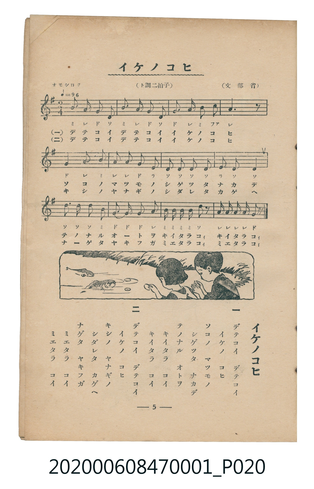

# イケノコヒ（池中鯉魚）

> Re:Shōka 使用 AI 協助辨識與重建樂譜，可能會有錯誤。歡迎回報。

- **鋼琴伴奏版**：<br><audio controls src="ike_no_koi.mp3"></audio>
- **NEUTRINO 歌聲合成版**：<br><audio controls src="ike_no_koi_neutrino.mp3"></audio>

- 詞：文部省
- 曲：文部省
- 臺灣教育會公認《新定兒童唱歌》尋常科第一學年用（2020.006.0847.0001）

## 說明

曲目說明
中文解釋：描寫池水中的鯉魚游動，以及孩子觀魚的趣味。

原書資訊與歌詞全文（對應 P020.jpg，書頁 p. 5，第一學期第 5 首）：
調性與拍號：ト調二拍子（G 大調 2/4 拍），「オモシロク」♩=96


## 歌詞

```text
一
デテコイ　デテコイ
イケノ　コヒ
ソコノ　マツモノ
シゲツタ　ナカデ
テノナル　オトヲ
キイタラ　コイ
キイタラ　コイ

二
デテコイ　デテコイ
イケノ　コヒ
キシノ　ヤナギノ
シダレタ　カゲヘ
ナゲタ　ヤキフガ
ミエタラ　コイ
ミエタラ　コイ
```

## ABC

<div class="abc-score" data-abc-src="ike_no_koi.abc" aria-label="五線譜載入中"></div>

[下載 ABC 原始檔](ike_no_koi.abc)

## TMD 檔案連結

- [主旋律 TMD 檔案](ike_no_koi.tmd) [[在 TMD Studio 編輯](https://tmdlang.github.io/Tmd-TS/#tmd=s7IKdvYPcrWy4qpTUCpJTLdSSM7PyUlNLsnMz7MqzsjMK0nNjM_KTMmPL87Iz05Ugisry88pzU21Si9KTEmNN4w3MjAyiDcwMIs3sDAxBzIMDBFKi_NLi5JTrYqTM_Lzc-JLUitKkvLzsxHyBUX5Zal5iXlANQVFIBtTwIoQClLLMlNSQdKpKZkl-UWZiTlI7kgtKga7FWxJfElRYl5xclFmAcgDCFUlGalAxybmZeYi6wUalZ6ZZ5Wbn5dUCvQeskRJRj7QawUZlVYZmcUgO5MTc-KzE_OQQgBqY0FieqpVAND7SlxaWgqPm5Y8btr4uLnvcdPmx82T3u_peLZxwZMda1-u73y5dtb7PZ0KWlpcirYKlmZc9rYK7lw2RvomdiAjX6yc937PrGfT2l82r3g-pxFszbPZmzDEXrTvet64-NnUmS-aNj2b0_y0dc2LVb2PG7qeTdvwdN2sp62Tnq9e-nTKxmdrex43dD_d0P10x47nyyc-X7PmyY6Gp2t3PN255fmUFUBngSJMDxhheqAIAzIMDIGOU-LS11IA2vp89roXq1Y9m9HHpaCgAHQ90Akvli9-2d4Nck5__9P1q4G-erZhC1Dq-awWiN-e7djxtHvq-z09T3Yvfdrf9XTtyqdrJ7xY3gCUAqp5sW3x04mbHzc0cWnpc4FssaUWADnxad_8Z7N3vNjc_mJF14uOdqDngcH5tHUF0N1Arz7d0PusvVMBFEd6WQXpQCcCFb9c0KhQoKdgCuTBA-fZnPlAtoKpwstl04ChAfQsyPAXq_Y_a1gOMra798XM-UDRx80dQMEnu3qAIkBPAq1wV3i6ZDlQTAEYnQpAUbBuYAz0PG5a9bh50eOm7Y-b1z5uWv-4offRzJW2wNiHhGwDiHrc3P64uQ2UYICJp6EBmQuWhicpoBw4VUFE94I5YNHmeY-bW0D2NINjDGRd0yaQUNN-sHTX46bVQGMhlrWBNAGFmleDDQS6r-Nx8yaIPqAbgZbtf9y8EmoZzAnYJMBe2NVDgReApgIDBuKFJWBnrkPyQjNQdA3UC0D3g3w0A2IZUOEmmN-AJq993Dz1cdMaiNz8x00rsHkBlwTlKRAKFEAp2zM71S_fOz_TKiAzMS_focagphpkiYKNoZmWHZiFLe0rQJLgi4U9ChomCk839D9f36ADT7CaWDQA7QIZVqNgrKALhEYKhkDSNB5IYBUCMY2AGCJlAhQB8WDQAKQGbJ6PYQ0oLsGiwBgERsNmEKtpCdgUPDJgGhjHYNk-iCqgCpCeSUg2gV0DscmIHjbhD_FdPeSEOCgsQaEJCUuQm0BhCcIgGTNIgIPDHRz8YBY0GsCSYAIqjxLuTXvhvoH5DBIW88B-bQGTi-D-BunYDtWxCSbftB-qpwvMWw1WDQlLlJBvWgvVuR3NLnDoQnWvw2ZXcwMQr0G2C2IL0A0g2Rlwuwik9k5ywt4UEqpg2hiRtEFBD0vioPQPgSBF4KQNFIdAkBr0xN4G9VYfzNvNIO-AvLUK6hVgAQkmQR6EBB0oEYK8DyxLQNEFSZMQ5-CXRkr6ILtgkYcccSC1ID7QmOapYBYosEEy84HsFTjtxSvNVcvFpWunACudomMVgDxlLgA)]
- [鋼琴伴奏 TMD 檔案](ike_no_koi_piano.tmd) [[在 TMD Studio 編輯](https://tmdlang.github.io/Tmd-TS/#tmd=s7IKdvYPcrWy4qpTUCpJTLdSyC8qychPL0osyKi0ysgsLskvykxOzInPTsxLVIIrKs4vLUpOjS9ITE-1CjAwMlDi0tJSeNy05HHTxsfNfY-bNj9unvR-T8fL7j3PJ2x5smfL06X9zzs73u_pVNDS4lK0VbA047K3VXDnsjHSN7EDmfpi5bz3e2Y9m9b-snnF8zmNYJuezd6EIfaifdfzxsXPps580bTp2Zzmp61rXqzqfdzQ9WzahqfrZj1tnfR89dKnUzY-W9vzuKH76Ybupzt2PF8-8fmaNU92NDxdu-Ppzi3Pp6wAuswI6Gg9AwMzPQMLE3Mgw8AQ6DglLi7P7FS_fO_8TKuAzMS8_CAPhxqDmmouBSCwMTTTsgOz9LUUbNGBAsSKFwt7FDRMFJ5u6H--vkFHARQ0elkF6ZpYNGjpgw2rUTBW0AVCIwVDIGkaDySwCoGYRkAMkTIBioB4MGgAUgM2z8ewRuFxcztY9HFzGzBSNoNYTUvApuCRAdPA-APL9kFUAVWA9ExCsgnsGohNRvSwCX-I7-ohJ8RBYQkKTUhYgtwECksQBsmYQQIcHO7g4AezoNEAlgQTUHmUcG_aC_cNzGeQsJgH9msLmFwE9zdIx3aojk0w-ab9UD1dYN5qsGpIWKKEfNNaqM7taHaBQxeqex02u5obgHgNsl0QW4BuAMnOgNtFILV3khP2ppBQBdOg8IfFhiE8hYOSPwSC1IBTNlAcAkFq0NN6G9RXfTBfN4N8A_LVKqhPHjd3gEmQ_yAhB0qDIN8_bl4Jii1IkoTEMH5ppJQPsgsWd8jxBlIL4gONaZ4KZoHCGiQzH8hegdNevNJctehlkw9y2WQCLZqAoRmvEG0Yi84wiQexTOPjgaEH8QNE3BQsbgIUjzaEK4GKwgzAZjCqCogusAEgd-raKcCcGu0DlEfhG4H5ylwA)]

## 分析

```text
================================================================================
📊 TMD Song Profile: [ イケノコヒ（池中鯉魚） ]
================================================================================
⏱  Duration:       0:15 (15.0s), 12 measures total
🎼 Key & Tempo:    首調基準 G, != 96.0 BPM, <2/4>
   - 分析範圍：      由實際發聲的音符與和弦推測調性；播放脈絡另行呈現
🎤 人聲音域:    B3 (MIDI 59) – D5 (MIDI 74) [跨度: 15 個半音 / 1.2 個八度, 難度: moderate]
   - 最低音:  B3 in [IkeNoKoi[] #1 @ m.9, 0:10]
   - 最高音: D5 in [IkeNoKoi[] #1 @ m.9, 0:10]
   - 適合: soprano, mezzo-soprano, contralto, tenor, baritone, bass
🏛  結構:      IkeNoKoi[] (15.0s)
⚡ 編曲密度:        Peak 1 軌道同時演奏
🗝  調性診斷：       D 調性不明確（純淨自然大調，未偵測到可信轉調）
   - 風格氣質:    純淨自然大調（陽光明朗、易唱易記，無明顯調外色彩）
   - 轉調歷程:    全曲維持單一推測調性（未偵測到可信轉調）
   - 核心骨幹音:  D, A, G, B, E
   - 調性數值:    D 調性不明確 [相關度: 0.82, 穩定度: Ambiguous, 自然音純度: 98.9%]
   - 候選調性 (K-S): D 大調 (0.82), G 大調 (0.79), B 小調 (0.64)
   - 五度圈歷程:   +2
   - 各段落調性細節:
     • [IkeNoKoi[] #1]: D 調性不明確 (r: 0.82, 自然音純度: 98.9%, 調外音: C)

  [ 五度圈游移軌跡 ]
               C  
         F            G  
      Bb              [D ]*
      Eb               A  
         Ab           E  
            Db       B  
               F# 
     (* = active key center)

  [ 十二半音累積音高分佈 ]
     C  : █                          1.1%
     C# :                            0.0%
     D  : ████████████████████████  26.7%
     D# :                            0.0%
     E  : ██████                     6.7%
     F  :                            0.0%
     F# :                            0.0%
     G  : ███████████████████       21.1%
     G# :                            0.0%
     A  : █████████████████████     23.3%
     A# :                            0.0%
     B  : ███████████████████       21.1%
--------------------------------------------------------------------------------
Assignment 軌道音域：
  - Piano         : B3 – D5 (15 個半音 / 1.2 個八度, 45 個音符)
================================================================================
```


## 原書掃描頁




