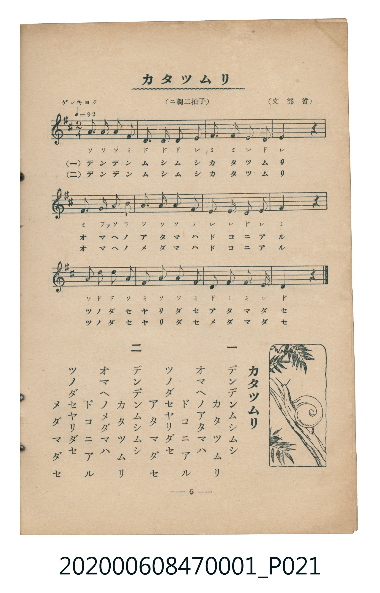

# カタツムリ

> Re:Shoka 使用 AI 協助辨識與重建樂譜，可能會有錯誤。歡迎回報。

<audio controls src="katatsumuri.mp3"></audio>

- 詞：文部省
- 曲：文部省
- 臺灣教育會公認《新定兒童唱歌》尋常科第一學年用（2020.006.0847.0001）

## 說明

原書資訊與歌詞全文（對應 P021.jpg，書頁 p. 6，第一學期第 6 首）：
調性與拍號：ニ調二拍子（D 大調 2/4 拍），「ゲンキヨク」♩=92

## 跨冊／重複收錄參照

> 同名異曲（各冊收錄之不同詞曲版本）

- **[同名異曲]** 楊金土手抄《唱歌帖》第 2 冊・II（2020.006.0843）：[**〈カタツムリ〉**](../../../shokacho/vol_02/p079_katatsumuri/index.md)（`C` / `2/4` — [原始 TMD](../../../shokacho/vol_02/p079_katatsumuri/katatsumuri.tmd)）
- 總表：[跨冊重複與同名歌曲總索引](../../../duplicate_songs.md)

## 歌詞

```text
一
デンデンムシムシ
カタツムリ
オマヘノアタマハ
ドコニアル
ツノダセヤリダセ
アタマダセ

二
デンデンムシムシ
カタツムリ
オマヘノメダマハ
ドコニアル
ツノダセヤリダセ
メダマダセ
```

## ABC

```abc
X:1
T:カタツムリ
C:曲：文部省
M:2/4
L:1/16
Q:1/4=92
K:D
V:V1 name="Piano" snm="Pia"
[V:V1]
A3 A A2 F2 | d3 d d2 e2 | f3 f e2 d2 | e4 z4 |
f3 g a2 b2 | a3 a a2 f2 | e3 e d2 e2 | f4 z4 |
A2 d2 d2 A2 | f2 a2 a2 f2 | d2 f2 f3 e | d4 z4 |
```

## TMD 檔案連結

- [主旋律 TMD 檔案](katatsumuri.tmd) [[在 TMD Studio 編輯](https://tmdlang.github.io/Tmd-TS/#tmd=s7IKdvYPcrWy4qpTUCpJTLdSSM7PyUlNLsnMz7MqzsjMK0nNjM_KTMmPL87Iz05Ugisry88pzU21Si9KTEmNN4w3MjAyiDcwMIs3sDAxBzIMDBFKi_NLi5JTrYqTM_Lzc-JLUitKkvLzsxHyBUX5Zal5iXlANQVFIBtTwIoQClLLMlNSQdKpKZkl-UWZiTlI7kgtKga7FWxJfElRYl5xclFmAcgDCFUlGalAxybmZeaC9GppKTxuWv24af_j5pbHzQseN69S0NLiUrRVsDTisrdVcOGyMdI3sQNpfrFy3vs9s55Na3_ZvOL5nEawgc9mb8IQe9G-63nj4mdTZ75o2vRsTvPT1jUvVvU-buh6Nm3D03WznrZOer566dMpG5-t7Xnc0P10Q_fTHTueL5_4fM2aJzsanq7d8XTnludTVrzf0wEKRj1gMOqBghHIMDB8v6dTiYtLX0vBllqAS0FB4Wnf_Gezd7zY3P5iRdeLjnagu4A-fdq6AugroCuebuh91t6pEGBgZKiXVZD-fk8PUPHLBY0KBXoKZkAe3N3P5swHshXMFF4umwZ0KDBYQIa_WLX_WcNykLHdvS9mzgeKPm7uBgo-2dUDFHm6dgLQCheFp0uWA8UUgCGtABQF6wYGTs_jpk2Pmzc_blr7uHnF46b1jxt6H81caQuMGJDJQFtB1OPmdpAaKLngcdN2CAmWQ41YiNCqx83zHjfPeNzc97hpEVgayO2HGNX5uAloSDdIonk1RAiot-9xc8Pjpt2Pm5cADYGwIUbBtYOFwI7a1UOpo5oXgswj21EI7TAhylMJFCho6XNxeSeWJJYUl-aWFmVaBWQm5uU71BjUKFSDLFKwMTTTsgOzsKVRBUhSebGwR0HDROHphv7n6xt04AlLE4sGoH0gw2oUTBV0gdAUTBsDcY2CYRxYCEiBWUYgokbBGCIKpMACYKkaCBsEDaB0DTiucDtyVw85joRabhKnYApimUEsB7OBboeKghXBnQSksDifeIfu6CQ3NMHWggkQD2o12IXIzgQrALOhTgM6FB72yM6s5eLStVNAShsKQK4yFxcA)]
- [鋼琴伴奏 TMD 檔案](katatsumuri_piano.tmd) [[在 TMD Studio 編輯](https://tmdlang.github.io/Tmd-TS/#tmd=s7IKdvYPcrWy4tLSUnjctPpx0_7HzS2Pmxc8bl71fk_Hy-49zydsebJny9Ol_c87O97v6VTQ0uJStFWwNOKyt1Vw4bIx0jex46pTUHqxct77PbOeTWt_2bzi-ZxGJZDYs9mbMMRetO963rj42dSZL5o2PZvT_LR1zYtVvY8bup5N2_B03aynrZOer176dMrGZ2t7Hjd0P93Q_XTHjufLJz5fs-bJjoana3c83bnl-ZQVQJcZGRgZ6BkYmOkZWJiYAxkGhkDHKXFxeSeWJJYUl-aWFmVaBWQm5uUHeTjUGNQoVHMpAIGNoZmWHZilr6Vgiw4UINa8WNijoGGi8HRD__P1DToKAQZGhnpZBemaWDRo6YMNq1EwVdAFQlMwbQzENQqGYBFDMG0EFgGJg2RBPJBoDZgFggZQuoYLv9t29ZDjNoi9JmC3mYHtxXQtxCVGGK4l3m07OskNN8M4GAHiQWwGsVDDEsSCuMkIHrrIrqvFEvc-KHFvAo16oO54hWjDWKwM0_h4oKE1SApNMOSjTeOhYqgqMY1EUQh0oa6dApIjFTC5ylxcAA)]

## 分析

```text
================================================================================
📊 TMD Song Profile: [ カタツムリ ]
================================================================================
⏱  Duration:       0:15 (15.7s), 12 measures total
🎼 Key & Tempo:    首調基準 D, != 92.0 BPM, <2/4>
   - 分析範圍：      由實際發聲的音符與和弦推測調性；播放脈絡另行呈現
🎤 人聲音域:    F#4 (MIDI 66) – B5 (MIDI 83) [跨度: 17 個半音 / 1.4 個八度, 難度: challenging]
   - 最低音:  F#4 in [Katatsumuri #1 @ m.1, 0:00]
   - 最高音: B5 in [Katatsumuri #1 @ m.5, 0:06]
   - 適合: soprano, tenor
🏛  結構:      Katatsumuri (15.7s)
⚡ 編曲密度:        Peak 1 軌道同時演奏
🗝  調性診斷：       D 大調（純淨自然大調，未偵測到可信轉調）
   - 風格氣質:    純淨自然大調（陽光明朗、易唱易記，無明顯調外色彩）
   - 轉調歷程:    全曲維持單一推測調性（未偵測到可信轉調）
   - 核心骨幹音:  F#, A, D, E, B
   - 調性數值:    D 大調 [相關度: 0.81, 穩定度: Moderate, 自然音純度: 100.0%]
   - 候選調性 (K-S): D 大調 (0.81), F# 小調 (0.74), A 大調 (0.72)
   - 五度圈歷程:   +2
   - 各段落調性細節:
     • [Katatsumuri #1]: D 大調 (r: 0.81, 自然音純度: 100.0%)

  [ 五度圈游移軌跡 ]
               C  
         F            G  
      Bb              [D ]*
      Eb               A  
         Ab           E  
            Db       B  
               F# 
     (* = active key center)

  [ 十二半音累積音高分佈 ]
     C  :                            0.0%
     C# :                            0.0%
     D  : ████████████████████      23.8%
     D# :                            0.0%
     E  : ███████████████           17.9%
     F  :                            0.0%
     F# : ████████████████████████  28.6%
     G  : █                          1.2%
     G# :                            0.0%
     A  : ██████████████████████    26.2%
     A# :                            0.0%
     B  : ██                         2.4%
--------------------------------------------------------------------------------
Assignment 軌道音域：
  - Piano         : F#4 – B5 (17 個半音 / 1.4 個八度, 39 個音符)
================================================================================
```


## 原書掃描頁




