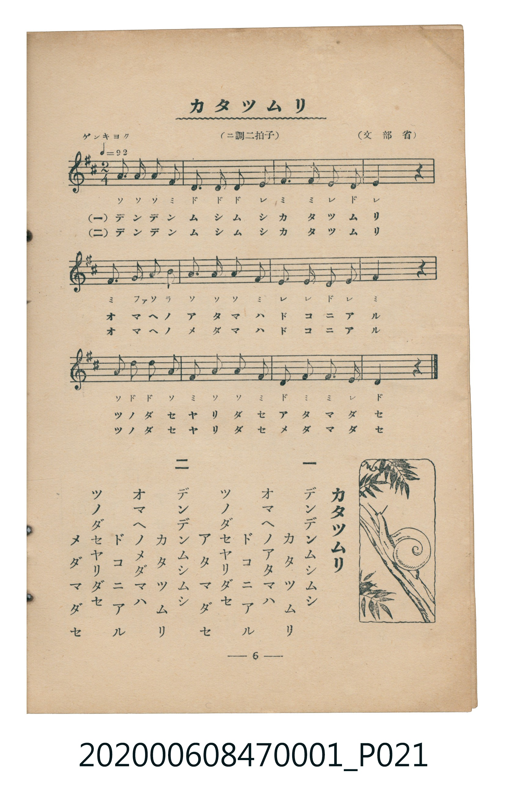

# カタツムリ（蝸牛）

> Re:Shōka 使用 AI 協助辨識與重建樂譜，可能會有錯誤。歡迎回報。

- **鋼琴伴奏版**：<br><audio controls src="katatsumuri.mp3"></audio>
- **NEUTRINO 歌聲合成版**：<br><audio controls src="katatsumuri_neutrino.mp3"></audio>

- 詞：文部省
- 曲：文部省
- 臺灣教育會公認《新定兒童唱歌》尋常科第一學年用（2020.006.0847.0001）

## 說明

曲目說明
中文解釋：描寫蝸牛背著殼慢慢爬行的樣子。

原書資訊與歌詞全文（對應 P021.jpg，書頁 p. 6，第一學期第 6 首）：
調性與拍號：ニ調二拍子（D 大調 2/4 拍），「ゲンキヨク」♩=92


## 歌詞

```text
一
デンデンムシムシ
カタツムリ
オマヘノアタマハ
ドコニアル
ツノダセヤリダセ
アタマダセ

二
デンデンムシムシ
カタツムリ
オマヘノメダマハ
ドコニアル
ツノダセヤリダセ
メダマダセ
```

## ABC

<div class="abc-score" data-abc-src="katatsumuri.abc" aria-label="五線譜載入中"></div>

[下載 ABC 原始檔](katatsumuri.abc)

## TMD 檔案連結

- [主旋律 TMD 檔案](katatsumuri.tmd) [[在 TMD Studio 編輯](https://tmdlang.github.io/Tmd-TS/#tmd=s7IKdvYPcrWy4qpTUCpJTLdSSM7PyUlNLsnMz7MqzsjMK0nNjM_KTMmPL87Iz05Ugisry88pzU21Si9KTEmNN4w3MjAyiDcwMIs3sDAxBzIMDBFKi_NLi5JTrYqTM_Lzc-JLUitKkvLzsxHyBUX5Zal5iXlANQVFIBtTwIoQClLLMlNSQdKpKZkl-UWZiTlI7kgtKga7FWxJfElRYl5xclFmAcgDCFUlGalAxybmZeYi6wUalZ6ZZ5Wbn5dUCvQeskRJRj7QawUZlVYZmcUgO5MTc-KzE_OQQgBqY0FieqpVgIER0MNaWgqPm1Y_btr_uLnlcfOCx82r3u_peDF3x_PO2e_3dCpoaXEp2ipYGnHZ2yq4cNkY6ZvYgQx7sXLe-z2znk1rf9m84vmcRrAFz2ZvwhB70b7reePiZ1Nnvmja9GxO89PWNS9W9T5u6Ho2bcPTdbOetk56vnrp0ykbn63tedzQ_XRD99MdO54vn_h8zZonOxqert3xdOeW51NWAB0Eiio9YFTpgaIKyDAwBDpOiUtfSwFo6_PZ616sWvVsRh-XgoLCkx1rgU54sXzxy_ZukHP6-5-uXw3xz4vmnhcTpz9bt-dZ6yIget6x5sXCnuezWp6tWPx07YTHDU1cWvpcIDNtqQVADnraN__Z7B0vNre_WNH1oqMd6FVg4D1tXQF0JdBjTzf0PmvvVADFhV5WQfr7PT1AxS8XNCoU6CmYAXnwoHg2Zz6QrWCm8HLZNKDfgV4DGf5i1f5nDctBxnb3vpg5Hyj6uLkbKPhkVw9QBOgroBUuCk-XLAeKKQAjTwEoCtYNDO-ex02bHjdvfty09nHzisdN6x839D6audIWGNeQcGwAUY-b20FqoOSCx03bISRYDjXdQIRWPW6e97h5xuPmvsdNi8DSQG4_xKjOx01AQ7pBEs2rIUJAvX2PmxseN-1-3LwEaAiEDTEKrh0sBHbUrh5KHdW8EGQe2Y5CaIcJUZ5KoEABlPq8E0sSS4pLc0uLMq0CMhPz8h1qDGqqQfYo2BiaadmBWdiSqAIkpQBTtIKGicLTDf3P1zfowNOVJhYNQOtAhtUomCroAqEpmDYG4hoFQ7CIIZg2AouAxEGyIB5ItAbMAkEDKF0DNs3HsAYUPWARYOxA2SAWSA8wTiAyTduhbBALLNO0GiqzHxQBYD0geZCeVVAb4lFtMqKHTfjDe1cPOeENCUsTcHibgW3GjAFI6BphxADW8G6CuBuYLIF4BpjVB_XrIiS_zgPL9EP92gmVAYVcN5gFUguSgYQP1vDGbVPzQqhMA0U2EUjfneSmb8M4GAHiQUITxEJN8yAWJJyN4LkAewqHpBuQ30E-BvlpN9RPS8BioHBCkwH7GhQTkPCDhRZIBqQCVwonwyZwXEDFCNpUy8Wla6eAVO5ExyoABZS5AA)]
- [鋼琴伴奏 TMD 檔案](katatsumuri_piano.tmd) [[在 TMD Studio 編輯](https://tmdlang.github.io/Tmd-TS/#tmd=s7IKdvYPcrWy4qpTUCpJTLdSyC8qychPL0osyKi0ysgsLskvykxOzInPTsxLVIIrKs4vLUpOjS9ITE-1CjAwMlTi0tJSeNy0-nHT_sfNLY-bFzxuXvV-T8fL7j3PJ2x5smfL06X9zzs73u_pVNDS4lK0VbA04rK3VXDhsjHSN7EDmfpi5bz3e2Y9m9b-snnF8zmNYJuezd6EIfaifdfzxsXPps580bTp2Zzmp61rXqzqfdzQ9WzahqfrZj1tnfR89dKnUzY-W9vzuKH76Ybupzt2PF8-8fmaNU92NDxdu-Ppzi3Pp6wAuszIwMhAz8DATM_AwsQcyDAwBDpOiYvLO7EksaS4NLe0KNMqIDMxLz_Iw6HGoKaaSwEIbAzNtOzALH0tBVt0oACx5cXCHgUNE4WnG_qfr2_QUQCFjl5WQbomFg1a-mDDahRMFXSB0BRMGwNxjYIhWMQQTBuBRUDiIFkQDyRaA2aBoAGUrgGb5mNYo_C4uR0s8rh5M5QNYoH0AKMGItO0HcoGscAyTauhMvuBMi1gPSB5kJ5VUBviUW0yoodN-MN7Vw854Q0JSxNweJuBbcaMAUjoGmHEANbwboK4-3HzPCCeAWb1Qf26CMmv88Ay_VC_dkJlQCHXDWaB1IJkIOGDNbxx29S8ECrTQJFNBNJ3J7np2zAORoB4kNAEsVDTPIgFCWcjeC7AnsIh6Qbkd5CPQX7aDfXTErAYKJzQZMC-BsUEJPxgoQWSAanAlcLJsAkcF1AxgjbVYil2fJCLHRNoqQMMkHiFaMNYrAzT-HhgOEHcDRE2wZCPNo2HiqGqxDQSRSHQgbp2CkhujPYBKkQXMgILKXMBAA)]

## 分析

```text
================================================================================
📊 TMD Song Profile: [ カタツムリ（蝸牛） ]
================================================================================
⏱  Duration:       0:15 (15.7s), 12 measures total
🎼 Key & Tempo:    首調基準 D, != 92.0 BPM, <2/4>
   - 分析範圍：      由實際發聲的音符與和弦推測調性；播放脈絡另行呈現
🎤 人聲音域:    D4 (MIDI 62) – D5 (MIDI 74) [跨度: 12 個半音 / 1.0 個八度, 難度: easy]
   - 最低音:  D4 in [Katatsumuri[] #1 @ m.2, 0:01]
   - 最高音: D5 in [Katatsumuri[] #1 @ m.9, 0:10]
   - 適合: soprano, mezzo-soprano, contralto, tenor, baritone, bass
🏛  結構:      Katatsumuri[] (15.7s)
⚡ 編曲密度:        Peak 1 軌道同時演奏
🗝  調性診斷：       D 大調（純淨自然大調，未偵測到可信轉調）
   - 風格氣質:    純淨自然大調（陽光明朗、易唱易記，無明顯調外色彩）
   - 轉調歷程:    全曲維持單一推測調性（未偵測到可信轉調）
   - 核心骨幹音:  F#, A, D, E, B
   - 調性數值:    D 大調 [相關度: 0.81, 穩定度: Moderate, 自然音純度: 100.0%]
   - 候選調性 (K-S): D 大調 (0.81), F# 小調 (0.74), A 大調 (0.72)
   - 五度圈歷程:   +2
   - 各段落調性細節:
     • [Katatsumuri[] #1]: D 大調 (r: 0.81, 自然音純度: 100.0%)

  [ 五度圈游移軌跡 ]
               C  
         F            G  
      Bb              [D ]*
      Eb               A  
         Ab           E  
            Db       B  
               F# 
     (* = active key center)

  [ 十二半音累積音高分佈 ]
     C  :                            0.0%
     C# :                            0.0%
     D  : ████████████████████      23.8%
     D# :                            0.0%
     E  : ███████████████           17.9%
     F  :                            0.0%
     F# : ████████████████████████  28.6%
     G  : █                          1.2%
     G# :                            0.0%
     A  : ██████████████████████    26.2%
     A# :                            0.0%
     B  : ██                         2.4%
--------------------------------------------------------------------------------
Assignment 軌道音域：
  - Piano         : D4 – D5 (12 個半音 / 1.0 個八度, 39 個音符)
================================================================================
```


## 原書掃描頁




