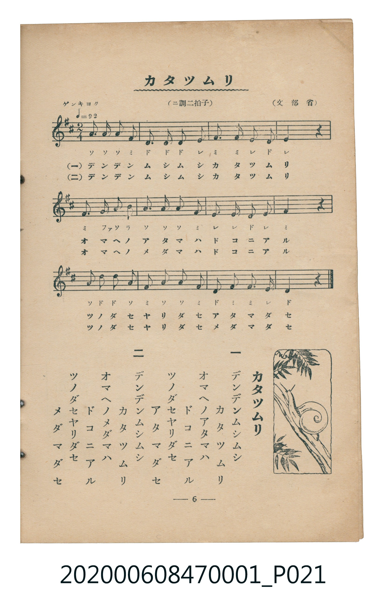

# カタツムリ（蝸牛）

> Re:Shōka 使用 AI 協助辨識與重建樂譜，可能會有錯誤。歡迎回報。

- **鋼琴伴奏版**：<br><audio controls src="katatsumuri.mp3"></audio>
- **NEUTRINO 歌聲合成版**：<br><audio controls src="katatsumuri_neutrino.mp3"></audio>

- 詞：文部省
- 曲：文部省
- 臺灣教育會公認《新定兒童唱歌》尋常科第一學年用（2020.006.0847.0001）

## 說明

曲目說明
中文解釋：描寫蝸牛背著殼慢慢爬行的樣子。

原書資訊與歌詞全文（對應 P021.jpg，書頁 p. 6，第一學期第 6 首）：
調性與拍號：ニ調二拍子（D 大調 2/4 拍），「ゲンキヨク」♩=92


## 歌詞

```text
一
デンデンムシムシ
カタツムリ
オマヘノアタマハ
ドコニアル
ツノダセヤリダセ
アタマダセ

二
デンデンムシムシ
カタツムリ
オマヘノメダマハ
ドコニアル
ツノダセヤリダセ
メダマダセ
```

## ABC

```abc
X:1
T:カタツムリ（蝸牛）
C:曲：文部省
M:2/4
L:1/16
Q:1/4=92
K:D
V:V1 name="Piano" snm="Pia"
[V:V1]
A3 A A2 F2 | D3 D D2 E2 | F3 F E2 D2 | E4 z4 |
w: 1.~デ ン デ ン | ム シ ム シ | カ タ ツ ム | リ
w: 2.~デ ン デ ン | ム シ ム シ | カ タ ツ ム | リ
F3 G A2 B2 | A3 A A2 F2 | E3 E D2 E2 | F4 z4 |
w: 1.~オ マ ヘ ノ | ア タ マ ハ | ド コ ニ ア | ル
w: 2.~オ マ ヘ ノ | メ ダ マ ハ | ド コ ニ ア | ル
A2 d2 d2 A2 | F2 A2 A2 F2 | D2 F2 F3 E | D4 z4 |
w: 1.~ツ ノ ダ セ | ヤ リ ダ セ | ア タ マ ダ | セ
w: 2.~ツ ノ ダ セ | ヤ リ ダ セ | メ ダ マ ダ | セ
```

## TMD 檔案連結

- [主旋律 TMD 檔案](katatsumuri.tmd) [[在 TMD Studio 編輯](https://tmdlang.github.io/Tmd-TS/#tmd=s7IKdvYPcrWy4qpTUCpJTLdSSM7PyUlNLsnMz7MqzsjMK0nNjM_KTMmPL87Iz05Ugisry88pzU21Si9KTEmNN4w3MjAyiDcwMIs3sDAxBzIMDBFKi_NLi5JTrYqTM_Lzc-JLUitKkvLzsxHyBUX5Zal5iXlANQVFIBtTwIoQClLLMlNSQdKpKZkl-UWZiTlI7kgtKga7FWxJfElRYl5xclFmAcgDCFUlGalAxybmZeYi6wUalZ6ZZ5Wbn5dUCvSeEpeWlsLjptWPm_Y_bm553LzgcfOq93s6Xszd8bxz9vs9nQpaWlyKtgqWRlz2tgouXDZG-iZ2ILNerJz3fs-sZ9PaXzaveD6nEWz-s9mbMMRetO963rj42dSZL5o2PZvT_LR1zYtVvY8bup5N2_B03aynrZOer176dMrGZ2t7Hjd0P93Q_XTHjufLJz5fs-bJjoana3c83bnl-ZQVQAeBwloPGNZ6oLAGMgwMgY5T4tLXUgDa-nz2uherVj2b0celoKDwZMdaoBNeLF_8sr0b5Jz-_qfrV0P886K558XE6c_W7XnWugiInnesebGw5_mslmcrFj9dO-FxQxOXlj4XyExbagGQg572zX82e8eLze0vVnS96GgHehUYeE9bVwBdCfTY0w29z9o7FQIMjAz1sgrS3-_pASp-uaBRoUBPwQzIgwfFsznzgWwFM4WXy6YB_Q70GsjwF6v2P2tYDjK2u_fFzPlA0cfN3UDBJ7t6gCJAXwGtcFF4umQ5UEwBGHkKQFGwbmB49zxu2vS4efPjprWPm1c8blr_uKH30cyVtsC4hoRjA4h63NwOUgMlFzxu2g4hwXKo6QYitOpx87zHzTMeN_c9bloElgZy-yFGdT5uAhrSDZJoXg0RAurte9zc8Lhp9-PmJUBDIGyIUXDtYCGwo3b1UOqo5oUg88h2FEI7TIjyVAIFCqDU551YklhSXJpbWpRpFZCZmJfvUGNQUw2yR8HG0EzLDszClkQVICkFmKIVNEwUnm7of76-QQeerjSxaABaBzKsRsFUQRcITcG0MRDXKBiCRQzBtBFYBCQOkgXxQKI1YBYIGkDpGrBpPoY1oOgBiwBjB8oGsUB6gHECkWnaDmWDWGCZptVQmf2gCADrAcmD9KyC2hCPapMRPWzCH967esgJb0hYmoDD2wxsM2YMQELXCCMGsIZ3E8TdwGQJxDPArD6oXxch-XUeWKYf6tdOqAwo5LrBLJBakAwkfLCGN26bmhdCZRoosolA-u4kN30bxsEIEA8SmiAWapoHsSDhbATPBdhTOCTdgPwO8jHIT7uhfloCFgOFE5oM2NegmICEHyy0QDIgFbhSOBk2geMCKkbQplouLl07BaRyJzpWASigzAUA)]
- [鋼琴伴奏 TMD 檔案](katatsumuri_piano.tmd) [[在 TMD Studio 編輯](https://tmdlang.github.io/Tmd-TS/#tmd=s7IKdvYPcrWy4tLSUnjctPpx0_7HzS2Pmxc8bl71fk_Hy-49zydsebJny9Ol_c87O97v6VTQ0uJStFWwNOKyt1Vw4bIx0jex46pTUHqxct77PbOeTWt_2bzi-ZxGJZDYs9mbMMRetO963rj42dSZL5o2PZvT_LR1zYtVvY8bup5N2_B03aynrZOer176dMrGZ2t7Hjd0P93Q_XTHjufLJz5fs-bJjoana3c83bnl-ZQVQJcZGRgZ6BkYmOkZWJiYAxkGhkDHKXFxeSeWJJYUl-aWFmVaBWQm5uUHeTjUGNRUcykAgY2hmZYdmKWvpWCLDhQgtrxY2KOgYaLwdEP_8_UNOgoBBkaGelkF6ZpYNGjpgw2rUTBV0AVCUzBtDMQ1CoZgEUMwbQQWAYmDZEE8kGgNmAWCBlC6Bmyaj2GNwuPmdrDI4-bNUDaIBdIDjBqITNN2KBvEAss0rYbK7AfKtID1gORBelZBbYhHtcmIHjbhD-9dPeSENyQsTcDhbQa2GTMGIKFrhBEDWMO7CeLux83zgHgGmNUH9esiJL_OA8v0Q_3aCZUBhVw3mAVSC5KBhA_W8MZtU_NCqEwDRTYRSN-d5KZvwzgYAeJBQhPEQk3zIBYknI3guQB7CoekG5DfQT4G-Wk31E9LwGKgcEKTAfsaFBOQ8IOFFkgGpAJXCifDJnBcQMUI2lSLpdjxQS52TKClDjBA4hWiDWOxMkzj44HhBHE3RNgEQz7aNB4qhqoS00gUhUAH6topILkx2geoEF3ICCykzAUA)]

## 分析

```text
================================================================================
📊 TMD Song Profile: [ カタツムリ（蝸牛） ]
================================================================================
⏱  Duration:       0:15 (15.7s), 12 measures total
🎼 Key & Tempo:    首調基準 D, != 92.0 BPM, <2/4>
   - 分析範圍：      由實際發聲的音符與和弦推測調性；播放脈絡另行呈現
🎤 人聲音域:    D4 (MIDI 62) – D5 (MIDI 74) [跨度: 12 個半音 / 1.0 個八度, 難度: easy]
   - 最低音:  D4 in [Katatsumuri[] #1 @ m.2, 0:01]
   - 最高音: D5 in [Katatsumuri[] #1 @ m.9, 0:10]
   - 適合: soprano, mezzo-soprano, contralto, tenor, baritone, bass
🏛  結構:      Katatsumuri[] (15.7s)
⚡ 編曲密度:        Peak 1 軌道同時演奏
🗝  調性診斷：       D 大調（純淨自然大調，未偵測到可信轉調）
   - 風格氣質:    純淨自然大調（陽光明朗、易唱易記，無明顯調外色彩）
   - 轉調歷程:    全曲維持單一推測調性（未偵測到可信轉調）
   - 核心骨幹音:  F#, A, D, E, B
   - 調性數值:    D 大調 [相關度: 0.81, 穩定度: Moderate, 自然音純度: 100.0%]
   - 候選調性 (K-S): D 大調 (0.81), F# 小調 (0.74), A 大調 (0.72)
   - 五度圈歷程:   +2
   - 各段落調性細節:
     • [Katatsumuri[] #1]: D 大調 (r: 0.81, 自然音純度: 100.0%)

  [ 五度圈游移軌跡 ]
               C  
         F            G  
      Bb              [D ]*
      Eb               A  
         Ab           E  
            Db       B  
               F# 
     (* = active key center)

  [ 十二半音累積音高分佈 ]
     C  :                            0.0%
     C# :                            0.0%
     D  : ████████████████████      23.8%
     D# :                            0.0%
     E  : ███████████████           17.9%
     F  :                            0.0%
     F# : ████████████████████████  28.6%
     G  : █                          1.2%
     G# :                            0.0%
     A  : ██████████████████████    26.2%
     A# :                            0.0%
     B  : ██                         2.4%
--------------------------------------------------------------------------------
Assignment 軌道音域：
  - Piano         : D4 – D5 (12 個半音 / 1.0 個八度, 39 個音符)
================================================================================
```


## 原書掃描頁




