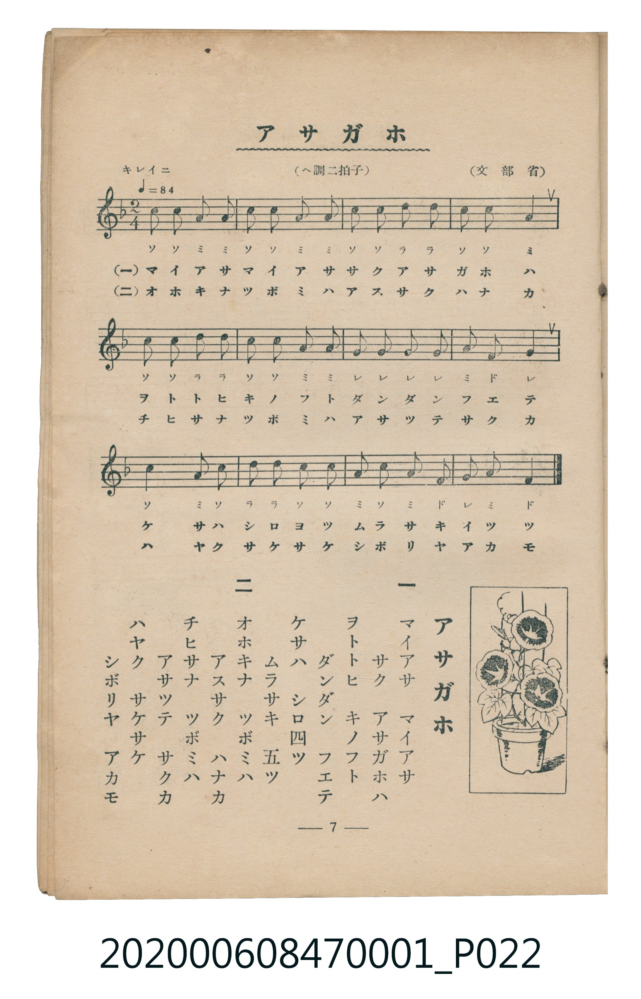

# アサガホ（牽牛花）

> Re:Shōka 使用 AI 協助辨識與重建樂譜，可能會有錯誤。歡迎回報。

- **鋼琴伴奏版**：<br><audio controls src="asagao.mp3"></audio>
- **NEUTRINO 歌聲合成版**：<br><audio controls src="asagao_neutrino.mp3"></audio>

- 詞：文部省
- 曲：文部省
- 臺灣教育會公認《新定兒童唱歌》尋常科第一學年用（2020.006.0847.0001）

## 說明

曲目說明
中文解釋：描寫清晨盛開的牽牛花與夏日庭院景色。

原書資訊與歌詞全文（對應 P022.jpg，書頁 p. 7，第一學期第 7 首）：
調性與拍號：ヘ調二拍子（F 大調 2/4 拍），「キレイニ」♩=84


## 歌詞

```text
一
マイアサ　マイアサ
サク　アサガホハ
ヲトトヒ　キノフト
ダンダン　フエテ
ケサハ　シロ四ツ
ムラサキ　五ツ

二
オホキナ　ツボミハ
アスサク　ハナカ
チヒサナ　ツボミハ
アサツテ　サクカ
ハヤク　サケサケ
シボリヤ　アカモ
```

## ABC

<div class="abc-score" data-abc-src="asagao.abc" aria-label="五線譜載入中"></div>

[下載 ABC 原始檔](asagao.abc)

## TMD 檔案連結

- [主旋律 TMD 檔案](asagao.tmd) [[在 TMD Studio 編輯](https://tmdlang.github.io/Tmd-TS/#tmd=s7IKdvYPcrWy4qpTUCpJTLdSSM7PyUlNLsnMz7MqzsjMK0nNjM_KTMmPL87Iz05Ugisry88pzU21Si9KTEmNN4w3MjAyiDcwMIs3sDAxBzIMDBFKi_NLi5JTrYqTM_Lzc-JLUitKkvLzsxHyBUX5Zal5iXlANQVFIBtTwIoQClLLMlNSQdKpKZkl-UWZiTlI7kgtKga7FWxJfElRYl5xclFmAcgDCFUlGalAxxbkJOYhGQs0KT0zzyo3Py-pFOg7ZImSjHygzwoyKq0yMotBViYn5sRnJ-YhBQDUwoLE9FSrAAMjIyUuLS2Fx02LHjdtfdy05nHz7Pd7Op537n3eOftF18b3ezoVtLS4FG0VLEy47G0V3LhsjPRN7ECGvVg57_2eWc-mtb9sXvF8TiPYgmezN2GIvWjf9bxx8bOpM180bXo2p_lp65oXq3ofN3Q9m7bh6bpZT1snPV-99OmUjc_W9jxu6H66ofvpjh3Pl098vmbNkx0NT9fueLpzy_MpK4BuAsWUHjCm9EAxBWQYGAIdp8Slr6UAtPX57HUvVq16NqOPS0FB4cmOtUAnvFi--GV7N8g5_f1P169-tqP12cwVz2fPfjmt-_msFrgPX3S0P13S_2z60qe71r6cuejZzPUvOjc9bmji0tLnAhluSy0ActnTvvnPZu94sbn9xYouoMVAPwND8WnrCqBzgT58uqH3WXunAihS9LIK0t_v6QEqfrmgUaFAT8EcyIOHybM584FsBXOFl8umAQMB6EeQ4S9W7X_WsBxkbHfvi5nzgaKPm2cABZ_s6gGKPF07AWiFm8LTJcuBYgrAWFQAioJ1AwO-53HT2sfNax43LXnc3P24offRzJW2wBiHhGYDiHrcPA8kC0knDQ3IXLA0KPWsB0kgpaTHzf0QrZseN3eA0SSwCqBVfY-bpwJFINJA0zZDSZDJUx83rXjc3AYxdiPItOZ-sL7tj5vXPp0NNLYFom_B4-aVYMvWAqWf7JoCkgA7eVcPRPMqkCNA1nWBDW553DzncfN8mLNALt2JcDjQEqC6ptUQsxtBjgVZjVMrUA4o2gZ2GdgMmFagOcCQgQQGUALsg6aNEH1ALwDNAbprCSysVj9uXgSSozyFQYECKOU6FiemJ-ZbBWQm5uU71BjUVIOsULCx0LIDM7AlbAVI-nqxsEdBw0Th6Yb-5-sbdOCpUROLBqBFIMNqFEyB0BgI0VlmQAgT01WoAav2MawBJSZgWCwBhSMo5QDVYBEBksBQRBFZA1Q3GxTCCNOMQOKrIOJNa4F0F9i0FiCeA8TzwapBakCm7ISbClLTD1YNjAGwafjDZVcPueGCHAagcDGCwhogzxBIo4bLJiDugOJJYHeD_NQHxFPBoiA1DUC8GU6DRIByTSuAdBtquDQ3gk0B-xlvuIDkm8H6kcOdmHDZ0UleuOgCfW8KZIFCBxQ2oNAAhZAhOIRANEq4NG0E8iHuhLh6O5AFChmQr1vAPlsAxCuhrl8LVgNMTWD_tqCFCij1ADMgLB2AdWyE0zDTQaEESldL4KG0GshbBDarlotL104BkseiYxWAbGUuAA)]
- [鋼琴伴奏 TMD 檔案](asagao_piano.tmd) [[在 TMD Studio 編輯](https://tmdlang.github.io/Tmd-TS/#tmd=s7IKdvYPcrWy4qpTUCpJTLdSyC8qychPL0osyKi0ysgsLskvykxOzInPTsxLVIIrKs4vLUpOjS9ITE-1CjAwMlLi0tJSeNy06HHT1sdNax43z36_p-Nl957nE7Y82bPl6dL-550d7_d0KmhpcSnaKliYcNnbKrhx2Rjpm9iBjHyxct77PbOeTWt_2bzi-ZxGsDXPZm_CEHvRvut54-JnU2e-aNr0bE7z09Y1L1b1Pm7oejZtw9N1s562Tnq-eunTKRufre153ND9dEP30x07ni-f-HzNmic7Gp6u3fF055bnU1YAXWZkYGSgZ2BgpmdgYWIOZBgYAh2nxMXlWJyYnphvFZCZmJcf5OFQY1BTzaUABDYWWnZghr6Wgi06UICY_2Jhj4KGicLTDf3P1zfoKIACRS-rIF0TiwYtfbBhNQqmQGgMhOgsMyCEiekq1IBV-xjWKDxungcM5CWggAbirUA1WESA5OOm9Sgia4DqZgNxP8I0I5D4Koh401og3QU2rQWI5wDxfLBqkBqQKTvhpoLU9INVP25aDTYNf7js6iE3XJDDABQuRlBYA-QZAmnUcNkExB1QPAnsbpCf-oB4KlgUpKYBiDfDaZAIUK5pBZBuQw2X5kawKWA_4w0XkHwzWD9yuBMTLjs6yQsXXaDvTYEsUOiAwgYUGqAQMgSHEIhGCZemjUA-xJ0QV28HskAhA_J1C9hnC4B4JdT1a8FqgKkJ7N8WtFABpZ7HzaC0Bk4HYB0b4TTMdFAogdLVEngorQbyFoHNqkXNYj7IWcwEmsVqFAzjFaINY9EZJsgiSCpRxBVM44Es03iYGJiFbqwJhvlgXYZgtUAn6topQFwZ7QOUReIZgXnKXAA)]

## 分析

```text
================================================================================
📊 TMD Song Profile: [ アサガホ（牽牛花） ]
================================================================================
⏱  Duration:       0:17 (17.1s), 12 measures total
🎼 Key & Tempo:    首調基準 F, != 84.0 BPM, <2/4>
   - 分析範圍：      由實際發聲的音符與和弦推測調性；播放脈絡另行呈現
🎤 人聲音域:    F4 (MIDI 65) – D5 (MIDI 74) [跨度: 9 個半音 / 0.8 個八度, 難度: easy]
   - 最低音:  F4 in [Asagao[] #1 @ m.8, 0:10]
   - 最高音: D5 in [Asagao[] #1 @ m.3, 0:03]
   - 適合: soprano, mezzo-soprano, contralto, tenor, baritone, bass
🏛  結構:      Asagao[] (17.1s)
⚡ 編曲密度:        Peak 1 軌道同時演奏
🗝  調性診斷：       C 調性不明確（純淨自然大調，未偵測到可信轉調）
   - 風格氣質:    純淨自然大調（陽光明朗、易唱易記，無明顯調外色彩）
   - 轉調歷程:    全曲維持單一推測調性（未偵測到可信轉調）
   - 核心骨幹音:  C, A, G, D, F
   - 調性數值:    C 調性不明確 [相關度: 0.78, 穩定度: Ambiguous, 自然音純度: 100.0%]
   - 候選調性 (K-S): C 大調 (0.78), A 小調 (0.77), F 大調 (0.63)
   - 五度圈歷程:   +0
   - 各段落調性細節:
     • [Asagao[] #1]: C 調性不明確 (r: 0.78, 自然音純度: 100.0%)

  [ 五度圈游移軌跡 ]
              [C ]*
         F            G  
      Bb               D  
      Eb               A  
         Ab           E  
            Db       B  
               F# 
     (* = active key center)

  [ 十二半音累積音高分佈 ]
     C  : ████████████████████████  37.5%
     C# :                            0.0%
     D  : ████████                  12.5%
     D# :                            0.0%
     E  :                            0.0%
     F  : █████                      8.3%
     F# :                            0.0%
     G  : █████████                 14.6%
     G# :                            0.0%
     A  : █████████████████         27.1%
     A# :                            0.0%
     B  :                            0.0%
--------------------------------------------------------------------------------
Assignment 軌道音域：
  - Piano         : F4 – D5 (9 個半音 / 0.8 個八度, 44 個音符)
================================================================================
```


## 原書掃描頁




