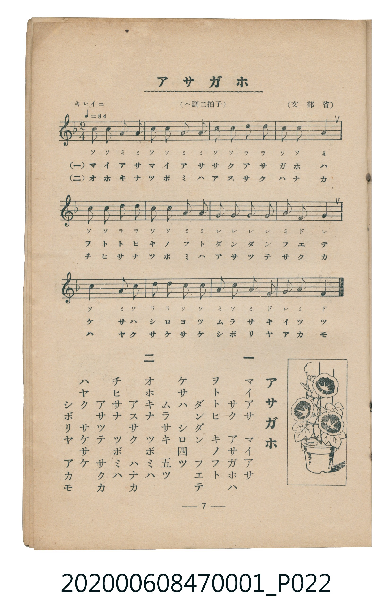

# アサガホ（牽牛花）

> Re:Shōka 使用 AI 協助辨識與重建樂譜，可能會有錯誤。歡迎回報。

- **鋼琴伴奏版**：<br><audio controls src="asagao.mp3"></audio>
- **NEUTRINO 歌聲合成版**：<br><audio controls src="asagao_neutrino.mp3"></audio>

- 詞：文部省
- 曲：文部省
- 臺灣教育會公認《新定兒童唱歌》尋常科第一學年用（2020.006.0847.0001）

## 說明

曲目說明
中文解釋：描寫清晨盛開的牽牛花與夏日庭院景色。

原書資訊與歌詞全文（對應 P022.jpg，書頁 p. 7，第一學期第 7 首）：
調性與拍號：ヘ調二拍子（F 大調 2/4 拍），「キレイニ」♩=84


## 歌詞

```text
一
マイアサ　マイアサ
サク　アサガホハ
ヲトトヒ　キノフト
ダンダン　フエテ
ケサハ　シロ四ツ
ムラサキ　五ツ

二
オホキナ　ツボミハ
アスサク　ハナカ
チヒサナ　ツボミハ
アサツテ　サクカ
ハヤク　サケサケ
シボリヤ　アカモ
```

## ABC

```abc
X:1
T:アサガホ（牽牛花）
C:曲：文部省
M:2/4
L:1/16
Q:1/4=84
K:F
V:V1 name="Piano" snm="Pia"
[V:V1]
c2 c2 A2 A2 | c2 c2 A2 A2 | c2 c2 d2 d2 | c2 c2 A4 |
w: 1.~マ イ ア サ | マ イ ア サ | サ ク ア サ | ガ ホ ハ
w: 2.~オ ホ キ ナ | ツ ボ ミ ハ | ア ス サ ク | ハ ナ カ
c2 c2 d2 d2 | c2 c2 A2 A2 | G2 G2 G2 G2 | A2 F2 G4 |
w: 1.~ヲ ト ト ヒ | キ ノ フ ト | ダ ン ダ ン | フ エ テ
w: 2.~チ ヒ サ ナ | ツ ボ ミ ハ | ア サ ッ テ | サ ク カ
c4 A2 c2 | d2 d2 c2 c2 | A2 c2 A2 F2 | G2 A2 F4 |
w: 1.~ケ サ ハ | シ ロ ヨ ツ | ム ラ サ キ | イ ツ ツ
w: 2.~ハ ヤ ク | サ ケ サ ケ | シ ボ リ ヤ | ア カ モ
```

## TMD 檔案連結

- [主旋律 TMD 檔案](asagao.tmd) [[在 TMD Studio 編輯](https://tmdlang.github.io/Tmd-TS/#tmd=s7IKdvYPcrWy4qpTUCpJTLdSSM7PyUlNLsnMz7MqzsjMK0nNjM_KTMmPL87Iz05Ugisry88pzU21Si9KTEmNN4w3MjAyiDcwMIs3sDAxBzIMDBFKi_NLi5JTrYqTM_Lzc-JLUitKkvLzsxHyBUX5Zal5iXlANQVFIBtTwIoQClLLMlNSQdKpKZkl-UWZiTlI7kgtKga7FWxJfElRYl5xclFmAcgDCFUlGalAxxbkJOYhGQs0KT0zzyo3Py-pFOg7JS4tLYXHTYseN2193LTmcfPs93s6nnfufd45-0XXxvd7OhW0tLgUbRUsTLjsbRXcuGyM9E3sQGa9WDnv_Z5Zz6a1v2xe8XxOI9j8Z7M3YYi9aN_1vHHxs6kzXzRtejan-Wnrmhereh83dD2btuHpullPWyc9X7306ZSNz9b2PG7ofrqh--mOHc-XT3y-Zs2THQ1P1-54unPL8ykrgG4CBbUeMKj1QEENZBgYAh2nxKWvpQC09fnsdS9WrXo2o49LQUHhyY61QCe8WL74ZXs3yDn9_U_Xr362o_XZzBXPZ89-Oa37-awWuA9fdLQ_XdL_bPrSp7vWvpy56NnM9S86Nz1uaOLS0ucCGW5LLQBy2dO--c9m73ixuf3Fii6gxUA_A0PxaesKoHOBPny6ofdZe6dCgIGRkV5WQfr7PT1AxS8XNCoU6CmYA3nwMHk2Zz6QrWCu8HLZNGAgAP0IMvzFqv3PGpaDjO3ufTFzPlD0cfMMoOCTXT1AkadrJwCtcFN4umQ5UEwBGIsKQFGwbmDA9zxuWvu4ec3jpiWPm7sfN_Q-mrnSFhjjkNBsAFGPm-eBZCHppKEBmQuWBqWe9SAJpJT0uLkfonXT4-YOMJoEVgG0qu9x81SgCEQaaNpmKAkyeerjphWPm9sgxm4EmdbcD9a3_XHz2qezgca2QPQteNy8EmzZWqD0k11TQBJgJ-_qgWheBXIEyLousMEtj5vnPG6eD3MWyKU7EQ4HWgJU17QaYnYjyLEgq3FqBcoBRdvALgObAdMKNAcYMpDAAEqAfdC0EaIP6AWgOUB3LYGF1erHzYtAcpSnMChQAKVcx-LE9MR8q4DMxLx8hxqDmmqQFQo2Flp2YAa2hK0ASV8vFvYoaJgoPN3Q_3x9gw48NWpi0QC0CGRYjYIpEBoDITrLDAhhYroKNWDVPoY1oMQEDIsloHAEpRygGiwiQBIYiigia4DqZoNCGGGaEUh8FUS8aS2Q7gKb1gLEc4B4Plg1SA3IlJ1wU0Fq-sGqgTEANg1_uOzqITdckMMAFC5GUFgD5BkCadRw2QTEHVA8CexukJ_6gHgqWBSkpgGIN8NpkAhQrmkFkG5DDZfmRrApYD_jDReQfDNYP3K4ExMuOzrJCxddoO9NgSxQ6IDCBhQaoBAyBIcQiEYJl6aNQD7EnRBXbweyQCED8nUL2GcLgHgl1PVrwWqAqQns3xa0UAGlHmAGhKUDsI6NcBpmOiiUQOlqCTyUVgN5i8Bm1XJx6dopQPJYdKwCkK3MBQA)]
- [鋼琴伴奏 TMD 檔案](asagao_piano.tmd) [[在 TMD Studio 編輯](https://tmdlang.github.io/Tmd-TS/#tmd=s7IKdvYPcrWy4tLSUnjctOhx09bHTWseN89-v6fjZfee5xO2PNmz5enS_uedHe_3dCpoaXEp2ipYmHDZ2yq4cdkY6ZvYcdUpKL1YOe_9nlnPprW_bF7xfE6jEkjs2exNGGIv2nc9b1z8bOrMF02bns1pftq65sWq3scNXc-mbXi6btbT1knPVy99OmXjs7U9jxu6n27ofrpjx_PlE5-vWfNkR8PTtTue7tzyfMoKoMuMDIwM9AwMzPQMLEzMgQwDQ6DjlLi4HIsT0xPzrQIyE_PygzwcagxqqrkUgMDGQssOzNDXUrBFBwoQ818s7FHQMFF4uqH_-foGHYUAAyMjvayCdE0sGrT0wYbVKJgCoTEQorPMgBAmpqtQA1btY1ij8Lh5HjCQl4ACGoi3AtVgEQGSj5vWo4isAaqbDcT9CNOMQOKrIOJNa4F0F9i0FiCeA8TzwapBakCm7ISbClLTD1b9uGk12DT84bKrh9xwQQ4DULgYQWENkGcIpFHDZRMQd0DxJLC7QX7qA-KpYFGQmgYg3gynQSJAuaYVQLoNNVyaG8GmgP2MN1xA8s1g_cjhTky47OgkL1x0gb43BbJAoQMKG1BogELIEBxCIBolXJo2AvkQd0JcvR3IAoUMyNctYJ8tAOKVUNevBasBpiawf1vQQgWUeh43g9IaOB2AdWyE0zDTQaEESldL4KG0GshbBDarFjWL-SBnMRNoFqtRMIxXiDaMRWeYIIsgqUQRVzCNB7JM42FiYBa6sSYY5oN1GYLVAp2oa6cAcWW0D1AWiWcE5ilzAQA)]

## 分析

```text
================================================================================
📊 TMD Song Profile: [ アサガホ（牽牛花） ]
================================================================================
⏱  Duration:       0:17 (17.1s), 12 measures total
🎼 Key & Tempo:    首調基準 F, != 84.0 BPM, <2/4>
   - 分析範圍：      由實際發聲的音符與和弦推測調性；播放脈絡另行呈現
🎤 人聲音域:    F4 (MIDI 65) – D5 (MIDI 74) [跨度: 9 個半音 / 0.8 個八度, 難度: easy]
   - 最低音:  F4 in [Asagao[] #1 @ m.8, 0:10]
   - 最高音: D5 in [Asagao[] #1 @ m.3, 0:03]
   - 適合: soprano, mezzo-soprano, contralto, tenor, baritone, bass
🏛  結構:      Asagao[] (17.1s)
⚡ 編曲密度:        Peak 1 軌道同時演奏
🗝  調性診斷：       C 調性不明確（純淨自然大調，未偵測到可信轉調）
   - 風格氣質:    純淨自然大調（陽光明朗、易唱易記，無明顯調外色彩）
   - 轉調歷程:    全曲維持單一推測調性（未偵測到可信轉調）
   - 核心骨幹音:  C, A, G, D, F
   - 調性數值:    C 調性不明確 [相關度: 0.78, 穩定度: Ambiguous, 自然音純度: 100.0%]
   - 候選調性 (K-S): C 大調 (0.78), A 小調 (0.77), F 大調 (0.63)
   - 五度圈歷程:   +0
   - 各段落調性細節:
     • [Asagao[] #1]: C 調性不明確 (r: 0.78, 自然音純度: 100.0%)

  [ 五度圈游移軌跡 ]
              [C ]*
         F            G  
      Bb               D  
      Eb               A  
         Ab           E  
            Db       B  
               F# 
     (* = active key center)

  [ 十二半音累積音高分佈 ]
     C  : ████████████████████████  37.5%
     C# :                            0.0%
     D  : ████████                  12.5%
     D# :                            0.0%
     E  :                            0.0%
     F  : █████                      8.3%
     F# :                            0.0%
     G  : █████████                 14.6%
     G# :                            0.0%
     A  : █████████████████         27.1%
     A# :                            0.0%
     B  :                            0.0%
--------------------------------------------------------------------------------
Assignment 軌道音域：
  - Piano         : F4 – D5 (9 個半音 / 0.8 個八度, 44 個音符)
================================================================================
```


## 原書掃描頁




