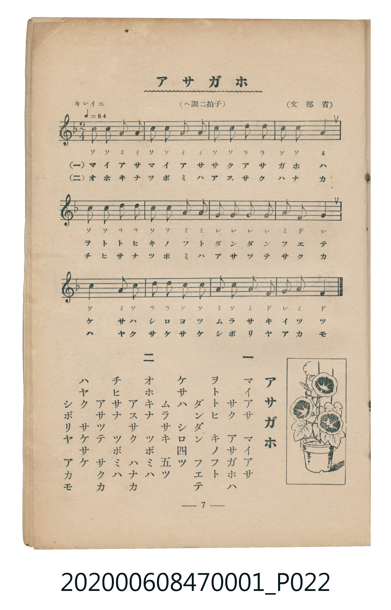

# アサガホ

<audio controls src="asagao.mp3"></audio>

- 詞：文部省
- 曲：文部省
- 臺灣教育會公認《新定兒童唱歌》尋常科第一學年用（2020.006.0847.0001）

## 說明

原書資訊與歌詞全文（對應 P022.jpg，書頁 p. 7，第一學期第 7 首）：
調性與拍號：ヘ調二拍子（F 大調 2/4 拍），「キレイニ」♩=84

## 歌詞

```text
一
マイアサ　マイアサ
サク　アサガホハ
ヲトトヒ　キノフト
ダンダン　フエテ
ケサハ　シロ四ツ
ムラサキ　五ツ

二
オホキナ　ツボミハ
アスサク　ハナカ
チヒサナ　ツボミハ
アサツテ　サクカ
ハヤク　サケサケ
シボリヤ　アカモ
```

## ABC

```abc
X:1
T:アサガホ
C:曲：文部省
M:2/4
L:1/16
Q:1/4=84
K:F
V:V1 name="Piano" snm="Pia"
[V:V1]
c2 c2 a2 a2 | c2 c2 a2 a2 | c2 c2 d2 d2 | c2 c2 a4 |
c2 c2 d2 d2 | c2 c2 a2 a2 | g2 g2 g2 g2 | a2 f2 g4 |
c4 a2 c2 | d2 d2 c2 c2 | a2 c2 a2 f2 | g2 a2 f4 |
```

## TMD 檔案連結

- [主旋律 TMD 檔案](asagao.tmd)
- [鋼琴伴奏 TMD 檔案](asagao_piano.tmd)

## 分析

```text
================================================================================
📊 TMD Song Profile: [ アサガホ ]
================================================================================
⏱  Duration:       0:17 (17.1s), 12 measures total
🎼 Key & Tempo:    首調基準 F, != 84.0 BPM, <2/4>
   - 分析範圍：      由實際發聲的音符與和弦推測調性；播放脈絡另行呈現
🎤 人聲音域:    F4 (MIDI 65) – D5 (MIDI 74) [跨度: 9 個半音 / 0.8 個八度, 難度: easy]
   - 最低音:  F4 in [Asagao #1 @ m.8, 0:10]
   - 最高音: D5 in [Asagao #1 @ m.3, 0:03]
   - 適合: soprano, mezzo-soprano, contralto, tenor, baritone, bass
🏛  結構:      Asagao (17.1s)
⚡ 編曲密度:        Peak 1 軌道同時演奏
🗝  調性診斷：       C 調性不明確（純淨自然大調，未偵測到可信轉調）
   - 風格氣質:    純淨自然大調（陽光明朗、易唱易記，無明顯調外色彩）
   - 轉調歷程:    全曲維持單一推測調性（未偵測到可信轉調）
   - 核心骨幹音:  C, A, G, D, F
   - 調性數值:    C 調性不明確 [相關度: 0.78, 穩定度: Ambiguous, 自然音純度: 100.0%]
   - 候選調性 (K-S): C 大調 (0.78), A 小調 (0.77), F 大調 (0.63)
   - 五度圈歷程:   +0
   - 各段落調性細節:
     • [Asagao #1]: C 調性不明確 (r: 0.78, 自然音純度: 100.0%)

  [ 五度圈游移軌跡 ]
              [C ]*
         F            G  
      Bb               D  
      Eb               A  
         Ab           E  
            Db       B  
               F# 
     (* = active key center)

  [ 十二半音累積音高分佈 ]
     C  : ████████████████████████  37.5%
     C# :                            0.0%
     D  : ████████                  12.5%
     D# :                            0.0%
     E  :                            0.0%
     F  : █████                      8.3%
     F# :                            0.0%
     G  : █████████                 14.6%
     G# :                            0.0%
     A  : █████████████████         27.1%
     A# :                            0.0%
     B  :                            0.0%
--------------------------------------------------------------------------------
Assignment 軌道音域：
  - Piano         : F4 – D5 (9 個半音 / 0.8 個八度, 44 個音符)
================================================================================
```


## 原書掃描頁




