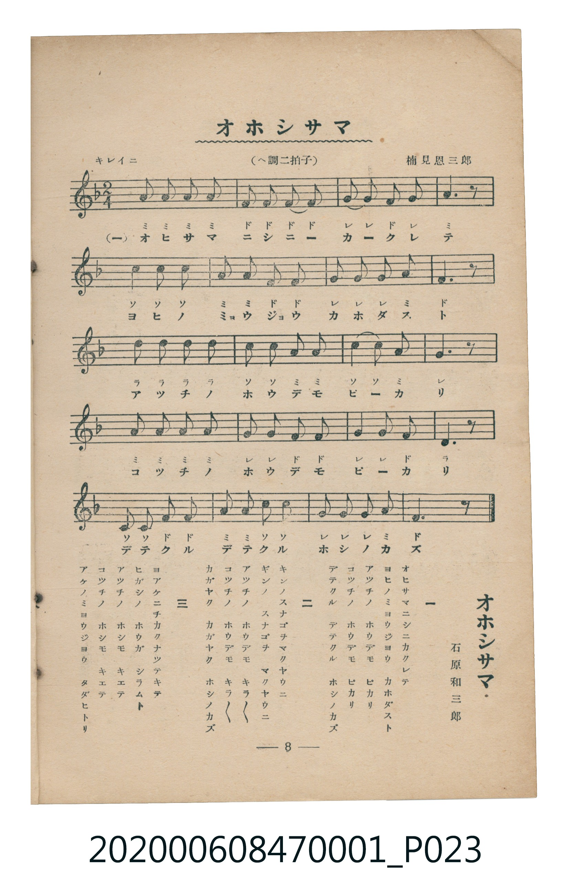

# オホシサマ（星星）

> Re:Shōka 使用 AI 協助辨識與重建樂譜，可能會有錯誤。歡迎回報。

- **NEUTRINO 歌聲合成版**：<br><audio controls src="ohoshisama_neutrino.mp3"></audio>
- **鋼琴伴奏版**：<br><audio controls src="ohoshisama.mp3"></audio>


- 詞：石原和三郎
- 曲：楠見恩三郎
- 臺灣教育會公認《新定兒童唱歌》尋常科第一學年用（2020.006.0847.0001）

## 說明

曲目說明
中文解釋：仰望夜空中的星星，歌唱其明亮與美麗。

原書資訊與歌詞全文（對應 P023.jpg，書頁 p. 8，第一學期第 8 首）：
調性與拍號：ヘ調二拍子（F 大調 2/4 拍），「キレイニ」


## 跨冊／重複收錄參照

> 同名異曲（各冊收錄之不同詞曲版本）

- **[同名異曲]** 楊金土手抄《唱歌帖》第 2 冊・II（2020.006.0843）：[**〈お星様〉**](../../../shokacho/vol_02/p077_ohoshisama/index.md)（`F` / `2/4` — [原始 TMD](../../../shokacho/vol_02/p077_ohoshisama/ohoshisama.tmd)）
- 總表：[跨冊重複與同名歌曲總索引](../../../duplicate_songs.md)

## 歌詞

```text
一
オヒサマニシニカクレテ
ヨヒノミヨウジヨウ　カホダスト
アツチノ　ホウデモ　ピカリ
コツチノ　ホウデモ　ピカリ
デテクル　デテクル　ホシノカズ

二
キンノスナゴヲマクヤウニ
ギンノ　スナゴヲ　マクヤウニ
アツチノ　ホウデモ　キラキラ
コツチノ　ホウデモ　キラキラ
カガヤク　カガヤク　ホシノカズ

三
ヨアケニチカクナツテキテ
ヒガシノ　ホウガ　シラムト
アツチノ　ホシモ　キエテ
コツチノ　ホシモ　キエテ
アケノミヨウジヨウ　タダヒトリ
```

## ABC

```abc
X:1
T:オホシサマ（星星）
C:曲：楠見恩三郎
M:2/4
L:1/16
Q:1/4=88
K:F
V:V1 name="Piano" snm="Pia"
[V:V1]
A2 A2 A2 A2 | F2 F2 F2 F2 | G2 G2 F2 G2 | A6 z2 |
w: 1.~オ ヒ サ マ | ニ シ ニ _ | カ _ ク レ | テ
w: 2.~キ ン ノ _ | ス ナ ゴ ヲ | マ ク ヤ ウ | ニ
w: 3.~ヨ ア ケ ニ | チ カ ク _ | ナ ッ テ キ | テ
c4 c2 c2 | A2 A2 F2 F2 | G2 G2 G2 A2 | F6 z2 |
w: 1.~ヨ ヒ ノ | ミョ ウ ジョ ウ | カ ホ ダ ス | ト
w: 2.~ギ ン ノ | ス ナ ゴ ヲ | マ ク ヤ ウ | ニ
w: 3.~ヒ ガ シ | ノ ホ ウ ガ | シ _ ラ ム | ト
d2 d2 d2 d2 | c2 c2 A2 A2 | c4 c2 A2 | G6 z2 |
w: 1.~ア ッ チ ノ | ホ ウ デ モ | ピ カ _ | リ
w: 2.~ア ッ チ ノ | ホ ウ デ モ | キ ラ キ | ラ
w: 3.~ア ッ チ ノ | ホ _ シ モ | キ エ _ | テ
A2 A2 A2 A2 | G2 G2 F2 F2 | G4 G2 F2 | D6 z2 |
w: 1.~コ ッ チ ノ | ホ ウ デ モ | ピ カ _ | リ
w: 2.~コ ッ チ ノ | ホ ウ デ モ | キ ラ キ | ラ
w: 3.~コ ッ チ ノ | ホ _ シ モ | キ エ _ | テ
C2 C2 F2 F2 | A2 A2 c2 c2 | G2 G2 G2 A2 | F6 z2 |
w: 1.~デ テ ク ル | デ テ ク ル | ホ シ ノ カ | ズ
w: 2.~カ ガ ヤ ク | カ ガ ヤ ク | ホ シ ノ カ | ズ
w: 3.~ア ケ ノ _ | ミョ ウ ジョ ウ | タ ダ ヒ ト | リ
```

## TMD 檔案連結

- [主旋律 TMD 檔案](ohoshisama.tmd) [[在 TMD Studio 編輯](https://tmdlang.github.io/Tmd-TS/#tmd=s7IKdvYPcrWy4qpTUCpJTLdSSM7PyUlNLsnMz7MqzsjMK0nNjM_KTMmPL87Iz05Ugisry88pzU21Si9KTEmNN4w3MjAyiDcwMIs3sDAxBzIMDBFKi_NLi5JTrYqTM_Lzc-JLUitKkvLzsxHyBUX5Zal5iXlANQVFIBtTwIoQClLLMlNSQdKpKZkl-UWZiTlI7kgtKga7FWxJfElRYl5xclFmAcgDCFUlGalAx-YllpQWpSpxaWkpPG5a9bh59uOm7Y-btj5unvd-T8ezGfOB6P2eTgUtLS5FWwULCy57WwU3LhsjfRM7kEEvVgKVzXo-f_PTvvlPJ_U82dH5srkPbMWz2ZuAMs-WLnixrPtZ40okmRftu543Ln42deaLpk3P5jQ_bV3zYlXv44auZ9M2PF0362nrpOerlz6dsvHZ2p7HDd1PN3Q_3bHj-fKJz9esebKj4enaHU93bnk-ZQXQcaDg1QMGrx4oeIEMA0OgQ5W49LUUgHY_n73uxapVz2b0cSkoKDzZsfbZtPYXyxe_bO8GOurJ7g3P5sx-umTO85W7gFLPZ7XA_NkDtBRo9dPWbUCdT3ate9HR_nxf38td0x83NHFp6XOBDLelFgC5DBhsz2bveLG5_cWKLqBlQOuBIfq0dQXQuUAfPt3Q-6y9UyHAwMhYL6sgHeS-2TteLmhUKNBTsADy4GHybM58IFvBQuHlsmnAQAD6EWT4i1X7nzUsBxnb3ftiJtB7sx43zwAKPtnVAxR5unYC0Ao3hadLlgPFFIAxqgAUBesGBnzP46a1j5vXPG5a8ri5-3FDLxckHBtAFDidTIIkEpAsMMGAyNWPm9aDtDS3gRU1rwApau573DwfxG5a9rhpB5TR0ABSDUxqzUDGzsfNHRBTFz1ubnnc3AjSA1QBSonLHje3P25eBOZOAetZBVG6mWilINE2sMtWg-XQuODkDjQF5PpdEE_u6oHYAfQ_0BqgFNCFXY-btjxu3gTyMEjvErB93RB166DqQL5CUgoyHYtqvJ4E2bkSQhLhTwzVQD8Agx9o3XpoECNzsXl1RycsqoDuatoIikagZdCY7ALbDQwsoAXQKAVGOjBJgE2BOwcoArIMKLjycfMCPJEJVAFzdhMwbUCMxOJD7Oog7sOVmvaDkhIouXVA453y7AkFCqBs75-RDyz3ixNzE60CMhPz8h1qDGqqQdYo2Fho2YEZ2EoGBUgGfbGwR0HDROHphv7n6xt04NlZE4sGoGUgw2oUjKGwRsEQCmsUjIDQEIhBsrpAaKBQA1btY1gDypOg-AHSW4H0PKAaYGQCedvBtC6I37QaSANjFiiyBizfBjYlHmaKEUjNWqD4ZiDug-rZCWR3AektQHoTWNc8qBlLgPQyqD0o5hiDxFaAogyIN4LlQSKNYBeA9IJNBpna3Ax2BchWVPfgD9FdPeSEqCnQbFMghIQtIkSNoKGMEaJAPwDDCxSmwNAA8YEpbznY0-C0B2FCwhWYboG4ARxeIJUdWEJ2Hdg0SNhSErKTwLG4Bhy3IH4fxHaws8DxChQH2bQSiBeguYZASu0kJ1zNoBAUwqbQNAsJaxDLCEtKBaYLcMwDUwQ0ZKHub24H4kVgkSlgX4JSLIi3Ckt4EmEKMF1BQwKawlZihidWc0B2g3IOkilNoNRAQip9Ons2ZfkektshqVQXzAaGdTyW4AQlKcqDkwhTiApObOZQITif7JpCVqaPByFIMIKCFVIA4M_2IP-2QbPiarAbMUVAYQPyETDzAUMV5KtdWMIUVNwBMyo4Q6-HFRWoIoRNgiVScFEKLZZxFkX7gXLAYghcaHWgxXUtF5eunQKiKouOVQDylbkA)]
- [鋼琴伴奏 TMD 檔案](ohoshisama_piano.tmd) [[在 TMD Studio 編輯](https://tmdlang.github.io/Tmd-TS/#tmd=s7IKdvYPcrWy4tLSUnjctOpx8-zHTdsfN2193Dzv_Z6Ol917nk_Y8mTPlqdL-593drzf06mgpcWlaKtgYcFlb6vgxmVjpG9ix1WnoPRiJVD9rOfzNz_tm_90Us-THZ0vm_uUQDLPZm8CyjxbuuDFsu5njSuRZF6073reuPjZ1JkvmjY9m9P8tHXNi1W9jxu6nk3b8HTdrKetk56vXvp0ysZna3seN3Q_3dD9dMeO58snPl-z5smOhqdrdzzdueX5lBVAVxoZGBnoGRiY6RlYmJgDGQaGQIcqcXH5Z-QXZ2QWJ-YmWgVkJublB3k41BjUVHMpAIGNhZYdmKGvpWCLDhQgdrxY2KOgYaLwdEP_8_UNOgoBBkbGelkF6ZpYNGjpgw2rUTCGwhoFQyisUTACQkMgBsnqAqGBQg1YtY9hDSjMFR43TwLSW4H0PKCax83dQN52MK0L4jetBtKPm9YDRdaA5dvApsTDTDECqVkLFN8MxH1QPTuB7C4gvQVIbwLrmgc1YwmQXga1B8UcY5DYCqDsIiDeCJYHiTSCXQDSCzYZZGpzM9gVIFtR3YM_RHf1kBOipkCzTYEQEraIEDWChjJGiAL9AAwvUJgCQwPEn_-4eTnY04-bdsCYkHAFJncgbgCHF0hlB5aQXQc2DRK2lITsJHAsrgHHLYjfB7Ed7CxwvALFQTatBOIFaK4hkFI7yQlXMygEhbApNM1CwhrEMsKSUoHpAhzzwBQBDVmo-5vbgXgRWGQK2JegFAvircISnkSYAkxX0JCAprCVmOGJ1RyQ3aCcg2RKEyg1kJBKn86eTVm-h-R2SCrVBbOBYR2PJThBSYry4CTCFKKCE5s5VAjOJ7umkJXp40EIEoygYIUUAPizPci_bdCsuBrsRkwRUNiAfATMfMBQBflqF5YwBRV3wIwKztDrYUUFqghhk2CJFFyUQotlnEXRfqAcsBgCF1odaHFdi1mT-SDXZCbQmgwYKvEK0YaxyAzTeCDLNB4qBgsvUlSaAIVNUFSiaMFiJNgkQ7BJSEwT7Irx2A_0t66dAsLr0T5AhWgiRhgixmARZS4A)]

## 分析

```text
================================================================================
📊 TMD Song Profile: [ オホシサマ（星星） ]
================================================================================
⏱  Duration:       0:27 (27.3s), 20 measures total
🎼 Key & Tempo:    首調基準 F, != 88.0 BPM, <2/4>
   - 分析範圍：      由實際發聲的音符與和弦推測調性；播放脈絡另行呈現
🎤 人聲音域:    C4 (MIDI 60) – D5 (MIDI 74) [跨度: 14 個半音 / 1.2 個八度, 難度: moderate]
   - 最低音:  C4 in [Ohoshisama[] #1 @ m.17, 0:21]
   - 最高音: D5 in [Ohoshisama[] #1 @ m.9, 0:10]
   - 適合: soprano, mezzo-soprano, contralto, tenor, baritone, bass
🏛  結構:      Ohoshisama[] (27.3s)
⚡ 編曲密度:        Peak 1 軌道同時演奏
🗝  調性診斷：       F 大調（純淨自然大調，未偵測到可信轉調）
   - 風格氣質:    純淨自然大調（陽光明朗、易唱易記，無明顯調外色彩）
   - 轉調歷程:    全曲維持單一推測調性（未偵測到可信轉調）
   - 核心骨幹音:  A, F, G, C, D
   - 調性數值:    F 大調 [相關度: 0.77, 穩定度: Moderate, 自然音純度: 100.0%]
   - 候選調性 (K-S): F 大調 (0.77), C 大調 (0.67), A 小調 (0.65)
   - 五度圈歷程:   -1
   - 各段落調性細節:
     • [Ohoshisama[] #1]: F 大調 (r: 0.77, 自然音純度: 100.0%)

  [ 五度圈游移軌跡 ]
               C  
        [F ]*          G  
      Bb               D  
      Eb               A  
         Ab           E  
            Db       B  
               F# 
     (* = active key center)

  [ 十二半音累積音高分佈 ]
     C  : ████████████████          17.3%
     C# :                            0.0%
     D  : ████████                   9.3%
     D# :                            0.0%
     E  :                            0.0%
     F  : ██████████████████████    24.0%
     F# :                            0.0%
     G  : ████████████████████      22.7%
     G# :                            0.0%
     A  : ████████████████████████  26.7%
     A# :                            0.0%
     B  :                            0.0%
--------------------------------------------------------------------------------
Assignment 軌道音域：
  - Piano         : C4 – D5 (14 個半音 / 1.2 個八度, 62 個音符)
================================================================================
```


## 原書掃描頁




