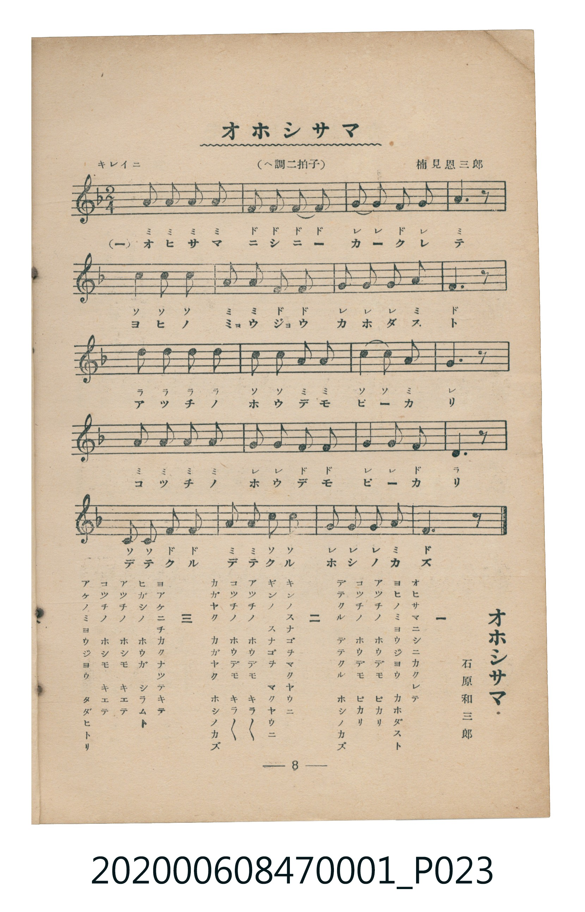

# オホシサマ（星星）

> Re:Shōka 使用 AI 協助辨識與重建樂譜，可能會有錯誤。歡迎[回報](https://github.com/TMDLang/reshoka/issues)。

- **鋼琴伴奏版**：<br><audio controls src="ohoshisama.mp3"></audio>
- **NEUTRINO 歌聲合成版**：<br><audio controls src="ohoshisama_neutrino.mp3"></audio>

- 詞：石原和三郎
- 曲：楠見恩三郎
- 臺灣教育會公認《新定兒童唱歌》尋常科第一學年用（2020.006.0847.0001）

## 說明

曲目說明
中文解釋：仰望夜空中的星星，歌唱其明亮與美麗。

原書資訊與歌詞全文（對應 P023.jpg，書頁 p. 8，第一學期第 8 首）：
調性與拍號：ヘ調二拍子（F 大調 2/4 拍），「キレイニ」


## 歌詞

```text
一
オヒサマニシニカクレテ
ヨヒノミヨウジヨウ　カホダスト
アツチノ　ホウデモ　ピカリ
コツチノ　ホウデモ　ピカリ
デテクル　デテクル　ホシノカズ

二
キンノスナゴヲマクヤウニ
ギンノ　スナゴヲ　マクヤウニ
アツチノ　ホウデモ　キラキラ
コツチノ　ホウデモ　キラキラ
カガヤク　カガヤク　ホシノカズ

三
ヨアケニチカクナツテキテ
ヒガシノ　ホウガ　シラムト
アツチノ　ホシモ　キエテ
コツチノ　ホシモ　キエテ
アケノミヨウジヨウ　タダヒトリ
```

## ABC

<div class="abc-score" data-abc-src="ohoshisama.abc" aria-label="五線譜載入中"></div>

[下載 ABC 原始檔](ohoshisama.abc)

## TMD 檔案連結

- [主旋律 TMD 檔案](ohoshisama.tmd) [[在 TMD Studio 編輯](https://tmdlang.github.io/Tmd-TS/#tmd=s7IKdvYPcrWy4qpTUCpJTLdSSM7PyUlNLsnMz7MqzsjMK0nNjM_KTMmPL87Iz05Ugisry88pzU21Si9KTEmNN4w3MjAyiDcwMIs3sDAxBzIMDBFKi_NLi5JTrYqTM_Lzc-JLUitKkvLzsxHyBUX5Zal5iXlANQVFIBtTwIoQClLLMlNSQdKpKZkl-UWZiTlI7kgtKga7FWxJfElRYl5xclFmAcgDCFUlGalAx-YllpQWpSJEgUalZ-ZZ5aZmZmVicVd-UUlGPtCDBRmVVhmZxSCbkxNz4rMT85DCAWpvQWJ6qlWAgZGxEpeWlsLjplWPm2c_btr-uGnr4-Z57_d0PJsxH4je7-lU0NLiUrRVsLDgsrdVcOOyMdI3sQMZ9mIlUNms5_M3P-2b_3RSz5MdnS-b-8DWPJu9CSjzbOmCF8u6nzWuRJJ50b7reePiZ1Nnvmja9GxO89PWNS9W9T5u6Ho2bcPTdbOetk56vnrp0ykbn63tedzQ_XRD99MdO54vn_h8zZonOxqert3xdOeW51NWAB0Hijw9YOTpgSIPyDAwBDpUiUtfSwFo9_PZ616sWvVsRh-XgoLCkx1rn01rf7F88cv2bqCjnuze8GzO7KdL5jxfuQso9XxWC8yfPUBLgVY_bd0G1Plk17oXHe3P9_W93DX9cUMTl5Y-F8hwW2oBkMuAwfZs9o4Xm9tfrOgCWga0HhiiT1tXAJ0L9OHTDb3P2jsVQBGkl1WQDnLf7B0vFzQqFOgpWAB58DB5Nmc-kK1gofBy2TRgIAD9CDL8xar9zxqWg4zt7n0xE-i9WY-bZwAFn-zqAYo8XTsBaIWbwtMly4FiCsAYVQCKgnUDA77ncdPax81rHjctedzc_bihlwsSjg0gCpxOJkESCUgWmGBA5OrHTetBWprbwIqaV4AUNfc9bp4PYjcte9y0A8poaACpBia1ZiBj5-PmDoipix43tzxubgTpAaoApcRlj5vbHzcvAnOngPWsgijdTLRSkGgb2GWrwXJoXHByB5oCcv0uiCd39UDsAPofaA1QCujCrsdNWx43bwJ5GKR3Cdi-boi6dVB1IF8hKQWZjkU1Xk-C7FwJIYnwJ4ZqoB-AwQ-0bj00iJG52Ly6oxMWVUB3NW0ERSPQMmhMdoHtBgYW0AJolAIjHZgkwKbAnQMUAVkGFFz5uHkBnsgEqoA5uwmYNiBGYvEhdnUQ9-FKTftBSQmU3Dqg8U559oQCBVC298_IB9YqxYm5iVYBmYl5-Q41BjXVIGsUbCy07MAMbCWDAiSDvljYo6BhovB0Q__z9Q068OysiUUD0DKQYTUKxlBYo2AIhTUKRkBoCMQgWV0gNFCoAav2MawB5UlQ_ADprUB6HlANMDKBvO1gWhfEb1oNpIExCxRZA5ZvA5sSDzPFCKRmLVB8MxD3QfXsBLK7gPQWIL0JrGse1IwlQHoZ1B4Uc4xBYitAUQbEG8HyIJFGsAtAesEmg0xtbga7AmQrqnvwh-iuHnJC1BRotikQQsIWEaJG0FDGCFGgH4DhBQpTYGiA-MCUtxzsaXDagzAh4QpMt0DcAA4vkMoOLCG7DmwaJGwpCdlJ4FhcA45bEL8PYjvYWeB4BYqDbFoJxAvQXEMgpXaSE65mUAgKYVNomoWENYhlhCWlAtMFOOaBKQIaslD3N7cD8SKwyBSwL0EpFsRbhSU8iTAFmK6gIQFNYSsxwxOrOSC7QTkHyZQmUGogIZU-nT2bsnwPye2QVKoLZgPDOh5LcIKSFOXBSYQpRAUnNnOoEJxPdk0hK9PHgxAkGEHBCikA8Gd7kH_boFlxNdiNmCKgsAH5CJj5gKEK8tUuLGEKKu6AGRWcodfDigpUEcImwRIpuCiFFss4i6L9QDlgMQQutDrQ4rqWi0vXTgFRlUXHKgD5ylwA)]
- [鋼琴伴奏 TMD 檔案](ohoshisama_piano.tmd) [[在 TMD Studio 編輯](https://tmdlang.github.io/Tmd-TS/#tmd=s7IKdvYPcrWy4qpTUCpJTLdSyC8qychPL0osyKi0ysgsLskvykxOzInPTsxLVIIrKs4vLUpOjS9ITE-1CjAwMlbi0tJSeNy06nHz7MdN2x83bX3cPO_9no6X3XueT9jyZM-Wp0v7n3d2vN_TqaClxaVoq2BhwWVvq-DGZWOkb2IHMvXFSqD6Wc_nb37aN__ppJ4nOzpfNveB7Xs2exNQ5tnSBS-WdT9rXIkk86J91_PGxc-mznzRtOnZnOanrWterOp93ND1bNqGp-tmPW2d9Hz10qdTNj5b2_O4ofvphu6nO3Y8Xz7x-Zo1T3Y0PF274-nOLc-nrAC60sjAyEDPwMBMz8DCxBzIMDAEOlSJi8s_I78YGAKJuYlWAZmJeflBHg41BjXVXApAYGOhZQdm6Gsp2KIDBYgdLxb2KGiYKDzd0P98fYOOAiic9LIK0jWxaNDSBxtWo2AMhTUKhlBYo2AEhIZADJLVBUIDhRqwah_DGlCYKzxungSktwLpeUA1j5u7gbztYFoXxG9aDaQfN60HiqwBy7eBTYmHmWIEUrMWKL4ZiPugenYC2V1AeguQ3gTWNQ9qxhIgvQxqD4o5xiCxFUDZRUC8ESwPEmkEuwCkF2wyyNTmZrArQLaiugd_iO7qISdETYFmmwIhJGwRIWoEDWWMEAX6ARheoDAFhgaIP_9x83Kwpx837YAxIeEKTO5A3AAOL5DKDiwhuw5sGiRsKQnZSeBYXAOOWxC_D2I72FngeAWKg2xaCcQL0FxDIKV2khOuZlAICmFTaJqFhDWIZYQlpQLTBTjmgSkCGrJQ9ze3A_EisMgUsC9BKRbEW4UlPIkwBZiuoCEBTWErMcMTqzkgu0E5B8mUJlBqICGVPp09m7J8D8ntkFSqC2YDwzoeS3CCkhTlwUmEKUQFJzZzqBCcT3ZNISvTx4MQJBhBwQopAPBne5B_26BZcTXYjZgioLAB-QiY-YChCvLVLixhCirugBkVnKHXw4oKVBHCJsESKbgohRbLOIui_UA5YDEELrQ60OK6FrMm80GuyUygNRkwVOIVog1jkRmm8UCWaTxUDBZepKg0AQqboKhE0YLFSLBJhmCTkJgm2BXjsR_ob107BYTXo32ACtFEjDBEjMEiylwA)]

## 分析

```text
================================================================================
📊 TMD Song Profile: [ オホシサマ（星星） ]
================================================================================
⏱  Duration:       0:27 (27.3s), 20 measures total
🎼 Key & Tempo:    首調基準 F, != 88.0 BPM, <2/4>
   - 分析範圍：      由實際發聲的音符與和弦推測調性；播放脈絡另行呈現
🎤 人聲音域:    C4 (MIDI 60) – D5 (MIDI 74) [跨度: 14 個半音 / 1.2 個八度, 難度: moderate]
   - 最低音:  C4 in [Ohoshisama[] #1 @ m.17, 0:21]
   - 最高音: D5 in [Ohoshisama[] #1 @ m.9, 0:10]
   - 適合: soprano, mezzo-soprano, contralto, tenor, baritone, bass
🏛  結構:      Ohoshisama[] (27.3s)
⚡ 編曲密度:        Peak 1 軌道同時演奏
🗝  調性診斷：       F 大調（純淨自然大調，未偵測到可信轉調）
   - 風格氣質:    純淨自然大調（陽光明朗、易唱易記，無明顯調外色彩）
   - 轉調歷程:    全曲維持單一推測調性（未偵測到可信轉調）
   - 核心骨幹音:  A, F, G, C, D
   - 調性數值:    F 大調 [相關度: 0.77, 穩定度: Moderate, 自然音純度: 100.0%]
   - 候選調性 (K-S): F 大調 (0.77), C 大調 (0.67), A 小調 (0.65)
   - 五度圈歷程:   -1
   - 各段落調性細節:
     • [Ohoshisama[] #1]: F 大調 (r: 0.77, 自然音純度: 100.0%)

  [ 五度圈游移軌跡 ]
               C  
        [F ]*          G  
      Bb               D  
      Eb               A  
         Ab           E  
            Db       B  
               F# 
     (* = active key center)

  [ 十二半音累積音高分佈 ]
     C  : ████████████████          17.3%
     C# :                            0.0%
     D  : ████████                   9.3%
     D# :                            0.0%
     E  :                            0.0%
     F  : ██████████████████████    24.0%
     F# :                            0.0%
     G  : ████████████████████      22.7%
     G# :                            0.0%
     A  : ████████████████████████  26.7%
     A# :                            0.0%
     B  :                            0.0%
--------------------------------------------------------------------------------
Assignment 軌道音域：
  - Piano         : C4 – D5 (14 個半音 / 1.2 個八度, 62 個音符)
================================================================================
```


## 原書掃描頁




