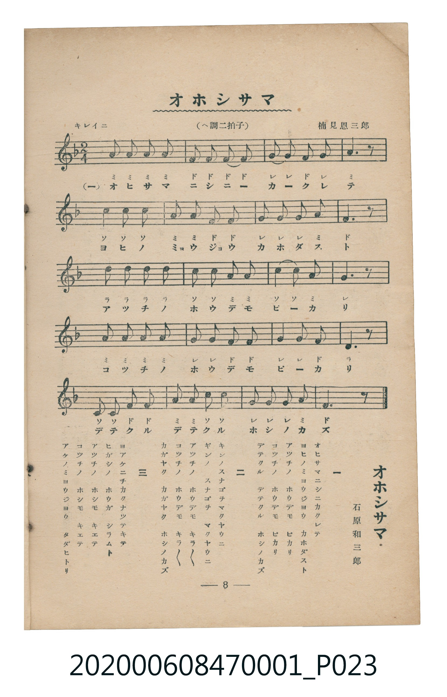

# オホシサマ

<audio controls src="ohoshisama.mp3"></audio>

- 詞：石原和三郎
- 曲：楠見恩三郎
- 臺灣教育會公認《新定兒童唱歌》尋常科第一學年用（2020.006.0847.0001）

- note

原書資訊與歌詞全文（對應 P023.jpg，書頁 p. 8，第一學期第 8 首）：
調性與拍號：ヘ調二拍子（F 大調 2/4 拍），「キレイニ」

## 歌詞

```text
一
オヒサマニシニカクレテ
ヨヒノミヨウジヨウ　カホダスト
アツチノ　ホウデモ　ピカリ
コツチノ　ホウデモ　ピカリ
デテクル　デテクル　ホシノカズ

二
キンノスナゴヲマクヤウニ
ギンノ　スナゴヲ　マクヤウニ
アツチノ　ホウデモ　キラキラ
コツチノ　ホウデモ　キラキラ
カガヤク　カガヤク　ホシノカズ

三
ヨアケニチカクナツテキテ
ヒガシノ　ホウガ　シラムト
アツチノ　ホシモ　キエテ
コツチノ　ホシモ　キエテ
アケノミヨウジヨウ　タダヒトリ
```

## 原書掃描頁



## 調性分析

```text
================================================================================
📊 TMD Song Profile: [ オホシサマ ]
================================================================================
⏱  Duration:       0:27 (27.3s), 20 measures total
🎼 Key & Tempo:    首調基準 F, != 88.0 BPM, <2/4>
   - 分析範圍：      由實際發聲的音符與和弦推測調性；播放脈絡另行呈現
🎤 人聲音域:    C4 (MIDI 60) – D5 (MIDI 74) [跨度: 14 個半音 / 1.2 個八度, 難度: moderate]
   - 最低音:  C4 in [Ohoshisama #1 @ m.17, 0:21]
   - 最高音: D5 in [Ohoshisama #1 @ m.9, 0:10]
   - 適合: soprano, mezzo-soprano, contralto, tenor, baritone, bass
🏛  結構:      Ohoshisama (27.3s)
⚡ 編曲密度:        Peak 1 軌道同時演奏
🗝  調性診斷：       F 大調（純淨自然大調，未偵測到可信轉調）
   - 風格氣質:    純淨自然大調（陽光明朗、易唱易記，無明顯調外色彩）
   - 轉調歷程:    全曲維持單一推測調性（未偵測到可信轉調）
   - 核心骨幹音:  A, F, G, C, D
   - 調性數值:    F 大調 [相關度: 0.78, 穩定度: Moderate, 自然音純度: 100.0%]
   - 候選調性 (K-S): F 大調 (0.78), A 小調 (0.65), C 大調 (0.63)
   - 五度圈歷程:   -1
   - 各段落調性細節:
     • [Ohoshisama #1]: F 大調 (r: 0.78, 自然音純度: 100.0%)

  [ 五度圈游移軌跡 ]
               C  
        [F ]*          G  
      Bb               D  
      Eb               A  
         Ab           E  
            Db       B  
               F# 
     (* = active key center)

  [ 十二半音累積音高分佈 ]
     C  : ██████████████            16.0%
     C# :                            0.0%
     D  : ████████                   9.3%
     D# :                            0.0%
     E  :                            0.0%
     F  : ██████████████████████    25.3%
     F# :                            0.0%
     G  : ██████████████████        21.3%
     G# :                            0.0%
     A  : ████████████████████████  28.0%
     A# :                            0.0%
     B  :                            0.0%
--------------------------------------------------------------------------------
Assignment 軌道音域：
  - Piano         : C4 – D5 (14 個半音 / 1.2 個八度, 62 個音符)
================================================================================
```

## ABC

```abc
X:1
T:オホシサマ
C:曲：楠見恩三郎
M:2/4
L:1/16
Q:1/4=88
K:F

V:V1 name="Piano" snm="Pia"

[V:V1]
a2 a2 a2 a2 | f2 f2 f2 f2 | g2 g2 f2 g2 | a6 z2 |
c4 c2 c2 | a2 a2 f2 f2 | g2 g2 g2 a2 | f6 z2 |
d2 d2 d2 d2 | c2 c2 a2 a2 | c2 c2 a4 | g6 z2 |
a2 a2 a2 a2 | g2 g2 f2 f2 | g2 g2 f4 | d6 z2 |
c2 c2 f2 f2 | a2 a2 c2 c2 | g2 g2 g2 a2 | f6 z2 |
```

- [主旋律 TMD 檔案](ohoshisama.tmd)
- [鋼琴伴奏 TMD 檔案](ohoshisama_piano.tmd)
