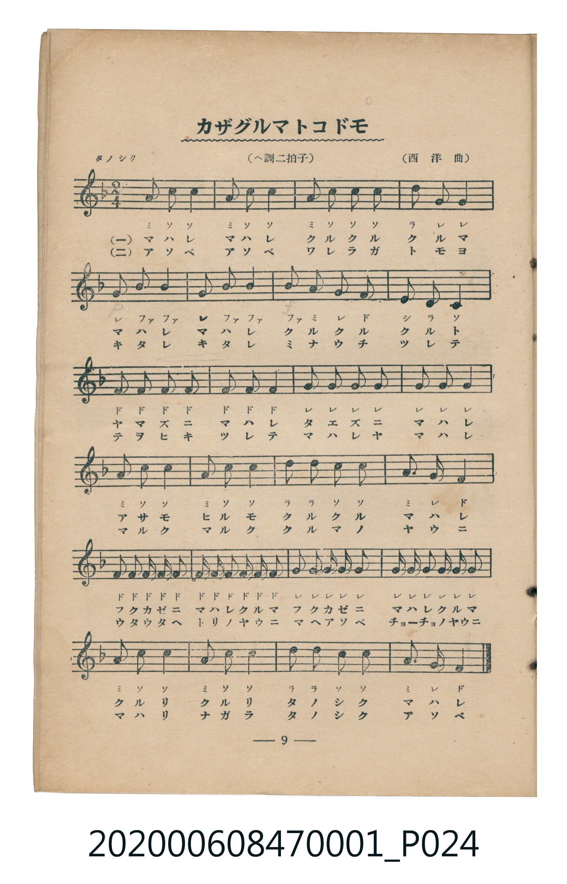
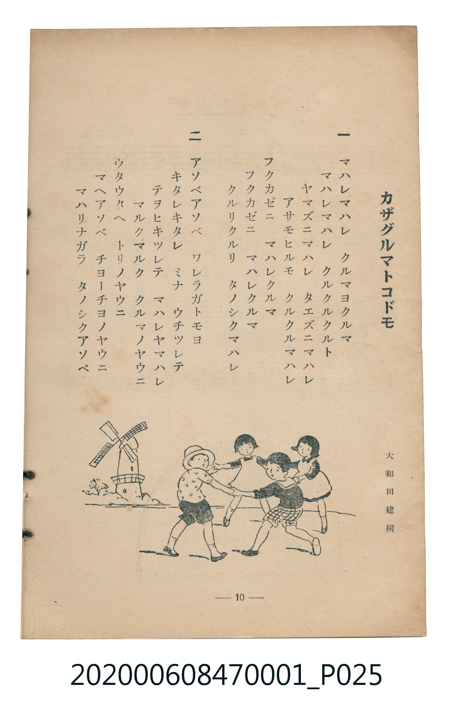

# カザグルマトコドモ（風車與孩子）

> Re:Shōka 使用 AI 協助辨識與重建樂譜，可能會有錯誤。歡迎回報。

- **NEUTRINO 歌聲合成版**：<br><audio controls src="kazaguruma_to_kodomo_neutrino.mp3"></audio>
- **鋼琴伴奏版**：<br><audio controls src="kazaguruma_to_kodomo.mp3"></audio>


- 詞：大和田建樹
- 曲：西洋曲
- 臺灣教育會公認《新定兒童唱歌》尋常科第一學年用（2020.006.0847.0001）

## 說明

曲目說明
中文解釋：描寫孩子拿著風車，在風中歡快遊玩的情景。

原書資訊與歌詞全文（對應 P024.jpg–P025.jpg，書頁 pp. 9–10，第一學期第 9 首）：
調性與拍號：ヘ調二拍子（F 大調 2/4 拍），「タノシク」


## 歌詞

```text
一
マハレマハレ　クルマヨクルマ
マハレマハレ　クルクルクルト
ヤマズニマハレ　タエズニマハレ
アサモヒルモ　クルクルマハレ
フクカゼニ　マハレクルマ
フクカゼニ　マハレクルマ
クルリクルリ　タノシクマハレ

二
アソベアソベ　ワレラガトモヨ
キタレキタレ　ミナ　ウチツレテ
テヲヒキツレテ　マハレヤマハレ
マルクマルク　クルマノヤウニ
ウタウタヘ　トリノヤウニ
マヘアソベ　チヨーチヨノヤウニ
マハリナガラ　タノシクアソベ
```

## ABC

```abc
X:1
T:カザグルマトコドモ（風車與孩子）
C:曲：西洋曲
M:2/4
L:1/16
Q:1/4=104
K:F
V:V1 name="Piano" snm="Pia"
[V:V1]
A2 c2 c4 | A2 c2 c4 | A2 c2 c2 c2 | d2 G4 G2 |
w: 1.~マ ハ レ | マ ハ レ | ク ル マ ヨ | ク ル マ
w: 2.~ア ソ ベ | ア ソ ベ | ワ レ ラ ガ | ト モ ヨ
G2 B2 B4 | G2 B2 B4 | B2 A2 G2 F2 | E2 D2 C4 |
w: 1.~マ ハ レ | マ ハ レ | ク ル ク ル | ク ル ト
w: 2.~キ タ レ | キ タ レ | ミ ナ ウ チ | ツ レ テ
F2 F2 F2 F2 | F2 F4 F2 | G2 G2 G2 G2 | G2 G4 G2 |
w: 1.~ヤ マ ズ ニ | マ ハ レ | タ エ ズ ニ | マ ハ レ
w: 2.~テ ヲ ヒ キ | ツ レ テ | マ ハ レ ヤ | マ ハ レ
A2 c2 c4 | A2 c2 c4 | d2 d2 c2 c2 | A2 G2 F4 |
w: 1.~ア サ モ | ヒ ル モ | ク ル ク ル | マ ハ レ
w: 2.~マ ル ク | マ ル ク | ク ル マ ノ | ヤ ウ ニ
F2 F2 F F F2 | F F F2 F F F2 | G2 G2 G G G2 | G G G2 G G G2 |
w: 1.~フ ク カ ゼ ニ | マ ハ レ ク ル マ | フ ク カ ゼ ニ | マ ハ レ ク ル マ
w: 2.~ウ タ ウ タ ヘ | ト リ ノ ヤ ウ ニ | マ ヘ ア ソ ベ | チョー チョ ノ ヤ ウ ニ
A2 c2 c4 | A2 c2 c4 | d2 d2 c2 c2 | A2 G2 F4 |
w: 1.~ク ル リ | ク ル リ | タ ノ シ ク | マ ハ レ
w: 2.~マ ハ リ | ナ ガ ラ | タ ノ シ ク | ア ソ ベ
```

## TMD 檔案連結

- [主旋律 TMD 檔案](kazaguruma_to_kodomo.tmd) [[在 TMD Studio 編輯](https://tmdlang.github.io/Tmd-TS/#tmd=s7IKdvYPcrWy4qpTUCpJTLdSSM7PyUlNLsnMz7MqzsjMK0nNjM_KTMmPL87Iz05Ugisry88pzU21Si9KTEmNN4w3MjAyiDcwMIs3sDAxBzIMDBFKi_NLi5JTrYqTM_Lzc-JLUitKkvLzsxHyBUX5Zal5iXlANQVFIBtTwIoQClLLMlNSQdKpKZkl-UWZiTlI7kgtKga7FWxJfElRYl5xclFmAcgDCFUlGalAx6Yl5mbmVCJEgUalZ-ZZ5aZmZmVicRdUujy1uCS1KC8-NzUnPwWoW0tL4XHT6sdN2x43bXjcvPpx87zHzR2PmzY_bu583Lzo_Z6Ol4tWvNjd9aKj_enalU_XTni_p1NBS4tL0VbB0MCEy95WwY3LxkjfxA5kz4uV897vmfV0yfKnk3qeT9nwdPeuZyt2gl3wbPYmoMyLpfufbekGssFiL9p3PW9c_GzqzBdNm57NaX7auubFqt7HDV3Ppm14um7W09ZJz1cvfTpl47O1PY8bup9u6H66Y8fz5ROfr1nzZEfD07U7nu7c8nzKCqADQZGlB4wsPVBkARkGhkA3KnHpaykAbXo-e92LVauezejjUlBQeLJj7bNp7S-WL37Z3g10zrP-_qfrV0O89ax7_4uJ0yF-fb-n5-mcFUA2SP3ahU_3r37Z2PW8b-XzWS3PmlufzVz_uKGJS0ufC2SFLbUAyH1P--Y_m73jxeb2FytAAQ70OTBEn7auADoa6M-nG3qftXcqBBgYmehlFaQ_apgMZJqCmEAHA_W9XNCoUFCgp2AJlDE0AIrBg-rZnPlAtoKlwstl04BhA_Q6yLYXq_Y_a1gOsqe798XM-UDRx80zgIJPdvUARcBR3eGmAIxNoJgCMIoVgKJg3cD46HnctP9xc9_jpu2Pm4DB0csFCd4GEAVOQv2Pm9cgGA0NIGXQ1LUCziakGpls7oCoXgJS17TrcXM3qob9j5uABqOIgzU0LXrctBWYkh83TwIbswjdeBTVzVNBoqD8sAdkElAp3BJURxOpDspZhWBA3AoPOrjt4ADc1QN3897HzTMRDJAFQMXAQFr5uAlIdoB9tAKiei3YRKDNMAZI9fzHzV1gy5Y9bm583NwC1twGcXzb4-ZNoPAAaoBJoHgBEshIoQLkQIILxkCJ0D6QBpA93RD3LAPHBphsngE2GOjcVRjqQFpnoHoR6NAVj5uBQQphYNEAdBPQpC5wIKxED0yYWSDVlOdIKFAA5XTvxKrE9NKi0tzEkHzv_JT83HyrgMzEvHyHGoOaapB1CjaGZlp2YBa2UkEBkhdfLOxR0DBReLqh__n6Bh14VtbEogFoK8iwGgVjBV0FUygGQUIiIFyjYAYkjaDyILoGbJqPYQ0oGIF8YEiCyTVwM3CKN60Hi6wGkxA1KzBkQBAiC7XJCCS_CCTatBcsNxPJRBzizRDzQHYDYxesBsQGyXSAxUD6IDaBXQDONLjDe1cPOeENCi0TKIa4C1MExAKFOUjGECxiHg-kzECEKYgAK6NOkCOx0SMDFChINoGDfC1Yz34ME3GIN88Hi3SBZZeB2Y1QmRakyGiD20QgiXeSE-SgIETGCBEQhIiAghoZI0SwJfElYFeDQ7dpF5jdjRHikIQETWCQkGkCJSuidCBCHBw2wAIVTE4C6weFNWoIQnSCVGKLdYh7cduFN8yfzp5Nq2IFVIiAMKJYQU70aGkcmqm3gt0Ny6ggP4HDBJpikcRxp3HsuQIpxCHyCJ2ouQlDHEsB1gfVAU4n0HQPim9i0viuKZSlcRCEpHEICyGCSN8gCBGBsOAiSGl8KiLkmlYD8R6UNAsKP2jqAqoB-R5aPJOvE6mUAYcYNM8sA7OAdTnUhA4gXgUNY1AIg1Wg5SaQWlCKAVUCkCoAJAes9ZcDq38oC7sRBDJD69rBkRmQk9wqHEkRWRxSMIP927QdHj3EZwaIPJKJ0CIdUZcStAl7rcxVy8Wla6eA2QCKjlUAiitzAQA)]
- [鋼琴伴奏 TMD 檔案](kazaguruma_to_kodomo_piano.tmd) [[在 TMD Studio 編輯](https://tmdlang.github.io/Tmd-TS/#tmd=s7IKdvYPcrWy4tLSUnjctPpx07bHTRseN69-3DzvcXPH46bNj5s7Hzcver-n42X3nucTtjzZs-Xp0v7nnR3v93QqaGlxKdoqGBqYcNnbKrhx2Rjpm9hx1SkovVg57_2eWU-XLH86qef5lA1Pd-96tmKnEkjm2exNQJkXS_c_29INZIPFXrTvet64-NnUmS-aNj2b0_y0dc2LVb2PG7qeTdvwdN2sp62Tnq9e-nTKxmdrex43dD_d0P10x47nyyc-X7PmyY6Gp2t3PN255fmUFUAHGhkYGegZGJjpGViYmAMZBoZANypxcXknViWmlxaV5iaG5Hvnp-Tn5lsFZCbm5TvUGNRUcykAgY2hmZYdmKWvpWCLDhQgVr1Y2KOgYaLwdEP_8_UNOgoBBkYmelkF6ZpYNGjpgw2rUTBW0FUwhWIQJCQCwjUKZkDSCCoPomvApvkY1igAYwXIf9zcDybXwM3AKd60HiyyGkxC1KzAkAFBiCzUJiOQ_CKQaNNesNxMJBNxiDdDzAPZ_bh5JVgNiA2S6QCLgfRBbAK7gAt_eO_qISe8QaFlAsUQd2GKgFigMAfJGIJFzOOBlBmIMAURYGXUCXIkNnpkgAIFySZwkK8F69mPYSIO8eb5YJEusOwyMLsRKtOCFBltcJsIJPFOcoIcFITIGCECghARUFAjY4QItiS-BOxqcOg27QKzuzFCHJKQoAkMEjJNoGRFlA5EiIPD5nHzJjA5CawfFNaoIQjRCVKJLdYh7sVtF94wfzp7Nq2KFVAhAsKIYgU50aOlcWim3gp2NyyjgvwEDhNoikUSx53GsecKpBCHyCN0ouYmDHEsBVgfVAc4nUDTPSi-iUnju6ZQlsZBEJLGISyECCJ9gyBEBMKCiyCl8amIkGtaDcR7UNIsKPygqQuoBuR7aPFMvk6kUgYcYtA8swzMetw8A2pCBxCvgoYxKITBKtByE0gtKMWAKgFIFQCSa3zcvPxxM8g1IBZ2Iwhkhta1gyMzICe5VTiSIrI4pGAG-7dpOzx6iM8MEHkkE6FFOqIuJWgT9lqZqxZ368fHA6n9YwJt_gATdrxCtGEsVoYJkGEaD2RBlZrGwwQwmIZoTJyGYzUDp2qQCxDaaG0yMPB07RQwwy_aB6gSh4wRWEaZCwA)]

## 分析

```text
================================================================================
📊 TMD Song Profile: [ カザグルマトコドモ（風車與孩子） ]
================================================================================
⏱  Duration:       0:27 (27.7s), 24 measures total
🎼 Key & Tempo:    首調基準 F, != 104.0 BPM, <2/4>
   - 分析範圍：      由實際發聲的音符與和弦推測調性；播放脈絡另行呈現
🎤 人聲音域:    C4 (MIDI 60) – D5 (MIDI 74) [跨度: 14 個半音 / 1.2 個八度, 難度: moderate]
   - 最低音:  C4 in [KazagurumaToKodomo[] #1 @ m.8, 0:08]
   - 最高音: D5 in [KazagurumaToKodomo[] #1 @ m.4, 0:03]
   - 適合: soprano, mezzo-soprano, contralto, tenor, baritone, bass
🏛  結構:      KazagurumaToKodomo[] (27.7s)
⚡ 編曲密度:        Peak 1 軌道同時演奏
🗝  調性診斷：       C 大調（流行色彩大調，未偵測到可信轉調）
   - 風格氣質:    流行大調（略帶和弦色彩音與裝飾副屬和弦）
   - 轉調歷程:    全曲維持單一推測調性（未偵測到可信轉調）
   - 核心骨幹音:  C, G, F, A, A#
   - 調性數值:    C 大調 [相關度: 0.84, 穩定度: Moderate, 自然音純度: 92.7%]
   - 候選調性 (K-S): C 大調 (0.84), F 大調 (0.80), C 小調 (0.56)
   - 五度圈歷程:   +0
   - 各段落調性細節:
     • [KazagurumaToKodomo[] #1]: C 大調 (r: 0.84, 自然音純度: 92.7%, 調外音: A#)

  [ 五度圈游移軌跡 ]
              [C ]*
         F            G  
      Bb               D  
      Eb               A  
         Ab           E  
            Db       B  
               F# 
     (* = active key center)

  [ 十二半音累積音高分佈 ]
     C  : ████████████████████████  28.1%
     C# :                            0.0%
     D  : █████                      6.2%
     D# :                            0.0%
     E  : █                          1.0%
     F  : ███████████████████       21.9%
     F# :                            0.0%
     G  : █████████████████████     25.0%
     G# :                            0.0%
     A  : █████████                 10.4%
     A# : ██████                     7.3%
     B  :                            0.0%
--------------------------------------------------------------------------------
Assignment 軌道音域：
  - Piano         : C4 – D5 (14 個半音 / 1.2 個八度, 88 個音符)
================================================================================
```


## 原書掃描頁






