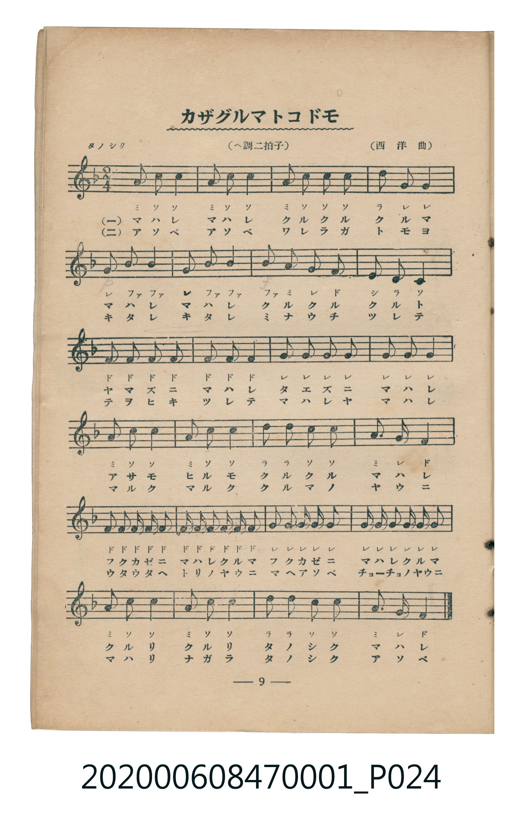
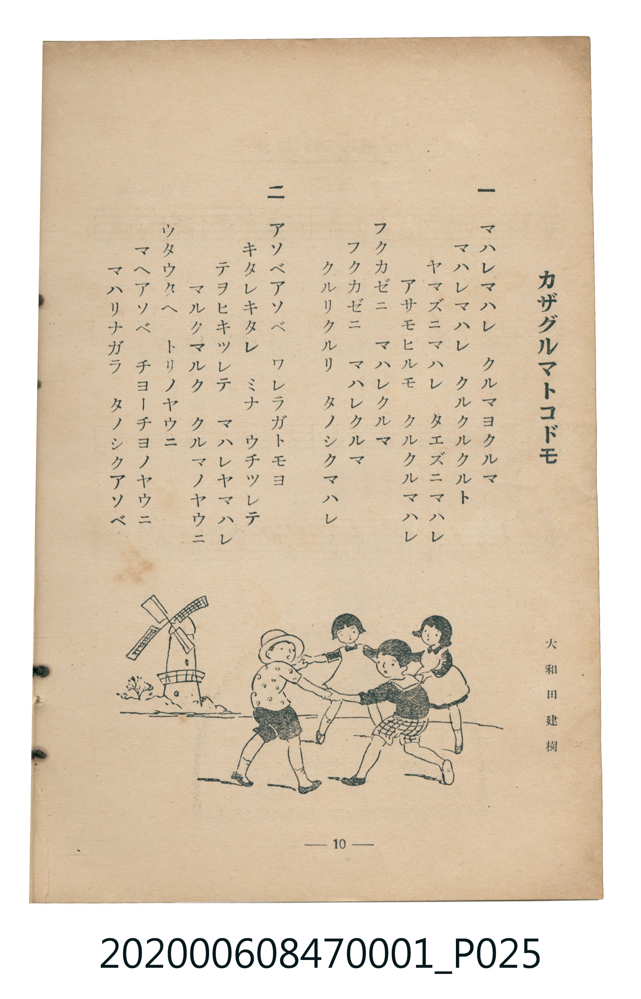

# カザグルマトコドモ（風車與孩子）

> Re:Shoka 使用 AI 協助辨識與重建樂譜，可能會有錯誤。歡迎回報。

<audio controls src="kazaguruma_to_kodomo.mp3"></audio>

- 詞：大和田建樹
- 曲：西洋曲
- 臺灣教育會公認《新定兒童唱歌》尋常科第一學年用（2020.006.0847.0001）

## 說明

曲目說明
中文解釋：描寫孩子拿著風車，在風中歡快遊玩的情景。

原書資訊與歌詞全文（對應 P024.jpg–P025.jpg，書頁 pp. 9–10，第一學期第 9 首）：
調性與拍號：ヘ調二拍子（F 大調 2/4 拍），「タノシク」

## 歌詞

```text
一
マハレマハレ　クルマヨクルマ
マハレマハレ　クルクルクルト
ヤマズニマハレ　タエズニマハレ
アサモヒルモ　クルクルマハレ
フクカゼニ　マハレクルマ
フクカゼニ　マハレクルマ
クルリクルリ　タノシクマハレ

二
アソベアソベ　ワレラガトモヨ
キタレキタレ　ミナ　ウチツレテ
テヲヒキツレテ　マハレヤマハレ
マルクマルク　クルマノヤウニ
ウタウタヘ　トリノヤウニ
マヘアソベ　チヨーチヨノヤウニ
マハリナガラ　タノシクアソベ
```

## ABC

```abc
X:1
T:カザグルマトコドモ（風車與孩子）
C:曲：西洋曲
M:2/4
L:1/16
Q:1/4=104
K:F
V:V1 name="Piano" snm="Pia"
[V:V1]
A2 c2 c4 | A2 c2 c4 | A2 c2 c2 c2 | d2 G4 G2 |
G2 B2 B4 | G2 B2 B4 | B2 A2 G2 F2 | E2 D2 C4 |
F2 F2 F2 F2 | F2 F4 F2 | G2 G2 G2 G2 | G2 G4 G2 |
A2 c2 c4 | A2 c2 c4 | d2 d2 c2 c2 | A2 G2 F4 |
F2 F2 F F F2 | F F F2 F F F2 | G2 G2 G G G2 | G G G2 G G G2 |
A2 c2 c4 | A2 c2 c4 | d2 d2 c2 c2 | A2 G2 F4 |
```

## TMD 檔案連結

- [主旋律 TMD 檔案](kazaguruma_to_kodomo.tmd) [[在 TMD Studio 編輯](https://tmdlang.github.io/Tmd-TS/#tmd=s7IKdvYPcrWy4qpTUCpJTLdSSM7PyUlNLsnMz7MqzsjMK0nNjM_KTMmPL87Iz05Ugisry88pzU21Si9KTEmNN4w3MjAyiDcwMIs3sDAxBzIMDBFKi_NLi5JTrYqTM_Lzc-JLUitKkvLzsxHyBUX5Zal5iXlANQVFIBtTwIoQClLLMlNSQdKpKZkl-UWZiTlI7kgtKga7FWxJfElRYl5xclFmAcgDCFUlGalAx6Yl5mbmVCpxaWkpPG5a_bhp2-OmDY-bVz9unve4ueNx0-bHzZ2Pmxe939PxctGKF7u7XnS0P1278unaCe_3dCpoaXEp2ioYGphw2dsquHHZGOmb2IGMf7Fy3vs9s54uWf50Us_zKRue7t71bMVOsMXPZm8CyrxYuv_Zlm4gGyz2on3X88bFz6bOfNG06dmc5qeta16s6n3c0PVs2oan62Y9bZ30fPXSp1M2Plvb87ih--mG7qc7djxfPvH5mjVPdjQ8Xbvj6c4tz6esADoQFNx6wODWAwU3kGFgCHSjEpe-lgLQpuez171YterZjD4uBQWFJzvWPpvW_mL54pft3UDnPOvvf7p-NcRbz7r3v5g4HeLX93t6ns5ZAWSD1K9d-HT_6peNXc_7Vj6f1fKsufXZzPWPG5q4tPS5QFbYUguA3Pe0b_6z2TtebG5_sQIU4ECfA0P0aesKoKOB_ny6ofdZe6dCgIGRiV5WQfqjhslApimICXQwUN_LBY0KBQV6CpZAGUMDoBg8qJ7NmQ9kK1gqvFw2DRg2QK-DbHuxav-zhuUge7p7X8ycDxR93DwDKPhkVw9QBBzVHW4KwNgEiikAo1gBKArWDYyPnsdN-x839z1u2v64CRgcvVyQ4G0AUeAk1P-4eQ2C0dAAUgZNXSvgbEKqkcnmDojqJSB1TbseN3ejatj_uAloMIo4WEPTosdNW4Ep-XHzJLAxi9CNR1HdPBUkCsoPe0AmAZXCLUF1NJHqoJxVCAbErfCgg9sODsBdPXA3733cPBPBAFkAVAwMpJWPm4BkB9hHKyCq14JNBNoMY4BUz3_c3AW2bNnj5sbHzS1gzW0Qx7c9bt4ECg-gBpgEihcggYwUKkAOJLhgDJQI7QNpANnTDXHPMnBsgMnmGWCDgc5dhaEOpHUGqheBDl3xuBkYpBAGFg1ANwFN6gIHwkr0wISZBVJNeY6EAgVQTvdOrEpMLy0qzU0MyffOT8nPzbcKyEzMy3eoMahRqAbZp2BjaKZlB2ZhKxYUIJnxxcIeBQ0Thacb-p-vb9CB52VNLBqA1oIMq1EwVtBVMIViECQkAsI1CmZA0ggqD6JrwCkMt9t29ZDjNpDJJlAMcQmmCIgFch9IxhAsYh4PpMxAhCmIACsj4LwdneQ4D2QdMkaIgCBEBOQsZIwQITLons6eTatoBUUiCCOiFTkgiQm3XVMoCzcQhIQbhIUQQYQZCEJEICy4CIFwa107kOFWy8Wla6eAmbEVgKLKXFwA)]
- [鋼琴伴奏 TMD 檔案](kazaguruma_to_kodomo_piano.tmd) [[在 TMD Studio 編輯](https://tmdlang.github.io/Tmd-TS/#tmd=s7IKdvYPcrWy4tLSUnjctPpx07bHTRseN69-3DzvcXPH46bNj5s7Hzcver-n42X3nucTtjzZs-Xp0v7nnR3v93QqaGlxKdoqGBqYcNnbKrhx2Rjpm9hx1SkovVg57_2eWU-XLH86qef5lA1Pd-96tmKnEkjm2exNQJkXS_c_29INZIPFXrTvet64-NnUmS-aNj2b0_y0dc2LVb2PG7qeTdvwdN2sp62Tnq9e-nTKxmdrex43dD_d0P10x47nyyc-X7PmyY6Gp2t3PN255fmUFUAHGhkYGegZGJjpGViYmAMZBoZANypxcXknViWmlxaV5iaG5Hvnp-Tn5lsFZCbm5TvUGNQoVHMpAIGNoZmWHZilr6Vgiw4UIHa9WNijoGGi8HRD__P1DToKAQZGJnpZBemaWDRo6YMNq1EwVtBVMIViECQkAsI1CmZA0ggqD6JruPC7bVcPOW4DmWwCxRCXYIqAWCD3gWQMwSLm8UDKDESYggiwMgLO29FJjvNA1iFjhAgIQkRAzkLGCBEig-7p7Nm0ilZQJIIwIlqRA5KYcNs1hbJwA0FIuEFYCBFEmIEgRATCgosQCLfWtQMZbrW4c7WPB3K-NoFma2AgxCtEG8ZiZZgAGabxQBZUqWk8TACDaYjGxGk4VjNwqga5AKGN1iYDQ0_XTgEzABVwiipzcQEA)]

## 分析

```text
================================================================================
📊 TMD Song Profile: [ カザグルマトコドモ（風車與孩子） ]
================================================================================
⏱  Duration:       0:27 (27.7s), 24 measures total
🎼 Key & Tempo:    首調基準 F, != 104.0 BPM, <2/4>
   - 分析範圍：      由實際發聲的音符與和弦推測調性；播放脈絡另行呈現
🎤 人聲音域:    C4 (MIDI 60) – D5 (MIDI 74) [跨度: 14 個半音 / 1.2 個八度, 難度: moderate]
   - 最低音:  C4 in [KazagurumaToKodomo #1 @ m.8, 0:08]
   - 最高音: D5 in [KazagurumaToKodomo #1 @ m.4, 0:03]
   - 適合: soprano, mezzo-soprano, contralto, tenor, baritone, bass
🏛  結構:      KazagurumaToKodomo (27.7s)
⚡ 編曲密度:        Peak 1 軌道同時演奏
🗝  調性診斷：       C 大調（流行色彩大調，未偵測到可信轉調）
   - 風格氣質:    流行大調（略帶和弦色彩音與裝飾副屬和弦）
   - 轉調歷程:    全曲維持單一推測調性（未偵測到可信轉調）
   - 核心骨幹音:  C, G, F, A, A#
   - 調性數值:    C 大調 [相關度: 0.84, 穩定度: Moderate, 自然音純度: 92.7%]
   - 候選調性 (K-S): C 大調 (0.84), F 大調 (0.80), C 小調 (0.56)
   - 五度圈歷程:   +0
   - 各段落調性細節:
     • [KazagurumaToKodomo #1]: C 大調 (r: 0.84, 自然音純度: 92.7%, 調外音: A#)

  [ 五度圈游移軌跡 ]
              [C ]*
         F            G  
      Bb               D  
      Eb               A  
         Ab           E  
            Db       B  
               F# 
     (* = active key center)

  [ 十二半音累積音高分佈 ]
     C  : ████████████████████████  28.1%
     C# :                            0.0%
     D  : █████                      6.2%
     D# :                            0.0%
     E  : █                          1.0%
     F  : ███████████████████       21.9%
     F# :                            0.0%
     G  : █████████████████████     25.0%
     G# :                            0.0%
     A  : █████████                 10.4%
     A# : ██████                     7.3%
     B  :                            0.0%
--------------------------------------------------------------------------------
Assignment 軌道音域：
  - Piano         : C4 – D5 (14 個半音 / 1.2 個八度, 88 個音符)
================================================================================
```


## 原書掃描頁






