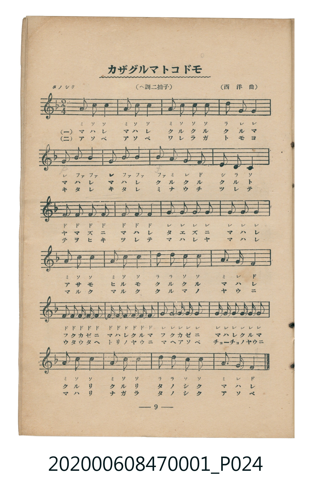
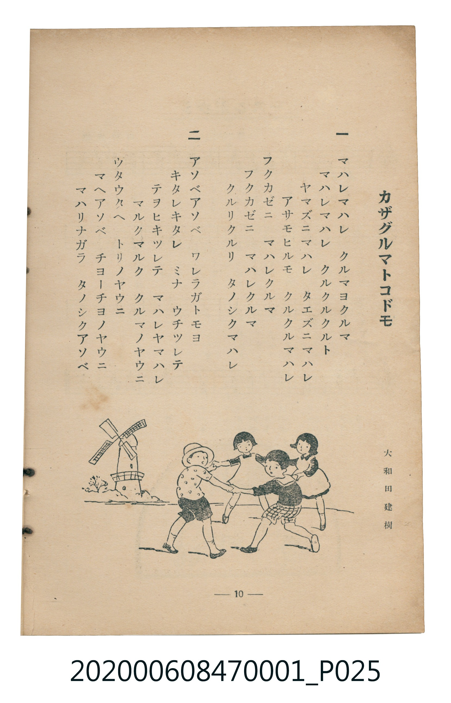

# カザグルマトコドモ（風車與孩子）

> Re:Shōka 使用 AI 協助辨識與重建樂譜，可能會有錯誤。歡迎回報。

- **鋼琴伴奏版**：<br><audio controls src="kazaguruma_to_kodomo.mp3"></audio>
- **NEUTRINO 歌聲合成版**：<br><audio controls src="kazaguruma_to_kodomo_neutrino.mp3"></audio>

- 詞：大和田建樹
- 曲：西洋曲
- 臺灣教育會公認《新定兒童唱歌》尋常科第一學年用（2020.006.0847.0001）

## 說明

曲目說明
中文解釋：描寫孩子拿著風車，在風中歡快遊玩的情景。

原書資訊與歌詞全文（對應 P024.jpg–P025.jpg，書頁 pp. 9–10，第一學期第 9 首）：
調性與拍號：ヘ調二拍子（F 大調 2/4 拍），「タノシク」


## 歌詞

```text
一
マハレマハレ　クルマヨクルマ
マハレマハレ　クルクルクルト
ヤマズニマハレ　タエズニマハレ
アサモヒルモ　クルクルマハレ
フクカゼニ　マハレクルマ
フクカゼニ　マハレクルマ
クルリクルリ　タノシクマハレ

二
アソベアソベ　ワレラガトモヨ
キタレキタレ　ミナ　ウチツレテ
テヲヒキツレテ　マハレヤマハレ
マルクマルク　クルマノヤウニ
ウタウタヘ　トリノヤウニ
マヘアソベ　チヨーチヨノヤウニ
マハリナガラ　タノシクアソベ
```

## ABC

<div class="abc-score" data-abc-src="kazaguruma_to_kodomo.abc" aria-label="五線譜載入中"></div>

[下載 ABC 原始檔](kazaguruma_to_kodomo.abc)

## TMD 檔案連結

- [主旋律 TMD 檔案](kazaguruma_to_kodomo.tmd) [[在 TMD Studio 編輯](https://tmdlang.github.io/Tmd-TS/#tmd=s7IKdvYPcrWy4qpTUCpJTLdSSM7PyUlNLsnMz7MqzsjMK0nNjM_KTMmPL87Iz05Ugisry88pzU21Si9KTEmNN4w3MjAyiDcwMIs3sDAxBzIMDBFKi_NLi5JTrYqTM_Lzc-JLUitKkvLzsxHyBUX5Zal5iXlANQVFIBtTwIoQClLLMlNSQdKpKZkl-UWZiTlI7kgtKga7FWxJfElRYl5xclFmAcgDCFUlGalAx6Yl5mbmVCJEgUalZ-ZZ5aZmZmVicRdUujy1uCS1KC8-NzUnPwVFd0lGPtD_BRmVVhmZxSCHJSfmxGcn5iEFE9RZBYnpqVYBBkYmukDCVIlLS0vhcdPqx03bHjdteNy8-nHzvMfNHY-bNj9u7nzcvOj9no6Xi1a82N31oqP96dqVT9dOeL-nU0FLi0vRVsHQwITL3lbBjcvGSN_EDmTPi5Xz3u-Z9XTJ8qeTep5P2fB0965nK3aCXfBs9iagzIul-59t6QaywWIv2nc9b1z8bOrMF02bns1pftq65sWq3scNXc-mbXi6btbT1knPVy99OmXjs7U9jxu6n27ofrpjx_PlE5-vWfNkR8PTtTue7tzyfMoKoANBEa4HjHA9UIQDGQaGQDcqcelrKQBtej573YtVq57N6ONSUFB4smPts2ntL5YvftneDXTOs_7-p-tXQ7z1rHv_i4nTIX59v6fn6ZwVQDZI_dqFT_evftnY9bxv5fNZLc-aW5_NXP-4oYlLS58LZIUttQDIfU_75j-bvePF5vYXK0ABDvQ5MESftq4AOhroz6cbep-1dyqA4k4vqyD9UcNkUAyCmEAHA_W9XNCoUFCgp2AJlDE0AIrBg-rZnPlAtoKlwstl04BhA_Q6yLYXq_Y_a1gOsqe798XM-UDRx80zgIJPdvUARcBR3eGmAIxNoJgCMIoVgKJg3cD46HnctP9xc9_jpu2Pm4DB0csFCd4GEAVOQv2Pm9cgGA0NIGXQ1LUCziakGpls7oCoXgJS17TrcXM3qob9j5uABqOIgzU0LXrctBWYkh83TwIbswjdeBTVzVNBoqD8sAdkElAp3BJURxOpDspZhWBA3AoPOrjt4ADc1QN3897HzTMRDJAFQMXAQFr5uAlIdoB9tAKiei3YRKDNMAZI9fzHzV1gy5Y9bm583NwC1twGcXzb4-ZNoPAAaoBJoHgBEshIoQLkQIILxkCJ0D6QBpA93RD3LAPHBphsngE2GOjcVRjqQFpnoHoR6NAVj5uBQQphYNEAdBPQpC5wIKxED0yYWSDVlOdIKFAA5XTvxKrE9NKi0tzEkHzv_JT83HyrgMzEvHyHGoOaapB1CjaGZlp2YBa2UkEBkhdfLOxR0DBReLqh__n6Bh14VtbEogFoK8iwGgVjBV0FUygGQUIiIFyjYAYkjaDyILoGbJqPYQ0oGIF8YEiCyTVwM3CKN60Hi6wGkxA1KzBkQBAiC7XJCCS_CCTatBcsNxPJRBzizRDzQHYDYxesBsQGyXSAxUD6IDaBXQDONLjDe1cPOeENCi0TKIa4C1MExAKFOUjGECxiHg-kzECEKYgAK6NOkCOx0SMDFChINoGDfC1Yz34ME3GIN88Hi3SBZZeB2Y1QmRakyGiD20QgiXeSE-SgIETGCBEQhIiAghoZI0SwJfElYFeDQ7dpF5jdjRHikIQETWCQkGkCJSuidCBCHBw2wAIVTE4C6weFNWoIQnSCVGKLdYh7cduFN8yfzp5Nq2IFVIiAMKJYQU70aGkcmqm3gt0Ny6ggP4HDBJpikcRxp3HsuQIpxCHyCJ2ouQlDHEsB1gfVAU4n0HQPim9i0viuKZSlcRCEpHEICyGCSN8gCBGBsOAiSGl8KiLkmlYD8R6UNAsKP2jqAqoB-R5aPJOvE6mUAYcYNM8sA7OAdTnUhA4gXgUNY1AIg1Wg5SaQWlCKAVUCkCoAJAes9ZcDq38oC7sRBDJD69rBkRmQk9wqHEkRWRxSMIP927QdHj3EZwaIPJKJ0CIdUZcStAl7rcxVy8Wla6eA2QCKjlUAiitzAQA)]
- [鋼琴伴奏 TMD 檔案](kazaguruma_to_kodomo_piano.tmd) [[在 TMD Studio 編輯](https://tmdlang.github.io/Tmd-TS/#tmd=s7IKdvYPcrWy4qpTUCpJTLdSyC8qychPL0osyKi0ysgsLskvykxOzInPTsxLVIIrKs4vLUpOjS9ITE-1CjAwMtEFEqZKXFpaCo-bVj9u2va4acPj5tWPm-c9bu543LT5cXPn4-ZF7_d0vOze83zClid7tjxd2v-8s-P9nk4FLS0uRVsFQwMTLntbBTcuGyN9EzuQPS9Wznu_Z9bTJcufTup5PmXD0927nq3YCXbBs9mbgDIvlu5_tqUbyAaLvWjf9bxx8bOpM180bXo2p_lp65oXq3ofN3Q9m7bh6bpZT1snPV-99OmUjc_W9jxu6H66ofvpjh3Pl098vmbNkx0NT9fueLpzy_MpK4AONDIwMtAzMDDTM7AwMQcyDAyBblTi4vJOrEpMLy0qzU0MyffOT8nPzbcKyEzMy3eoMaip5lIAAhtDMy07MEtfS8EWHShArHqxsEdBw0Th6Yb-5-sbdBRAQaeXVZCuiUWDlj7YsBoFYwVdBVMoBkFCIiBco2AGJI2g8iC6Bmyaj2GNAjBWgPzHzf1gcg3cDJziTevBIqvBJETNCgwZEITIQm0yAskvAok27QXLzUQyEYd4M8Q8kN2Pm1eC1YDYIJkOsBhIH8QmsAu48If3rh5ywhsUWiZQDHEXpgiIBQpzkIwhWMQ8HkiZgQhTEAFWRp0gR2KjRwYoUJBsAgf5WrCe_Rgm4hBvng8W6QLLLgOzG6EyLUiR0Qa3iUAS7yQnyEFBiIwRIiAIEQEFNTJGiGBL4kvArgaHbtMuMLsbI8QhCQmawCAh0wRKVkTpQIQ4OGweN28Ck5PA-kFhjRqCEJ0gldhiHeJe3HbhDfOns2fTqlgBFSIgjChWkBM9WhqHZuqtYHfDMirIT-AwgaZYJHHcaRx7rkAKcYg8QidqbsIQx1KA9UF1gNMJNN2D4puYNL5rCmVpHAQhaRzCQogg0jcIQkQgLLgIUhqfigi5ptVAvAclzYLCD5q6gGpAvocWz-TrRCplwCEGzTPLwKzHzTOgJnQA8SpoGINCGKwCLTeB1IJSDKgSgFQBILnGx83LHzeDXANiYTeCQGZoXTs4MgNykluFIykii0MKZrB_m7bDo4f4zACRRzIRWqQj6lKCNmGvlblqcbd-fDyQ2j8m0OYPMGHHK0QbxmJlmAAZpvFAFlSpaTxMAINpiMbEaThWM3CqBrkAoY3WJgMDT9dOATP8on2AKnHIGIFllLkA)]

## 分析

```text
================================================================================
📊 TMD Song Profile: [ カザグルマトコドモ（風車與孩子） ]
================================================================================
⏱  Duration:       0:27 (27.7s), 24 measures total
🎼 Key & Tempo:    首調基準 F, != 104.0 BPM, <2/4>
   - 分析範圍：      由實際發聲的音符與和弦推測調性；播放脈絡另行呈現
🎤 人聲音域:    C4 (MIDI 60) – D5 (MIDI 74) [跨度: 14 個半音 / 1.2 個八度, 難度: moderate]
   - 最低音:  C4 in [KazagurumaToKodomo[] #1 @ m.8, 0:08]
   - 最高音: D5 in [KazagurumaToKodomo[] #1 @ m.4, 0:03]
   - 適合: soprano, mezzo-soprano, contralto, tenor, baritone, bass
🏛  結構:      KazagurumaToKodomo[] (27.7s)
⚡ 編曲密度:        Peak 1 軌道同時演奏
🗝  調性診斷：       C 大調（流行色彩大調，未偵測到可信轉調）
   - 風格氣質:    流行大調（略帶和弦色彩音與裝飾副屬和弦）
   - 轉調歷程:    全曲維持單一推測調性（未偵測到可信轉調）
   - 核心骨幹音:  C, G, F, A, A#
   - 調性數值:    C 大調 [相關度: 0.84, 穩定度: Moderate, 自然音純度: 92.7%]
   - 候選調性 (K-S): C 大調 (0.84), F 大調 (0.80), C 小調 (0.56)
   - 五度圈歷程:   +0
   - 各段落調性細節:
     • [KazagurumaToKodomo[] #1]: C 大調 (r: 0.84, 自然音純度: 92.7%, 調外音: A#)

  [ 五度圈游移軌跡 ]
              [C ]*
         F            G  
      Bb               D  
      Eb               A  
         Ab           E  
            Db       B  
               F# 
     (* = active key center)

  [ 十二半音累積音高分佈 ]
     C  : ████████████████████████  28.1%
     C# :                            0.0%
     D  : █████                      6.2%
     D# :                            0.0%
     E  : █                          1.0%
     F  : ███████████████████       21.9%
     F# :                            0.0%
     G  : █████████████████████     25.0%
     G# :                            0.0%
     A  : █████████                 10.4%
     A# : ██████                     7.3%
     B  :                            0.0%
--------------------------------------------------------------------------------
Assignment 軌道音域：
  - Piano         : C4 – D5 (14 個半音 / 1.2 個八度, 88 個音符)
================================================================================
```


## 原書掃描頁






