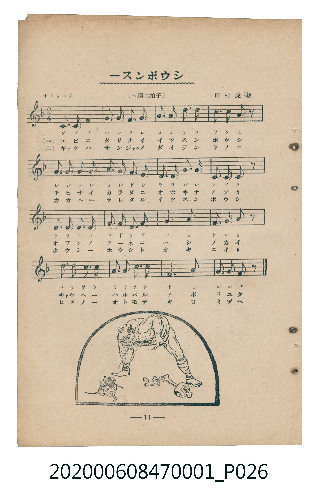
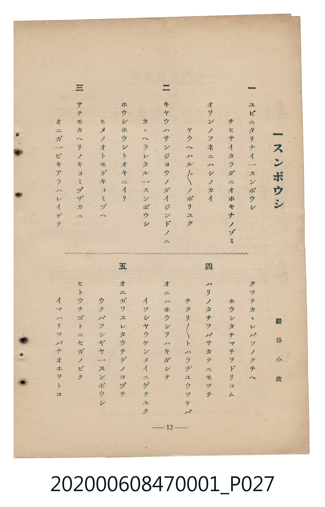

# 一スンボウシ（一寸法師）

> Re:Shōka 使用 AI 協助辨識與重建樂譜，可能會有錯誤。歡迎[回報](https://github.com/TMDLang/reshoka/issues)。

- **鋼琴伴奏版**：<br><audio controls src="issunboshi.mp3"></audio>
- **NEUTRINO 歌聲合成版**：<br><audio controls src="issunboshi_neutrino.mp3"></audio>

- 詞：巖谷小波
- 曲：田村虎藏
- 臺灣教育會公認《新定兒童唱歌》尋常科第一學年用（2020.006.0847.0001）

## 說明

曲目說明
中文解釋：日本民間故事中的小小英雄，描寫他勇敢出發、闖蕩世界。

原書資訊與歌詞全文（對應 P026.jpg–P027.jpg，書頁 pp. 11–12，第一學期第 10 首）：
調性與拍號：ヘ調二拍子（F 大調 2/4 拍），「オモシロク」


## 歌詞

```text
一
ユビニタリナイ一スンボウシ
チヒサイカラダニオホキナノゾミ
オワンノフネニハシノカイ
キヤウヘハルバルノボリユク

二
キヤウハサンジヨウノダイジンドノニ
カカヘラレタル一スンボウシ
ホウシホウシトオキニイリ
ヒメノオトモデキヨミヅヘ

三
サテモカヘリノキヨミヅザカニ
オニガ一ピキアラハレイデテ
クツテカカレバソノクチヘ
ホウシタチマチヲドリコム

四
ハリノタチヲバサカテニモツテ
チクリチクリトハラヂユウツケバ
オニハホウシヲハキダシテ
イツシヤウケンメイニゲテユク

五
オニガワスレタウチデノコヅチ
ウテバフシギヤ一スンボウシ
ヒトウチゴトニセガノビテ
イマハリツパナオホヲトコ
```

## ABC

<div class="abc-score" data-abc-src="issunboshi.abc" aria-label="五線譜載入中"></div>

[下載 ABC 原始檔](issunboshi.abc)

## TMD 檔案連結

- [主旋律 TMD 檔案](issunboshi.tmd) [[在 TMD Studio 編輯](https://tmdlang.github.io/Tmd-TS/#tmd=s7IKdvYPcrWy4qpTUCpJTLdSSM7PyUlNLsnMz7MqzsjMK0nNjM_KTMmPL87Iz05Ugisry88pzU21Si9KTEmNN4w3MjAyiDcwMIs3sDAxBzIMDBFKi_NLi5JTrYqTM_Lzc-JLUitKkvLzsxHyBUX5Zal5iXlANQVFIBtTwIoQClLLMlNSQdKpKZkl-UWZiTlI7kgtKga7FWxJfElRYl5xclFmAcgDCFUlGalAx6bl52Tn5BelIsSBhqVn5lnlpmZmZWJxWX5RSUY-0IsFGZVWGZnFILuTE3PisxPzkEICanNBYnqqVYCBkZkukDBX4tLSUniyo-Fx087HzZsfN8953LTscdP293s6gIJP1-94tnnq0x2r3-_pVNDS4lK0VTA0MOCyt1Vw47Ix0jexA5n9YuW893tmPd0-7cWG7U839D_bvAhs5bPZm4DCz6dseDZ34ouZfS-m94OFX7Tvet64-NnUmS-aNj2b0_y0dc2LVb2PG7qeTdvwdN2sp62Tnq9e-nTKxmdrex43dD_d0P10x47nyyc-X7MG5Jy1O57u3PJ8ygqg60DxqAeMRz1QPAIZBoZANypx6WspAC1-Pnvdi1Wrns3o41JQAHpu7bNp7S-WL37Z3g100bPpS5_NWfNsw8SX0yY_m9r6ZFc3UMHzWS1ApwPRi-6NL2e3vN_T86y__-n61U92T3va3f5s6qKnQGfP3PO4ofHl9Gkvpq58smPa86lAFzZxaelzgSy1pRYAufhp3_xns3e82Nz-YkXXi452YFgAw_hp6wqgN4A-f7qh91l7pwIoBvWyCtIfNUwGxSOICXL27B0vFzQqFBToKRgaAqUMjYCC8NB7Nmc-kA2MQ4WXy6YBwwsYHCD7Xqza_6xhOcim7t4XM-cDRR83zwAKPtnVAxR5unYC0FY3hadLlgPFFIDRrgAUBesGhkDP46ZVj5sXAZPM4-a1j5vWP27o5YKEegOIety87HHz5MfN3Y-b9j9uBqrsety0BDO5QZQ2Pm6e9LhpK1DF46bVj5tXPm5uAOsEapv9uGktSHNz3-OmfY-b54M1gCTWg43pe9w89XFzL0h1cz_YLUB1q4EGQdQBtQKNBLpkBki6GWj2BDAJ1DYH7CqgG9ZDnL2rB00L0LitIDuadjxuXgEWAeoCuh8oCxQB2t0JFumGaAPaCTQXaA3Q8WvAfl6Ny7dAL4E4SIwOkI9ANgP9vAToLoi6SY-bF4L9A3RnByiom9vBilYAg-FxcyvQNmiAd0KcAHRtGzhGIA4B6gLqRVLftA0sBXUwUBpoGyh9PG6eAlLXBLQA6HhgMAHdD3RFO9A4iFJgULeAzIZ6cg0oFJv2go0HSgEjbwaqx0C-B4rOA5ObwAEF9B4wGBaAHfx09myIeqBVEEdC1ANVAs0FpgKgHUCPAGMU6CKQxbBEArINqAHOAAYK0Aigm5vAEQmMoZbHTRuBpiD5EKQCHs5AG4CxCgwSYMQAuVDvAf0K1Afkg-MdZADQqQvB4sAQAuoBOgYpnUxBCT9QQgRFMjjOQU4AegQYckBPAQ0BxlEjRDVQAmgKMPFNBQfQOqBluJIHMNqB6QFsUtMWsCeB9uwGWwVMbsAshXA2MIQhYQgMpYngLAbOMSB_Ao3YDFJHecEEBQqgAs-zuLg0LykfWO1aBWQm5uU71BjUVIOsUbAxNNOyA7OwFYoKkJLoxcIeBQ0TBWBx-3x9gw68JNPEogFoG8iwGgXTeAVdIARShmCGLlDMCEwbQUWMgCLGYJaxghmYNgPpg2gDyxiAdIHN8zGsARVNYDlgYAJxN9xUYAxCxVcBcReE3bQELLMEKtMMZO-EsjeDZJrnQNUtA-LtQBbIuVC7jEA6galtMUJJcz-SdVvhBoGLlOUgFRCRPrDRDXAnAOVRLO2Eq4N4AMlSY2ST24B4EZKNq6HiM8CeRLKraS2UtwKI50PZrWCZbVBXrMa0ywTkFoiPIIHWhyUwG4F4E5Q9AdnfYBPboDLdYH9B3AoOZrAMkl2mIJ0wN3cD2WsQdjWvh5q4E8iGiIPsB-mAhSjIFe0oPt4M9yVIFmYX_iS8q4ecJAxLrjAallxhCdg8HihkBknnQAqhDJH2wSz0ZAxyNcgHk5DCFJJcYfG8EpGKICEMD8HZSHHeBQ5DSNwBa1loCkBPyFAzwbE2AynsV0JNWYMU56vJzzTg9IsjnpFNbJ4CNWMtWAaWckA-hqXINSh62jHTFDj9QkOxaT08T0D8hSkOLFXBMjDzQXYBq56lcM-AJFugvI3g5I6ZhGEJsg0qD7NuKlTfdiBeB1VDXtlDoBTuJCcJI1InglUDTb6GMDFDeFqHQFAqhykywlYQw-MZFMaw_Agp-yDBAeL3QmlICQErP2GBBQk8WNoFpk1wcKGlXWBqRw0oWKBjikPjGOoymD2gnAJSD6kswCUyOE2gp1toOQQvv2DpFjnvQMsnaFm4F9kesD-QzQGVWqC8hpZmkfMHco2C1T-bsIQbzD-wGgaY6LCVt8CSBRYmyCUpyAVb4G7ugLsFJL4bxR6QX5HiB1zhIuzBm1CBrUSyEirYJjN49Q8pa0EYJALCsBSJnEaRGxToaRStAkcu-kCBCirsINEJYyM8DAsiUD4FicKiDRQ9oChGT6aw4F6IZAIsuiEBDakiIVUZotqG2bMCag-iAsdIPqBkiis7gItvSMEHbFvC2SAdkAocZg-o-YHkH2BVCmzbo9oDTqbAJmozVAmweb0Ynoggtm0EmwXK9iAfQ7IVcjaDJSKQ3SBRWFMBS-iBS1ZYOTkPLVNAQg_kEGArGUyC2nYYmRwcKgi_QhI9yHUQe2q5uHTtFBANYAUgT5kLAA)]
- [鋼琴伴奏 TMD 檔案](issunboshi_piano.tmd) [[在 TMD Studio 編輯](https://tmdlang.github.io/Tmd-TS/#tmd=s7IKdvYPcrWy4qpTUCpJTLdSyC8qychPL0osyKi0ysgsLskvykxOzInPTsxLVIIrKs4vLUpOjS9ITE-1CjAwMtMFEuZKXFpaCk92NDxu2vm4efPj5jmPm5Y9btr-fk_Hy-49zydsebJny9Ol_c87O97v6VTQ0uJStFUwNDDgsrdVcOOyMdI3sQMZ_2LlvPd7Zj3dPu3Fhu1PN_Q_27wIbOuz2ZuAws-nbHg2d-KLmX0vpveDhV-073reuPjZ1JkvmjY9m9P8tHXNi1W9jxu6nk3b8HTdrKetk56vXvp0ysZna3seN3Q_3dD9dMeO58snPl-zBujMp2t3PN255fmUFUAHGhkYGegZGJjpGViYmAMZBoZANypxcXkWF5fmJeUXZ2RaBWQm5uUHeTjUGNRUcykAgY2hmZYdmKWvpWCLDhQglrxY2KOgYaIA9Mnz9Q06CqCw0ssqSNfEokFLH2xYjYJpvIIuEAIpQzBDFyhmBKaNoCJGQBFjMMtYwQxMm4H0QbSBZQxAusDm-RjWKDxuXgaWe9w8GYi74aY-btoPFV8FxF0QdtMSsMwSqEwzkL0Tyt4MkmmeA1W3DIi3A1kg50LtMgLpXPu4eTFCSXM_knVb4QY9btrxuHk5SAVEpA9sdAPcCUB5FEs74eogHkCy1BjZ5DYgXoRk42qo-AywJ5HsaloL5a0A4vlQe3eBZbZBeasx7TIBuQXiI0ig9WEJzEYg3gRlT0D2N9jENqhMN9hfELeCgxksg2SXKUgnzM3dQPYahF3N66Em7gSyIeIg-0E6YCEKckU7io83w30JkoXZhT8J7-ohJwnDkiuMhiVXWAI2jwcKmUHSOZBCKEOkfTALPRmDXA3yzySkMIUkV1g8r0SkIkgIw0NwNlKcd4HDEBJ3j5v2QVMAekKGmgmOtRlIYb8SasoapDhfTX6mAadfHPGMbGLzFKgZa8EysJQD8jEsRa5B0dOOmabA6Rcaik3r4XkC4i9M8cfNHWAZmPlAu0D5dincMyDJFihvIzi5YyZhWIIEZU2QPMy6qVB924F4HVQNeWUPgVK4k5wkjEidCFYNNPkawsQM4WkdAkGpHKbICFtBDI9nUBhD8yO07IMEB4jfC6UhJQSs_IQFFiTwYGkXmDbBwYWWdoGpHTWgYIGOKQ6NY6jLYPaAcgpIPaSyAJfI4DSBnm6h5RC8_IKlW-S8Ay2foGXhXmR7wP5ANgdUaoHyGlqaRc4fyDUKVv9swhJuMP_AahhgosNW3gJLFliYIJekIBdsgbu5A-4WkPhuFHtAfkWKH3CFi7AHb0J9Ons2WQkVbJMZvPqHlLUgDBIBYViKRE6jyA0K9DSKVoEjF32gQAUVdpDohLERHoYFESifgkRh0QaKHlAUoydTWHAvRDIBFt2QgIZUkZCqDFFtw-xZAbUHUYFjJB9QMsWVHcDFN6Tge9w8D84G6YBU4DB7QM0PJP8Aq9LHzQtQ7QEn0yWgnABNYaBQhCUiiG0bwWaBsj3Ix5BshZzNYIkIZDdIFNZUwBJ64JIVVk7OQ8sUkNADOeRx80QwCWrbYWRycKgg_ApJ9CDXQeypxWz_-iC3f02gzV9g8opXiDaMBVffQJZpPIgJEjOBMgygrsZQANZkBhIzAouBpBGKTUASJmAJJCaqEciqoebBDUZ1liFIC8hTunYKCH9F-wBVoIkYYYgYY4gAvYYmYgoWUeYCAA)]

## 分析

```text
================================================================================
📊 TMD Song Profile: [ 一スンボウシ（一寸法師） ]
================================================================================
⏱  Duration:       0:19 (19.2s), 16 measures total
🎼 Key & Tempo:    首調基準 F, != 100.0 BPM, <2/4>
   - 分析範圍：      由實際發聲的音符與和弦推測調性；播放脈絡另行呈現
🎤 人聲音域:    C4 (MIDI 60) – D5 (MIDI 74) [跨度: 14 個半音 / 1.2 個八度, 難度: moderate]
   - 最低音:  C4 in [Issunboshi #1 @ m.1, 0:00]
   - 最高音: D5 in [Issunboshi #1 @ m.3, 0:03]
   - 適合: soprano, mezzo-soprano, contralto, tenor, baritone, bass
🏛  結構:      Issunboshi (19.2s)
⚡ 編曲密度:        Peak 1 軌道同時演奏
🗝  調性診斷：       C 調性不明確（純淨自然大調，未偵測到可信轉調）
   - 風格氣質:    純淨自然大調（陽光明朗、易唱易記，無明顯調外色彩）
   - 轉調歷程:    全曲維持單一推測調性（未偵測到可信轉調）
   - 核心骨幹音:  G, F, D, C, A
   - 調性數值:    C 調性不明確 [相關度: 0.74, 穩定度: Ambiguous, 自然音純度: 100.0%]
   - 候選調性 (K-S): C 大調 (0.74), F 大調 (0.74), D 小調 (0.67)
   - 五度圈歷程:   +0
   - 各段落調性細節:
     • [Issunboshi #1]: C 調性不明確 (r: 0.74, 自然音純度: 100.0%)

  [ 五度圈游移軌跡 ]
              [C ]*
         F            G  
      Bb               D  
      Eb               A  
         Ab           E  
            Db       B  
               F# 
     (* = active key center)

  [ 十二半音累積音高分佈 ]
     C  : ██████████████████        18.3%
     C# :                            0.0%
     D  : ███████████████████       19.2%
     D# :                            0.0%
     E  : █                          0.8%
     F  : ██████████████████████    21.7%
     F# :                            0.0%
     G  : ████████████████████████  24.2%
     G# :                            0.0%
     A  : ████████████████          15.8%
     A# :                            0.0%
     B  :                            0.0%
--------------------------------------------------------------------------------
Assignment 軌道音域：
  - Piano         : C4 – D5 (14 個半音 / 1.2 個八度, 55 個音符)
================================================================================
```


## 原書掃描頁






