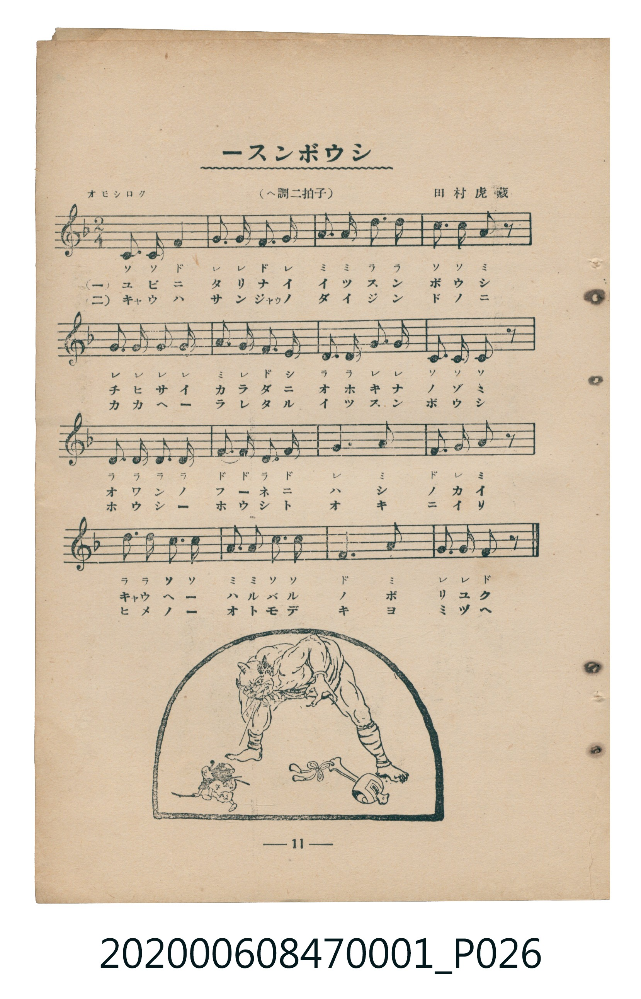
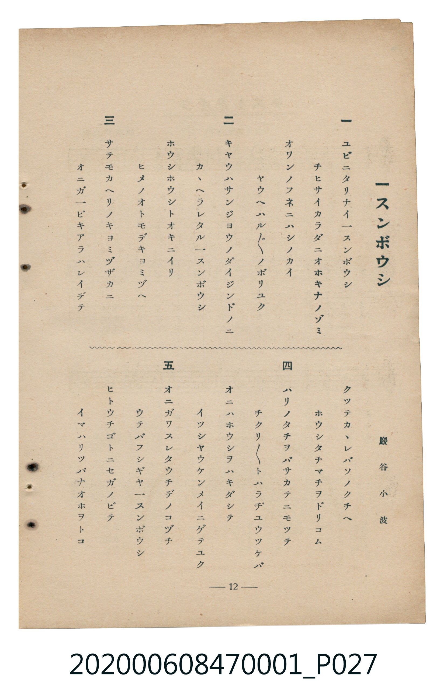

# 一スンボウシ（一寸法師）

> Re:Shōka 使用 AI 協助辨識與重建樂譜，可能會有錯誤。歡迎回報。

- **NEUTRINO 歌聲合成版**：<br><audio controls src="issunboshi_neutrino.mp3"></audio>
- **鋼琴伴奏版**：<br><audio controls src="issunboshi.mp3"></audio>


- 詞：巖谷小波
- 曲：田村虎藏
- 臺灣教育會公認《新定兒童唱歌》尋常科第一學年用（2020.006.0847.0001）

## 說明

曲目說明
中文解釋：日本民間故事中的小小英雄，描寫他勇敢出發、闖蕩世界。

原書資訊與歌詞全文（對應 P026.jpg–P027.jpg，書頁 pp. 11–12，第一學期第 10 首）：
調性與拍號：ヘ調二拍子（F 大調 2/4 拍），「オモシロク」


## 歌詞

```text
一
ユビニタリナイ一スンボウシ
チヒサイカラダニオホキナノゾミ
オワンノフネニハシノカイ
キヤウヘハルバルノボリユク

二
キヤウハサンジヨウノダイジンドノニ
カカヘラレタル一スンボウシ
ホウシホウシトオキニイリ
ヒメノオトモデキヨミヅヘ

三
サテモカヘリノキヨミヅザカニ
オニガ一ピキアラハレイデテ
クツテカカレバソノクチヘ
ホウシタチマチヲドリコム

四
ハリノタチヲバサカテニモツテ
チクリチクリトハラヂユウツケバ
オニハホウシヲハキダシテ
イツシヤウケンメイニゲテユク

五
オニガワスレタウチデノコヅチ
ウテバフシギヤ一スンボウシ
ヒトウチゴトニセガノビテ
イマハリツパナオホヲトコ
```

## ABC

```abc
X:1
T:一スンボウシ（一寸法師）
C:曲：田村虎藏
M:2/4
L:1/16
Q:1/4=100
K:F
V:V1 name="Piano" snm="Pia"
[V:V1]
C3 C F4 | G3 G F3 G | A3 A d3 d | c3 c A2 z2 |
w: 1.~ユ ビ ニ | タ リ ナ イ | イ ッ ス ン | ボ ウ シ
w: 2.~キャ ウ ハ | サ ン ジョウ ノ | ダ イ ジ ン | ド ノ ニ
w: 3.~サ テ モ | カ ヘ リ ノ | キ ヨ ミ ヅ | ザ カ ニ
w: 4.~ハ リ ノ | タ チ ヲ バ | サ カ テ ニ | モ ッ テ
w: 5.~オ ニ ガ | ワ ス レ タ | ウ チ デ ノ | コ ヅ チ
G3 G G3 G | A3 G F3 E | D3 D G3 G | C3 C C2 z2 |
w: 1.~チ ヒ サ イ | カ ラ ダ ニ | オ ホ キ ナ | ノ ゾ ミ
w: 2.~カ カ ヘ _ | ラ レ タ ル | イ ッ ス ン | ボ ウ シ
w: 3.~オ ニ ガ _ | イ ッ ピ キ | ア ラ ハ レ | イ デ テ
w: 4.~チ ク リ _ | チ ク リ ト | ハ ラ ヂュ ウ | ツ ケ バ
w: 5.~ウ テ バ _ | フ シ ギ ヤ | イ ッ ス ン | ボ ウ シ
D3 D D3 D | F3 F D3 F | G6 A2 | F3 G A2 z2 |
w: 1.~オ ワ ン ノ | フ _ ネ ニ | ハ シ | ノ カ イ
w: 2.~ホ ウ シ _ | ホ ウ シ ト | オ キ | ニ イ リ
w: 3.~ク ッ テ _ | カ カ レ バ | ソ ノ | ク チ ヘ
w: 4.~オ ニ ハ _ | ホ ウ シ ヲ | ハ キ | ダ シ テ
w: 5.~ヒ ト ウ チ | ゴ _ ト ニ | セ ガ | ノ ビ テ
d3 d c3 c | A2 A2 c2 c2 | F6 A2 | G3 G F2 z2 |
w: 1.~キャ ウ ヘ _ | ハ ル バ ル | ノ ボ | リ ユ ク
w: 2.~ヒ メ ノ _ | オ ト モ デ | キ ヨ | ミ ヅ ヘ
w: 3.~ホ ウ シ _ | タ チ マ チ | ヲ ド | リ コ ム
w: 4.~イッ シャ ウ _ | ケ ン メ イ | ニ ゲ | テ ユ ク
w: 5.~イ マ ハ _ | リ ッ パ ナ | オ ホ | ヲ ト コ
```

## TMD 檔案連結

- [主旋律 TMD 檔案](issunboshi.tmd) [[在 TMD Studio 編輯](https://tmdlang.github.io/Tmd-TS/#tmd=s7IKdvYPcrWy4qpTUCpJTLdSSM7PyUlNLsnMz7MqzsjMK0nNjM_KTMmPL87Iz05Ugisry88pzU21Si9KTEmNN4w3MjAyiDcwMIs3sDAxBzIMDBFKi_NLi5JTrYqTM_Lzc-JLUitKkvLzsxHyBUX5Zal5iXlANQVFIBtTwIoQClLLMlNSQdKpKZkl-UWZiTlI7kgtKga7FWxJfElRYl5xclFmAcgDCFUlGalAx6bl52Tn5BelIsSBhqVn5lnlpmZmZSK5TEtL4cmOhsdNOx83b37cPOdx07LHTdvf7-kACj5dv-PZ5qlPd6x-v6dTQUuLS9FWwdDAgMveVsGNy8ZI38QOZPaLlfPe75n1dPu0Fxu2P93Q_2zzIrCVz2ZvAgo_n7Lh2dyJL2b2vZjeDxZ-0b7reePiZ1Nnvmja9GxO89PWNS9W9T5u6Ho2bcPTdbOetk56vnrp0ykbn63tedzQ_XRD99MdO54vn_h8zRqQc9bueLpzy_MpK4CuA8WBHjAO9EBxAGQYGALdqMSlr6UAtPj57HUvVq16NqOPS0EB6Lm1z6a1v1i--GV7N9BFz6YvfTZnzbMNE19Om_xsauuTXd1ABc9ntQCdDkQvuje-nN3yfk_Ps_7-p-tXP9k97Wl3-7Opi54CnT1zz-OGxpfTp72YuvLJjmnPpwJd2MSlpc8FstSWWgDk4qd985_N3vFic_uLFV0vOtqBYQEM46etK4DeAPr86YbeZ-2dCgEGRmZ6WQXpjxomA5nmICbI2bN3vFzQqFBQoKdgaAiUMjQCCsJD79mc-UA2MA4VXi6bBgwvYHCA7Huxav-zhuUgm7p7X8ycDxR93DwDKPhkVw9Q5OnaCUBb3RSeLlkOFFMARrsCUBSsGxgCPY-bVj1uXgRMMo-b1z5uWv-4oZcLEuoNIOpx87LHzZMfN3c_btr_uBmosutx0xLM5AZR2vi4edLjpq1AFY-bVj9uXvm4uQGsE6ht9uOmtSDNzX2Pm_Y9bp4P1gCSWA82pu9x89THzb0g1c39YLcA1a0GGgRRB9QKNBLokhkg6Wag2RPAJFDbHLCrgG5YD3H2rh40LUDjtoLsaNrxuHkFWASoC-h-oCxQBGh3J1ikG6INaCfQXKA1QMevAft5NS7fAr0E4iAxOkA-AtkM9PMSoLsg6iY9bl4I9g_QnR2goG5uBytaAQyGx82tQNugAd4JcQLQtW3gGIE4BKgLqBdJfdM2sBTUwUBpoG2g9PG4eQpIXRPQAqDjgcEEdD_QFe1A4yBKgUHdAjIb6sk1oFBs2gs2HigFjLwZqB4D-R4oOg9MbgIHFNB7wGBYAHbw09mzIeqBVkEcCVEPVAk0F5gKgHYAPQKMUaCLQBbDEgnINqAGOAMYKEAjgG5uAkckMIZaHjdtBJqC5EOQCng4A20AxiowSIARA-RCvQf0K1AfkA-Od5ABQKcuBIsDQwioB-gYpHQyBSX8QAkRFMngOAc5AegRYMgBPQU0BBhHjRDVQAmgKcDENxUcQOuAluFKHsBoB6YHsElNW8CeBNqzG2wVMLkBsxTC2cAQhoQhMJQmgrMYOMeA_Ak0YjNIHeUFExQogAo8z-Li0rykfGCVaRWQmZiX71BjUFMNskbBxtBMyw7MwlYoKkBKohcLexQ0TBSAxe3z9Q068JJME4sGoG0gw2oUTOMVdIEQSBmCGbpAMSMwbQQVMQKKGINZxgpmYNoMpA-iDSxjANIFNs_HsAZUNIHlgIEJxN1wU4ExCBVfBcRdEHbTErDMEqhMM5C9E8reDJJpngNVtwyItwNZIOdC7TIC6QSmtsUIJc39SNZthRsELlKWg1RARPrARjfAnQCUR7G0E64O4gEkS42RTW4D4kVINq6Gis8AexLJrqa1UN4KIJ4PZbeCZbZBXbEa0y4TkFsgPoIEWh-WwGwE4k1Q9gRkf4NNbIPKdIP9BXErOJjBMkh2mYJ0wtzcDWSvQdjVvB5q4k4gGyIOsh-kAxaiIFe0o_h4M9yXIFmYXfiT8K4ecpIwLLnCaFhyhSVg83igkBkknQMphDJE2gez0JMxyNUgH0xCClNIcoXF80pEKoKEMDwEZyPFeRc4DCFxB6xloSkAPSFDzQTH2gyksF8JNWUNUpyvJj_TgNMvjnhGNrF5CtSMtWAZWMoB-RiWIteg6GnHTFPg9AsNxab18DwB8RemOLBUBcvAzAfZBax6lsI9A5JsgfI2gpM7ZhKGJcg2qDzMuqlQfduBeB1UDXllD4FSuJOcJIxInQhWDTT5GsLEDOFpHQJBqRymyAhbQQyPZ1AYw_IjpOyDBAeI3wulISUErPyEBRYk8GBpF5g2wcGFlnaBqR01oGCBjikOjWOoy2D2gHIKSD2ksgCXyOA0gZ5uoeUQvPyCpVvkvAMtn6Bl4V5ke8D-QDYHVGqB8hpamkXOH8g1Clb_bMISbjD_wGoYYKLDVt4CSxZYmCCXpCAXbIG7uQPuFpD4bhR7QH5Fih9whYuwB29CBbYSyUqoYJvM4NU_pKwFYZAICMNSJHIaRW5QoKdRtAocuegDBSqosINEJ4yN8DAsiED5FCQKizZQ9ICiGD2ZwoJ7IZIJsOiGBDSkioRUZYhqG2bPCqg9iAocI_mAkimu7AAuviEFH7BtCWeDdEAqcJg9oOYHkn-AVSmwbY9qDziZApuozVAlwOb1Yngigti2EWwWKNuDfAzJVsjZDJaIQHaDRGFNBSyhBy5ZYeXkPLRMAQk9kEOArWQwCWrbYWRycKgg_ApJ9CDXQeyp5eLStVNANIAVgDxlLgA)]
- [鋼琴伴奏 TMD 檔案](issunboshi_piano.tmd) [[在 TMD Studio 編輯](https://tmdlang.github.io/Tmd-TS/#tmd=s7IKdvYPcrWy4tLSUniyo-Fx087HzZsfN8953LTscdP293s6XnbveT5hy5M9W54u7X_e2fF-T6eClhaXoq2CoYEBl72tghuXjZG-iR1XnYLSi5Xz3u-Z9XT7tBcbtj_d0P9s8yIlkPCz2ZuAws-nbHg2d-KLmX0vpveDhV-073reuPjZ1JkvmjY9m9P8tHXNi1W9jxu6nk3b8HTdrKetk56vXvp0ysZna3seN3Q_3dD9dMeO58snPl-zBujMp2t3PN255fmUFUAHGhkYGegZGJjpGViYmAMZBoZANypxcXkWF5fmJeUXZ2RaBWQm5uUHeTjUGNRUcykAgY2hmZYdmKWvpWCLDhQglrxY2KOgYaIA9Mnz9Q06CgEGRmZ6WQXpmlg0aOmDDatRMI1X0AVCIGUIZugCxYzAtBFUxAgoYgxmGSuYgWkzkD6INrCMAUgX2DwfwxqFx83LwHKPmycDcTfc1MdN-6Hiq4C4C8JuWgKWWQKVaQayd0LZm0EyzXOg6pYB8XYgC-RcqF1GIJ1rHzcvRihp7keybivcoMdNOx43LwepgIj0gY1ugDsBKI9iaSdcHcQDSJYaI5vcBsSLkGxcDRWfAfYkkl1Na6G8FUA8H8puBctsg7piNaZdJiC3QHwECbQ-LIHZCMSboOwJyP4Gm9gGlekG-wviVnAwg2WQ7DIF6YS5uRvIXoOwq3k91MSdQDZEHGQ_SAcsREGuaEfx8Wa4L0GyMLvwJ-FdPeQkYVhyhdGw5ApLwObxQCEzSDoHUghliLQPZqEnY5CrQT6YhBSmkOQKi-eViFQECWF4CM5GivMucBhC4u5x0z5oCkBPyFAzwbE2AynsV0JNWYMU56vJzzTg9IsjnpFNbJ4CNWMtWAaWckA-hqXINSh62jHTFDj9QkOxaT08T0D8hSn-uLkDLAMzH2RX0-PmpXDPgCRboLyN4OSOmYRhCbINKg-zbipU33YgXgdVQ17ZQ6AU7iQnCSNSJ4JVA02-hjAxQ3hah0BQKocpMsJWEMPjGRTGsPwIKfsgwQHi90JpSAkBKz9hgQUJPFjaBaZNcHChpV1gakcNKFigY4pD4xjqMpg9oJwCUg-pLMAlMjhNoKdbaDkEL79g6RY570DLJ2hZuBfZHrA_kM0BlVqgvIaWZpHzB3KNgtU_m7CEG8w_sBoGmOiwlbfAkgUWJsglKcgFW-Bu7oC7BSS-G8UekF-R4gdc4SLswZtQn86eTVZCBdtkBq_-IWUtCINEQBiWIpHTKHKDAj2NolXgyEUfKFBBhR0kOmFshIdhQQTKpyBRWLSBogcUxejJFBbcC5FMgEU3JKAhVSSkKkNU2zB7VkDtQVTgGMkHlExxZQdw8Q0p-B43z4OzQTogFTjMHlDzA8k_wKr0cfMCVHvAyXQJKCdAUxgoFGGJCGLbRrBZoGwP8jEkWyFnM1giAtkNEoU1FbCEHrhkhZWT89AyBST0QA553DwRTILadhiZHBwqCL9CEj3IdRB7ajHbvz7I7V8TaPMXmLziFaINY8HVN5BlGg9igsRMoAwDqKsxFIA1mYHEjMBiIGmEYhOQhAlYAomJagSyaqh5cINRnWUI0gLylK6dAsJf0T5AFWgiRhgixhgiQK-hiZiCRZS5AA)]

## 分析

```text
================================================================================
📊 TMD Song Profile: [ 一スンボウシ（一寸法師） ]
================================================================================
⏱  Duration:       0:19 (19.2s), 16 measures total
🎼 Key & Tempo:    首調基準 F, != 100.0 BPM, <2/4>
   - 分析範圍：      由實際發聲的音符與和弦推測調性；播放脈絡另行呈現
🎤 人聲音域:    C4 (MIDI 60) – D5 (MIDI 74) [跨度: 14 個半音 / 1.2 個八度, 難度: moderate]
   - 最低音:  C4 in [Issunboshi #1 @ m.1, 0:00]
   - 最高音: D5 in [Issunboshi #1 @ m.3, 0:03]
   - 適合: soprano, mezzo-soprano, contralto, tenor, baritone, bass
🏛  結構:      Issunboshi (19.2s)
⚡ 編曲密度:        Peak 1 軌道同時演奏
🗝  調性診斷：       C 調性不明確（純淨自然大調，未偵測到可信轉調）
   - 風格氣質:    純淨自然大調（陽光明朗、易唱易記，無明顯調外色彩）
   - 轉調歷程:    全曲維持單一推測調性（未偵測到可信轉調）
   - 核心骨幹音:  G, F, D, C, A
   - 調性數值:    C 調性不明確 [相關度: 0.74, 穩定度: Ambiguous, 自然音純度: 100.0%]
   - 候選調性 (K-S): C 大調 (0.74), F 大調 (0.74), D 小調 (0.67)
   - 五度圈歷程:   +0
   - 各段落調性細節:
     • [Issunboshi #1]: C 調性不明確 (r: 0.74, 自然音純度: 100.0%)

  [ 五度圈游移軌跡 ]
              [C ]*
         F            G  
      Bb               D  
      Eb               A  
         Ab           E  
            Db       B  
               F# 
     (* = active key center)

  [ 十二半音累積音高分佈 ]
     C  : ██████████████████        18.3%
     C# :                            0.0%
     D  : ███████████████████       19.2%
     D# :                            0.0%
     E  : █                          0.8%
     F  : ██████████████████████    21.7%
     F# :                            0.0%
     G  : ████████████████████████  24.2%
     G# :                            0.0%
     A  : ████████████████          15.8%
     A# :                            0.0%
     B  :                            0.0%
--------------------------------------------------------------------------------
Assignment 軌道音域：
  - Piano         : C4 – D5 (14 個半音 / 1.2 個八度, 55 個音符)
================================================================================
```


## 原書掃描頁






