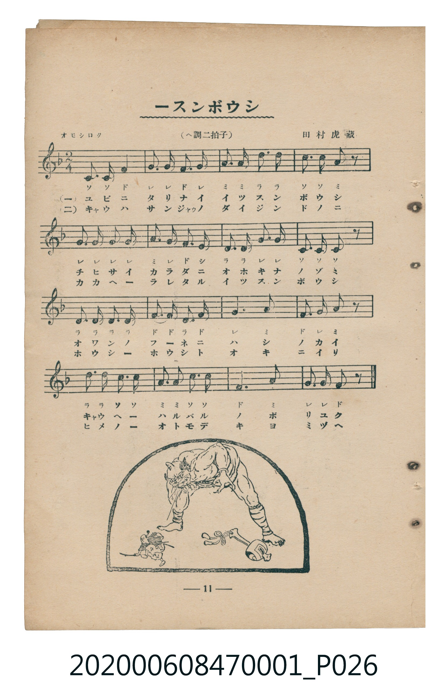
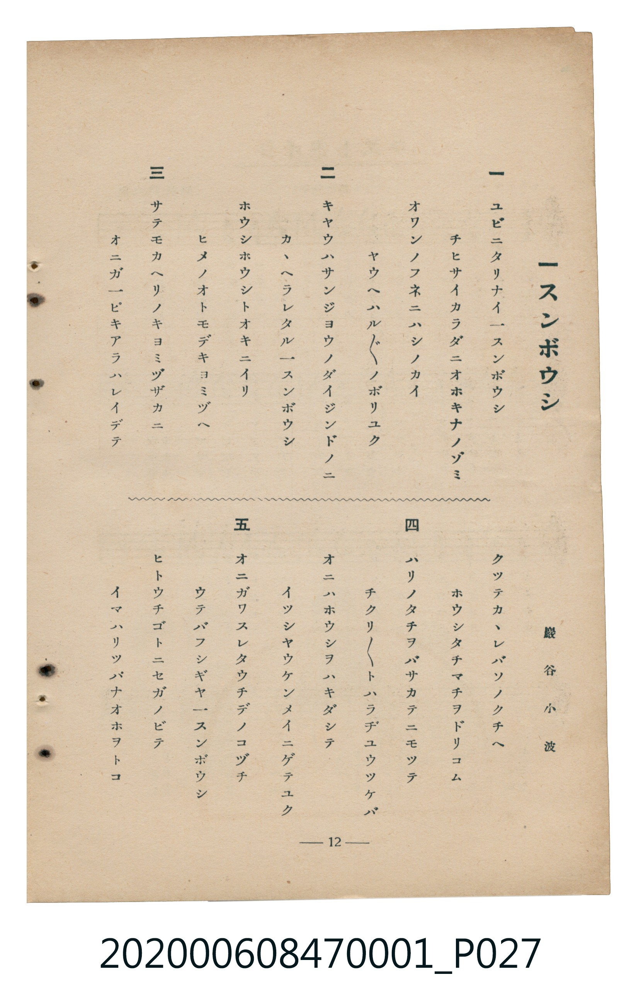

# 一スンボウシ

> Re:Shoka 使用 AI 辨識樂譜，可能會有錯誤。歡迎回報。

<audio controls src="issunboshi.mp3"></audio>

- 詞：巖谷小波
- 曲：田村虎藏
- 臺灣教育會公認《新定兒童唱歌》尋常科第一學年用（2020.006.0847.0001）

## 說明

原書資訊與歌詞全文（對應 P026.jpg–P027.jpg，書頁 pp. 11–12，第一學期第 10 首）：
調性與拍號：ヘ調二拍子（F 大調 2/4 拍），「オモシロク」

## 歌詞

```text
一
ユビニタリナイ一スンボウシ
チヒサイカラダニオホキナノゾミ
オワンノフネニハシノカイ
ヤウヘハルバルノボリユク

二
キヤウハサンジヨウノダイジンドノニ
カカヘラレタル一スンボウシ
ホウシホウシトオキニイリ
ヒメノオトモデキヨミヅヘ

三
サテモカヘリノキヨミヅザカニ
オニガ一ピキアラハレイデテ
クツテカカレバソノクチヘ
ホウシタチマチヲドリコム

四
ハリノタチヲバサカテニモツテ
チクリチクリトハラヂユウツケバ
オニハホウシヲハキダシテ
イツシヤウケンメイニゲテユク

五
オニガワスレタウチデノコヅチ
ウテバフシギヤ一スンボウシ
ヒトウチゴトニセガノビテ
イマハリツパナオホヲトコ
```

## ABC

```abc
X:1
T:一スンボウシ
C:曲：田村虎藏
M:2/4
L:1/16
Q:1/4=100
K:F
V:V1 name="Piano" snm="Pia"
[V:V1]
C3 C F4 | G3 G F3 G | A3 A d3 d | c3 c A2 z2 |
G3 G G3 G | A3 G F3 E | D3 D G3 G | C3 C C2 z2 |
D3 D D3 D | F3 F D3 F | G6 A2 | F3 G A2 z2 |
d3 d c3 c | A2 A2 c2 c2 | F6 A2 | G3 G F2 z2 |
```

## TMD 檔案連結

- [主旋律 TMD 檔案](issunboshi.tmd) [[在 TMD Studio 編輯](https://tmdlang.github.io/Tmd-TS/#tmd=s7IKdvYPcrWy4qpTUCpJTLdSSM7PyUlNLsnMz7MqzsjMK0nNjM_KTMmPL87Iz05Ugisry88pzU21Si9KTEmNN4w3MjAyiDcwMIs3sDAxBzIMDBFKi_NLi5JTrYqTM_Lzc-JLUitKkvLzsxHyBUX5Zal5iXlANQVFIBtTwIoQClLLMlNSQdKpKZkl-UWZiTlI7kgtKga7FWxJfElRYl5xclFmAcgDCFUlGalAx6bl52Tn5BelKnFpaSk82dHwuGnn4-bNj5vnPG5a9rhpu4KWFpeirYKhgQGXva2CG5eNkb6JHciIFyvnvd8z6-n2aS82bH-6of_Z5kVgk5_N3gQUfj5lw7O5E1_M7HsxvR8s_KJ91_PGxc-mznzRtOnZnOanrWterOp93ND1bNqGp-tmPW2d9Hz10qdTNj5b2_O4ofvphu6nO3Y8Xz7x-Zo1QBc9Xbvj6c4tz6eseL-nAxSkesAg1QMFKZBhYPh-T6cSF5e-loIttQCXgoLC0775z2bveLG5_cWKrhcd7UB3Af37tHXFs2ntQFc83dD7rL1TIcDAyEwvqyD9UcNkINMcxHy_pweo7-WCRoWCAj0FQ0OglKERUBDuk2dz5gPZwPBUeLlsGtDtwMAC2fdi1f5nDctBNnX3vpg5Hyj6uHkGUPDJrh6gyNO1E4C2uik8XbIcKKYAjAIFoChYNzC8eh43rXrcvAgYWY-b1z5uWv-4oZcLZCbQQhD1uHnZ4-bJj5u7Hzftf9wMVNn1uGkJZkRDlDY-bp70uGkrUMXjptWPm1c-bm4A6wRqm_24aS1Ic3Pf46Z9j5vngzWAJNaDjel73Dz1cXMvSHVzP9gtQHWrgQZBDAaaB3TGDJBcM9DgCWASqGcO2ElAB6yHuHlXD8RcoFUQLUCztoIsaNrxuHkFWASoC-h4oCxQBGhxJ1ikG6INaCHQXKA1QJevAXt4NS6vAv0D4iAxOkDeAdkM9PASoLsg6iY9bl4I9gzQnR2gcG5uBytaAQyDx82tQNugod0JcQLQtW3g6IA4BKgLqBdJfdM2sBTUwUBpoG2gxPG4eQpIXRPQAqDjgcEEdD_QFe1A4yBKgeHcAjIb6sk1oFBs2gs2HigFjLkZqB4D-R4oOg9MbgIHFNB7wGBYAHbw09mzIeqBVkEcCVEPVAk0F5gEgHYAPQKMTqCLQBbDUgjINqAGOAMYKEAjgG5uAkckMIZaHjdtBJqC5EOQCng4A20AxiowSIARA-RCvQf0K1AfkA-Od5ABQKcuBIsDQwioB-gYpHQyBSX8QKkQFMngOAc5AegRYMgBPQU0BBhHjRDVQAmgKcDENxUcQOuAluFKHsBoB6YHsElNW8CeBNqzG2wVMLkB8xPC2cAQhoQhMJQmgvMXOLuA_Ak0YjNIHeWlEhQoaOlzcXkWF5fmJeUDqyKrgMzEvHyHGoMahWqQPQo2hmZadmAWtiJRAVIOvVjYo6BhogAstp-vb9CBl2OaWDQArQMZVqNgGq-gC4RAyhDM0AWKGYFpI6iIEVDEGMwyVjAD02YgfRBtYBkDkC5w_OF23a4eclwHcwmMhrkE7jjzeKCYGcQPQAqhDuEvMIsYJ-7oJMeJCMsRrBqo6wxhYoZwv0AgyBcwRUbEhiEwZ5PlQGicwWIMEoYgDBIBYZhLkN2GnAYgbqvl4tK1U0CkUQUgT5mLCwA)]
- [鋼琴伴奏 TMD 檔案](issunboshi_piano.tmd) [[在 TMD Studio 編輯](https://tmdlang.github.io/Tmd-TS/#tmd=s7IKdvYPcrWy4tLSUniyo-Fx087HzZsfN8953LTscdP293s6XnbveT5hy5M9W54u7X_e2fF-T6eClhaXoq2CoYEBl72tghuXjZG-iR1XnYLSi5Xz3u-Z9XT7tBcbtj_d0P9s8yIlkPCz2ZuAws-nbHg2d-KLmX0vpveDhV-073reuPjZ1JkvmjY9m9P8tHXNi1W9jxu6nk3b8HTdrKetk56vXvp0ysZna3seN3Q_3dD9dMeO58snPl-zBujMp2t3PN255fmUFUAHGhkYGegZGJjpGViYmAMZBoZANypxcXkWF5fmJeUXZ2RaBWQm5uUHeTjUGNQoVHMpAIGNoZmWHZilr6Vgiw4UILa8WNijoGGiAPTK8_UNOgoBBkZmelkF6ZpYNGjpgw2rUTCNV9AFQiBlCGboAsWMwLQRVMQIKGIMZhkrmIFpM5A-iDawjAFIFxd-1-3qIcd1MJfAaJhLYG4zjwcKmUG8AKQQyhDeArOIceGOTnJciLAcwaqBus4QJmYI9woEgjwBU2REbBA-nT2bLAdCowwWYZAgBGGQCAjDXILsNuQkAHFbLWYK9UFJoSbQBAo0Ll4h2jAWHAtAlmk8iAkSM4EyDIDGwVIfigKwJjOQmBFYDCSNUGwCkjABSyAxUY1AVg01D24wqrMMQVpAvtK1U0B4TAGDp8zFBQA)]

## 分析

```text
================================================================================
📊 TMD Song Profile: [ 一スンボウシ ]
================================================================================
⏱  Duration:       0:19 (19.2s), 16 measures total
🎼 Key & Tempo:    首調基準 F, != 100.0 BPM, <2/4>
   - 分析範圍：      由實際發聲的音符與和弦推測調性；播放脈絡另行呈現
🎤 人聲音域:    C4 (MIDI 60) – D5 (MIDI 74) [跨度: 14 個半音 / 1.2 個八度, 難度: moderate]
   - 最低音:  C4 in [Issunboshi #1 @ m.1, 0:00]
   - 最高音: D5 in [Issunboshi #1 @ m.3, 0:03]
   - 適合: soprano, mezzo-soprano, contralto, tenor, baritone, bass
🏛  結構:      Issunboshi (19.2s)
⚡ 編曲密度:        Peak 1 軌道同時演奏
🗝  調性診斷：       C 調性不明確（純淨自然大調，未偵測到可信轉調）
   - 風格氣質:    純淨自然大調（陽光明朗、易唱易記，無明顯調外色彩）
   - 轉調歷程:    全曲維持單一推測調性（未偵測到可信轉調）
   - 核心骨幹音:  G, F, D, C, A
   - 調性數值:    C 調性不明確 [相關度: 0.74, 穩定度: Ambiguous, 自然音純度: 100.0%]
   - 候選調性 (K-S): C 大調 (0.74), F 大調 (0.74), D 小調 (0.67)
   - 五度圈歷程:   +0
   - 各段落調性細節:
     • [Issunboshi #1]: C 調性不明確 (r: 0.74, 自然音純度: 100.0%)

  [ 五度圈游移軌跡 ]
              [C ]*
         F            G  
      Bb               D  
      Eb               A  
         Ab           E  
            Db       B  
               F# 
     (* = active key center)

  [ 十二半音累積音高分佈 ]
     C  : ██████████████████        18.3%
     C# :                            0.0%
     D  : ███████████████████       19.2%
     D# :                            0.0%
     E  : █                          0.8%
     F  : ██████████████████████    21.7%
     F# :                            0.0%
     G  : ████████████████████████  24.2%
     G# :                            0.0%
     A  : ████████████████          15.8%
     A# :                            0.0%
     B  :                            0.0%
--------------------------------------------------------------------------------
Assignment 軌道音域：
  - Piano         : C4 – D5 (14 個半音 / 1.2 個八度, 55 個音符)
================================================================================
```


## 原書掃描頁






