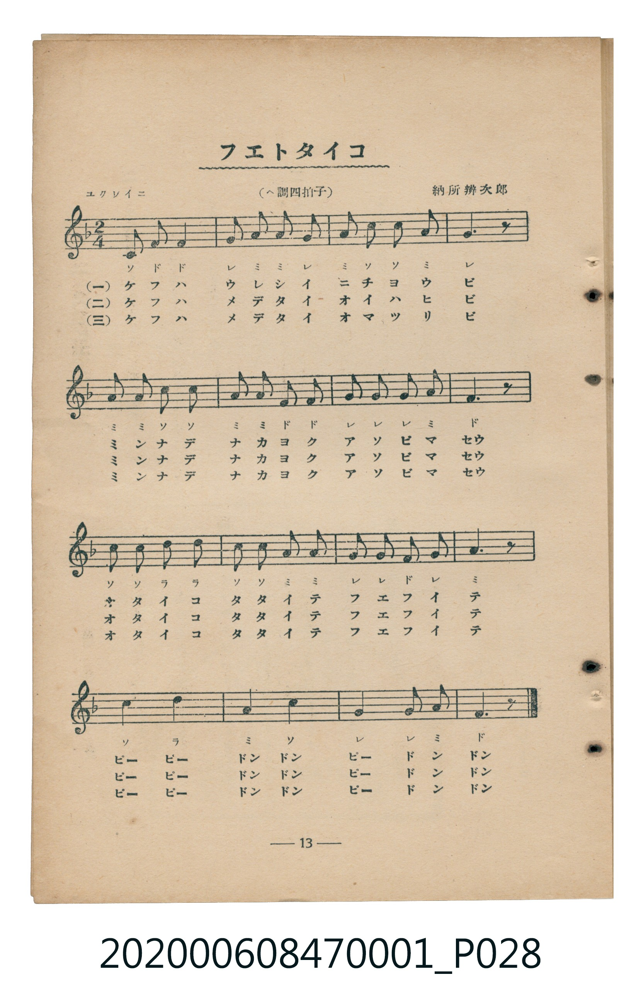
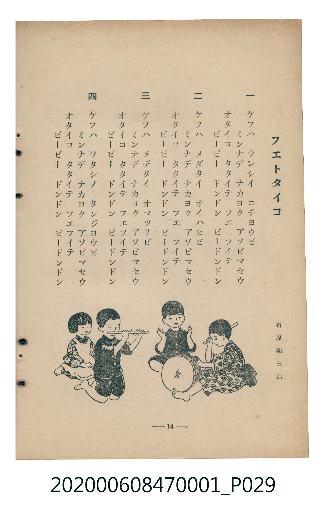

# フエトタイコ

<audio controls src="fue_to_taiko.mp3"></audio>

- 詞：石原和三郎
- 曲：納所辨次郎
- 臺灣教育會公認《新定兒童唱歌》尋常科第一學年用（2020.006.0847.0001）

## 說明

原書資訊與歌詞全文（對應 P028.jpg–P029.jpg，書頁 pp. 13–14，第一學期第 11 首）：
調性與拍號：原書副標題誤植為「（ヘ調四拍子）」，五線譜拍號與小節實為 2/4 拍（F 大調 2/4 拍），「ユクワイニ」

## 歌詞

```text
一
ケフハ　ウレシイ　ニチヨウビ
ミンナデ　ナカヨク　アソビマセウ
オタイコ　タタイテ　フエ　フイテ
ピーピー　ドンドン　ピードンドン

二
ケフハ　メデタイ　オイハヒビ
ミンナデ　ナカヨク　アソビマセウ
オタイコ　タタイテ　フエ　フイテ
ピーピー　ドンドン　ピードンドン

三
ケフハ　メデタイ　オマツリビ
ミンナデ　ナカヨク　アソビマセウ
オタイコ　タタイテ　フエフイテ
ピーピー　ドンドン　ピードンドン

四
ケフハ　ワタシノ　タンジヨウビ
ミンナデ　ナカヨク　アソビマセウ
オタイコ　タタイテ　フエフイテ
ピーピー　ドンドン　ピードンドン
```

## 原書掃描頁





## 分析

```text
================================================================================
📊 TMD Song Profile: [ フエトタイコ ]
================================================================================
⏱  Duration:       0:17 (17.8s), 16 measures total
🎼 Key & Tempo:    首調基準 F, != 108.0 BPM, <2/4>
   - 分析範圍：      由實際發聲的音符與和弦推測調性；播放脈絡另行呈現
🎤 人聲音域:    C4 (MIDI 60) – D5 (MIDI 74) [跨度: 14 個半音 / 1.2 個八度, 難度: moderate]
   - 最低音:  C4 in [FueToTaiko #1 @ m.1, 0:00]
   - 最高音: D5 in [FueToTaiko #1 @ m.9, 0:09]
   - 適合: soprano, mezzo-soprano, contralto, tenor, baritone, bass
🏛  結構:      FueToTaiko (17.8s)
⚡ 編曲密度:        Peak 1 軌道同時演奏
🗝  調性診斷：       F 調性不明確（純淨自然大調，未偵測到可信轉調）
   - 風格氣質:    純淨自然大調（陽光明朗、易唱易記，無明顯調外色彩）
   - 轉調歷程:    全曲維持單一推測調性（未偵測到可信轉調）
   - 核心骨幹音:  A, G, C, F, D
   - 調性數值:    F 調性不明確 [相關度: 0.73, 穩定度: Ambiguous, 自然音純度: 100.0%]
   - 候選調性 (K-S): F 大調 (0.73), C 大調 (0.72), A 小調 (0.70)
   - 五度圈歷程:   -1
   - 各段落調性細節:
     • [FueToTaiko #1]: F 調性不明確 (r: 0.73, 自然音純度: 100.0%)

  [ 五度圈游移軌跡 ]
               C  
        [F ]*          G  
      Bb               D  
      Eb               A  
         Ab           E  
            Db       B  
               F# 
     (* = active key center)

  [ 十二半音累積音高分佈 ]
     C  : ██████████████████        21.7%
     C# :                            0.0%
     D  : ██████                     6.7%
     D# :                            0.0%
     E  :                            0.0%
     F  : █████████████████         20.0%
     F# :                            0.0%
     G  : ████████████████████      23.3%
     G# :                            0.0%
     A  : ████████████████████████  28.3%
     A# :                            0.0%
     B  :                            0.0%
--------------------------------------------------------------------------------
Assignment 軌道音域：
  - Piano         : C4 – D5 (14 個半音 / 1.2 個八度, 46 個音符)
================================================================================
```

## ABC

```abc
X:1
T:フエトタイコ
C:曲：納所辨次郎
M:2/4
L:1/16
Q:1/4=108
K:F

V:V1 name="Piano" snm="Pia"

[V:V1]
c2 f2 f4 | g2 a2 a2 g2 | a2 c2 c2 a2 | g6 z2 |
a2 a2 c2 c2 | a2 a2 f2 f2 | g2 g2 g2 a2 | f6 z2 |
c2 c2 d2 d2 | c2 c2 a2 a2 | g2 g2 f2 g2 | a6 z2 |
c4 d4 | a4 c4 | g4 g2 a2 | f6 z2 |
```

- [主旋律 TMD 檔案](fue_to_taiko.tmd)
- [鋼琴伴奏 TMD 檔案](fue_to_taiko_piano.tmd)
