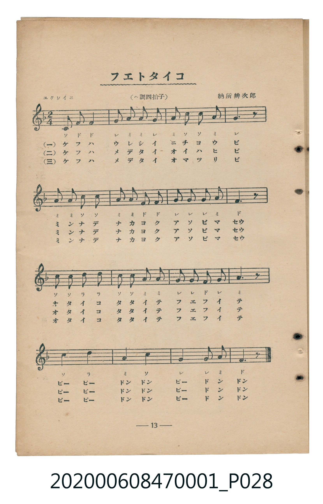
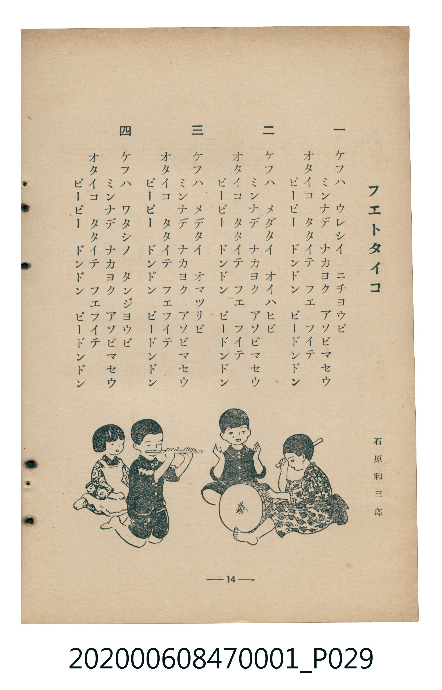

# フエトタイコ（笛與太鼓）

> Re:Shōka 使用 AI 協助辨識與重建樂譜，可能會有錯誤。歡迎回報。

- **NEUTRINO 歌聲合成版**：<br><audio controls src="fue_to_taiko_neutrino.mp3"></audio>
- **鋼琴伴奏版**：<br><audio controls src="fue_to_taiko.mp3"></audio>


- 詞：石原和三郎
- 曲：納所辨次郎
- 臺灣教育會公認《新定兒童唱歌》尋常科第一學年用（2020.006.0847.0001）

## 說明

曲目說明
中文解釋：以吹笛和擊鼓為主題，描寫孩子聽見樂聲、一起歡樂遊戲。

原書資訊與歌詞全文（對應 P028.jpg–P029.jpg，書頁 pp. 13–14，第一學期第 11 首）：
調性與拍號：原書副標題誤植為「（ヘ調四拍子）」，五線譜拍號與小節實為 2/4 拍（F 大調 2/4 拍），「ユクワイニ」


## 歌詞

```text
一
ケフハ　ウレシイ　ニチヨウビ
ミンナデ　ナカヨク　アソビマセウ
オタイコ　タタイテ　フエ　フイテ
ピーピー　ドンドン　ピードンドン

二
ケフハ　メデタイ　オイハヒビ
ミンナデ　ナカヨク　アソビマセウ
オタイコ　タタイテ　フエ　フイテ
ピーピー　ドンドン　ピードンドン

三
ケフハ　メデタイ　オマツリビ
ミンナデ　ナカヨク　アソビマセウ
オタイコ　タタイテ　フエフイテ
ピーピー　ドンドン　ピードンドン

四
ケフハ　ワタシノ　タンジヨウビ
ミンナデ　ナカヨク　アソビマセウ
オタイコ　タタイテ　フエフイテ
ピーピー　ドンドン　ピードンドン
```

## ABC

```abc
X:1
T:フエトタイコ（笛與太鼓）
C:曲：納所辨次郎
M:2/4
L:1/16
Q:1/4=108
K:F
V:V1 name="Piano" snm="Pia"
[V:V1]
C2 F2 F4 | G2 A2 A2 G2 | A2 c2 c2 A2 | G6 z2 |
w: 1.~ケ フ ハ | ウ レ シ イ | ニ チ ヨ ウ | ビ
w: 2.~ケ フ ハ | メ デ タ イ | オ イ ハ ヒ | ビ
w: 3.~ケ フ ハ | メ デ タ イ | オ マ ツ リ | ビ
w: 4.~ケ フ ハ | ワ タ シ ノ | タ ン ジョ ウ | ビ
A2 A2 c2 c2 | A2 A2 F2 F2 | G2 G2 G2 A2 | F6 z2 |
w: 1.~ミ ン ナ デ | ナ カ ヨ ク | ア ソ ビ マ | セウ
w: 2.~ミ ン ナ デ | ナ カ ヨ ク | ア ソ ビ マ | セウ
w: 3.~ミ ン ナ デ | ナ カ ヨ ク | ア ソ ビ マ | セウ
w: 4.~ミ ン ナ デ | ナ カ ヨ ク | ア ソ ビ マ | セウ
c2 c2 d2 d2 | c2 c2 A2 A2 | G2 G2 F2 G2 | A6 z2 |
w: 1.~オ タ イ コ | タ タ イ テ | フ エ フ イ | テ
w: 2.~オ タ イ コ | タ タ イ テ | フ エ フ イ | テ
w: 3.~オ タ イ コ | タ タ イ テ | フ エ フ イ | テ
w: 4.~オ タ イ コ | タ タ イ テ | フ エ フ イ | テ
c4 d4 | A4 c4 | G4 G2 A2 | F6 z2 |
w: 1.~ピー ピー | ドン ドン | ピー ド ン | ドン
w: 2.~ピー ピー | ドン ドン | ピー ド ン | ドン
w: 3.~ピー ピー | ドン ドン | ピー ド ン | ドン
w: 4.~ピー ピー | ドン ドン | ピー ド ン | ドン
```

## TMD 檔案連結

- [主旋律 TMD 檔案](fue_to_taiko.tmd) [[在 TMD Studio 編輯](https://tmdlang.github.io/Tmd-TS/#tmd=s7IKdvYPcrWy4qpTUCpJTLdSSM7PyUlNLsnMz7MqzsjMK0nNjM_KTMmPL87Iz05Ugisry88pzU21Si9KTEmNN4w3MjAyiDcwMIs3sDAxBzIMDBFKi_NLi5JTrYqTM_Lzc-JLUitKkvLzsxHyBUX5Zal5iXlANQVFIBtTwIoQClLLMlNSQdKpKZkl-UWZiTlI7kgtKga7FWxJfElRYl5xclFmAcgDCFUlGalAx5akJmfk5efkp1eiy-SWFmcmIwSBdqRn5lnlpmZmZSI5WEtL4XHz1MdNKx43dzxu2v-4acnjps3v93Q8XzP7RUf70yWrXu6Z_H5Pp4KWFpeirYKhgQWXva2CG5eNkb6JHcjsFyvnvd8z6_n8zU_75j-d1PNkR-fL5j6wrc9mbwLJbOl91tnwYt-KZ2sWwmRetO963rj42dSZL5o2PZvT_LR1zYtVvY8bup5N2_B03aynrZOer176dMrGZ2t7Hjd0P93Q_XTHjufLJz5fs-bJjoana3c83bnl-ZQVQDeCIkgPGEF6oAgCMgwMgS5V4tLXUgDa_Xz2uherVj2b0celoKDwZMfaZ9PaXyxf_LK9G-ioJ7uXPp2wE-hFoIufTe4CevF5064nO3a_XNjzfk_Ps_7-p-tXP1278unaCS8a975Y1v1sRdOLxk2PGxqBDnixdfuztQuBIi8bu551AAWbuLT0uUCW2lILgFwMDM5ns3e82Nz-YkUXMCKAYQEM6aetK4DeAPr86YbeZ-2dCgEGRhZ6WQXpjxomA5mWICbI_bN3vFzQqFBQoKdgaAyUMjQBCsJD79mc-UC2gqGhwstl04DhBQwOkH0vVu1_1rAcZFN374uZ84GiEBc87Vz_bMVMYMC8WLXk2ZJeYDg9bgAGUsfj5hlALU9nzwaqB4YT0KDHDb1Ae57smvJ8-6wXa-dAzAGloQ39z9c3PF2_DKhXAZhsFIAyQAPcFJ4uWQ40AiEEdAowwnseNy973LT-cfN6UFps7gYaywWJwgYQ9bhpIyi9Nvc_bmh43LTscfOax03bQSqBXKDi5sbHzSvA4pPBqpvnP27e_Li563FzO1hF1-Om1WAV68H6Fz1u2gtU-rh53uOm3UBtEBtWwTMCWBGQDeY2t4GNAGcWKAMkCLFnyuPmPVASJNcJthZMgrgQWYQgxEe7ejB81LwQ5FKIfSC7gU4B2tH_uHnSkPDRjk4ifAR0WnPL42Ygg7Y-otg7wNSN6R1gsgTatP1xcx_UYqCWph30SXUU-Qioh_KiCQoUQEWeW2lqSH5IYmZ2vlVAZmJevkONQU01yBoFGwstOzADW6moACmKXizsUdAwUYCUDjrwokwTiwagZSDDahRM4xUMgVAXyDRSMAZCIyDLWMEUCI3BYrpAaKBQA1buY1gDijpQ9QbE_WBdwMAGstcA6e1AvAQk0twNxI1AvAIsCxKZDDYnHmaOERZzmhcCcTtQfD_MnKZVYBZIBTC3YjPHmGhzmucBcQsQr8Jmjgk2c9ZDzQD6q7kPbA6Q17wZSAPT5nIsXsMfP7t6yIkfUJSAIgPCAkUVKFJAEBQ9oIhDi57m-RBHNneBgwEkAmQ1rYZGx3qwRxYB8V6w20EBAxIBZRrMOKKaYaCIopphoNiihmEE8lMnWfkJCM2AEMICxRkkvgyhGQszO4ESOSSpAsspWDKDiTS3gb0GTJZNQG-BaUgWa8OSoahiEjhLUcUkcKai1CS8cQSsTciLI11gDIEyOSg-QDxIQYc7T4FKfqAgnAESA9UAYDEoA0VdJzh1IilDz1hUNRGcu6hqIjiLUcvEWi4uXTsFRN2mAOQpcwEA)]
- [鋼琴伴奏 TMD 檔案](fue_to_taiko_piano.tmd) [[在 TMD Studio 編輯](https://tmdlang.github.io/Tmd-TS/#tmd=s7IKdvYPcrWy4tLSUnjcPPVx04rHzR2Pm_Y_blryuGnz-z0dL7v3PJ-w5cmeLU-X9j_v7Hi_p1NBS4tL0VbB0MCCy95WwY3LxkjfxI6rTkHpxcp57_fMej5_89O--U8n9TzZ0fmyuU8JJPNs9iaQzJbeZ50NL_ateLZmIUzmRfuu542Ln02d-aJp07M5zU9b17xY1fu4oevZtA1P18162jrp-eqlT6dsfLa253FD99MN3U937Hi-fOLzNWue7Gh4unbH051bnk9ZAXSmkYGRgZ6BgZmegYWJOZBhYAh0qRIXl1tpakh-SGJmdr5VQGZiXn6Qh0ONQU01lwIQ2Fho2YEZ-loKtuhAAWLHi4U9ChomCk839D9f36CjEGBgZKGXVZCuiUWDlj7YsBoF03gFQyDUBTKNFIyB0AjIMlYwBUJjsJguEBoo1ICV-xjWKDxu2ggKfCDuB-t63LQMyF4DpLcD8RKQSHM3EDcC8QqwLEhkMticeJg5RljMaV4IxO1A8f0wc5pWgVkgFY-bJ2Ezx5hoc5rnAXELEK_CZo4JNnPWQ80A-qu5D2wOkNe8GUjveNy8HIvX8MfPrh5y4gcUJaDIgLBAUQWKFBAERQ8o4tCip3k-xJHNXeBgAIkAWU2rodGxHuyRRUC8F-x2UMCARHaDvIMRR1QzDBRRVDMMFFvUMIxAfuokKz8BoRkQQligOIPElyE0Y2FmJ1AihyRVYCEGS2YwkeY2sNeAybIJ6C0wDclibVgyFFVMAmcpqpgEzlSUmoQ3jp7Onk1eHOkCYwiUyUHxAeJBCjrceWrK4-Y9QEE4AyTWCUp_IDEoA0VdJzh1IilDz1hUNRGcu6hqIjiLUcvEWsyqzQe5ajOBVm3AsI9XiDaMBUVRPIgVD2KiiMGiBUkYVY8pTA-qShOqqQR6RtdOAeGfaB-gQjQRIwwRYwwRoD1AEWUuAA)]

## 分析

```text
================================================================================
📊 TMD Song Profile: [ フエトタイコ（笛與太鼓） ]
================================================================================
⏱  Duration:       0:17 (17.8s), 16 measures total
🎼 Key & Tempo:    首調基準 F, != 108.0 BPM, <2/4>
   - 分析範圍：      由實際發聲的音符與和弦推測調性；播放脈絡另行呈現
🎤 人聲音域:    C4 (MIDI 60) – D5 (MIDI 74) [跨度: 14 個半音 / 1.2 個八度, 難度: moderate]
   - 最低音:  C4 in [FueToTaiko #1 @ m.1, 0:00]
   - 最高音: D5 in [FueToTaiko #1 @ m.9, 0:09]
   - 適合: soprano, mezzo-soprano, contralto, tenor, baritone, bass
🏛  結構:      FueToTaiko (17.8s)
⚡ 編曲密度:        Peak 1 軌道同時演奏
🗝  調性診斷：       F 調性不明確（純淨自然大調，未偵測到可信轉調）
   - 風格氣質:    純淨自然大調（陽光明朗、易唱易記，無明顯調外色彩）
   - 轉調歷程:    全曲維持單一推測調性（未偵測到可信轉調）
   - 核心骨幹音:  A, G, C, F, D
   - 調性數值:    F 調性不明確 [相關度: 0.73, 穩定度: Ambiguous, 自然音純度: 100.0%]
   - 候選調性 (K-S): F 大調 (0.73), C 大調 (0.72), A 小調 (0.70)
   - 五度圈歷程:   -1
   - 各段落調性細節:
     • [FueToTaiko #1]: F 調性不明確 (r: 0.73, 自然音純度: 100.0%)

  [ 五度圈游移軌跡 ]
               C  
        [F ]*          G  
      Bb               D  
      Eb               A  
         Ab           E  
            Db       B  
               F# 
     (* = active key center)

  [ 十二半音累積音高分佈 ]
     C  : ██████████████████        21.7%
     C# :                            0.0%
     D  : ██████                     6.7%
     D# :                            0.0%
     E  :                            0.0%
     F  : █████████████████         20.0%
     F# :                            0.0%
     G  : ████████████████████      23.3%
     G# :                            0.0%
     A  : ████████████████████████  28.3%
     A# :                            0.0%
     B  :                            0.0%
--------------------------------------------------------------------------------
Assignment 軌道音域：
  - Piano         : C4 – D5 (14 個半音 / 1.2 個八度, 46 個音符)
================================================================================
```


## 原書掃描頁






