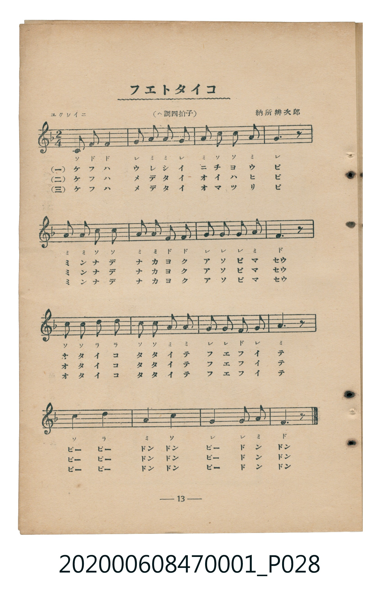
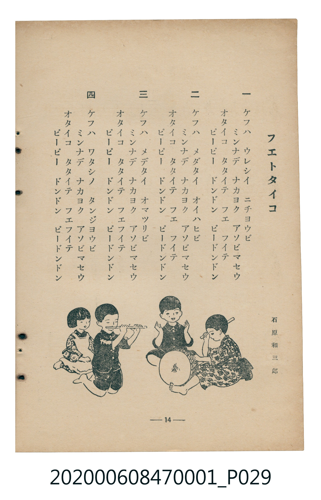

# フエトタイコ（笛與太鼓）

> Re:Shōka 使用 AI 協助辨識與重建樂譜，可能會有錯誤。歡迎[回報](https://github.com/TMDLang/reshoka/issues)。

- **鋼琴伴奏版**：<br><audio controls src="fue_to_taiko.mp3"></audio>
- **NEUTRINO 歌聲合成版**：<br><audio controls src="fue_to_taiko_neutrino.mp3"></audio>

- 詞：石原和三郎
- 曲：納所辨次郎
- 臺灣教育會公認《新定兒童唱歌》尋常科第一學年用（2020.006.0847.0001）

## 說明

曲目說明
中文解釋：以吹笛和擊鼓為主題，描寫孩子聽見樂聲、一起歡樂遊戲。

原書資訊與歌詞全文（對應 P028.jpg–P029.jpg，書頁 pp. 13–14，第一學期第 11 首）：
調性與拍號：原書副標題誤植為「（ヘ調四拍子）」，五線譜拍號與小節實為 2/4 拍（F 大調 2/4 拍），「ユクワイニ」


## 歌詞

```text
一
ケフハ　ウレシイ　ニチヨウビ
ミンナデ　ナカヨク　アソビマセウ
オタイコ　タタイテ　フエ　フイテ
ピーピー　ドンドン　ピードンドン

二
ケフハ　メデタイ　オイハヒビ
ミンナデ　ナカヨク　アソビマセウ
オタイコ　タタイテ　フエ　フイテ
ピーピー　ドンドン　ピードンドン

三
ケフハ　メデタイ　オマツリビ
ミンナデ　ナカヨク　アソビマセウ
オタイコ　タタイテ　フエフイテ
ピーピー　ドンドン　ピードンドン

四
ケフハ　ワタシノ　タンジヨウビ
ミンナデ　ナカヨク　アソビマセウ
オタイコ　タタイテ　フエフイテ
ピーピー　ドンドン　ピードンドン
```

## ABC

<div class="abc-score" data-abc-src="fue_to_taiko.abc" aria-label="五線譜載入中"></div>

[下載 ABC 原始檔](fue_to_taiko.abc)

## TMD 檔案連結

- [主旋律 TMD 檔案](fue_to_taiko.tmd) [[在 TMD Studio 編輯](https://tmdlang.github.io/Tmd-TS/#tmd=s7IKdvYPcrWy4qpTUCpJTLdSSM7PyUlNLsnMz7MqzsjMK0nNjM_KTMmPL87Iz05Ugisry88pzU21Si9KTEmNN4w3MjAyiDcwMIs3sDAxBzIMDBFKi_NLi5JTrYqTM_Lzc-JLUitKkvLzsxHyBUX5Zal5iXlANQVFIBtTwIoQClLLMlNSQdKpKZkl-UWZiTlI7kgtKga7FWxJfElRYl5xclFmAcgDCFUlGalAx5akJmfk5efkp1eiy-SWFmcmIwSBdqRn5lnlpmZmZWJxcH5RSUY-0OcFGZVWGZnFICclJ-bEZyfmIQUQ1EEFiempVgEGRha6QMJSiUtLS-Fx89THTSseN3c8btr_uGnJ46bN7_d0PF8z-0VH-9Mlq17umfx-T6eClhaXoq2CoYEFl72tghuXjZG-iR3I7Bcr573fM-v5_M1P--Y_ndTzZEfny-Y-sK3PZm8CyWzpfdbZ8GLfimdrFsJkXrTvet64-NnUmS-aNj2b0_y0dc2LVb2PG7qeTdvwdN2sp62Tnq9e-nTKxmdrex43dD_d0P10x47nyyc-X7PmyY6Gp2t3PN255fmUFUA3giJZDxjJeqBIBjIMDIEuVeLS11IA2v189roXq1Y9m9HHpaCg8GTH2mfT2l8sX_yyvRvoqCe7lz6dsBPoRaCLn03uAnrxedOuJzt2v1zY835Pz7P-_qfrVz9du_Lp2gkvGve-WNb9bEXTi8ZNjxsagQ54sXX7s7ULgSIvG7uedQAFm7i09LlAltpSC4BcDAzOZ7N3vNjc_mJFFzAigGEBDOmnrSuA3gD6_OmG3mftnQqgeNTLKkh_1DAZFJsgJsj9s3e8XNCoUFCgp2BoDJQyNAEKwkPv2Zz5QLaCoaHCy2XTgOEFDA6QfS9W7X_WsBxkU3fvi5nzgaIQFzztXP9sxUxgwLxYteTZkl5gOD1uAAZSx-PmGUAtT2fPBqoHhhPQoMcNvUB7nuya8nz7rBdr50DMAaWhDf3P1zc8Xb8MqFcBmGwUgDJAA9wUni5ZDjQCIQR0CjDCex43L3vctP5x83pQWmzuBhrLBYnCBhD1uGkjKL029z9uaHjctOxx85rHTdtBKoFcoOLmxsfNK8Dik8Gqm-c_bt78uLnrcXM7WEXX46bVYBXrwfoXPW7aC1T6uHne46bdQG0QG1bBMwJYEZAN5ja3gY0AZxYoAyQIsWfK4-Y9UBIk1wm2FkyCuBBZhCDER7t6MHzUvBDkUoh9ILuBTgHa0f-4edKQ8NGOTiJ8BHRac8vjZiCDtj6i2DvA1I3pHWCyBNq0_XFzH9RioJamHfRJdRT5CKiH8qIJChRARZ5baWpIfkhiZna-VUBmYl6-Q41BTTXIGgUbCy07MANbqagAKYpeLOxR0DBRgJQOOvCiTBOLBqBlIMNqFEzjFQyBUBfINFIwBkIjIMtYwRQIjcFiukBooFADVu5jWAOKOlD1BsT9YF3AwAay1wDp7UC8BCTS3A3EjUC8AiwLEpkMNiceZo4RFnOaFwJxO1B8P8ycplVgFkgFMLdiM8eYaHOa5wFxCxCvwmaOCTZz1kPNAPqruQ9sDpDXvBlIA9Pmcixewx8_u3rIiR9QlIAiA8ICRRUoUkAQFD2giEOLnub5EEc2d4GDASQCZDWthkbHerBHFgHxXrDbQQEDEgFlGsw4opphoIiimmGg2KKGYQTyUydZ-QkIzYAQwgLFGSS-DKEZCzM7gRI5JKkCyylYMoOJNLeBvQZMlk1Ab4FpSBZrw5KhqGISOEtRxSRwpqLUJLxxBKxNyIsjXWAMgTI5KD5APEhBhztPgUp-oCCcARID1QBgMSgDRV0nOHUiKUPPWFQ1EZy7qGoiOItRy8RaLi5dOwVE3aYA5ClzAQA)]
- [鋼琴伴奏 TMD 檔案](fue_to_taiko_piano.tmd) [[在 TMD Studio 編輯](https://tmdlang.github.io/Tmd-TS/#tmd=s7IKdvYPcrWy4qpTUCpJTLdSyC8qychPL0osyKi0ysgsLskvykxOzInPTsxLVIIrKs4vLUpOjS9ITE-1CjAwstAFEpZKXFpaCo-bpz5uWvG4ueNx0_7HTUseN21-v6fjZfee5xO2PNmz5enS_uedHe_3dCpoaXEp2ioYGlhw2dsquHHZGOmb2IGMf7Fy3vs9s57P3_y0b_7TST1PdnS-bO4DW_xs9iaQzJbeZ50NL_ateLZmIUzmRfuu542Ln02d-aJp07M5zU9b17xY1fu4oevZtA1P18162jrp-eqlT6dsfLa253FD99MN3U937Hi-fOLzNWue7Gh4unbH051bnk9ZAXSmkYGRgZ6BgZmegYWJOZBhYAh0qRIXl1tpakh-SGJmdr5VQGZiXn6Qh0ONQU01lwIQ2Fho2YEZ-loKtuhAAWLHi4U9ChomCk839D9f36CjAAowvayCdE0sGrT0wYbVKJjGKxgCoS6QaaRgDIRGQJaxgikQGoPFdIHQQKEGrNzHsEbhcdNGUOADcT9Y1-OmZUD2GiC9HYiXgESau4G4EYhXgGVBIpPB5sTDzDHCYk7zQiBuB4rvh5nTtArMAql43DwJmznGRJvTPA-IW4B4FTZzTLCZsx5qBtBfzX1gc4C85s1Aesfj5uVYvIY_fnb1kBM_oCgBRQaEBYoqUKSAICh6QBGHFj3N8yGObO4CBwNIBMhqWg2NjvVgjywC4r1gt4MCBiSyG-QdjDiimmGgiKKaYaDYooZhBPJTJ1n5CQjNgBDCAsUZJL4MoRkLMzuBEjkkqQILMVgyg4k0t4G9BkyWTUBvgWlIFmvDkqGoYhI4S1HFJHCmotQkvHH0dPZs8uJIFxhDoEwOig8QD1LQ4c5TUx437wEKwhkgsU5Q-gOJQRko6jrBqRNJGXrGoqqJ4NxFVRPBWYxaJtZiVm0-yFWbCbRqA4Z9vEK0YSwoiuJBrHgQE0UMFi1Iwqh6TGF6UFWaUE0l0DO6dgoI_0T7ABWiiRhhiBhjiADtAYoocwEA)]

## 分析

```text
================================================================================
📊 TMD Song Profile: [ フエトタイコ（笛與太鼓） ]
================================================================================
⏱  Duration:       0:17 (17.8s), 16 measures total
🎼 Key & Tempo:    首調基準 F, != 108.0 BPM, <2/4>
   - 分析範圍：      由實際發聲的音符與和弦推測調性；播放脈絡另行呈現
🎤 人聲音域:    C4 (MIDI 60) – D5 (MIDI 74) [跨度: 14 個半音 / 1.2 個八度, 難度: moderate]
   - 最低音:  C4 in [FueToTaiko #1 @ m.1, 0:00]
   - 最高音: D5 in [FueToTaiko #1 @ m.9, 0:09]
   - 適合: soprano, mezzo-soprano, contralto, tenor, baritone, bass
🏛  結構:      FueToTaiko (17.8s)
⚡ 編曲密度:        Peak 1 軌道同時演奏
🗝  調性診斷：       F 調性不明確（純淨自然大調，未偵測到可信轉調）
   - 風格氣質:    純淨自然大調（陽光明朗、易唱易記，無明顯調外色彩）
   - 轉調歷程:    全曲維持單一推測調性（未偵測到可信轉調）
   - 核心骨幹音:  A, G, C, F, D
   - 調性數值:    F 調性不明確 [相關度: 0.73, 穩定度: Ambiguous, 自然音純度: 100.0%]
   - 候選調性 (K-S): F 大調 (0.73), C 大調 (0.72), A 小調 (0.70)
   - 五度圈歷程:   -1
   - 各段落調性細節:
     • [FueToTaiko #1]: F 調性不明確 (r: 0.73, 自然音純度: 100.0%)

  [ 五度圈游移軌跡 ]
               C  
        [F ]*          G  
      Bb               D  
      Eb               A  
         Ab           E  
            Db       B  
               F# 
     (* = active key center)

  [ 十二半音累積音高分佈 ]
     C  : ██████████████████        21.7%
     C# :                            0.0%
     D  : ██████                     6.7%
     D# :                            0.0%
     E  :                            0.0%
     F  : █████████████████         20.0%
     F# :                            0.0%
     G  : ████████████████████      23.3%
     G# :                            0.0%
     A  : ████████████████████████  28.3%
     A# :                            0.0%
     B  :                            0.0%
--------------------------------------------------------------------------------
Assignment 軌道音域：
  - Piano         : C4 – D5 (14 個半音 / 1.2 個八度, 46 個音符)
================================================================================
```


## 原書掃描頁






