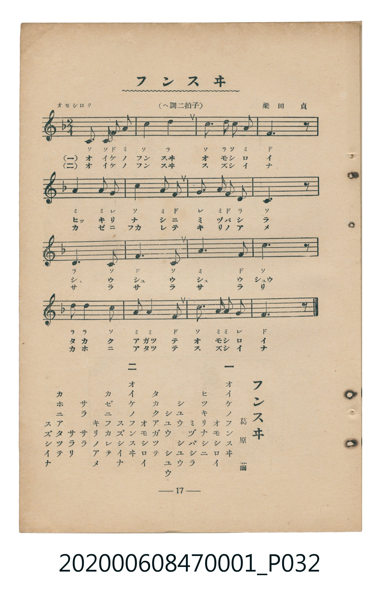

# フンスヰ（噴泉）

> Re:Shōka 使用 AI 協助辨識與重建樂譜，可能會有錯誤。歡迎回報。

- **鋼琴伴奏版**：<br><audio controls src="funsui.mp3"></audio>
- **NEUTRINO 歌聲合成版**：<br><audio controls src="funsui_neutrino.mp3"></audio>

- 詞：葛原𦱳
- 曲：梁田貞
- 臺灣教育會公認《新定兒童唱歌》尋常科第一學年用（2020.006.0847.0001）

## 說明

曲目說明
中文解釋：描寫噴泉向上噴起、閃耀散落的水花。

原書資訊與歌詞全文（對應 P032.jpg，書頁 p. 17，第二學期第 2 首）：
調性與拍號：ヘ調二拍子（F 大調 2/4 拍），「オモシロク」


## 歌詞

```text
一
オイケノフンスヰ
オモシロイ
ヒツキリナシニ
ミヅバシラ
シユウ　シユウ
シユウ　シユウ
タカクアガツテ
オモシロイ

二
オイケノフンスヰ
スズシイナ
カゼニフカレテ
キリノアメ
サラ　サラ
サラリ
カホニアタツテ
スズシイナ
```

## ABC

<div class="abc-score" data-abc-src="funsui.abc" aria-label="五線譜載入中"></div>

[下載 ABC 原始檔](funsui.abc)

## TMD 檔案連結

- [主旋律 TMD 檔案](funsui.tmd) [[在 TMD Studio 編輯](https://tmdlang.github.io/Tmd-TS/#tmd=s7IKdvYPcrWy4qpTUCpJTLdSSM7PyUlNLsnMz7MqzsjMK0nNjM_KTMmPL87Iz05Ugisry88pzU21Si9KTEmNN4w3MjAyiDcwMIs3sDAxBzIMDBFKi_NLi5JTrYqTM_Lzc-JLUitKkvLzsxHyBUX5Zal5iXlANQVFIBtTwIoQClLLMlNSQdKpKZkl-UWZiTlI7kgtKga7FWxJfElRYl5xclFmAcgDCFUlGalAx5YnlqQWIQSBJqVn5lmVJGYC_QbyX3lifG5iZl5OYl4KsqqSjHygNwsyKq0yMotB9icn5sRnJ-YhhQbU9oLE9FSrAANjIyUuLS2Fx81THzdvfty083Hzhvd7Op7O3PJsc-f7PZ0KWlpcirYKlmZc9rYKblw2RvomdiCTXqyc937PrBcTZz_tm_9h2cbNYOOfzd4EFHy2qPH5lA0vNs0Di71o3_W8cfGzqTNfNG16Nqf5aeuaF6t6Hzd0PZu24em6WU9bJz1fvfTplI3P1vY8buh-uqH76Y4dz5dPfL5mzZMdDU_X7ni6c8vzKSuALgJFmh4w0vRAkQZkGBgCXafEpa-lALT1-ex1L1atejajj0tBQeHJjrXPprW_WL74ZXs3yDn9_U_Xr4Z46OmEiU92dAHZL7Zuf9zQ-HJa84uGhmdTF7-YsPf5rJZnG7a86Nr4uKGJS0ufC2SyLbUAyFnAgHo2e8eLze0vVnS96GgHehgYhk9bVwDdCgrwDb3P2jsVQPGhl1WQ_n5PD1DxywWNCgV6CobmQC4oRHb1AEPk2Zz5QLaCkcLLZdOAQQD0Icj0F6v2P2tYDjK3u_fFzPlA0cfNM4CCQD1AkadrJwDtcFN4umQ5UEwBGIkKQFGwbmCw9zxuWvW4edHjpu2Pm9c-blr_uKGXCxKQDSAKJNu05HHTxsfNfcjJBCaH0LkELNQ86XFzy-OmtY-bgXJdYLluiMT8x82tj5sngIVWQrQDWcseNy173NAAZxOQ2P-4aTXIkU1Aa9eAbGpuw-YSsAd29RD2wM7HTbtA2oAqmrsgQkDz9wAdDVILZDcDbYFaAfFTH8ju5oUQoa1Ar4AdCWIgCTWvgpnVPBtkFsi5-5Gdi2Ev5ckMChRAydetNK-4NNMqIDMxL9-hxqCmGmSFgo2hmZYdmIUteStAst2LhT0KGiYKTzf0P1_foANPk5pYNABtAhlWo2Aar6ALhEDKEEgZAzFQDCykq2AGpWEiZmAaogakGgYNQCJg83wMa0CxBhYFBhAQbwSxmvvAeiBxCNUEiUq4DXBdzYtAiQjMWguVWYJkF8i5ULuMyLdrJ1R4F8wusB0gXV0YduEP9V095IQ6KAxBEEQboYQ5SAQUtjVgcRAfxDMDOwUWWVhDHZR7m-H-BQUdMCmjeQoWsN1Q8fnQIG8F4glweZDMSjxBvhpu2h4U00CZDibVvAZMtkHDG-QciIMg8QPMVVBNC0kM7x2d5IQ3OPxgEByKqCkYKgSLFhCERAIsWrAEOKjEWookDSzooL4lTwLCwxXoW5H1gaOHRFFwYiAhpJ_Onk1WSANNhpUboMCDBCosYJED1Rgp9eMrTfaDQwqR6NZDfQlKQeCaBJ7q4cmNvKIEZAWw0IebBk3XUIuAdQCmRaSUI7VcXLp2CpDiXQHIUuYCAA)]
- [鋼琴伴奏 TMD 檔案](funsui_piano.tmd) [[在 TMD Studio 編輯](https://tmdlang.github.io/Tmd-TS/#tmd=s7IKdvYPcrWy4qpTUCpJTLdSyC8qychPL0osyKi0ysgsLskvykxOzInPTsxLVIIrKs4vLUpOjS9ITE-1CjAwNlLi0tJSeNw89XHz5sdNOx83b3i_p-Nl957nE7Y82bPl6dL-550d7_d0KmhpcSnaKliacdnbKrhx2Rjpm9iBjHyxct77PbNeTJz9tG_-h2UbN4PteTZ7E1Dw2aLG51M2vNg0Dyz2on3X88bFz6bOfNG06dmc5qeta16s6n3c0PVs2oan62Y9bZ30fPXSp1M2Plvb87ih--mG7qc7djxfPvH5mjVPdjQ8Xbvj6c4tz6esADrNyMDIQM_AwEzPwMLEHMgwMAS6TomLy600r7g00yogMzEvP8jDocagpppLAQhsDM207MAsfS0FW3SgALHgxcIeBQ0Thacb-p-vb9BRAAWLXlZBuiYWDVr6YMNqFEzjFXSBEEgZAiljIAaKgYV0FcygNEzEDExD1IBUw6ABSARsno9hjcLjplVg0cdNS4B4I4jV3AfWA4keqCZQLAFVwGyA62peBGRvB7PWQmVgqkAQ5FyoXUbk27UTKrwLZhdYFqSrC8Mu_KG-q4ecUAeFIQiCaCOUMAeJgMK2BiwO4oN4ZmCnwCILa6g3T3rc3Az3LyjoHjeDAgfZU7CA7YaKz0cEQ_MEuDxIZiWeIF8NN20PimlTkaSa14DJNmh4g5wDcRAkfh43LYJqWkhieO_oJCe8weEHg-BQRE3BUCFYtIAgJBJg0YIlwJu2P25eiiT9uGkZ1LfkSUB4uAJ9K7I-cPSQKApODCSE9NPZs8kKaaDJsHIDFHiQQIUFLHKgGiOlfnylyX5wSCES3XqoL0Ep6HHTGqRUD09u5BUlICseN8-GmwZN11CL9mOziJRypBa1dPdBLt1NoIU7MCTiFaINY6EMExgDJmIAdTBE1DQeRd4oHsgyAouZApkItSYgCRNUxXAGulJs8gibQCqBHtG1U4D4JdoHqAiJZwTmKXMBAA)]

## 分析

```text
================================================================================
📊 TMD Song Profile: [ フンスヰ（噴泉） ]
================================================================================
⏱  Duration:       0:20 (20.0s), 16 measures total
🎼 Key & Tempo:    首調基準 F, != 96.0 BPM, <2/4>
   - 分析範圍：      由實際發聲的音符與和弦推測調性；播放脈絡另行呈現
🎤 人聲音域:    C4 (MIDI 60) – D5 (MIDI 74) [跨度: 14 個半音 / 1.2 個八度, 難度: moderate]
   - 最低音:  C4 in [Funsui #1 @ m.1, 0:00]
   - 最高音: D5 in [Funsui #1 @ m.2, 0:01]
   - 適合: soprano, mezzo-soprano, contralto, tenor, baritone, bass
🏛  結構:      Funsui (20.0s)
⚡ 編曲密度:        Peak 1 軌道同時演奏
🗝  調性診斷：       F 大調（純淨自然大調，未偵測到可信轉調）
   - 風格氣質:    純淨自然大調（陽光明朗、易唱易記，無明顯調外色彩）
   - 轉調歷程:    全曲維持單一推測調性（未偵測到可信轉調）
   - 核心骨幹音:  C, F, A, D, G
   - 調性數值:    F 大調 [相關度: 0.84, 穩定度: Moderate, 自然音純度: 100.0%]
   - 候選調性 (K-S): F 大調 (0.84), A 小調 (0.73), C 大調 (0.69)
   - 五度圈歷程:   -1
   - 各段落調性細節:
     • [Funsui #1]: F 大調 (r: 0.84, 自然音純度: 100.0%)

  [ 五度圈游移軌跡 ]
               C  
        [F ]*          G  
      Bb               D  
      Eb               A  
         Ab           E  
            Db       B  
               F# 
     (* = active key center)

  [ 十二半音累積音高分佈 ]
     C  : ████████████████████████  31.7%
     C# :                            0.0%
     D  : ████████████              15.8%
     D# :                            0.0%
     E  :                            0.0%
     F  : ██████████████████        23.3%
     F# :                            0.0%
     G  : ████                       5.8%
     G# :                            0.0%
     A  : ██████████████████        23.3%
     A# :                            0.0%
     B  :                            0.0%
--------------------------------------------------------------------------------
Assignment 軌道音域：
  - Piano         : C4 – D5 (14 個半音 / 1.2 個八度, 40 個音符)
================================================================================
```


## 原書掃描頁




