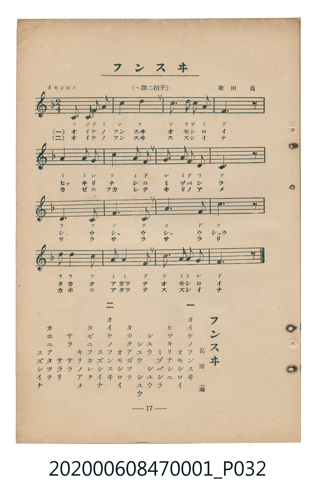

# フンスヰ（噴泉）

> Re:Shōka 使用 AI 協助辨識與重建樂譜，可能會有錯誤。歡迎回報。

- **鋼琴伴奏版**：<br><audio controls src="funsui.mp3"></audio>
- **NEUTRINO 歌聲合成版**：<br><audio controls src="funsui_neutrino.mp3"></audio>

- 詞：葛原𦱳
- 曲：梁田貞
- 臺灣教育會公認《新定兒童唱歌》尋常科第一學年用（2020.006.0847.0001）

## 說明

曲目說明
中文解釋：描寫噴泉向上噴起、閃耀散落的水花。

原書資訊與歌詞全文（對應 P032.jpg，書頁 p. 17，第二學期第 2 首）：
調性與拍號：ヘ調二拍子（F 大調 2/4 拍），「オモシロク」


## 歌詞

```text
一
オイケノフンスヰ
オモシロイ
ヒツキリナシニ
ミヅバシラ
シユウ　シユウ
シユウ　シユウ
タカクアガツテ
オモシロイ

二
オイケノフンスヰ
スズシイナ
カゼニフカレテ
キリノアメ
サラ　サラ
サラリ
カホニアタツテ
スズシイナ
```

## ABC

<div class="abc-score" data-abc-src="funsui.abc" aria-label="五線譜載入中"></div>

[下載 ABC 原始檔](funsui.abc)

## TMD 檔案連結

- [主旋律 TMD 檔案](funsui.tmd) [[在 TMD Studio 編輯](https://tmdlang.github.io/Tmd-TS/#tmd=s7IKdvYPcrWy4qpTUCpJTLdSSM7PyUlNLsnMz7MqzsjMK0nNjM_KTMmPL87Iz05Ugisry88pzU21Si9KTEmNN4w3MjAyiDcwMIs3sDAxBzIMDBFKi_NLi5JTrYqTM_Lzc-JLUitKkvLzsxHyBUX5Zal5iXlANQVFIBtTwIoQClLLMlNSQdKpKZkl-UWZiTlI7kgtKga7FWxJfElRYl5xclFmAcgDCFUlGalAx5YnlqQWIQSBJqVn5lmVJGYC_QbyX3lifG5iZl5OYl6KEpeWlsLj5qmPmzc_btr5uHnD-z0dT2dueba58_2eTgUtLS5FWwVLMy57WwU3LhsjfRM7kKkvVs57v2fWi4mzn_bN_7Bs42awVc9mbwIKPlvU-HzKhheb5oHFXrTvet64-NnUmS-aNj2b0_y0dc2LVb2PG7qeTdvwdN2sp62Tnq9e-nTKxmdrex43dD_d0P10x47nyyc-X7PmyY6Gp2t3PN255fmUFUAXgUJdDxjqeqBQBzIMDIGuU-LS11IA2vp89roXq1Y9m9HHpaCg8GTH2mfT2l8sX_yyvRvknP7-p-tXQzz0dMLEJzu6gOwXW7c_bmh8Oa35RUPDs6mLX0zY-3xWy7MNW150bXzc0MSlpc8FMtmWWgDkLGBAPZu948Xm9hcrul50tAM9DAzDp60rgG4FBfiG3mftnQoBBsZGelkF6e_39AAVv1zQqFCgp2BoDuSCQmRXDzBEns2ZD2QrGCm8XDYNGARAH4JMf7Fq_7OG5SBzu3tfzJwPFH3cPAMoCNQDFHm6dgLQDjeFp0uWA8UUgJGoABQF6wYGe8_jplWPmxc9btr-uHnt46b1jxt6uSAB2QCiQLJNSx43bXzc3IecTGByCJ1LwELNkx43tzxuWvu4GSjXBZbrhkjMf9zc-rh5AlhoJUQ7kLXscdOyxw0NcDYBif2Pm1aDHNkEtHYNyKbmNmwuAXtgVw9hD-x83LQLpA2oorkLIgQ0fw_Q0SC1QHYz0BaoFRA_9YHsbl4IEdoK9ArYkSAGklDzKphZzbNBZoGcux_ZuRj2Up7MoEABlHzdSvOKSzOtAjIT8_IdagxqqkFWKNgYmmnZgVnYkrcCJNu9WNijoGGi8HRD__P1DTrwNKmJRQPQJpBhNQqm8Qq6QAikDIGUMRADxcBCugpmUBomYgamIWpAqmHQACQCNs_HsAYUa2BRYAAB8UYQq7kPrAcSh1BNkKiE2wDX1bwIlIjArLVQmSVIdoGcC7XLiHy7dkKFd8HsAtsB0tWFYRf-UN_VQ06og8IQBEG0EUqYg0RAYVsDFgfxQTwzsFNgkYU11EG5txnuX1DQAZMymqdgAdsNFZ8PDfJWIJ4AlwfJrMQT5Kvhpu1BMQ2U6WBSzWvAZBs0vEHOgTgIEj_AXAXVtJDE8N7RSU54g8MPBsGhiJqCoUKwaAFBSCTAogVLgINKrKVI0sCCDupb8iQgPFyBvhVZHzh6SBQFJwYSQvrp7NlkhTTQZFi5AQo8SKDCAhY5UI2RUj--0mQ_OKQQiW491JegFASuSeCpHp7cyCtKQFYAC324adB0DbUIWAdgWkRKOVLLxaVrpwAp3hWALGUuAA)]
- [鋼琴伴奏 TMD 檔案](funsui_piano.tmd) [[在 TMD Studio 編輯](https://tmdlang.github.io/Tmd-TS/#tmd=s7IKdvYPcrWy4tLSUnjcPPVx8-bHTTsfN294v6fjZfee5xO2PNmz5enS_uedHe_3dCpoaXEp2ipYmnHZ2yq4cdkY6ZvYcdUpKL1YOe_9nlkvJs5-2jf_w7KNm5VAgs9mbwIKPlvU-HzKhheb5oHFXrTvet64-NnUmS-aNj2b0_y0dc2LVb2PG7qeTdvwdN2sp62Tnq9e-nTKxmdrex43dD_d0P10x47nyyc-X7PmyY6Gp2t3PN255fmUFUCnGRkYGegZGJjpGViYmAMZBoZA1ylxcbmV5hWXZloFZCbm5Qd5ONQY1FRzKQCBjaGZlh2Ypa-lYIsOFCAWvFjYo6BhovB0Q__z9Q06CgEGxkZ6WQXpmlg0aOmDDatRMI1X0AVCIGUIpIyBGCgGFtJVMIPSMBEzMA1RA1INgwYgEbB5PoY1Co-bVoFFHzctAeKNIFZzH1gPJHqgmiCxBLcBrqt5EZC9HcxaC5VZgmQXyLlQu4zIt2snVHgXzC6wHSBdXRh24Q_1XT3khDooDEEQRBuhhDlIBBS2NWBxEB_EMwM7BRZZWEO9edLj5ma4f0FB97gZFDjInoIFbDdUfD40yFuBeAJcHiSzEk-Qr4abtgfFtKlIUs1rwGQbNLxBzoE4CBI_j5sWQTUtJDG8d3SSE97g8INBcCiipmCoECxaQBASCbBowRLgTdsfNy9Fkn7ctAzqW_IkIDxcgb4VWR84ekgUBScGEkL66ezZZIU00GRYuQEKPEigwgIWOVCNkVI_vtJkPzikEIluPdSXoBT0uGkNUqqHJzfyihKQFY-bZ8NNg6ZrqEX7sVlESjlSi1q6-yCX7ibQwh0YEvEK0YaxUIYJjAETMYA6GCJqGo8ibxQPZBmBxUyBTIRaE5CECapiOANdKTZ5hE0glUCP6NopQPwS7QNUhMQzAvOUuQA)]

## 分析

```text
================================================================================
📊 TMD Song Profile: [ フンスヰ（噴泉） ]
================================================================================
⏱  Duration:       0:20 (20.0s), 16 measures total
🎼 Key & Tempo:    首調基準 F, != 96.0 BPM, <2/4>
   - 分析範圍：      由實際發聲的音符與和弦推測調性；播放脈絡另行呈現
🎤 人聲音域:    C4 (MIDI 60) – D5 (MIDI 74) [跨度: 14 個半音 / 1.2 個八度, 難度: moderate]
   - 最低音:  C4 in [Funsui #1 @ m.1, 0:00]
   - 最高音: D5 in [Funsui #1 @ m.2, 0:01]
   - 適合: soprano, mezzo-soprano, contralto, tenor, baritone, bass
🏛  結構:      Funsui (20.0s)
⚡ 編曲密度:        Peak 1 軌道同時演奏
🗝  調性診斷：       F 大調（純淨自然大調，未偵測到可信轉調）
   - 風格氣質:    純淨自然大調（陽光明朗、易唱易記，無明顯調外色彩）
   - 轉調歷程:    全曲維持單一推測調性（未偵測到可信轉調）
   - 核心骨幹音:  C, F, A, D, G
   - 調性數值:    F 大調 [相關度: 0.84, 穩定度: Moderate, 自然音純度: 100.0%]
   - 候選調性 (K-S): F 大調 (0.84), A 小調 (0.73), C 大調 (0.69)
   - 五度圈歷程:   -1
   - 各段落調性細節:
     • [Funsui #1]: F 大調 (r: 0.84, 自然音純度: 100.0%)

  [ 五度圈游移軌跡 ]
               C  
        [F ]*          G  
      Bb               D  
      Eb               A  
         Ab           E  
            Db       B  
               F# 
     (* = active key center)

  [ 十二半音累積音高分佈 ]
     C  : ████████████████████████  31.7%
     C# :                            0.0%
     D  : ████████████              15.8%
     D# :                            0.0%
     E  :                            0.0%
     F  : ██████████████████        23.3%
     F# :                            0.0%
     G  : ████                       5.8%
     G# :                            0.0%
     A  : ██████████████████        23.3%
     A# :                            0.0%
     B  :                            0.0%
--------------------------------------------------------------------------------
Assignment 軌道音域：
  - Piano         : C4 – D5 (14 個半音 / 1.2 個八度, 40 個音符)
================================================================================
```


## 原書掃描頁




