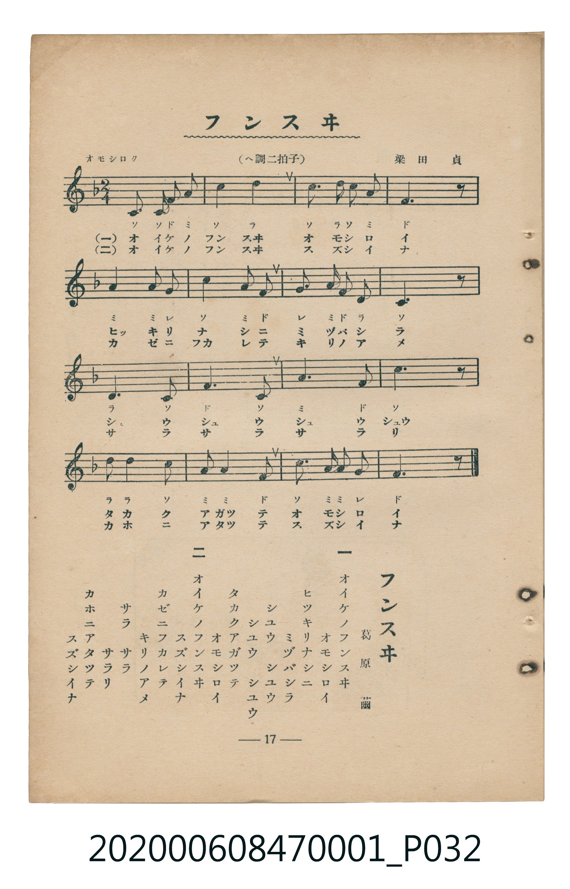

# フンスヰ

<audio controls src="funsui.mp3"></audio>

- 詞：葛原𦱳
- 曲：梁田貞
- 臺灣教育會公認《新定兒童唱歌》尋常科第一學年用（2020.006.0847.0001）

## 說明

原書資訊與歌詞全文（對應 P032.jpg，書頁 p. 17，第二學期第 2 首）：
調性與拍號：ヘ調二拍子（F 大調 2/4 拍），「オモシロク」

## 歌詞

```text
一
オイケノフンスヰ
オモシロイ
ヒツキリナシニ
ミヅバシラ
シユウ　シユウ
シユウ　シユウ
タカクアガツテ
オモシロイ

二
オイケノフンスヰ
スズシイナ
カゼニフカレテ
キリノアメ
サラ　サラ
サラリ
カホニアタツテ
スズシイナ
```

## ABC

```abc
X:1
T:フンスヰ
C:曲：梁田貞
M:2/4
L:1/16
Q:1/4=96
K:F
V:V1 name="Piano" snm="Pia"
[V:V1]
C2 C2 F2 A2 | c4 d4 | c3 d c2 A2 | F6 z2 |
A3 A G4 | c4 A2 F2 | G3 A F2 D2 | C6 z2 |
D6 C2 | F6 C2 | A6 F2 | c6 z2 |
d2 d2 c4 | A2 A2 F4 | C2 A2 A2 G2 | F6 z2 |
```

## TMD 檔案連結

- [主旋律 TMD 檔案](funsui.tmd) [[在 TMD Studio 編輯](https://tmdlang.github.io/Tmd-TS/#tmd=s7IKdvYPcrWy4tLSUnjcPPVx8-bHTTsfN29Q0NLiUrRVsDTjsrdVcOOyMdI3seOqU1B6sXLe-z2zXkyc_bRv_odlGzcrgQSfzd4EFHy2qPH5lA0vNs0Di71o3_W8cfGzqTNfNG16Nqf5aeuaF6t6Hzd0PZu24em6WU9bJz1fvfTplI3P1vY8buh-uqH76Y4dz5dPfL5mzZMdDU_X7ni6c8vzKSve7-kwMjAy0DMwMNMzsDAxBzIMDN_v6VTi4tLXUrClFuBSUFAA-ufZ7B0vNre_WNH1oqMd6C6gV5-2rng2rR3oiqcbep-1dyoEGBgb6WUVpL_f0wNU_HJBo0KBnoKhOZALcviuHqDDn82ZD2QrGCm8XDYN6FJguIBMf7Fq_7OG5SBzu3tfzJwPFH3cPAMoCNQDFHm6dgLQDjeFp0uWA8UUgGGtABQF6waGTs_jplWPmxc9btr-uHnt46b1jxt6uUBmAgMKRIFkm5Y8btr4uLkPOQZhcgidS8BCzZMeN7c8blr7uBko1wWW64ZIzH_c3Pq4eQJYaCVEO5C17HHTsscNDXA2AYn9j5tWgxzZBLR2Dcim5jZsLgF7YFcPYQ_sfNy0C6QNqKK5CyIENH8P0NEgtUB2M9AWqBUQP_WB7G5eCBHaCvQK2JEgBpJQ8yqYWc2zQWaBnLsf2bkY9lKezKBAQUufi8utNK-4NNMqIDMxL9-hxqBGoRpkh4KNoZmWHZiFLX0rQLLHi4U9ChomCk839D9f36ADT5SaWDQArQIZVqNgGq-gCyEMgdgYiIFiQBIEzaA0TMQMTEPUgFTDoAFIBBxzuF23q4cc14HsAtlohOYSiCtAbqiByhmDeWYgj0A9RYrrdnSS4zqwbTAIthM1XKBCEE9AIMTJME8Q6byns2eT5TxoFMJsg7gEFnDQ4AQ5ESYMCklsMVvLxaVrpwBJmQpAljIXAA)]
- [鋼琴伴奏 TMD 檔案](funsui_piano.tmd) [[在 TMD Studio 編輯](https://tmdlang.github.io/Tmd-TS/#tmd=s7IKdvYPcrWy4tLSUnjcPPVx8-bHTTsfN294v6fjZfee5xO2PNmz5enS_uedHe_3dCpoaXEp2ipYmnHZ2yq4cdkY6ZvYcdUpKL1YOe_9nlkvJs5-2jf_w7KNm5VAgs9mbwIKPlvU-HzKhheb5oHFXrTvet64-NnUmS-aNj2b0_y0dc2LVb2PG7qeTdvwdN2sp62Tnq9e-nTKxmdrex43dD_d0P10x47nyyc-X7PmyY6Gp2t3PN255fmUFUCnGRkYGegZGJjpGViYmAMZBoZA1ylxcbmV5hWXZloFZCbm5Qd5ONQY1ChUcykAgY2hmZYdmKWvpWCLDhQgNrxY2KOgYaLwdEP_8_UNOgoBBsZGelkF6ZpYNGjpgw2rUTCNV9CFEIZAbAzEQDEgCYJmUBomYgamIWpAqmHQACTChd91u3rIcR3ILpCNRmgugbgC5IYaqJwxmGcG8gjUU6S4bkcnOa4D2waDYDtRwwUqBPEEBEKcDPMEkc57Ons2Wc6DRiHMNohLYAEHDU6QE2HCoJDEFrO1qAnTByVhmkDTJVBjvEK0YSyUYQJjwEQMgAYh1JnGo8gbxQNZRmAxUyATodYEJGGCqhjOQFeKTR5hE0gl0Ce6dgoQzyigsJS5AA)]

## 分析

```text
================================================================================
📊 TMD Song Profile: [ フンスヰ ]
================================================================================
⏱  Duration:       0:20 (20.0s), 16 measures total
🎼 Key & Tempo:    首調基準 F, != 96.0 BPM, <2/4>
   - 分析範圍：      由實際發聲的音符與和弦推測調性；播放脈絡另行呈現
🎤 人聲音域:    C4 (MIDI 60) – D5 (MIDI 74) [跨度: 14 個半音 / 1.2 個八度, 難度: moderate]
   - 最低音:  C4 in [Funsui #1 @ m.1, 0:00]
   - 最高音: D5 in [Funsui #1 @ m.2, 0:01]
   - 適合: soprano, mezzo-soprano, contralto, tenor, baritone, bass
🏛  結構:      Funsui (20.0s)
⚡ 編曲密度:        Peak 1 軌道同時演奏
🗝  調性診斷：       F 大調（純淨自然大調，未偵測到可信轉調）
   - 風格氣質:    純淨自然大調（陽光明朗、易唱易記，無明顯調外色彩）
   - 轉調歷程:    全曲維持單一推測調性（未偵測到可信轉調）
   - 核心骨幹音:  C, F, A, D, G
   - 調性數值:    F 大調 [相關度: 0.86, 穩定度: High, 自然音純度: 100.0%]
   - 候選調性 (K-S): F 大調 (0.86), C 大調 (0.73), A 小調 (0.70)
   - 五度圈歷程:   -1
   - 各段落調性細節:
     • [Funsui #1]: F 大調 (r: 0.86, 自然音純度: 100.0%)

  [ 五度圈游移軌跡 ]
               C  
        [F ]*          G  
      Bb               D  
      Eb               A  
         Ab           E  
            Db       B  
               F# 
     (* = active key center)

  [ 十二半音累積音高分佈 ]
     C  : ████████████████████████  32.5%
     C# :                            0.0%
     D  : ██████████                14.2%
     D# :                            0.0%
     E  :                            0.0%
     F  : ██████████████████        25.0%
     F# :                            0.0%
     G  : ██████                     7.5%
     G# :                            0.0%
     A  : ███████████████           20.8%
     A# :                            0.0%
     B  :                            0.0%
--------------------------------------------------------------------------------
Assignment 軌道音域：
  - Piano         : C4 – D5 (14 個半音 / 1.2 個八度, 40 個音符)
================================================================================
```


## 原書掃描頁




