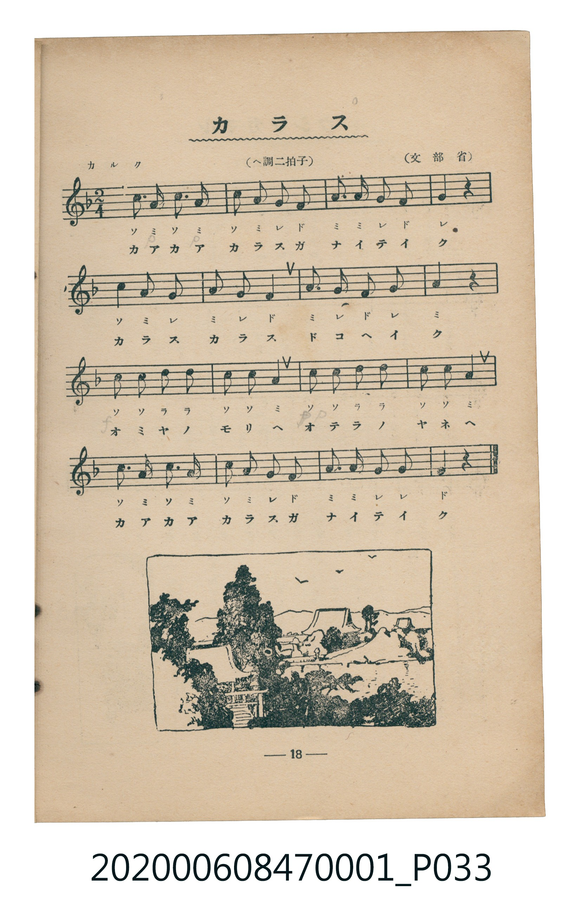

# カラス（烏鴉）

> Re:Shōka 使用 AI 協助辨識與重建樂譜，可能會有錯誤。歡迎回報。

- **鋼琴伴奏版**：<br><audio controls src="karasu.mp3"></audio>
- **NEUTRINO 歌聲合成版**：<br><audio controls src="karasu_neutrino.mp3"></audio>

- 詞：文部省
- 曲：文部省
- 臺灣教育會公認《新定兒童唱歌》尋常科第一學年用（2020.006.0847.0001）

## 說明

曲目說明
中文解釋：描寫烏鴉飛翔、鳴叫與在鄉野活動的情景。

原書資訊與歌詞全文（對應 P033.jpg，書頁 p. 18，第二學期第 3 首）：
調性與拍號：ヘ調二拍子（F 大調 2/4 拍），「カルク」


## 歌詞

```text
カアカア　カラスガ　ナイテイク
カラス　カラス　ドコヘイク
オミヤノ　モリヘ　オテラノ　ヤネヘ
カアカア　カラスガ　ナイテイク
```

## ABC

```abc
X:1
T:カラス（烏鴉）
C:曲：文部省
M:2/4
L:1/16
Q:1/4=96
K:F
V:V1 name="Piano" snm="Pia"
[V:V1]
c3 A c3 A | c2 A2 G2 F2 | A3 A G2 F2 | G4 z4 |
w: カ ア カ ア | カ ラ ス ガ | ナ イ テ イ | ク
c4 A2 G2 | A2 G2 F4 | A3 G F2 G2 | A4 z4 |
w: カ ラ ス | カ ラ ス | ド コ ヘ イ | ク
c2 c2 d2 d2 | c2 c2 A4 | c2 c2 d2 d2 | c2 c2 A4 |
w: オ ミ ヤ ノ | モ リ ヘ | オ テ ラ ノ | ヤ ネ ヘ
c3 A c3 A | c2 A2 G2 F2 | A3 A G2 G2 | F4 z4 |
w: カ ア カ ア | カ ラ ス ガ | ナ イ テ イ | ク
```

## TMD 檔案連結

- [主旋律 TMD 檔案](karasu.tmd) [[在 TMD Studio 編輯](https://tmdlang.github.io/Tmd-TS/#tmd=s7IKdvYPcrWy4qpTUCpJTLdSSM7PyUlNLsnMz7MqzsjMK0nNjM_KTMmPL87Iz05Ugisry88pzU21Si9KTEmNN4w3MjAyiDcwMIs3sDAxBzIMDBFKi_NLi5JTrYqTM_Lzc-JLUitKkvLzsxHyBUX5Zal5iXlANQVFIBtTwIoQClLLMlNSQdKpKZkl-UWZiTlI7kgtKga7FWxJfElRYl5xclFmAcgDCFUlGalAxybmZeYi6wUalZ6ZZ5Wbn5dUCvSeEpeWlsLjptWPm1c-btr5fk_H8-b-l1s63-_pVNDS4lK0VbA047K3VXDjsjHSN7EDmfJi5bz3e2Y9m9b-snnF8zmNYJOfzd6EIfaifdfzxsXPps580bTp2Zzmp61rXqzqfdzQ9WzahqfrZj1tnfR89dKnUzY-W9vzuKH76Ybupzt2PF8-8fmaNU92NDxdu-Ppzi3Pp6wAOggUynrAUNYDhTKQYWAIdJwSl76WAtDW57PXvVi16tmMPi4FBYUnO9YCnfBi-eKX7d0g5_T3P12_GuKfl4tnP98_5XFD48vNW572r37R0f50zoqXLZ0v2_uebdn9tHvq81ktz5pbn81c_7ihiUtLnwtkvi21AMhxT_vmP5u948Xm9hcruoDWA70NDMinrSuALgZ68umG3mftnQoBBsbGelkF6e_39AAVv1zQqFCgp2BoAeSCwmVXDzBcns2ZD2QrGCu8XDYNGBBAf4JMf7Fq_7OG5SBzu3tfzJwPFH3cPAMoCNQDFHm6dgLQDjeFp0uWA8UUgDGpABQF6wYGfg84-lc_bgL6vZcLZBpIoGkRlGxogCePx01rQNzmrsdNSx43t4HIpvUwDRAVyKpBSjsfN20GOgVZ6arHzfMfNwMN6AOrWPS4GSgyA6wTyGgDaYZKAdX0AqXIchLlsQYFCqDU4J1YlFhcahWQmZiX71BjUFMNskLBxtBMyw7MwpZaFCBp-cXCHgUNE4WnG_qfr2_QgUexJhYNQJtAhtUomCroAqExnIaIGAOxERAbAnENmAcSQ4iAWCBoAKVrwKb51IACDywADDsUNkwGGJRgkZ1gcg3YMGCQQtUtAbLboCywTNN6qAXxcIvwB8KuHvIDAeFtiJdh3gXbCw0EI7AIQg3eQED1LrYggBgNTLvQANgMZM-gKAB2dJIbACBsBsUIEZgniVKDCIBVYI_OB5MgrwDzGdSri8A8iDzIq9AggOoAxz4kgOA6IPp7UXXgD4ans2fTIzNA0gEsjQxAZqjl4tK1U4AUGQpAljIXAA)]
- [鋼琴伴奏 TMD 檔案](karasu_piano.tmd) [[在 TMD Studio 編輯](https://tmdlang.github.io/Tmd-TS/#tmd=s7IKdvYPcrWy4tLSUnjctPpx88rHTTvf7-l42b3n-YQtT_Zsebq0_3lnx_s9nQpaWlyKtgqWZlz2tgpuXDZG-iZ2XHUKSi9Wznu_Z9azae0vm1c8n9OoBBJ7NnsThtiL9l3PGxc_mzrzRdOmZ3Oan7auebGq93FD17NpG56um_W0ddLz1UufTtn4bG3P44bupxu6n-7Y8Xz5xOdr1jzZ0fB07Y6nO7c8n7IC6DIjAyMDPQMDMz0DCxNzIMPAEOg4JS4u78SixOJSq4DMxLz8IA-HGoOaai4FILAxNNOyA7P0tRRs0YECxIIXC3sUNEwUnm7of76-QUchwMDYWC-rIF0TiwYtfbBhNQqmCrpAaAynISLGQGwExIZAXAPmgcQQIiAWCBpA6RqwaT41oNAHCzxuWoTChskAowYsshNMrgEb9ri5C6puCZDdBmWBZZrWQy2Ih1uEPxB29ZAfCAhvQ7wM8y7YXmggGIFFEGrwBgKqd7EFAcTox82d0ADYDGTPoCgAdnSSGwAgbAbFCBGYJ4lSgwiAVWCPzgeTIK88bu6DenURmAeRB3kVGgRQHeDYhwQQXAdEfy-qDvzB8HT2bHpkBkg6gKWRAcgMtaglhg9yiWECLTCADoxXiDaMxcowjY8HuhviYoiwaTyGSrgQqkoTDIUoIngtRzES6AtdOwWIRxSALGUuAA)]

## 分析

```text
================================================================================
📊 TMD Song Profile: [ カラス（烏鴉） ]
================================================================================
⏱  Duration:       0:20 (20.0s), 16 measures total
🎼 Key & Tempo:    首調基準 F, != 96.0 BPM, <2/4>
   - 分析範圍：      由實際發聲的音符與和弦推測調性；播放脈絡另行呈現
🎤 人聲音域:    F4 (MIDI 65) – D5 (MIDI 74) [跨度: 9 個半音 / 0.8 個八度, 難度: easy]
   - 最低音:  F4 in [Karasu #1 @ m.2, 0:02]
   - 最高音: D5 in [Karasu #1 @ m.9, 0:10]
   - 適合: soprano, mezzo-soprano, contralto, tenor, baritone, bass
🏛  結構:      Karasu (20.0s)
⚡ 編曲密度:        Peak 1 軌道同時演奏
🗝  調性診斷：       A 調性不明確（純淨自然大調，未偵測到可信轉調）
   - 風格氣質:    純淨自然大調（陽光明朗、易唱易記，無明顯調外色彩）
   - 轉調歷程:    全曲維持單一推測調性（未偵測到可信轉調）
   - 核心骨幹音:  C, A, G, F, D
   - 調性數值:    A 調性不明確 [相關度: 0.79, 穩定度: Ambiguous, 自然音純度: 100.0%]
   - 候選調性 (K-S): A 小調 (0.79), C 大調 (0.76), F 大調 (0.69)
   - 五度圈歷程:   +3
   - 各段落調性細節:
     • [Karasu #1]: A 調性不明確 (r: 0.79, 自然音純度: 100.0%)

  [ 五度圈游移軌跡 ]
               C  
         F            G  
      Bb               D  
      Eb              [A ]*
         Ab           E  
            Db       B  
               F# 
     (* = active key center)

  [ 十二半音累積音高分佈 ]
     C  : ████████████████████████  31.0%
     C# :                            0.0%
     D  : █████                      6.9%
     D# :                            0.0%
     E  :                            0.0%
     F  : ███████████               13.8%
     F# :                            0.0%
     G  : ██████████████            18.1%
     G# :                            0.0%
     A  : ███████████████████████   30.2%
     A# :                            0.0%
     B  :                            0.0%
--------------------------------------------------------------------------------
Assignment 軌道音域：
  - Piano         : F4 – D5 (9 個半音 / 0.8 個八度, 51 個音符)
================================================================================
```


## 原書掃描頁




