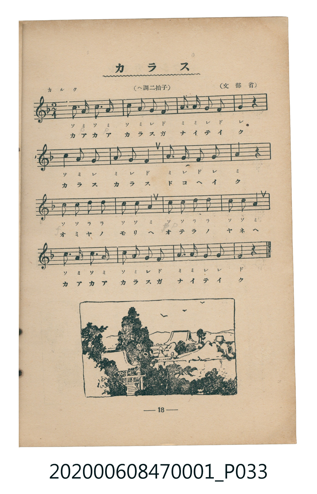

# カラス（烏鴉）

> Re:Shōka 使用 AI 協助辨識與重建樂譜，可能會有錯誤。歡迎回報。

- **鋼琴伴奏版**：<br><audio controls src="karasu.mp3"></audio>
- **NEUTRINO 歌聲合成版**：<br><audio controls src="karasu_neutrino.mp3"></audio>

- 詞：文部省
- 曲：文部省
- 臺灣教育會公認《新定兒童唱歌》尋常科第一學年用（2020.006.0847.0001）

## 說明

曲目說明
中文解釋：描寫烏鴉飛翔、鳴叫與在鄉野活動的情景。

原書資訊與歌詞全文（對應 P033.jpg，書頁 p. 18，第二學期第 3 首）：
調性與拍號：ヘ調二拍子（F 大調 2/4 拍），「カルク」


## 歌詞

```text
カアカア　カラスガ　ナイテイク
カラス　カラス　ドコヘイク
オミヤノ　モリヘ　オテラノ　ヤネヘ
カアカア　カラスガ　ナイテイク
```

## ABC

<div class="abc-score" data-abc-src="karasu.abc" aria-label="五線譜載入中"></div>

[下載 ABC 原始檔](karasu.abc)

## TMD 檔案連結

- [主旋律 TMD 檔案](karasu.tmd) [[在 TMD Studio 編輯](https://tmdlang.github.io/Tmd-TS/#tmd=s7IKdvYPcrWy4qpTUCpJTLdSSM7PyUlNLsnMz7MqzsjMK0nNjM_KTMmPL87Iz05Ugisry88pzU21Si9KTEmNN4w3MjAyiDcwMIs3sDAxBzIMDBFKi_NLi5JTrYqTM_Lzc-JLUitKkvLzsxHyBUX5Zal5iXlANQVFIBtTwIoQClLLMlNSQdKpKZkl-UWZiTlI7kgtKga7FWxJfElRYl5xclFmAcgDCFUlGalAxybmZeYi6wUalZ6ZZ5Wbn5dUCvQeskRJRj7QawUZlVYZmcUgO5MTc-KzE_OQQgBqY0FieqpVgIGxsRKXlpbC46bVj5tXPm7a-X5Px_Pm_pdbOt_v6VTQ0uJStFWwNOOyt1Vw47Ix0jexAxnzYuW893tmPZvW_rJ5xfM5jWCjn83ehCH2on3X88bFz6bOfNG06dmc5qeta16s6n3c0PVs2oan62Y9bZ30fPXSp1M2Plvb87ih--mG7qc7djxfPvH5mjVPdjQ8Xbvj6c4tz6esADoIFEl6wEjSA0USkGFgCHScEpe-lgLQ1uez171YterZjD4uBQWFJzvWAp3wYvnil-3dIOf09z9dvxrin5eLZz_fP-VxQ-PLzVue9q9-0dH-dM6Kly2dL9v7nm3Z_bR76vNZLc-aW5_NXP-4oYlLS58LZL4ttQDIcU_75j-bvePF5vYXK7qA1gO9DQzIp60rgC4GevLpht5n7Z0KoBjRyypIf7-nB6j45YJGhQI9BUMLIBcULrt6gOHybM58IFvBWOHlsmnAgAD6E2T6i1X7nzUsB5nb3fti5nyg6OPmGUBBoB6gyNO1E4B2uCk8XbIcKKYAjEkFoChYNzDwe8DRv_pxE9DvvVwg00ACTYugZEMDPHk8bloD4jZ3PW5a8ri5DUQ2rYdpgKhAVg1S2vm4aTPQKchKVz1unv-4GWhAH1jFosfNQJEZYJ1ARhtIM1QKqKYXKEWWkyiPNShQAKUG78SixOJSq4DMxLx8hxqDmmqQFQo2hmZadmAWttSiAEnLLxb2KGiYKDzd0P98fYMOPIo1sWgA2gQyrEbBVEEXCI3hNETEGIiNgNgQiGvAPJAYQgTEAkEDKF0DNs2nBhR4YAFg2KGwYTLAoASL7ASTa8CGAYMUqm4JkN0GZYFlmtZDLYiHW4Q_EHb1kB8ICG9DvAzzLtheaCAYgUUQavAGAqp3sQUBxGhg2oUGwGYgewZFAbCjk9wAAGEzKEaIwDxJlBpEAKwCe3Q-mAR5BZjPoF5dBOZB5EFehQYBVAc49iEBBNcB0d-LqgN_MDydPZsemQGSDmBpZAAyQy0Xl66dAqTIUACylLkA)]
- [鋼琴伴奏 TMD 檔案](karasu_piano.tmd) [[在 TMD Studio 編輯](https://tmdlang.github.io/Tmd-TS/#tmd=s7IKdvYPcrWy4qpTUCpJTLdSyC8qychPL0osyKi0ysgsLskvykxOzInPTsxLVIIrKs4vLUpOjS9ITE-1CjAwNlbi0tJSeNy0-nHzysdNO9_v6XjZvef5hC1P9mx5urT_eWfH-z2dClpaXIq2CpZmXPa2Cm5cNkb6JnYg816snPd-z6xn09pfNq94PqcRbMez2ZswxF6073reuPjZ1JkvmjY9m9P8tHXNi1W9jxu6nk3b8HTdrKetk56vXvp0ysZna3seN3Q_3dD9dMeO58snPl-z5smOhqdrdzzdueX5lBVAlxkZGBnoGRiY6RlYmJgDGQaGQMcpcXF5JxYlFpdaBWQm5uUHeTjUGNRUcykAgY2hmZYdmKWvpWCLDhQgFrxY2KOgYaLwdEP_8_UNOgqgINHLKkjXxKJBSx9sWI2CqYIuEBrDaYiIMRAbAbEhENeAeSAxhAiIBYIGULoGbJpPDSj0wQKPmxahsGEywKgBi-wEk2vAhj1u7oKqWwJkt0FZYJmm9VAL4uEW4Q-EXT3kBwLC2xAvw7wLthcaCEZgEYQavIGA6l1sQQAx-nFzJzQANgPZMygKgB2d5AYACJtBMUIE5kmi1CACYBXYo_PBJMgrj5v7oF5dBOZB5EFehQYBVAc49iEBBNcB0d-LqgN_MDydPZsemQGSDmBpZAAyQy1qieGDXGKYQAsMoAPjFaINY7EyTOPjge6GuBgibBqPoRIuhKrSBEMhighey1GMBPpC104B4hEFIEuZCwA)]

## 分析

```text
================================================================================
📊 TMD Song Profile: [ カラス（烏鴉） ]
================================================================================
⏱  Duration:       0:20 (20.0s), 16 measures total
🎼 Key & Tempo:    首調基準 F, != 96.0 BPM, <2/4>
   - 分析範圍：      由實際發聲的音符與和弦推測調性；播放脈絡另行呈現
🎤 人聲音域:    F4 (MIDI 65) – D5 (MIDI 74) [跨度: 9 個半音 / 0.8 個八度, 難度: easy]
   - 最低音:  F4 in [Karasu #1 @ m.2, 0:02]
   - 最高音: D5 in [Karasu #1 @ m.9, 0:10]
   - 適合: soprano, mezzo-soprano, contralto, tenor, baritone, bass
🏛  結構:      Karasu (20.0s)
⚡ 編曲密度:        Peak 1 軌道同時演奏
🗝  調性診斷：       A 調性不明確（純淨自然大調，未偵測到可信轉調）
   - 風格氣質:    純淨自然大調（陽光明朗、易唱易記，無明顯調外色彩）
   - 轉調歷程:    全曲維持單一推測調性（未偵測到可信轉調）
   - 核心骨幹音:  C, A, G, F, D
   - 調性數值:    A 調性不明確 [相關度: 0.79, 穩定度: Ambiguous, 自然音純度: 100.0%]
   - 候選調性 (K-S): A 小調 (0.79), C 大調 (0.76), F 大調 (0.69)
   - 五度圈歷程:   +3
   - 各段落調性細節:
     • [Karasu #1]: A 調性不明確 (r: 0.79, 自然音純度: 100.0%)

  [ 五度圈游移軌跡 ]
               C  
         F            G  
      Bb               D  
      Eb              [A ]*
         Ab           E  
            Db       B  
               F# 
     (* = active key center)

  [ 十二半音累積音高分佈 ]
     C  : ████████████████████████  31.0%
     C# :                            0.0%
     D  : █████                      6.9%
     D# :                            0.0%
     E  :                            0.0%
     F  : ███████████               13.8%
     F# :                            0.0%
     G  : ██████████████            18.1%
     G# :                            0.0%
     A  : ███████████████████████   30.2%
     A# :                            0.0%
     B  :                            0.0%
--------------------------------------------------------------------------------
Assignment 軌道音域：
  - Piano         : F4 – D5 (9 個半音 / 0.8 個八度, 51 個音符)
================================================================================
```


## 原書掃描頁




