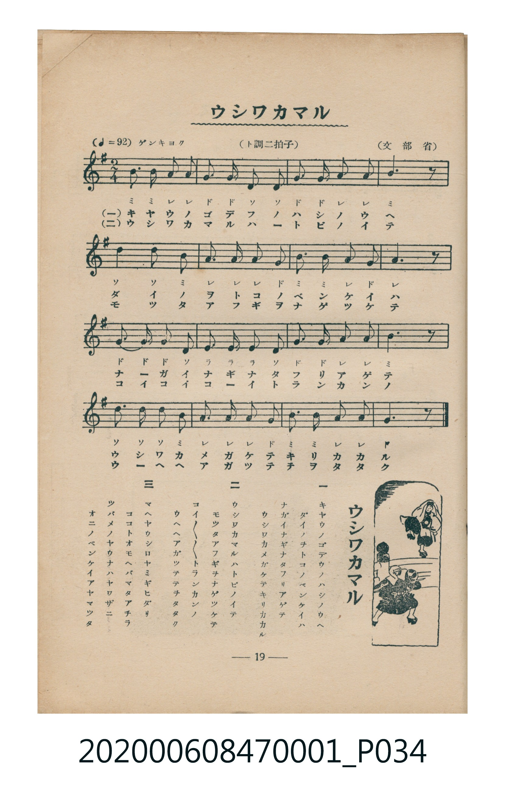

# ウシワカマル（牛若丸）

> Re:Shōka 使用 AI 協助辨識與重建樂譜，可能會有錯誤。歡迎回報。

- **鋼琴伴奏版**：<br><audio controls src="ushiwakamaru.mp3"></audio>
- **NEUTRINO 歌聲合成版**：<br><audio controls src="ushiwakamaru_neutrino.mp3"></audio>

- 詞：文部省
- 曲：文部省
- 臺灣教育會公認《新定兒童唱歌》尋常科第一學年用（2020.006.0847.0001）

## 說明

曲目說明
中文解釋：描寫源義經幼名牛若丸的少年故事與英勇形象。

原書資訊與歌詞全文（對應 P034.jpg，書頁 p. 19，第二學期第 4 首）：
調性與拍號：ト調二拍子（G 大調 2/4 拍），「ゲンキヨク」（♩=92）


## 歌詞

```text
一
キヤウノゴデウノハシノウヘ
ダイノヲトコノベンケイハ
ナガイナギナタフリアゲテ
ウシワカメガケテキリカカル

二
ウシワカマルハトビノイテ
モツタアフギヲナゲツケテ
コイコイコイトランカンノ
ウヘヘアガツテテヲタタク

三
マヘヤウシロヤミギヒダリ
ココトオモヘバマタアチラ
ツバメノヤウナハヤワザニ
オニノベンケイアヤマツタ
```

## ABC

```abc
X:1
T:ウシワカマル（牛若丸）
C:曲：文部省
M:2/4
L:1/16
Q:1/4=92
K:G
V:V1 name="Piano" snm="Pia"
[V:V1]
B3 B A2 A2 | G2 G2 D2 D2 | G2 G2 A2 A2 | B6 z2 |
w: 1.~キ ヤ ウ ノ | ゴ デ ウ ノ | ハ シ ノ ウ | ヘ
w: 2.~ウ シ ワ カ | マ ル ハ _ | ト ビ ノ イ | テ
w: 3.~マ ヘ ヤ ウ | シ ロ ヤ _ | ミ ギ ヒ ダ | リ
d3 d B4 | A3 A A2 G2 | B2 B2 A2 G2 | A6 z2 |
w: 1.~ダ イ ノ | ヲ ト コ ノ | ベ ン ケ イ | ハ
w: 2.~モ ツ タ | ア フ ギ ヲ | ナ ゲ ツ ケ | テ
w: 3.~コ コ ト | オ モ ヘ バ | マ タ ア チ | ラ
G3 G G2 D2 | E3 E E3 D | G2 G2 A2 A2 | B6 z2 |
w: 1.~ナ _ ガ イ | ナ ギ ナ タ | フ リ ア ゲ | テ
w: 2.~コ イ コ イ | コ _ イ ト | ラ ン カ ン | ノ
w: 3.~ツ バ メ ノ | ヤ _ ウ ナ | ハ ヤ ワ ザ | ニ
d3 d d2 B2 | A3 A A2 G2 | B3 B A2 A2 | G6 z2 |
w: 1.~ウ シ ワ カ | メ ガ ケ テ | キ リ カ カ | ル
w: 2.~ウ _ ヘ ヘ | ア ガ ツ テ | テ ヲ タ タ | ク
w: 3.~オ _ ニ ノ | ベ ン ケ イ | ア ヤ マ ツ | タ
```

## TMD 檔案連結

- [主旋律 TMD 檔案](ushiwakamaru.tmd) [[在 TMD Studio 編輯](https://tmdlang.github.io/Tmd-TS/#tmd=s7IKdvYPcrWy4qpTUCpJTLdSSM7PyUlNLsnMz7MqzsjMK0nNjM_KTMmPL87Iz05Ugisry88pzU21Si9KTEmNN4w3MjAyiDcwMIs3sDAxBzIMDBFKi_NLi5JTrYqTM_Lzc-JLUitKkvLzsxHyBUX5Zal5iXlANQVFIBtTwIoQClLLMlNSQdKpKZkl-UWZiTlI7kgtKga7FWxJfElRYl5xclFmAcgDCFUlGalAx6bl52Tn5BelootnZBYDja1ECAPtSM_Ms8rNz0sqBfpbiUtLS-Fx07LHTdsfN69_3LT6cfO8x82r3-_peN45-0X30ic7drzf06mgpcWlaKtgacRlb6vgzmVjpG9iBzLxxcp57_fMejat_WXziudzGsG2PJu9CUPsRfuu542Ln02d-aJp07M5zU9b17xY1fu4oevZtA1P18162jrp-eqlT6dsfLa253FD99MN3U937Hi-fOLzNWue7Gh4unbH051bnk9ZAXQTKCr0gFGhB4oKIMPAEOg4JS59LQWgrc9nr3uxatWzGX1cCgoKT3asBTrhxfLFL9u7Qc7p73-6fvWzXROe71v5fNvkpzv3PJ3QC_fh81ktTzdMBNrybGrrk13dLzraX3RvfNrd_nTvohcbFz5uaOLS0ucC2WJLLQBy4tO--c9m73ixuf3Fii6glUDPA4PzaesKoLuBXn26ofdZe6dCgIGxiV5WQfr7PT1AxS8XNCoU6CkYWgK5oNDZ1QMMnWdz5gPZCiYKL5dNAwYH0Lcg01-s2v-sYTnI3O7eFzPnA0UfN3cABYF6gCJP104A2uGu8HTJcqCYAjA-FYCiYN3AKOh53LTpcfPmx01rHzeveNy0_nEDUKrj0cyVtpZGQDVckABuAFFgNUtACai573HTlsfN7VB2cz84SQEFgdwZYKXNDY-bloDlgKZ3PG7aDGbPBNu0ESzVD1HX9bhpDZgPZKwDk_sfN0993LzqcdMisNPaIFYjp9qFYD0bgXJgJwGVrgaLr4a4dlcPphZQQge5E-iW5slgpwKthBjdvOhxcwvIWqCFQJtBrgBaC3QIkASKg6yBmAd0OtD3SCTIsJVgLwHNBvkQZm_zDBACeWANyAygO0FoE9gSIFoPDdVOiP1AtwHVgwMW5GBwIDfPBztkEiggm1fB7QdaAgzMVWA3A_VMAGmGurwR6BaIeUALgRILwSEOia4usNeBpgIDY9vj5m6IeUBjutGjBWQSUB3QSaAgAamjPANAgQIoY4UCC-PyxOzE3MSiUquAzMS8fIcag5pqkEUKNoZmWnZgFrbspwApIl4s7FHQMFF4uqH_-foGHXie0cSiAWgfyLAaBWMFXSA0VjACkiBco2AIJEHYNB5GIMQQqiD6INAAJAI2z8ewBpQVwKLAwAJFOJjVB9YDzBhgXjuIRJVp7geLbYeLQeRBMjOQbAK7BmKTEcg8kBqIPmD8gVmrobrmgU0C8SBmgyBIvAMsMhnJniVQmTbs9hjDTAPpmAH2FZLroC4G-RgiA7NnPljVOrD4JDDZAJVZhWEP_njd1UNOvJqCzTeFx1MNON5AsQeiQXEJiUMQRohA1GCNVbD7IeEFCTmYTzdBw6YDlA3h4QqSmQnmgcWaNqKENSxGsMRp8yKoeS1A9fsR9jTBxKfCwxVkM0hHF9hsEA-kC2YbgTgFuxWkdjM0VcDsgcQPyB2QtAcsMaCmgdMU2E0Q1wALFqjMSgx7COTVTnLiFBRHoJiC584aBTMQpQuioCygOInZFRx8kKBYAyZhkQQRBwU2gr0fLDMV7HlQQEEDAhz4eAIcnFlhAQ4qFiCJAmoTVAYmAklMsGCFJSBIVgaxQTKwBIgts4KSACTagCU9mAVLkLAMCi84gP6CFz6QjA0tRrZBdXRj2IM3Yp_Onk1JZgXRoJjClVkxC2occYqnYASFCCSuoZkSHGfIxfYqWGjD9YBoXLEKsQlSOMJIpOwKsgeSKWH2QNMIKPvCMhOIBOkBuRRXdoUVm5A4QS1kICkDrZCBFxigAgtSHYDcAZKBFSsIe2q5uHTtFJBrYAUgX5kLAA)]
- [鋼琴伴奏 TMD 檔案](ushiwakamaru_piano.tmd) [[在 TMD Studio 編輯](https://tmdlang.github.io/Tmd-TS/#tmd=s7IKdvYPcrWy4tLSUnjctOxx0_bHzesfN61-3DzvcfPq93s6XnbveT5hy5M9W54u7X_e2fF-T6eClhaXoq2CpRGXva2CO5eNkb6JHVedgtKLlfPe75n1bFr7y-YVz-c0KoHEns3ehCH2on3X88bFz6bOfNG06dmc5qeta16s6n3c0PVs2oan62Y9bZ30fPXSp1M2Plvb87ih--mG7qc7djxfPvH5mjVPdjQ8Xbvj6c4tz6esALrMyMDIQM_AwEzPwMLEHMgwMAQ6TomLK7Q4I7M8MTsxN7Go1CogMzEvP8jDocagpppLAQhsDM207MAsfS0FW3SgALHmxcIeBQ0Thacb-p-vb9BRCDAwNtHLKkjXxKJBSx9sWI2CsYIuEBorGAFJEK5RMASSIGwaDyMQYghVEH0QaAASAZvnY1gDjI-1YNHHzUtAcQNm9YH1PG7aAua1g0hUmeZ-sNh2uBhEHiQzA8kmsGsgNhmBzAOpgegDxj-YtRqqax7YJBAPYjYIgsQ7wCKTkexZApVpw26PMcw0kI4ZYF8huQ7qYpCPITIwe-aDVa0Di08Ckw1QmVUY9uCP11095MSrKdh8U3g81YDjDRR7IBoUl5A4BGGECEQN1lgFux8SXpCQg_l0EzRsOoBym-HhCpKZCeaBxZo2ooQ1LEawxGnzIqh5LUD1-xH2NMHEp8LDFWQzSEcX2GwQD6QLZhuBOAW7FaR2MzRVwOyBxA_IHZC097h5AtQ0cJoCuwnimsfNjVCZlRj2EMirneTEKSiOQDEFz501CmYgShdEQVlAcRKzKzj4IEGxBkzCIgkiDgpsBHs_WGYq2POggIIGBDjw8QQ4OLPCAhxULEASBdQmqAxMBJKYYMEKS0CQrAxig2RgCRBbZgUlAUi0PW5eCGbBEiQsg8ILDqC_4IUPJGNDi5FtUB3dGPbgjdins2dTkllBNCimcGVWzIIaR5ziKRhBIQKJa2imBMcZcrG9ChbacD0gGlesQmyCFI4wEim7guyBZEqYPdA0Asq-sMwEIkF6QC7FlV1hxSYkTlALGUjKQCtk4AUGqMCCVAcgd4BkYMUKwp5abBWwD3IFbAKtf4HhHq8QbRofC2UZwhhwIQOou5HkTeMx9YDEsCg1ASk1gSslwVQUpUAP6dopIPsp2geoCUPMCIuYMVhMmQsA)]

## 分析

```text
================================================================================
📊 TMD Song Profile: [ ウシワカマル（牛若丸） ]
================================================================================
⏱  Duration:       0:20 (20.9s), 16 measures total
🎼 Key & Tempo:    首調基準 G, != 92.0 BPM, <2/4>
   - 分析範圍：      由實際發聲的音符與和弦推測調性；播放脈絡另行呈現
🎤 人聲音域:    D4 (MIDI 62) – D5 (MIDI 74) [跨度: 12 個半音 / 1.0 個八度, 難度: easy]
   - 最低音:  D4 in [Ushiwakamaru #1 @ m.2, 0:01]
   - 最高音: D5 in [Ushiwakamaru #1 @ m.5, 0:05]
   - 適合: soprano, mezzo-soprano, contralto, tenor, baritone, bass
🏛  結構:      Ushiwakamaru (20.9s)
⚡ 編曲密度:        Peak 1 軌道同時演奏
🗝  調性診斷：       G 大調（純淨自然大調，未偵測到可信轉調）
   - 風格氣質:    純淨自然大調（陽光明朗、易唱易記，無明顯調外色彩）
   - 轉調歷程:    全曲維持單一推測調性（未偵測到可信轉調）
   - 核心骨幹音:  A, G, B, D, E
   - 調性數值:    G 大調 [相關度: 0.69, 穩定度: Moderate, 自然音純度: 100.0%]
   - 候選調性 (K-S): G 大調 (0.69), D 大調 (0.65), B 小調 (0.53)
   - 五度圈歷程:   +1
   - 各段落調性細節:
     • [Ushiwakamaru #1]: G 大調 (r: 0.69, 自然音純度: 100.0%)

  [ 五度圈游移軌跡 ]
               C  
         F           [G ]*
      Bb               D  
      Eb               A  
         Ab           E  
            Db       B  
               F# 
     (* = active key center)

  [ 十二半音累積音高分佈 ]
     C  :                            0.0%
     C# :                            0.0%
     D  : ███████████               14.2%
     D# :                            0.0%
     E  : █████                      5.8%
     F  :                            0.0%
     F# :                            0.0%
     G  : ████████████████████      25.0%
     G# :                            0.0%
     A  : ████████████████████████  30.0%
     A# :                            0.0%
     B  : ████████████████████      25.0%
--------------------------------------------------------------------------------
Assignment 軌道音域：
  - Piano         : D4 – D5 (12 個半音 / 1.0 個八度, 51 個音符)
================================================================================
```


## 原書掃描頁




