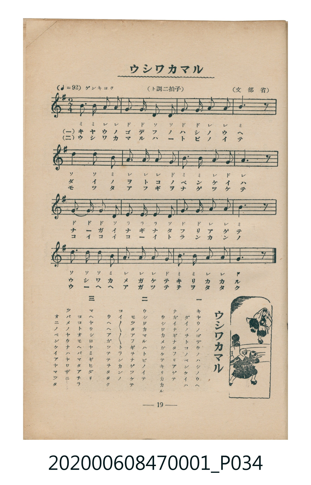

# ウシワカマル

<audio controls src="ushiwakamaru.mp3"></audio>

- 詞：文部省
- 曲：文部省
- 臺灣教育會公認《新定兒童唱歌》尋常科第一學年用（2020.006.0847.0001）

- note

原書資訊與歌詞全文（對應 P034.jpg，書頁 p. 19，第二學期第 4 首）：
調性與拍號：ト調二拍子（G 大調 2/4 拍），「ゲンキヨク」（♩=92）

## 歌詞

```text
一
キヤウノゴデウノハシノウヘ
ダイノヲトコノベンケイハ
ナガイナギナタフリアゲテ
ウシワカメガケテキリカカル

二
ウシワカマルハトビノイテ
モツタアフギヲナゲツケテ
コイコイコイトランカンノ
ウヘヘアガツテテヲタタク

三
マヘヤウシロヤミギヒダリ
ココトオモヘバマタアチラ
ツバメノヤウナハヤワザニ
オニノベンケイアヤマツタ
```

## 原書掃描頁



## 調性分析

```text
================================================================================
📊 TMD Song Profile: [ ウシワカマル ]
================================================================================
⏱  Duration:       0:20 (20.9s), 16 measures total
🎼 Key & Tempo:    首調基準 G, != 92.0 BPM, <2/4>
   - 分析範圍：      由實際發聲的音符與和弦推測調性；播放脈絡另行呈現
🎤 人聲音域:    D4 (MIDI 62) – D5 (MIDI 74) [跨度: 12 個半音 / 1.0 個八度, 難度: easy]
   - 最低音:  D4 in [Ushiwakamaru #1 @ m.2, 0:01]
   - 最高音: D5 in [Ushiwakamaru #1 @ m.13, 0:15]
   - 適合: soprano, mezzo-soprano, contralto, tenor, baritone, bass
🏛  結構:      Ushiwakamaru (20.9s)
⚡ 編曲密度:        Peak 1 軌道同時演奏
🗝  調性診斷：       D 調性不明確（純淨自然大調，未偵測到可信轉調）
   - 風格氣質:    純淨自然大調（陽光明朗、易唱易記，無明顯調外色彩）
   - 轉調歷程:    全曲維持單一推測調性（未偵測到可信轉調）
   - 核心骨幹音:  A, G, B, D, E
   - 調性數值:    D 調性不明確 [相關度: 0.71, 穩定度: Ambiguous, 自然音純度: 100.0%]
   - 候選調性 (K-S): D 大調 (0.71), G 大調 (0.68), B 小調 (0.50)
   - 五度圈歷程:   +2
   - 各段落調性細節:
     • [Ushiwakamaru #1]: D 調性不明確 (r: 0.71, 自然音純度: 100.0%)

  [ 五度圈游移軌跡 ]
               C  
         F            G  
      Bb              [D ]*
      Eb               A  
         Ab           E  
            Db       B  
               F# 
     (* = active key center)

  [ 十二半音累積音高分佈 ]
     C  :                            0.0%
     C# :                            0.0%
     D  : █████████████             16.7%
     D# :                            0.0%
     E  : █████                      6.7%
     F  :                            0.0%
     F# :                            0.0%
     G  : ██████████████████        23.3%
     G# :                            0.0%
     A  : ████████████████████████  31.7%
     A# :                            0.0%
     B  : ████████████████          21.7%
--------------------------------------------------------------------------------
Assignment 軌道音域：
  - Piano         : D4 – D5 (12 個半音 / 1.0 個八度, 51 個音符)
================================================================================
```

## ABC

```abc
X:1
T:ウシワカマル
C:曲：文部省
M:2/4
L:1/16
Q:1/4=92
K:G

V:V1 name="Piano" snm="Pia"

[V:V1]
b3 b a2 a2 | g2 g2 d4 | d2 g2 g2 a2 | a2 b4 z2 |
d3 d b4 | a3 a a4 | g2 b2 b2 a2 | g2 a4 z2 |
g3 g g2 d2 | e2 e2 e4 | d2 g2 g2 a2 | a2 b4 z2 |
d3 d d2 b2 | a3 a a4 | g2 b2 b2 a2 | a2 g4 z2 |
```

- [主旋律 TMD 檔案](ushiwakamaru.tmd)
- [鋼琴伴奏 TMD 檔案](ushiwakamaru_piano.tmd)
