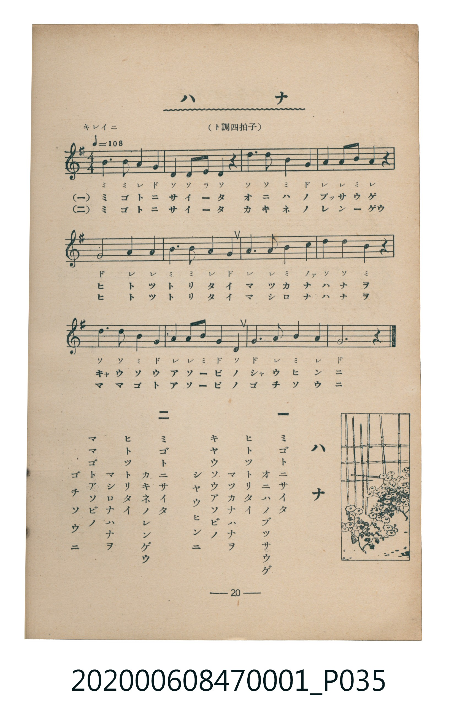

# ハナ（花）

> Re:Shōka 使用 AI 協助辨識與重建樂譜，可能會有錯誤。歡迎回報。

- **鋼琴伴奏版**：<br><audio controls src="hana.mp3"></audio>
- **NEUTRINO 歌聲合成版**：<br><audio controls src="hana_neutrino.mp3"></audio>

- 臺灣教育會公認《新定兒童唱歌》尋常科第一學年用（2020.006.0847.0001）

## 說明

曲目說明
中文解釋：歌唱各種花朵盛開的美麗景色。

原書資訊與歌詞全文（對應 P035.jpg，書頁 p. 20，第二學期第 5 首）：
調性與拍號：ト調四拍子（G 大調 4/4 拍），「キレイニ」♩=108

## 跨冊／重複收錄參照

> 同名異曲（各冊收錄之不同詞曲版本）

- **[同名異曲]** 《新定兒童唱歌》高等科女子用（2020.006.0849）：[**〈花〉**](../../koto_girls_2020.006.0849/2_4_04_hana/index.md)（`A` / `2/4` — [原始 TMD](../../koto_girls_2020.006.0849/2_4_04_hana/hana.tmd)）
- 總表：[跨冊重複與同名歌曲總索引](../../../duplicate_songs.md)

## 歌詞

```text
一
ミゴトニサイタ
オニハノブッサウゲ
ヒトツトリタイ
マツカナハナヲ
キヤウソウアソビノ
シヤウヒンニ

二
ミゴトニサイタ
カキネノレンゲウ
ヒトツトリタイ
マシロナハナヲ
ママゴトアソビノ
ゴチソウニ
```

## ABC

```abc
X:1
T:ハナ（花）
M:4/4
L:1/16
Q:1/4=108
K:G
V:V1 name="Piano" snm="Pia"
[V:V1]
B6 B2 A4 G4 | D4 D2 E2 D4 z4 | d6 d2 B4 G4 | A4 A2 B2 A4 z4 |
w: 1.~ミ ゴ ト ニ | サ イ _ タ | オ ニ ハ ノ | ブッ サ ウ ゲ
w: 2.~ミ ゴ ト ニ | サ イ _ タ | カ キ ネ ノ | レ ン _ ゲウ
G8 A4 A4 | B6 B2 A4 G4 | A6 A2 B4 c4 | d4 d4 B4 z4 |
w: 1.~ヒ ト ツ | ト リ タ イ | マ ツ カ ナ | ハ ナ ヲ
w: 2.~ヒ ト ツ | ト リ タ イ | マ シ ロ ナ | ハ ナ ヲ
d6 d2 B4 G4 | A4 A2 B2 G4 D4 | G6 A2 B4 A4 | G12 z4 |
w: 1.~キャ ウ ソ ウ | ア ソ _ ビ ノ | シャ ウ ヒ ン | ニ
w: 2.~マ マ ゴ ト | ア ソ _ ビ ノ | ゴ チ ソ ウ | ニ
```

## TMD 檔案連結

- [主旋律 TMD 檔案](hana.tmd) [[在 TMD Studio 編輯](https://tmdlang.github.io/Tmd-TS/#tmd=s7IKdvYPcrWy4qpTUCpJTLdSSM7PyUlNLsnMz7MqzsjMK0nNjM_KTMmPL87Iz05Ugisry88pzU21Si9KTEmNN4w3MjAyiDcwMIs3sDAxBzIMDBFKi_NLi5JTrYqTM_Lzc-JLUitKkvLzsxHyBUX5Zal5iXlANQVFIBtTwIoQClLLMlNSQdKpKZkl-UWZiTlI7kgtKga7FWxJfElRYl5xclFmAcgDCFUlGalAxxbkJOYBjdXSUnjc3P-4uev9no4XXRvf7-lU0NLiUrRVMDSw4LK3VXDnsjHRN7EDaX7Rvut54-JnU2e-aNr0bE7z09Y1L1b1Pm7oejZtw9N1s562Tnq-eunTKRufre153ND9dEP30x07ni-f-HzNmic7Gp6u3fF055bnU1YArQEFjx4wePRAwQNkGBgCbVXi0tdSeDZ70_PZ616sWvVsRh-XgoLCkx1rn01rf7F88cv27vd7ZgFNBpr_dELL8xXrgG59Nmfr89mzX07rfj6r5fm-vpe7pj-buf5F56bHDU1cWvpcIANtqQVArnnaN__Z7B0vNre_WNH1oqMd6JoXK-c9bV0BdCLQV0839D5r71QIMDA21csqSH-_pweo-OWCRoUCPQUjAyAXFBC7eoAB8WzOfCBbwVTh5bJpQJ8DPQYy_cWq_c8aloPM7e59MXM-UPRxcwdQ8Ons2UCRp2snAO1wV3i6ZDlQTAEYJQpAUbBuYGj3PG5a-7h5zeOmJY-bux839D6audIWFH-QMGwAUY-b5z9u2gI0EqSiaStIadN-sETTKpAQKA30PW6e9ri5GSy97HHTJoi-SWBNLWByFVATUCtEYh5ItGk1MO1AUtDjZogOkFuApgNN2AsmF4EYzZOB5kOkt0OlQSZvBtoNceauHgLOXA02uBfszDUgnU2bgKYQdCPIOqA-NDeCHA-UA9uE4UCgaCPU8UDXAYUoTz9QoABKlx6JeYlWAZmJefkONQY11SALFGwstOzADGyJVgGSh14s7FHQMFF4uqH_-foGHXhK08SiAWgNyLAaBWMFXSA0VjACkoZAXKNgGg-kgIRZPIRpABEFqzMFq4eoA-kwguoEqwGb6GNYA4ojsGpgQAHZHSBWczdYDzDGwOJLwOR-IAmyASS-CqIDqA4YD2BWH0QGnOLAyrcC8TIg3gTTBrHQiDwLV0N1rAWq7UWxcA2YtxksC0pBcOvwh_-uHnLCHxSWIAgJTZADMGMExIKEta6CCTw2QBgkgh72k6AmwgKiBeotEA_EXwUNCEiggGTmQWVaoMECzAZQGUhMgHjAfIEl2Mm2q2k7kL2WCLsIpPlOcsIcd1oG8cCJHhYxkECHRAwsqkAQLdBBBc9iqM9ASXQvlAVJaovAPLBY82QwCU1qoKIHSRs4OCEpDxQgoBQMg-gBD4uyeeA0D4sA_JaB1IH4jegOxGJTLReXrp0CqCBSANLKXAA)]
- [鋼琴伴奏 TMD 檔案](hana_piano.tmd) [[在 TMD Studio 編輯](https://tmdlang.github.io/Tmd-TS/#tmd=s7IKdvYPcrWy4tLSUnjc3P-4uev9no6X3XueT9jyZM-Wp0v7n3d2vN_TqaClxaVoq2BoYMFlb6vgzmVjom9ix1WnoPSifdfzxsXPps580bTp2Zzmp61rXqzqfdzQ9WzahqfrZj1tnfR89dKnUzY-W9vzuKH76Ybupzt2PF8-8fmaNU92NDxdu-Ppzi3Pp6wAWmlkYGSgZ2BgpmdgYWIOZBgYAm1V4uLySMxLtArITMzLD_JwqDGoqeZSAAIbCy07MENfS8EWHShATH-xsEdBw0Th6Yb-5-sbdBQCDIxN9bIK0jWxaNDSBxtWo2CsoAuExgpGQNIQiGsUTOOBFJAwi4cwDSCiYHWmYPUQdSAdRlCdYDVgE30Ma4ChOh-s-nHTFiC7A8Rq7gbredy0FSy-BEzuB5IgG0DiqyA6gOqAcQJm9UFkmqc9bm4GK98KxMuAeBNMG8RCI_IsXA3VsRaothfFwjVg3maw7CaQlTDr8If_rh5ywh8UliAICU2QAzBjBMSChLWuggk8NkAYJIIe9pOgJsICogXqLRAPxF8FDQhIoIBk5kFlWqDBAswSUBlITIB4j5uxBTvZdjVtB7LXEmEXgTTfSU6Y407LIB440cMiBhLokIiBRRUIogV609rHzYuhPgMl0b1QFiSpLQLzwGLNk8EkNKk1bUfRBg5OSMoDBQgoBcMgesDDomweOM3DIgC_ZSB1IH4jugOx2FSLXA75IJdDJtByCBge8QrRhrHA8ALR8bFQERMgC0gbIBRAKVDJAmSZAuVBDKACLOaAZLGZDJcESaEogtiFahSmjXARE5AIyI2Y1kFNAnpd104B5PtoH6AonG0EZitzAQA)]

## 分析

```text
================================================================================
📊 TMD Song Profile: [ ハナ（花） ]
================================================================================
⏱  Duration:       0:26 (26.7s), 12 measures total
🎼 Key & Tempo:    首調基準 G, != 108.0 BPM, <4/4>
   - 分析範圍：      由實際發聲的音符與和弦推測調性；播放脈絡另行呈現
🎤 人聲音域:    D4 (MIDI 62) – D5 (MIDI 74) [跨度: 12 個半音 / 1.0 個八度, 難度: easy]
   - 最低音:  D4 in [Hana #1 @ m.2, 0:02]
   - 最高音: D5 in [Hana #1 @ m.3, 0:04]
   - 適合: soprano, mezzo-soprano, contralto, tenor, baritone, bass
🏛  結構:      Hana (26.7s)
⚡ 編曲密度:        Peak 1 軌道同時演奏
🗝  調性診斷：       G 大調（純淨自然大調，未偵測到可信轉調）
   - 風格氣質:    純淨自然大調（陽光明朗、易唱易記，無明顯調外色彩）
   - 轉調歷程:    全曲維持單一推測調性（未偵測到可信轉調）
   - 核心骨幹音:  G, A, B, D, C
   - 調性數值:    G 大調 [相關度: 0.78, 穩定度: Moderate, 自然音純度: 100.0%]
   - 候選調性 (K-S): G 大調 (0.78), D 大調 (0.72), B 小調 (0.58)
   - 五度圈歷程:   +1
   - 各段落調性細節:
     • [Hana #1]: G 大調 (r: 0.78, 自然音純度: 100.0%)

  [ 五度圈游移軌跡 ]
               C  
         F           [G ]*
      Bb               D  
      Eb               A  
         Ab           E  
            Db       B  
               F# 
     (* = active key center)

  [ 十二半音累積音高分佈 ]
     C  : ██                         2.3%
     C# :                            0.0%
     D  : ████████████████████      21.6%
     D# :                            0.0%
     E  : █                          1.1%
     F  :                            0.0%
     F# :                            0.0%
     G  : ████████████████████████  26.1%
     G# :                            0.0%
     A  : ████████████████████████  26.1%
     A# :                            0.0%
     B  : █████████████████████     22.7%
--------------------------------------------------------------------------------
Assignment 軌道音域：
  - Piano         : D4 – D5 (12 個半音 / 1.0 個八度, 44 個音符)
================================================================================
```


## 原書掃描頁




