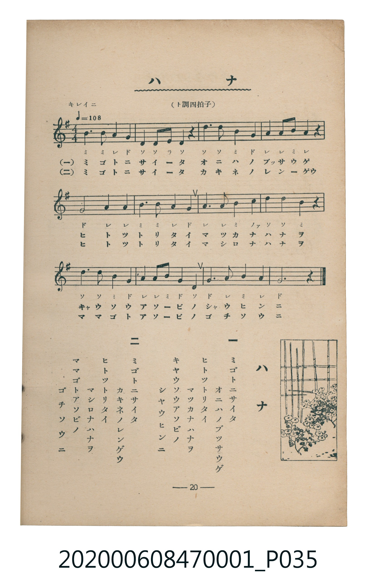

# ハナ

<audio controls src="hana.mp3"></audio>

- 臺灣教育會公認《新定兒童唱歌》尋常科第一學年用（2020.006.0847.0001）

- note

原書資訊與歌詞全文（對應 P035.jpg，書頁 p. 20，第二學期第 5 首）：
調性與拍號：ト調四拍子（G 大調 4/4 拍），「キレイニ」♩=108

## 歌詞

```text
一
ミゴトニサイタ
オニハノブッサウゲ
ヒトツトリタイ
マツカナハナヲ
キヤウソウアソビノ
シヤウヒンニ

二
ミゴトニサイタ
カキネノレンゲウ
ヒトツトリタイ
マシロナハナヲ
ママゴトアソビノ
ゴチソウニ
```

## 原書掃描頁



## 調性分析

```text
================================================================================
📊 TMD Song Profile: [ ハナ ]
================================================================================
⏱  Duration:       0:26 (26.7s), 12 measures total
🎼 Key & Tempo:    首調基準 G, != 108.0 BPM, <4/4>
   - 分析範圍：      由實際發聲的音符與和弦推測調性；播放脈絡另行呈現
🎤 人聲音域:    D4 (MIDI 62) – D5 (MIDI 74) [跨度: 12 個半音 / 1.0 個八度, 難度: easy]
   - 最低音:  D4 in [Hana #1 @ m.2, 0:02]
   - 最高音: D5 in [Hana #1 @ m.3, 0:04]
   - 適合: soprano, mezzo-soprano, contralto, tenor, baritone, bass
🏛  結構:      Hana (26.7s)
⚡ 編曲密度:        Peak 1 軌道同時演奏
🗝  調性診斷：       G 大調（純淨自然大調，未偵測到可信轉調）
   - 風格氣質:    純淨自然大調（陽光明朗、易唱易記，無明顯調外色彩）
   - 轉調歷程:    全曲維持單一推測調性（未偵測到可信轉調）
   - 核心骨幹音:  G, A, B, D, C
   - 調性數值:    G 大調 [相關度: 0.78, 穩定度: Moderate, 自然音純度: 100.0%]
   - 候選調性 (K-S): G 大調 (0.78), D 大調 (0.72), B 小調 (0.58)
   - 五度圈歷程:   +1
   - 各段落調性細節:
     • [Hana #1]: G 大調 (r: 0.78, 自然音純度: 100.0%)

  [ 五度圈游移軌跡 ]
               C  
         F           [G ]*
      Bb               D  
      Eb               A  
         Ab           E  
            Db       B  
               F# 
     (* = active key center)

  [ 十二半音累積音高分佈 ]
     C  : ██                         2.3%
     C# :                            0.0%
     D  : ████████████████████      21.6%
     D# :                            0.0%
     E  : █                          1.1%
     F  :                            0.0%
     F# :                            0.0%
     G  : ████████████████████████  26.1%
     G# :                            0.0%
     A  : ████████████████████████  26.1%
     A# :                            0.0%
     B  : █████████████████████     22.7%
--------------------------------------------------------------------------------
Assignment 軌道音域：
  - Piano         : D4 – D5 (12 個半音 / 1.0 個八度, 44 個音符)
================================================================================
```

## ABC

```abc
X:1
T:ハナ
C:TMD (Chen, Chih-Han / aguai)
M:4/4
L:1/16
Q:1/4=108
K:G

V:V1 name="Piano" snm="Pia"

[V:V1]
b6 b2 a4 g4 | d4 d2 e2 d4 z4 | d4 d4 b4 g4 | a4 a2 b2 a4 z4 |
g8 a4 a4 | b6 b2 a4 g4 | a6 a2 b4 c4 | d4 d4 b4 z4 |
d6 d2 b4 g4 | a4 a2 b2 g4 d4 | g6 a2 b4 a4 | g12 z4 |
```

- [主旋律 TMD 檔案](hana.tmd)
- [鋼琴伴奏 TMD 檔案](hana_piano.tmd)
