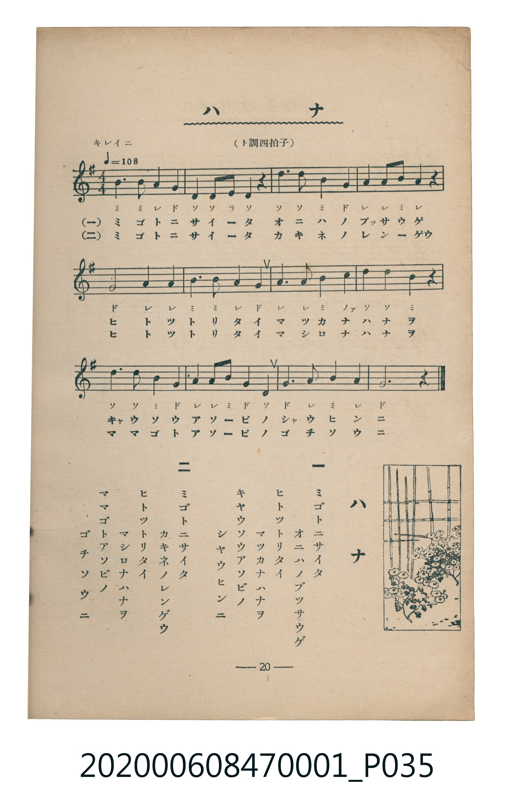

# ハナ（花）

> Re:Shōka 使用 AI 協助辨識與重建樂譜，可能會有錯誤。歡迎回報。

- **鋼琴伴奏版**：<br><audio controls src="hana.mp3"></audio>
- **NEUTRINO 歌聲合成版**：<br><audio controls src="hana_neutrino.mp3"></audio>

- 臺灣教育會公認《新定兒童唱歌》尋常科第一學年用（2020.006.0847.0001）

## 說明

曲目說明
中文解釋：歌唱各種花朵盛開的美麗景色。

原書資訊與歌詞全文（對應 P035.jpg，書頁 p. 20，第二學期第 5 首）：
調性與拍號：ト調四拍子（G 大調 4/4 拍），「キレイニ」♩=108


## 歌詞

```text
一
ミゴトニサイタ
オニハノブッサウゲ
ヒトツトリタイ
マツカナハナヲ
キヤウソウアソビノ
シヤウヒンニ

二
ミゴトニサイタ
カキネノレンゲウ
ヒトツトリタイ
マシロナハナヲ
ママゴトアソビノ
ゴチソウニ
```

## ABC

<div class="abc-score" data-abc-src="hana.abc" aria-label="五線譜載入中"></div>

[下載 ABC 原始檔](hana.abc)

## TMD 檔案連結

- [主旋律 TMD 檔案](hana.tmd) [[在 TMD Studio 編輯](https://tmdlang.github.io/Tmd-TS/#tmd=s7IKdvYPcrWy4qpTUCpJTLdSSM7PyUlNLsnMz7MqzsjMK0nNjM_KTMmPL87Iz05Ugisry88pzU21Si9KTEmNN4w3MjAyiDcwMIs3sDAxBzIMDBFKi_NLi5JTrYqTM_Lzc-JLUitKkvLzsxHyBUX5Zal5iXlANQVFIBtTwIoQClLLMlNSQdKpKZkl-UWZiTlI7kgtKga7FWxJfElRYl5xclFmAcgDCFUlGalAxxbkJOYhGQs0KT0zzyo3Py-pFOg7DImSxMzyxLz4_LS0zGQUO_OLSjLygT4vyKi0ysgsBjkpOTEnPjsxDymAoA4qSExPtQowMDZV4tLSUnjc3P-4uev9no4XXRvf7-lU0NLiUrRVMDSw4LK3VXDnsjHRN7EDmfCifdfzxsXPps580bTp2Zzmp61rXqzqfdzQ9WzahqfrZj1tnfR89dKnUzY-W9vzuKH76Ybupzt2PF8-8fmaNU92NDxdu-Ppzi3Pp6wAWgOKFj1gtOiBogXIMDAE2qrEpa-l8Gz2puez171YterZjD4uBQWFJzvWPpvW_mL54pft3e_3zAKaDDT_6YSW5yvWAd36bM7W57Nnv5zW_XxWy_N9fS93TX82c_2Lzk2PG5q4tPS5QAbaUguAXPO0b_6z2TtebG5_saLrRUc70DUvVs572roC6ESgr55u6H3W3qkAClW9rIL093t6gIpfLmhUKNBTMDIAckEBsasHGBDP5swHshVMFV4umwb0OdBjINNfrNr_rGE5yNzu3hcz5wNFHzd3AAWfzp4NFHm6dgLQDneFp0uWA8UUgFGiABQF6waGds_jprWPm9c8blryuLn7cUPvo5krbUHxBwnDBhD1uHn-46YtQCNBKpq2gpQ27QdLNK0CCYHSQN_j5mmPm5vB0sseN22C6JsE1tQCJlcBNQG1QiTmgUSbVgPTDiQFPW6G6AC5BWg60IS9YHIRiNE8GWg-RHo7VBpk8mag3RBn7uoh4MzVYIN7wc5cA9LZtAloCkE3gqwD6kNzI8jxQDmwTRgOBIo2Qh0PdB1QiPL0AwUKoHTpAcySVgGZiXn5DjUGNdUgCxRsLLTswAxsiVYBkodeLOxR0DBReLqh__n6Bh14StPEogFoDciwGgVjBV0gNFYwApKGQFyjYBoPpICEWTyEaQARBaszBauHqAPpMILqBKsBm-hjWAOKI7BqYEAB2R0gVnM3WA8wxsDiS8DkfiAJsgEkvgqiA6gOGA9gVh9EBpziwMq3AvEyIN4E0wax0Ig8C1dDdawFqu1FsXANmLcZLAtKQXDr8If_rh5ywh8UliAICU2QAzBjBMSChLWuggk8NkAYJIIe9pOgJsICogXqLRAPxF8FDQhIoIBk5kFlWqDBAswGUBlITIB4wHyBJdjJtqtpO5C9lgi7CKT5TnLCHHdaBvHAiR4WMZBAh0QMLKpAEC3QQQXPYqjPQEl0L5QFSWqLwDywWPNkMAlNaqCiB0kbODghKQ8UIKAUDIPoAQ-LsnngNA-LAPyWgdSB-I3oDsRiUy0Xl66dAqggUgDSylwA)]
- [鋼琴伴奏 TMD 檔案](hana_piano.tmd) [[在 TMD Studio 編輯](https://tmdlang.github.io/Tmd-TS/#tmd=s7IKdvYPcrWy4qpTUCpJTLdSyC8qychPL0osyKi0ysgsLskvykxOzInPTsxLVIIrKs4vLUpOjS9ITE-1CjAwNlXi0tJSeNzc_7i56_2ejpfde55P2PJkz5anS_ufd3a839OpoKXFpWirYGhgwWVvq-DOZWOib2IHMu1F-67njYufTZ35omnTsznNT1vXvFjV-7ih69m0DU_XzXraOun56qVPp2x8trbncUP30w3dT3fseL584vM1a57saHi6dsfTnVueT1kBtNLIwMhAz8DATM_AwsQcyDAwBNqqxMXlAXS2VUBmYl5-kIdDjUFNNZcCENhYaNmBGfpaCrboQAFi-ouFPQoaJgpPN_Q_X9-gowDypV5WQbomFg1a-mDDahSMFXSB0FjBCEgaAnGNgmk8kAISZvEQpgFEFKzOFKweog6kwwiqE6wGbKKPYQ0wVOeDVT9u2gJkd4BYzd1gPY-btoLFl4DJ_UASZANIfBVEB1AdME7ArD6ITPO0x83NYOVbgXgZEG-CaYNYaESehauhOtYC1faiWLgGzNsMlt0EshJmHf7w39VDTviDwhIEIaEJcgBmjIBYkLDWVTCBxwYIg0TQw34S1ERYQLRAvQXigfiroAEBCRSQzDyoTAs0WIBZAioDiQkQ73EztmAn266m7UD2WiLsIpDmO8kJc9xpGcQDJ3pYxEACHRIxsKgCQbRAb1r7uHkx1GegJLoXyoIktUVgHliseTKYhCa1pu0o2sDBCUl5oAABpWAYRA94WJTNA6d5WATgtwykDsRvRHcgFptqkcshH-RyyARaDgHDI14h2jAWGF4gOj4WKmICZAFpA4QCKAUqWYAsU6A8iAFUgMUckCw2k-GSICkURRC7UI3CtBEuYgISAbkR0zqoSUCv69opgHwf7QMUhbONwGxlLgA)]

## 分析

```text
================================================================================
📊 TMD Song Profile: [ ハナ（花） ]
================================================================================
⏱  Duration:       0:26 (26.7s), 12 measures total
🎼 Key & Tempo:    首調基準 G, != 108.0 BPM, <4/4>
   - 分析範圍：      由實際發聲的音符與和弦推測調性；播放脈絡另行呈現
🎤 人聲音域:    D4 (MIDI 62) – D5 (MIDI 74) [跨度: 12 個半音 / 1.0 個八度, 難度: easy]
   - 最低音:  D4 in [Hana #1 @ m.2, 0:02]
   - 最高音: D5 in [Hana #1 @ m.3, 0:04]
   - 適合: soprano, mezzo-soprano, contralto, tenor, baritone, bass
🏛  結構:      Hana (26.7s)
⚡ 編曲密度:        Peak 1 軌道同時演奏
🗝  調性診斷：       G 大調（純淨自然大調，未偵測到可信轉調）
   - 風格氣質:    純淨自然大調（陽光明朗、易唱易記，無明顯調外色彩）
   - 轉調歷程:    全曲維持單一推測調性（未偵測到可信轉調）
   - 核心骨幹音:  G, A, B, D, C
   - 調性數值:    G 大調 [相關度: 0.78, 穩定度: Moderate, 自然音純度: 100.0%]
   - 候選調性 (K-S): G 大調 (0.78), D 大調 (0.72), B 小調 (0.58)
   - 五度圈歷程:   +1
   - 各段落調性細節:
     • [Hana #1]: G 大調 (r: 0.78, 自然音純度: 100.0%)

  [ 五度圈游移軌跡 ]
               C  
         F           [G ]*
      Bb               D  
      Eb               A  
         Ab           E  
            Db       B  
               F# 
     (* = active key center)

  [ 十二半音累積音高分佈 ]
     C  : ██                         2.3%
     C# :                            0.0%
     D  : ████████████████████      21.6%
     D# :                            0.0%
     E  : █                          1.1%
     F  :                            0.0%
     F# :                            0.0%
     G  : ████████████████████████  26.1%
     G# :                            0.0%
     A  : ████████████████████████  26.1%
     A# :                            0.0%
     B  : █████████████████████     22.7%
--------------------------------------------------------------------------------
Assignment 軌道音域：
  - Piano         : D4 – D5 (12 個半音 / 1.0 個八度, 44 個音符)
================================================================================
```


## 原書掃描頁




